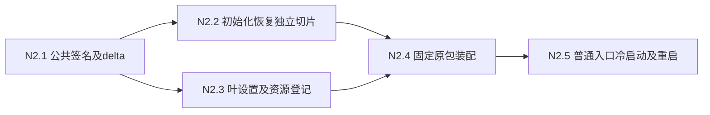
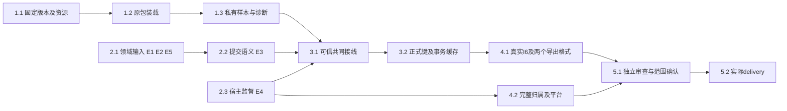

# 执行任务

## 当前范围

2026-10-29用户明确“按既定首批范围完成，后置功能另立变更”。本change按proposal收尾固定BBT普通期刊补键、显式原值题名更正及两格式、真实共同保存和生命周期；复杂类型／多原值／更广保存、茉莉花及Reader／PDF写回转入[后续提议](../extend-zotero-ecosystem-compatibility/proposal.md)。这些扩展保持未交付，不改变本片拒绝及真实库禁用要求。Linux／Windows原包与生命周期目标、完整I6及独立审查仍按以下任务验收，不因范围澄清自动完成。

## 当前轮：2.3 Windows普通布局（8d8f339）

Linux普通入口N2已由主线接收；Windows私有fd0／可信注入原包已有实际结果，百条例endpoint rename EPERM及其公共lifecycle修复仍归主线。第17轮主线已定A及ACL规则并授权本树实施W2私有platform／native片；W3设置／resolver和Windows布局尚不启用，不改公共lifecycle或CI，不重放旧补丁。

- [x] W1 核固定44.5.1 Windows发行入口、host产物／asar区别、原BBT9.0.68及当前设置／资源／原生提供者；在原investigation／design／delta明确只读核验缺口、同源布局候选、ACL及启动窗口选项、所有权和真实Windows验收入口。完成依据：本树来源及反例可核对，Linux现资源组25/25；这只是实际调查成果，不是Windows实现或目标通过。
- [ ] W2 【第17轮主线已选A及ACL策略，本轮实施平台Module】按design“第17轮主线选择与W2实施边界”提供只读设置文件／资源树核验、所有权与释放接口；生态树独占新平台Module／native构建及窄测试，主线整合公共导出／架构登记。不再等待A/B决策；Windows目标缺证仍不能关闭本项。完成依据：真实Windows根／后代ACL、reparse／对象身份、扫描竞争及选定窗口边界验证，不能以privateDirectory修复、内存ACL或Linux句柄代替。
- [x] W2.1 交付私有Module／native／构建登记和窄Windows测试定义，完成本机实际构建／类型／Linux保护及独立静态审查修正，提供主线公共登记窄补丁；目标缺证准确保留，不启用W3叶布局。初批26通过／22跳过、末次私有组1通过／23跳过与Linux收尾1/1分开记录，不相加为不同目标；Windows未编译／执行。architecture仅缺本片受控适配登记，待主线应用所交窄补丁，不冒称全绿。
- [ ] W2.2 在真实Windows按既有Visual C++入口构建并运行private-resource-tree目标组，核同对象读取、ACL／OWNER RIGHTS／祖先替换权／链接／变化／深目录／收尾；无SDK／OS或前置不适用逐项记未验，扫描期间替换没有可观察阶段时另留缺证，不用sleep循环或skip提升通过。
- [ ] W3 【依赖W2及叶契约批准】在host-settings／resolveZoteroResource接受同源Windows固定布局，派生固定electron.exe与已构建managed目录并复用版本、成员、beforeLaunch规则；不新增exec/env/root或第二登记。完成依据：私有设置与全树核验真实接入，Linux保护回归保持；需要变更TrustedZoteroLaunch消费者／公共注册先交主线，不能留下空壳分支。
- [ ] W4 【依赖W3、目标Windows及主线停机前置】扩原窄资源／普通CLI／原包持久用例，真实离线资源→关闭准备实例→普通冷启动／bootstrap→补键与两格式→完整停机／重启原ID；保留不安全后代、链接、资源替换及撤权／unknown代表边界。完成依据：真实Windows原生与原BBT结果，原包字节对照；公共endpoint失败不吞。Linux25/25不抵该目标，2.3／4.2父项保持开放。

## 当前轮：N2实施（cb5f7ed）

2026-10-29，主线已接收N2.1–5：固定Linux普通原包与真实产品静态bootstrap入口、持久回执／两格式、持续撤权及unknown保护均有实际结果和独审，41/50。原sandbox／缓存失败保留在delivery，不能用旧阶段停止描述当前状态；更广2.1–5.2及Windows原包仍按各自判据开放，不据本片勾完整E4／I6。

### R16规划接收依据（历史）

起点`7aff2c763504f0ddf3b2304eb6ea18b7ef0e389c`、clean；N1和两个消费者已由主线接收，不重放旧候选补丁。此次只写原investigation／design／tasks／已有delivery，D14-2／3已定A，不写生产settings／loader或新增delta。本轮规划工件不是N2实施授权，完整E4／I6仍开放。

- [x] R16.1 只读复核普通CLI／desktop／bootstrap／持锁serve、文件保护／库身份、HostConnection及共同准入恢复；区分已有源码、主线实跑和本轮静态证据，保留整合5/6及未验平台事实。
- [x] R16.2 在原design细化唯一host-settings.json叶schema／固定单资源布局、冷启动读取及失效、初始化前恢复屏障与公共hook签名／消费者；不新增第二配置权威、任意程序入口或默认库授权。
- [x] R16.3 完成原四工件核对／OpenSpec strict及diff，实际调查后取delivery instructions更新同一记录，导出独立规划补丁及Git／cache接续入口后停止；不把规划写成N2执行或关闭2.3／3.1／E4／I6。

### N2有界实施任务

以下为原2.3／3.1剩余接线的局部拆分，完成标准以design N2节及当前派发授权为准；执行证据沿同一delivery，目标OS缺证不勾完成。

- [x] N2.1 主线审查恢复函数、两处初始化调用、真实父kernel实例、窄环境／beforeLaunch及路径绑定语义；据批准范围补本change delta的持久绑定／恢复场景，确认生态与计算／Agent各自共享符号。完成依据：签名／错误／启动顺序与规格一致，不实施通用settings或分发范围。
- [x] N2.2 最小独立公共切片：从HostConnection抽recoverHostSupervision，ZoteroOperations.recover接Manual.initialize首步，在任何programs／harness恢复准入前完成真实同一ProcessAdmission记账。复用fixed-host扩实际旧unknown、满槽／释放无关槽／幂等恢复、disabled／invalid配置仍恢复、scope已停不占槽及坏记录保留代表例；先红后修，按影响build后测试。不需要settings／BBT／显示，不改计算线programs回调，不新增解除unknown／全局停用机制。
- [x] N2.3 私有叶设置与固定资源登记：按design schema实现host-settings.ts及zotero-resources.ts有界读／校验；serve持锁读取一次，library初始化后host-only绑定当前ID。复用cli-runtime／isolated-kernel代表验证缺失、无效、安全文件、错库／错目录、未知资源及stop/start一致，其他领域／N1可用且不自动grant；离线可信准备，无网络写端口、任意执行参数或新配置台账。
- [x] N2.4 消费已接入N2.2／3，供应真实status.instanceId，透传仅宿主可供应的DISPLAY／XAUTHORITY／操作TMPDIR及稳定beforeLaunch，按固定Linux离线配方接实际受管Electron／原BBT。先证同次ready及完整停止，不增加未记槽probe／普通spawn／sandbox逃逸；显示／sandbox或平台能力不满足时保留原失败交主线，依赖分支不假成功。
- [x] N2.5 普通入口整合：合成profile离线设置→关闭准备实例→普通CLI及desktop bootstrap冷启动→显式原包共同操作→stop/start不注入配置后核持久键／原值／回执及两格式，核未知原ID不重放、持续撤权及资源／设置变更。内部均真实，Agent仅外部HTTP可控；安排独立审查、按实际结果更新开发入口及原delivery。Linux新配方和普通持久装配未通过前不勾本项；Windows／分发／真实库及整体E4／I6不随之关闭。

N2.3复用cli-runtime完成普通start／stop／start、真实原值题名提交、CSL／键不变、错库／设置失效及N1回执；资源单元样本仅校验布局／权限，不冒充原包。N2.4最初的SUID／userns失败及其对照保留；随后受控系统helper及缓存等待修正已按真实原包验收，当前证据见delivery最新节。旧unknown/profile均保留；无原生槽虚占或重放。P2已受理回调误核设置的问题已通过真实共同提交红／绿及独立复核修复。

## 已完成调查：普通入口／CLI下一片

起点f4ab1e5f1ed17ae9af656c1f9945005a2786d911、clean。仅本change原工件，TMPDIR／工件为独立cache根；不写生产代码或重复已绿显示／原包／UI。CLI ready不是产品选择或实施授权。

- [x] R14.1 以当前源码复核普通bootstrap／start／serve与可信测试IPC差距、五操作门／权限／来源／资源／稳定结果及2.3／3.1剩余范围，形成精确事实依据。
- [x] R14.2 提交N1可独立查询接续候选、N2具体写集与阻断、输入输出／授权／原生实例来源及D14-1至D14-3；不把建议当用户已选，不新建配置或库权威。
- [x] R14.3 核对保全输入及接续路径不依赖现有/tmp，完成规划校验／diff及独立增量；实际调查后取delivery instructions更新同一记录，交回并停止，不关闭E4／I6。

### 已接收实施片N1

- [x] N1.1 用户委托主线选择后，已采纳D14-1 A并明确本change只读查询例外：保留原DTO及授权、其他四操作仍受隔离门约束；规格批准不表示实现完成。
- [x] N1.2 已授权下一片按design封闭写集局部调整ZoteroOperations.result／权限与native门；扩CLI-runtime的真实provider、普通start/serve及stop/start查询、拒绝／未知原ID／P1回归，按影响build后测试。无新库台账或原包／显示／安装／UI装配，不重放未知、不改E4／I6完成状态。

58eda140本树完成N1实现及三个代表回归；第十五轮主线已迁移isolated-kernel／zotero-original四处断言并实际通过内核15/15及原值双宿主2/2，见delivery主线回执。原候选已接入，不再应用历史cache补丁，也不再等待相同消费者输入；整合UI其他场景5/6仍部分失败。

N2沿原2.3／3.1已完成Linux普通布局／原包装配，原sandbox失败保留在delivery；Windows普通布局按本轮W1–W4独立承接。N1不依赖原包ready，不据Linux接收宣称Windows普通入口已验。

## 已接收：原包测试显示前置适配

基线ba29ee61ac6f8700cfe6a9fbaa529a8a7a75aad1，起始clean；生产源码／测试与e3c815b相同，复用主线已验产物。仅测试及所属工件，不重放round12未知现场。

- [x] R13.1 只读原trace、operation及监督记录，明确同次证据边界；核四消费者、真实DISPLAY和受管环境白名单，保留新隔离原例首次结果。
- [x] R13.2 以一个测试helper统一有DISPLAY实际预检／缺失才预检新Xvfb，显式传所需显示与TMPDIR，接四消费者；不新增生产配置或放宽system access，保留scope完整后代收尾和共享显示存活核对。
- [x] R13.3 复用已构建产物，完成真实原包题名／表达／两格式及必要监督、前置拒绝、scope和对应静态双宿主UI代表验证；留首次失败、环境缺证及实际停止结果，更新原delivery、类型／架构／strict／diff及可审查增量，到本片停止。

## 已接收：Windows实际送达监督目标验收

基线4312262c1a1f432ccd706dd1eb6ff6468765fd4e，起始clean。仅消费同源码Windows diagnosis40476577132的原始host步骤及稳定关联工件，不新增实现或重复本地测试。

- [x] R10.1 核对同HEAD的windows-host命令、24项逐例结果、实际caller及持久host/command实例与稳定操作关联；确认未派发拒绝、送达后unknown及重启不重放代表边界，更新原delivery并校验本轮仅文档增量。只关闭该Windows监督子项，不关闭完整E4／I6或其他CI失败。

## 已接收：E4断联写入夹具收敛（R9）

基线0b788151b5e17665a26d9286dfd1d12f6e2e0c30，起始clean，原R8已接收。本轮只核对Windows剩余host-connection:159，不扩原值API或生产装配。

- [x] R9.1 核对最新Windows trace／CI及call持久化、派发与drop顺序，用真实固定host隔离校准原轮询允许派发前断开；明确证据缺失及未知关联语义，不猜生产错误。
- [x] R9.2 复用固定host／现有sample.read回调校准真正送达后断开；保留派发前明确拒绝、送达后未知及重启不重放，先记录旧夹具缺报到的失败，不改生产分类／期限／容量／回调收尾。
- [x] R9.3 先构建后完成最小监督回归、受影响类型／架构／strict／diff，记录首次结果、真实及调度替身边界、Windows待验及本地增量，更新同一delivery后停止。

## 已接收：隔离内核／Agent切片

基线8a2f0ce，起始clean，D1–D3已确认；先按design顶部闭合DTO再实施。本轮不再等待选择／同步，不引入自动双写、其他字段／多来源或生产库。

- [x] R8.1 实施inspect／明确expression导出／独立replaceTitle同源schema及薄注册，复用library.get/record同revision、唯一identity、共同CAS及结果查询；其余字段准确notComparable。
- [x] R8.2 扩真实原包样本先证明旧实现未选择仍导出；实现题名只改原title、选择及导出依据、缺值／多来源／CAS／未知查询，保持正式键及P1。
- [x] R8.3 接既有harness薄工具与人工CLI，工具不确定询问，expression不假称人类授权凭据；GUI仅交消费者契约，不改文献表单。
- [x] R8.4 先构建后完成最小真实整合／only-export撤权重启／受影响监督及类型／生成／架构／strict，保留首次失败及最终结果，更新原delivery并交可审查增量，到本片停止。

## 前轮：CSL／原值差异调查与可决策规划

基线`4b13183f7489d3cae12fd0a7d1a9e83fb33d7384`已同步、开始时clean；主线已接收普通期刊真实切片及生态持续外发授权P1。本轮只规划，写集限本change及隔离调查工件。下方R5交回与更早阶段为历史，不再等待同一公共输入；不重复监督、P1或整套H1，不实施新产品政策。

- [x] R6.1 核对本树真实CSL更正／原值／正式键／导出路径、已接收领域分离契约及40315429083最新CI；保留平台失败和既有P1闭合范围。
- [x] R6.2 在新隔离配置复用既有普通期刊样本，运行CSL题名、日期／作者歧义更正及显式original题名对照；保存实际CSL／record／固定键／历史／两格式文本、来源与收尾，内部provider真实，不改生产代码或原包。
- [x] R6.3 完成无损显式操作／歧义／不可覆盖项、A/B/C备选、推荐A＋B1及D1–D3；列候选接口、归属、事务／冲突／恢复／通知、持续授权与最小真实验收，更新同一delivery并校验diff／OpenSpec后交回。
- [x] R6.4 用户确认D1导出前明确选择原值（Agent依用户明确指令选择，不确定时询问）、D2独立更正原值、D3唯一期刊原值的题名首片；依据见领域决定及design顶部。后续先闭合本片DTO与任务，再实施；未确认其他表达、字段或同步政策。

R6.1–R6.3完成的是本轮调查和规划；R6.4用户选择已闭合，原实现剩余项保持开放。没有勾选新生产实现或整体I6；下一片沿明确授权及具体任务实施。

## 共同领域接入后的期刊切片

当前基线 `1026796d854b8f568c3e819f13268a9638980bc1`，开始时工作区干净。共同 E1–E3 提供者已在本树，替代下文历史“待交付”条件；监督 E1 整改已由主线接收。完整 change 的材料、删除恢复、跨平台及 I6 条件仍开放。

- [x] R5.1 逐字段消费真实 record/source instance/key/commitRecords/result，落地最多100条现有普通期刊契约、隔离装配与同源操作；缺原值不可从CSL反推。
- [x] R5.2 实施真实 Item/SQL 派生投影与原包外层事务，一次共同原子提交；稳定未知查询、固定键/全库冲突、提交后读回及通知分别诊断。
- [x] R5.3 接真实 kernel/broker/认证受管Electron/原包与人工及harness薄入口，默认禁用真实用户库，不替换其他领域工具或根构造参数。
- [x] R5.4 先构建再运行隔离真实整合及最小相关回归，保留首次失败/模拟边界，更新同一delivery并交本轮增量补丁；不勾完整I6或全平台。

第五轮交回时13/22；六条新增整合、相关内核合计43/43及原包smoke10/10通过，已获主线接收。2/3/4组原任务中更广映射、偏好事件、材料／删除恢复、跨平台和整项I6仍未勾选。历史的提供者等待条件由真实本树接入替代，不能再按未收到设计阻塞本片。

## 第四轮验收整改（历史）

- [x] R4.1 修复主线实跑E1：外层RPC超时／失联不再丢失已受理回调的生命周期及容量；关闭按原预算等待，未结束则unknown并保留未决事实，不能用scopeStopped代替callback完成。复用host-connection回归先红后绿，核对读／写回调、完成后收尾与容量；仅改本线监督、必要测试及design／delivery，复验受影响构建／类型／架构／生成与原包，不扩文献／生产。

本轮验收E1整改及自验完成，当前9/18；关闭保证仍以主线复核和本轮实际范围为准，不等于整个change或I6接收。增量补丁依赖本轮开始前已有第三轮监督源码，证据见delivery第四轮。

2026-10-26恢复：当前HEAD `eaf38be1ac2d350120805859175fc82cf9c36927`，`0519904`（含`b838402`）已为祖先，恢复时工作区干净；用户已撤销等待手动同步条件。直接消费本树正式公共源码，不再构造临时基线组合。本轮实施独立认证host listener、私有stdin供应、监督／重启保护及原包profiler／shutdown修复；来源副本默认新实例、同库键大小写不敏感且不改名／覆盖固定键、有界多对象原子提交和稳定查询均已定，等待的是文献实际提供者而非A/B选择。

## 第三轮独立实施切片（历史）

- [x] R3.1 为ManagedCommands.start增加仅宿主供应的一次性stdin封套；准入／再次授权后取值，不进argv/env/log；旧execute和命令观察不回退。
- [x] R3.2 实施不依赖programs／BBT／文献的公共HostConnection及同源生命周期／客户端：独立认证listener、实例与操作绑定、双向RPC、ready、正常shutdown、unknown、持久重启核查。真实受管固定host先校准正常／错身份／失联／超时／取消／保存失败与占用。
- [x] R3.3 修复原包profiler能力与吞shutdown错误的可观察性，保留原发布包；原样本实际正常关闭及错误收尾回归。
- [x] R3.4 连接公共监督与原包显式样本Adapter，真实Linux受管Electron／Worker验证ready、双向操作及正常／异常退出；输出独立公共／私有补丁、必要类型／架构／生成映射／OpenSpec验证。未跑平台及共同提供者继续开放，不称I6或整change完成。

独立H1的历史进度为4/13；加入并完成本轮四项独立切片后，当前为8/17。共同提供者和3–5组整合任务不能据替身结果勾选，E1–E6当前状态见[investigation](investigation.md#影响方案的未知项与实验)，实际成果与补丁见[delivery](delivery.md)。

## 1. 首批可独立实施：固定原包装载及样本诊断

写入范围：`apps/zotero-host`私有装载／兼容资源，`tests/fixtures/zotero-host`和宿主smoke；不写文献schema、不启用真实库。1.1–1.3顺序依赖，2组调查可并行。

- [x] 1.1 记录固定Zotero10.0.5发布及schema／utilities资源、BBT9.0.68原包的来源、许可和实际成员；复用既有运行时，不依赖已消失的临时路径。完成依据：精确资产可读取、原包成员未修改、支持清单准确；缺资产或需安装时先取得相应授权，不将准备缺失写成成功。
- [x] 1.2 在现隐藏Electron入口抽取最小ZoteroHost装载Module，复用Node＋Chromium原生Worker／IndexedDB及固定资源，以明确的私有空库Adapter满足装载所需对象接口；运行真实原bootstrap、主包与完整启动任务，提供status、shutdown和失败阶段。完成依据：原包真实ready及正常／初始化失败两条资源收尾路径可查；不得通过占位服务、裁剪启动图或外部Zotero达成。沿现entrypoints扩展独立宿主smoke。
- [x] 1.3 扩展私有合成Adapter，加入少量普通期刊样本，使原包实际补缺键并产生BibTeX和BibLaTeX，保留已有键／通知缺失的历史反例作为独立oracle。完成依据：原包实际文本、样本存储和status对应，明确标记领域Adapter为替身；断开／缓存失效有结构化诊断。这个成果只验H1，不称共同库或生产I6通过。

## 2. 真实接线前置及超出当前切片的部分

来源实例／原值／正式键及现有对象原子提交提供者已从1026796本树真实消费，普通期刊成果见R5；以下原任务保留更广的映射、材料和完整整合条件，不再等待相同公共源码或设计。

- [x] 2.1 接收普通期刊的来源命名空间、原类型／字段与Extra保留、正式键／固定状态和冲突schema及真实端口，核对来源副本／重复登记及不支持形态的明确拒绝。完成依据：共同接口与首批映射联合核查，生态不另存正式键，项目继续用共同指针；对象删除／重入／恢复及Reader写回由后续变更承接，本片真实库仍禁用，不以备份副本恢复声称对象恢复。实际依据为authority-audit、真实共同7/7及BBT百条／冲突／缺映射拒绝，见delivery首批收尾节。
- [x] 2.2 消费文献所属schema／provider，核对首批补键的`save/saveTx/executeTransaction`原子范围、revision、授权、稳定结果及通知。原包多条fill汇集为一次共同原子提交，不缩成逐条成功；共同失败／未知提交必须实跑，不编共同事务假Adapter或假回执。超出补键／独立题名更正的通用保存及复杂事务由后续变更承接，不从方法存在宣称支持。真实共同事务／SQL保护及原包百条、提交后观察失败按原身份查询通过，独审反例已修复复核，原失败保留。
- [ ] 2.3 【Linux普通布局已验；Windows可信注入已有结果，普通布局及整项仍未完成】R3.1–R3.4提供独立认证／stdin／实例／双向RPC／ready／正常shutdown／恢复及原包吞错修复；Windows公共HostConnection及私有fd0／真实原包子项已有实际结果，不能再统称未跑。N2.1–5完成固定Linux普通装配；Windows普通布局沿W1–W4，百条例停机endpoint EPERM沿主线公共lifecycle，正式分发仍未验，macOS受管执行不可用。不用普通spawn或PID消失替代原生保证，不把scopeStopped当pluginClosed。
- [x] 2.4 【E6保持生产阻塞】核对并在能力状态中准确表达题录／附件删除、操作者及恢复／重新入库提供者的实际可用性。完成依据：缺少保护时真实用户库仍不可启用，不把备份副本恢复替代对象恢复，不以未发现引用宣称可安全撤回。此任务验收的是限制确实生效，无需本change实现删除恢复；待E6实际能力齐备后，生产启用由后续变更承接。1组及隔离I6可继续，本change不实施迁入。

## 3. 共同权威接线与保存一致性

前置：1组、2.1中E1/E2、2.2、2.3实际满足并获得实施授权。公共文件由本线提出最小增量，按design列出的符号范围核对，不占用其他领域业务写集。

- [x] 3.1 添加生态同源操作、派生导出及host角色受认证回环WS，复用broker／RpcPeer并允许等待期间的反向领域调用；实际绑定共同库范围、原调用身份、有效授权与实例。完成人工CLI及既有harness工具薄适配；schema与生成映射／architecture消费声明同步。完成依据：真实broker拒绝伪造身份、越界操作／库、旧实例与缺提供者，双向调用不死锁；不借connectProduct授予完整human权限。固定host监督／broker负例、普通N2.5及本轮真实harness工具原包整合共同构成证据，不扩为Windows普通持久布局通过。
- [x] 3.2 按已确认领域接口实现Item／SQL派生视图和受保护保存，正式键只有文献一处权威；处理提交后通知、插件提前改内存、回滚／CAS拒绝／撤权及未知回执。完成依据：共同结果／revision／键、SQL读取及随后原包导出一致；保存成功通知失败能分别诊断；已采用键在元数据更正、resetKeyOnChange触发及重启后保持。按同类根因表驱动覆盖必要反例，不断言内部调用顺序。实际reset偏好事件暴露的旧题名缓存已按共同事务可写状态修复；最终11/11及独审见delivery，不扩为Windows普通资源布局或后置作者产品动作验收。

## 4. 最小真实独立验收

- [x] 4.1 在隔离真实kernel／library／broker／WS／宿主组合完成人工CLI和实际harness工具的I6：补缺键、同库已有键冲突、更正后缓存刷新、原包BibTeX／BibLaTeX、停止重启读回及未知提交核查。完成依据：持久共同结果与实际导出文件证据对应，内部提供者均真实，模型只在外部边界受控；明确H1替身结果不能算本项。真实普通CLI／产品静态入口N2.5、百条及冲突、原包两格式与持久回执、末次未知提交及harness两例2/2构成限定Linux I6，Windows生命周期单列4.2，不据此宣称全平台或科研质量。
- [ ] 4.2 完成真实Electron与Worker的正常关闭、初始化中断、忙执行及失联归属检查，按实例核对后代退出／unknown并保护隔离目录；Linux与Windows分别记录，当前macOS明确拒绝。运行现宿主smoke及受影响原生／lifecycle回归；对调查列出的CI失败核对发送、受理、执行、领域提交与刷新，不通过加timeout或删除保证获得通过。未获目标平台结果的部分保持未完成。

## 5. 整合与交付

- [ ] 5.1 主Agent核对proposal完成判据及spec场景，安排关键接口、权限、并发、缓存／事务与数据保护的独立审查并处理发现；按实际改动运行typecheck、架构守卫、构建和上述定向测试。更新开发说明实际入口及初设中已转正式部分的链接；不把自动导出、外部JSON-RPC／pull export、Reader、迁入或三平台分发写成已支持。无关全仓失败另记范围，不顺带修复。
- [ ] 5.2 仅实际执行后获取 `openspec instructions delivery --change connect-zotero-host-bbt --json`，按实测成果／替身／失败及未完成前置创建或更新同一delivery.md；核对真实I6与阶段成果，只有相应完成依据满足才勾选。没有实施结果时本项保持未完成、delivery保持不存在。

## 续做入口

先读delivery最新Windows普通布局节及design／investigation的W1。N2.1–5及首批Linux成果已接收；本轮证据根为`/home/joshua/.cache/scholoom-parallel-resume-20261029-A5WuXN/zotero-ecosystem/work/`，历史原失败沿原delivery保留，不依赖/tmp。下一步由主线确认Windows只读原生能力／ACL与启动窗口保证，再实施W3／目标W4；公共停机EPERM单独处理，不重放旧unknown、不扩大执行参数或权限。E6真实库生产启用及正式分发仍不在本片，不据W1规划或Linux通过关闭父任务。
