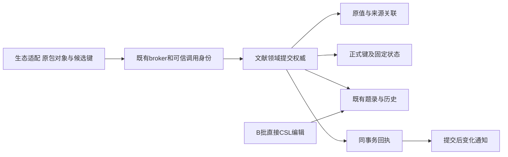
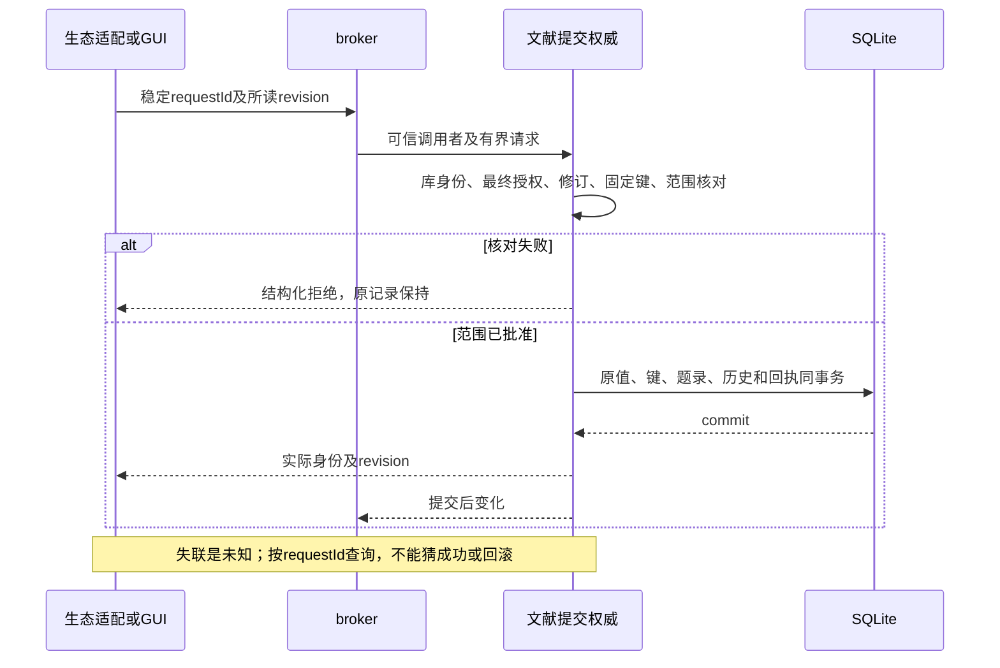

# 实现设计

## 变更总览

这是公共规划审查稿，**三项政策待主线决定，不能进入业务实施**。原值与正式键不进入B批表单局部任务，未新增生产schema或迁移。[investigation](investigation.md)给出收到的E1证据及未具备的真实提供者。

## 方案与接口

复用LiteratureCatalog、共同SQLite事务及历史、broker授权、LibrarySource身份／revision。新增职责集中在文献内部的提交权威；GUI与生态均消费同一结果，不在UI或兼容宿主再建持久权威。生态保留数字ID、SQL兼容映射和原包生命周期，其HostCatalog注入夹具不是生产实现。插件SQL必须翻译到被批准的领域操作，禁止提供任意库SQL执行口。

以下为**DTO候选字段与语义**，不是已发布端口；在三项政策闭合后才转为protocol schema并核定字节上限：

- `SourceIdentity { instanceId, libraryLocator, objectKey }`：来源实例由可信登记产生，三元组唯一关联到Scholoom `sourceId`。本机itemID只在生态进程映射；复制／恢复是否延续instanceId待决。
- `OriginalRecord { sourceIdentity, schemaVersion, itemType, fields, creators, relations }`：`schemaVersion`明确原schema，fields保存原字段值而非CSL别名；creators按原序为`{creatorType,firstName,lastName,fieldMode,orderIndex}`并保留明确原扩展，日期及Extra在fields中原样保存；relations为原关系而非推定的共同引用。未知值可核查，不执行字段名和数字ID。
- `CitationKeyState { value, pinned }`：独立于metadata，沿整条题录revision变化；候选键与明确改固定状态的意图分开。冲突比较、索引范围政策待决，正式权威始终在library。
- `CommitRequest { requestId, libraryId, changes[] }`，每项明确`sourceId`（新建另明示）、`observedRevision`、CSL变化、可选明确原值变更及键候选／固定变更意图；缺失表示保持，明确删除与空字符串区分。创建身份由领域在同事务分配；来源重复不能绕开当前材料身份规则。
- `CommitReceipt { requestId, state, results[] }`，结果含实际sourceId和revision；state区分rejected／committed，连接失联由调用方另标unknown并查询。失败含结构化code及相关对象身份，不泄露未授权记录。请求相同身份不同内容拒绝，库身份不符、撤权、修订冲突、固定键冲突、未开放范围均整体拒绝。

单对象还是有界多对象事务是阻塞政策，不能先把changes[]当生产多项API。受理、读取回执和最终提交均核对库实例及调用身份；不接受客户端自报已授权。外发仍独立受send权限约束。回执存储／通知去重和库重启恢复必须与实际事务设计一起实现，不能用缓存替代。

## 文件变化与归属

| 后续文件 | 唯一职责／拥有者 |
| --- | --- |
| `packages/protocol/src/library.ts`及新的library叶契约、生成映射 | 文献提供原值／键／提交同源schema；主线核对公共增量，消费者不能私造metadata键 |
| `packages/library/src/catalog.ts`及必要内部提交模块、存储表／迁移 | 文献拥有事务、修订、历史、来源关联、正式键与回执；具体拆文件以实际内聚职责决定 |
| kernel装配／broker适配 | 宿主接真实文献provider，保留其他领域装配；独立补丁先进入dev再同步消费者 |
| 生态HostCatalog／SQL／saveTx／通知适配 | 生态拥有，不由本文拷入或替其实现 |
| `tests/kernel/literature-catalog.spec.ts`及领域整合夹具 | 复用真实SQLite和内核；插件边界可替身，真实插件另验收 |
| 开发说明／正式规格 | 只在实际能力接入后同步入口与支持范围，本轮仅change内delta |

## 验证与风险

实施前先选三项政策并补精确schema、字段／数量／字节限额。最小验证：40→32非可逆独立样本、37角色中的跨序／机构／粒子样本、复杂日期和Extra未知行、同数字ID不同命名空间、旧revision、提交前撤权、固定键与并发解除固定、提交中故障及失联重试；真实库重启检查CSL、原值、键、历史及回执一致。样本依据固定上游而非实现输出。

迁移必须先保存可检查旧副本，不从现有CSL、origin字符串或citation-key推定原值／来源／正式固定键。缺少原值保持明确缺失；需用户选择的冲突保持受阻。采用版本化迁移而非每次开库猜表，读到不兼容格式停止受影响写入，不能靠`CREATE TABLE IF NOT EXISTS`掩盖失败。回滚到独立副本核查，保护迁移后成果。实际迁移版本、SQL和恢复策略在政策闭合后的任务2明确，本轮不捏造已可执行迁移。

可替换依赖：生态可用受控原对象／候选键验证文献契约，不需要完整插件宿主；文献本身、SQLite事务、授权和修订不可用替身代替最终独立验收。诊断沿requestId、库／sourceId、实际revision、拒绝code和提交状态；不记录敏感原文。真正原包保存、SQL及通知需生态接入后单独整合；本树不声称已收到真实provider。

## 阻塞与交回

主线需决定来源副本A/B、键冲突A/B、原子范围A/B，选项及证据在investigation。本轮在规划所需工件齐备处停止；业务实施、迁移、生态生产写入及delivery均不启动。B批局部表单可以独立继续，不能以本规划存在将原4.1／4.2整体勾选。
