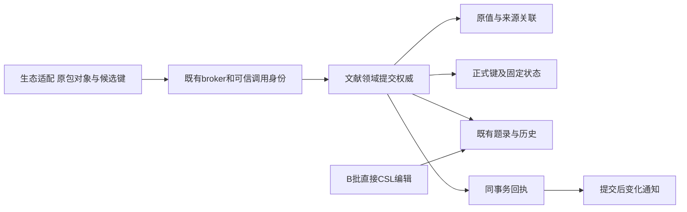
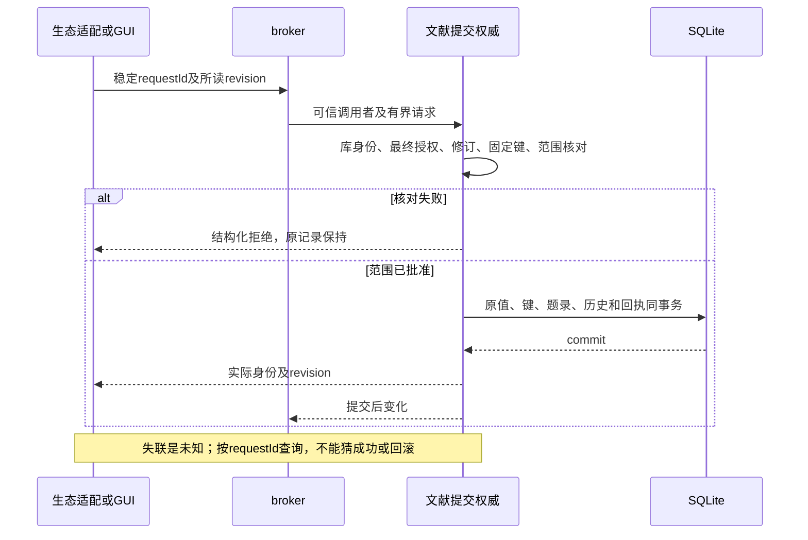

# 实现设计

## 2026-10-26 首片实施决定

三项政策已由用户及域票闭合：恢复／复制默认新来源实例，仅显式确认才重绑定；同库正式键按大小写不敏感冲突，不自动改名／覆盖固定键；首批支持有界多对象原子保存。当前已同步70be8bf／0519904，不再使用临时组合。下面早期候选仅保留设计来由，本节是当前切片精确范围。

提供`library.createSourceInstance`（按稳定requestId分配新实例，不从路径／副本猜身份）、`library.record`（有界原值及正式键读取）、`library.commitRecords`（多条现有sourceId+revision、可选CSL／原值／键意图）、`library.commitResult`（稳定结果查询）。创建Scholoom题录仍先沿原ingest；首片原子范围为多条已存在题录的题录／原字段／来源关联／键及对应历史与操作回执，拒绝任意SQL、附件／集合写入和跨库事务。完整BBT事务适配留生态组合，不能把本片称完整saveTx支持。

原值独立保存于source记录旁的专表，原始字段、创建者对象及数组顺序、关系完整JSON保留，不把字段名变为执行指令；只改CSL不改原值。每条来源身份是可信分配instanceId＋libraryLocator＋objectKey，唯一关联一个Scholoom sourceId；副本重新登记得到新instanceId。首片不提供重新绑定入口或UI，避免伪造用户确认。正式键独立保存，比较键使用Unicode NFC后默认Unicode小写，显示原拼写保留；旧metadata.citation-key不自动晋升。候选命中固定键则保留原键并明确回执，显式键变更／解除固定必须携带原revision及明确intent。并发／大小写冲突整体拒绝。

事务初定上限100条、完整编码256KiB，单份原值64KiB；本轮用独立合成Zotero字段／姓名／Extra样本测编码字节及提交／重启读回，在证据不支持时调整。每个请求有稳定requestId及完整规范参数记录，相同ID不同内容拒绝；已接受拒绝结果也可查询，回执只含实际身份／revision／候选采纳状态或结构化错误。read／write在边界核对；所有修改与历史／成功回执同一SQLite事务，失败回滚后仅保存拒绝回执，不通知成功；成功提交后只通知一次。公共迁移只修改library自身v3→v4，保留迁移前副本，不改变公共project v5→v6。

## 变更总览

三项政策已闭合，按首节切片实施；原值与正式键独立于B批表单，生产schema与库迁移在本change维护。[investigation](investigation.md)保存收到的E1证据；生态真实消费者接入仍需其所属change验收。

## 方案与接口

复用LiteratureCatalog、共同SQLite事务及历史、broker授权、LibrarySource身份／revision。新增职责集中在文献内部的提交权威；GUI与生态均消费同一结果，不在UI或兼容宿主再建持久权威。生态保留数字ID、SQL兼容映射和原包生命周期，其HostCatalog注入夹具不是生产实现。插件SQL必须翻译到被批准的领域操作，禁止提供任意库SQL执行口。

精确DTO唯一事实源为`packages/protocol/src/library-records.ts`，端口已在dev的manual/broker注册，并由真实ZoteroOperations／JournalCatalog消费；BBT普通期刊已验，茉莉花仍待原包接入。字段语义：

- `identity { instanceId, libraryLocator, objectKey }`：来源实例由登记分配，三元组唯一关联一个Scholoom sourceId。本机itemID只在生态映射；新的登记requestId分配新实例，不自动重绑定。
- `OriginalRecord { identity, schemaVersion, itemType, fields, creators, relations }`：schemaVersion明确原schema，fields为原字段而非CSL别名；creators按原序保留完整姓名／角色／fieldMode／orderIndex及扩展对象，日期和Extra原样保存；relations是原关系，不推定共同材料引用。未知JSON值可核查，不执行字段名或数字ID。
- `citationKey { value, pinned }`独立于metadata，沿source.revision变化；candidate只填缺键且固定状态为false，已有键明确返回preserved。显式改键或固定状态使用intent=explicit及revision；冲突按NFC及默认Unicode小写比较，显示原拼写。
- `CommitRequest { requestId, libraryId, changes[] }`每项明确已有sourceId与revision，可选完整metadata、original和key意图。缺失保持；key.value=null是显式清键，不允许空键固定。CSL沿原16KiB验证；旧origins／citation-key不猜升级。新题录创建继续原ingest，不在首片changes范围。
- `CommitReceipt { requestId, state, results[] }`，结果含实际sourceId和revision；state区分rejected／committed，连接失联由调用方另标unknown并查询。失败含结构化code及相关对象身份，不泄露未授权记录。请求相同身份不同内容拒绝，库身份不符、撤权、修订冲突、固定键冲突、未开放范围均整体拒绝。

`library.record`及recordHistory按sourceId有界分页，默认25／最多100并受512KiB结果预算；先核对实际库身份与read。事务及来源登记另核对write；外发继续独立受send约束。成功回执与记录同事务，重放不重复通知；拒绝回滚全部业务写入，仅另记拒绝回执。没有回执是notFound，不代表失联操作已回滚。不能用插件缓存证明成功。

## 文件变化与归属

| 后续文件 | 唯一职责／拥有者 |
| --- | --- |
| `packages/protocol/src/library.ts`及新的library叶契约、生成映射 | 文献提供原值／键／提交同源schema；主线核对公共增量，消费者不能私造metadata键 |
| `packages/library/src/catalog.ts`及必要内部提交模块、存储表／迁移 | 文献拥有事务、修订、历史、来源关联、正式键与回执；具体拆文件以实际内聚职责决定 |
| kernel装配／broker适配 | 宿主接真实文献provider，保留其他领域装配；独立补丁先进入dev再同步消费者 |
| 生态HostCatalog／SQL／saveTx／通知适配 | 生态拥有，不由本文拷入或替其实现 |
| `tests/kernel/literature-catalog.spec.ts`及领域整合夹具 | 复用真实SQLite和内核；插件边界可替身，真实插件另验收 |
| 开发说明／正式规格 | 只在实际能力接入后同步入口与支持范围，本轮仅change内delta |

## 验证与风险

首片精确schema及限额由当前protocol维护。最小验证：有损类型、跨角色姓名、机构／粒子、复杂日期和Extra未知行的原值保留，不同命名空间、旧revision、撤权、键冲突、候选不能固定、中途SQL故障回滚及失联重试；真实库重启检查CSL、原值、键、历史和回执一致。样本依据固定上游形态与独立静态期望，不由新实现输出生成oracle。完整37角色／40类型的迁入映射仍归后续生态整合，不以本片开放原值保留声称已支持全量映射。

库v3→v4升级先保存`before-migration-v3.sqlite`，沿既有Drizzle journal执行`0003_record_authority.sql`，不从CSL、origin或citation-key猜补原值／来源／正式键。缺少原值保持明确缺失，旧字段继续原样可读；不兼容未来版本停止写入并保留现场。独立v3夹具核对旧副本和重启，当前project公共v5→v6迁移不变。恢复仍创建独立副本保护后续成果。

可替换依赖：生态可用受控原对象／候选键验证文献契约，不需要完整插件宿主；文献本身、SQLite事务、授权和修订不可用替身代替最终独立验收。诊断沿requestId、库／sourceId、实际revision、拒绝code和提交状态；不记录敏感原文。真实BBT保存、SQL及通知已有独立整合证据，普通产品sandbox与茉莉花接入仍须分别完成。

## 阻塞与交回

来源副本、键比较和多对象方向已定，不再等待同一决定。首片之外的显式来源重绑定UI、原子新建／删除、组织关系／附件修改、完整BBT SQL／saveTx与真实生态生产接入保持后续任务，不扩写另一套库。B批4.1／4.2不能因本片存在整体勾选，实际交付只按任务与delivery证据。
