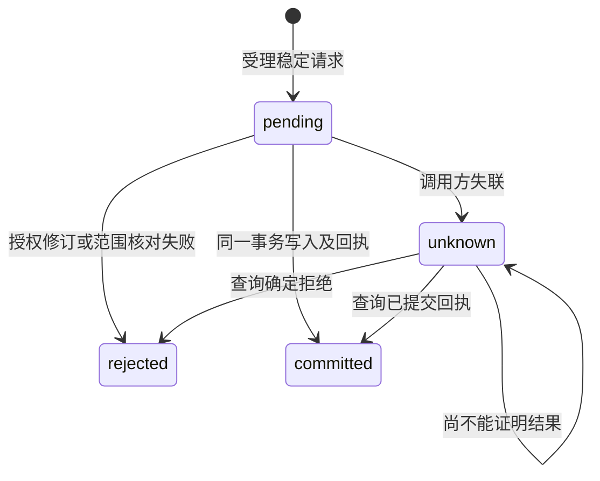

## ADDED Requirements

### Requirement: 来源原值与题录投影分离

共同文献权威 SHALL 将外部来源对象身份及原始题录与CSL投影分别保存和读取。原类型、字段、创建者姓名形态／角色及完整顺序、日期和Extra原文不得通过CSL反向猜测；仅更正CSL SHALL 不覆盖未明确修改的原值。来源身份 SHALL 区分来源实例、库定位及对象键，不能用本机数字itemID、路径、DOI或正式引用键替代。来源副本／重绑定政策未确认前 SHALL 拒绝会混淆身份的接入请求。

#### Scenario: 多对一类型和跨角色创建者

- **WHEN** 不同外部类型映射到同一CSL类型，且创建者跨角色交错排列，随后用户只更正CSL题名
- **THEN** 可分别读回更正后的CSL及原类型、姓名、角色、顺序、日期和Extra原文，来源关联不改变

#### Scenario: 相同数字ID来自不同来源实例

- **WHEN** 两个来源实例提交相同本机数字itemID或同名库／对象键
- **THEN** 不因这些局部值自动合并，未确定实例身份时拒绝接入并保留原库

### Requirement: 正式引用键由领域最终提交保护

共同文献权威 SHALL 单独保存正式引用键及固定状态，并在最终提交时核对已读修订、有效写入授权和固定键。插件生成结果、缓存与CSL扩展字段 SHALL 只作为明确候选，不获得覆盖正式键的权力。固定键变更必须有明确变更意图及有效修订依据；未确认冲突比较政策或存在未决冲突时 SHALL 拒绝覆盖并返回可诊断结果，不自动挑选胜者。

#### Scenario: 插件重算命中固定键

- **WHEN** BBT重算生成不同候选，而领域记录的正式键为固定状态
- **THEN** 普通题录保存不改正式键，调用方能区分已保存题录与未采纳候选，缓存不被当作提交成功依据

#### Scenario: 并发解除固定后写入

- **WHEN** 调用方基于过期修订请求解除固定并修改正式键
- **THEN** 整个请求被拒绝，原键、固定状态、原值和题录均保持，调用方重读后重新决定

### Requirement: 提交结果可核查且通知不先于提交

涉及同一已授权事务范围的题录、原值、来源关联、正式键及历史 SHALL 一起提交或一起保持原状。提交范围、数量和字节上限必须明确；尚未开放的多对象范围 SHALL 明确拒绝。提交回执 SHALL 可以按稳定请求身份查询；相同请求重试返回原结果，不重复生成对象或通知。提交前最终核对授权及所有修订，提交后才发布对应变化。调用方未获回执 SHALL 标为结果未知并查询，不推断回滚或立即重跑。

#### Scenario: 提交后回执丢失

- **WHEN** 库事务已提交后连接断开，调用方用相同请求身份重试或查询
- **THEN** 返回原提交结果，原值、键、历史和关系不重复写入，不发送重复业务变化

#### Scenario: 多对象范围尚未开放

- **WHEN** 插件请求跨多个对象原子保存而该范围尚未明确开放
- **THEN** 请求在写入前拒绝，不能拆成若干单条提交并声称整体成功

#### Scenario: 提交前撤权

- **WHEN** 请求受理后、最终事务前写库授权被撤销
- **THEN** 不写题录、原值、键或回执成功状态，不发送成功通知，已有记录可继续核查
