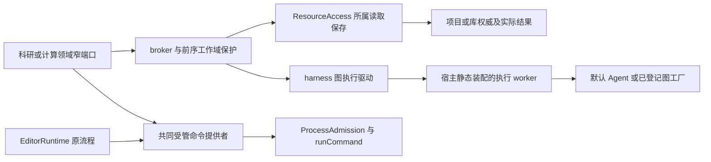
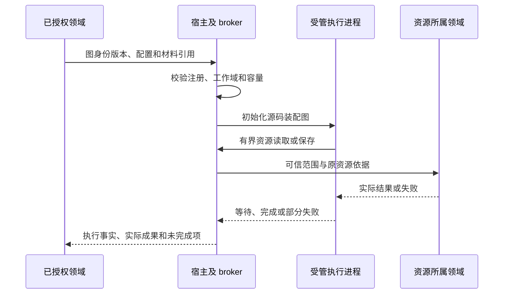

# 实现设计

## detached 后代的原生归属修复

2026-10-24，用户明确授权主分支继续修复 P1，再完成公共基础验收，不再委派。沿原进程停止契约扩展平台受控适配，不降低任意本机程序的后代收尾保证：

- 由平台构建独立原生监督程序，拥有实际执行进程及归属。Linux 使用 child subreaper，直接子进程列表来自内核；单线程监督者独占 wait/reap，停止后迭代收尾被接管的后代，只有 wait 确认无子进程才成功。Windows 使用不允许 breakaway 的 Job Object，子程序执行用户模块前完成归属，作业活动进程归零才成功。
- macOS 的原生后端仍待确定：真实 runner 和 [Apple XNU filt_procattach](https://github.com/apple-oss-distributions/xnu/blob/main/bsd/kern/kern_event.c) 均证明 NOTE_TRACK／NOTE_CHILD 返回 ENOTSUP，原 kqueue 候选已删除，不能将 BSD 支持视为 macOS 支持。用户已选择保留全功能目标，先规划系统级服务／隔离环境，公共基础暂不验收；当前在执行用户代码前明确不可用只是失败保护，不是已接受的交付边界。系统级 coalition 创建也有特权限制，候选证据与 macOS 27 后代 ES API 见 [investigation](investigation.md#macos-完整进程归属收尾调查与后续规划)。
- Node 控制器保留同源 IPC、独立停止及有界等待，原生监督程序通过私有控制管道获知停止或控制器失联。最小 bootstrap 在原生归属就绪后才导入原 worker，导入期间有界缓存消息；目标模块和外部命令不能在登记前执行。监督程序失败不产生 stopped 回执。
- 原生监督程序及 bootstrap 使用宿主最小环境启动，调用方的显式环境在归属确认后通过原 IPC 交给 bootstrap，再加载目标模块；避免运行时预加载变量在登记前执行代码。原生能力不可用且用户代码未启动时，确认未创建执行后释放准入；已经启动但停止未确认时仍保留占用。
- 普通 Agent／registered 图接续及项目仓储释放复用同一有界查询，只消费已确认 exited 的实例记录；接续核对同一会话所有历史归属，缺少所属 run 的孤立记录保留未知，不能只看最近一次尝试或根 PID。控制器失联后的自动清理不替代停止确认；未知归属当前仍需核查，重启不自动消除。Windows 原生启动使用宽字符路径并引用两个文件参数，覆盖含空格与非 ASCII 的安装目录。

### macOS 后续实施的决定条件

先对本机 ES 后代客户端／系统服务和 VM 分别作最小可行性验证，再选择后端。必须证明订阅与业务加载之间无空窗、后代身份不会误伤其他程序、停止确认包含在途派生，且失联或事件缺失保留未知。系统服务另外证明签名调用方、用户与执行范围授权，以及批准拒绝、撤销、升级和卸载；不得将服务变成任意 root 命令端口。VM 另外证明 macOS 工具语义、材料传入、成果保存和强制停机后的原收据核查，不让 guest 取得不受限的宿主目录。仅凭官方 API 的说明不完成这些验证。

文件影响以选择结果为准：`packages/platform/native/process-scope.c` 和平台私有 macOS 适配负责归属；`build-process-scope.mjs`、desktop 打包／签名配置负责原生工件及 entitlement；必要服务或 guest 桥只接既有同源执行契约和限制，`apps/kernel/src/commands.ts`／harness／材料读取继续消费共同提供者，不能各自管理后代。实际归属与确认持久化若扩展 DTO，先在 protocol 定义再统一接线。复用现有 process／managed-command／未知停止回归，新增的真实 Mac 场景仅覆盖安装权限和候选机制独有风险。

系统与硬件最低范围、Apple entitlement 的可取得性、服务权限和 guest 环境取舍仍未定案。tasks 第 5 组先交付实验和可审查的具体方案，再实施；当前不安装服务、申请权限或引入 VM 依赖，不归档本变更。

新增平台私有 native/process-scope.c、build-process-scope.mjs 和 src/process-bootstrap.ts，修改平台 build、process-controller.ts 及必要打包检查；对外 ManagedNode、受管命令、harness 和业务图接口不变。使用系统编译器，不新增 npm 依赖。验证复用原正常／取消／失联测试，新增 detached 后代及正常 root 退出场景，检查心跳停止和容量释放；实际三平台 CI 和分发能力分别记录。原复现脚本已在合并基线上再次证明 P1，日志 `/tmp/scholoom-r5-detached-probe.log`，探针后代均由其 finally 明确收尾。

## 变更总览

依赖[工作域变更](../archive/2026-10-23-establish-scoped-execution-foundation/design.md)的同源契约及真实授权增量，分别作为独立实现与真实接线的前置；不要求它整项交付才开始。本变更提供共同端口和实际夹具，不替代七域业务实现。

## 并行边界

共同契约由 0.1、1.1 承接，先将资源证据及端口落入 dev，再接入消费它们的图执行、等待恢复及命令声明。与工作台线交叉的执行输入和持久记录 DTO 在此阶段合并；产品版本升至 4 统一由工作台 1.1 承接。生成映射、架构／类型检查及原会话回归通过，三线同步同一基线后并行实施，具体归属见[公共基础实施规划](../../../.scratch/domain-development/public-foundation-plan.md)。

本线掌握资源创建、图 driver、受管命令及独立夹具；工作域线掌握只读授权，工作台线掌握窗口来源、显式项和草稿。1.4 修改项目保存前同步工作域 1.2 的 store/files 增量；1.2、2.4、3.3 的真实授权接线等待工作域 1.2、1.3、2.1、2.2 对应能力在 dev 验证。其他图驱动、命令提取和 URL 任务可独立推进并标明替身。

2.2 的 driver 提取与 4.1 的 URL／共用 UI fixture 改造分别独立接入 dev，供工作台线修改相同代码块前同步。资源适配 1.2 接入后，工作台即可验证真实取材与撤权，无需等待整个 Graph 或命令实现完成。每次交接记录增量、验证和未完成范围；共享宿主装配按独立增量依次接入。

## 方案与接口

### 共同契约落点

资源证据、创建／核查、保存与关联分别声明于 `protocol/resources.ts`；原未使用的阅读摘录别名不再占用 ResourceEvidence。创建成功分支必须给出项目资源描述，prepared／unknown 不强迫伪造资源身份，关联回执单列原 operationId 与 confirmed／pending／unknown。ExecutionResourcePort 复用原读取及文档端口，保留既有 ResourcePort 的保存返回形状。

图公共 DTO 集中于 `graph-contracts.ts`：注册定义、agent／registered 选择、等待、resume、持久绑定及输入／读取／保存证据。`execution.initialize` 保留原 Agent 分支，registered 分支接收 attemptId、图描述、可选模型及宿主私有 checkpointPath／checkpointRef，允许确定性图不提供模型。`execution.next` 以 done 加 graph 表达等待／完成／失败；等待结束的是当前推进，不表示科研完成。原 Agent 驱动对这些新结果明确报告不可用。

`executionControlOperations` 同源引用资源读写与创建／查询声明，使 worker 无需另造资源消息；宿主经 broker 绑定所属真实提供者。内部 platform.command 单独导出，复用 editor 的参数、输出及等待边界，由 editor 实际消费。registered 图通过内部 harness.startGraph 接纳；未登记图或不匹配的恢复输入明确拒绝或保留等待，不以默认 Agent 或成功空结果代替。

### 同源材料与结果

在 protocol/resources 增加 `ResourceEvidence = {ref: ResourceRef, basis, role?}`，复用原 ResourceRef，不新定义材料身份。新增窄 `ExecutionResourcePort`：describe、read、document、create、creation、save；create 接收本项目目标路径、内容及 operationId，creation 按该操作身份核查。已有文件的 save 必须带原 ref/basis。保存结果包含实际资源引用和 basis，关联另返回 confirmed/pending/unknown 及原操作引用。库写入必须调用所属已提供的能力，没有提供者即 unavailable，不能将普通附件只读接口改成写入入口。

新增 `resources.create`／`resources.creation`，仅接入所属项目的新建能力。复用 ProjectStore.save 的目标必须不存在、路径串行保护、候选文件和原子发布，项目内部沿既有操作记录扩展 create 类型；不新增公共业务台账。创建前持久保存 operationId、可信归属、目标、候选及可核查发布身份，执行中使用稳定 editId，成功后返回 fileId/basis。相同身份不同输入拒绝，相同输入重复提交先查原结果。发布后回执或登记未知时保留候选与收据，按原创建身份及实际发布依据核对；不能只凭同路径同内容认定是本次创建，不能自动覆盖、删除或重写。无法确认则保持 unknown。关联失败仅补关联，固定图必须从不存在的输出路径开始验收。

创建落在原 `file_operations.details.creation` 可选 JSON 字段，保留主体、首次 session／run、输入及 edit／候选依据；物理表结构不变。候选经同步后以硬链接原子发布，文件身份、编辑历史与操作完成在同一项目事务确认。原路径与 operationId 共同串行，重启核查只比较原发布物理身份和 basis，不重放。保存回执的可选 basis 来自发布前句柄，并在登记前复查；执行保存的 association 和首次创建查询复用 harness 原 `pending-artifacts`／artifacts，不另建关联账本。worker 保存返回同源 `ResourceSaveResult`，人工 `resources.save` 保留 descriptor。

图输入材料、实际读取材料和结果各有独立字段。材料不存在、删除、版本变化或外链不可用时原样传递所属领域失败，由负责 Agent 按引用行为矩阵处理，不隐式复制、不猜测替代对象。不要把 ResourceEvidence 引用集合变成全局存储或项目反向索引。

资源条件保存的原 strong basis 沿内部 `project.saveFile.resourceBasis` 进入项目串行临界区，实际打开的源句柄与发布前目标都核对原版本。文本读取令牌继续负责内容及路径，fileId 继续负责身份，不能仅凭保存前资源层核验或相同文本认领替换对象；不增加文件哈希或副本权威。

### 可装配图驱动

持久等待使用原 run 的 `waiting` 状态及 `graphProgress` 查询投影；图绑定保留原材料依据，源码登记可声明具名等待 schema。宿主内部选择图，后续消息由对应工厂的等待适配器转换并按该 schema 校验；消息有歧义时保留未消费。registered 初始化携带本次有界 instructionIds，复用 InstructionSaver 确认持久消费，人工／普通 Agent 接口不添加第二种继续动作。

在 protocol/execution 声明判别式执行描述：默认 `agent` 路径保留现有输入；`registered` 路径含 graphId、version、已校验 config、材料引用、工作域和尝试引用。业务方法到图的映射属于科研域，公共基础不修改旧材料分析方法含义，也不把当前 Skill 执行改名为新图。

提取 `packages/harness/src/execution.ts` 的通用进程入口为可注入图工厂的 driver；新增宿主 worker 入口静态组合默认 Agent 与科研图工厂。harness 不依赖 research 实现，宿主可知两者。图身份、版本与配置 schema 的声明及实现注册来自同一源码定义，宿主发现与 worker 校验引用同一导出，不维护两个手写注册表。

worker 不接收用户模块路径或代码。RemoteAgent 由宿主注入固定 worker 入口 URL，并继续使用原 RPC、独占进程、模型预算、checkpoint、工具记录和实例资格。SDK 对象只在 worker 内存在；跨边界为可校验 JSON。采用现有 LangGraph，若需要直接依赖声明则复用锁定版本，在授权实施时处理 manifest 与锁文件。

固定测试图由源码提供两个确定节点，读取真实材料并写入结果；另一个场景通过 LangGraph interrupt 保存等待状态。它作为测试宿主的装配输入，生产默认注册不含样例。等待记录及后续输入属于当前尝试，用户发送消息后通过现有执行推进选择恢复；公共接口不暴露另一个“继续”按钮。取消、未知效果和部分保存沿既有执行／工具规则。

图驱动扩展 execution.next 的判别结果，保留已有模型事件，新增 `graph.waiting`、`graph.completed`、`graph.failed`；确定性图可以完全没有模型事件。waiting 包含 attemptId、waitId、nodeKey、输入 schema 引用、有界提示及 checkpointRef；completed 含实际资源结果与未完成关联，failed 含结构化原因。waitId 由一次真实 interrupt 产生，在同步 checkpoint 成功且宿主保存等待绑定后才对调用方确认。查询在 harness 的当前尝试投影显示该等待及图描述，不另立科研完成状态。

宿主在尝试记录中持久保存 graphId、整体 version、实际 config、stateFormatVersion、checkpoint 位置及当前 waitId。注册元信息与 worker 来自同一源码定义，恢复须匹配图身份、版本、配置及状态格式；不兼容时保留旧尝试／checkpoint／成果，新消息核查后建立新尝试，不把新图或默认 Agent 套在旧 checkpoint 上。

新消息仍先按用户当前意图处理。图节点的输入适配把明确指向当前等待的指令转换为 `GraphResumeInput {attemptId, waitId, instructionIds, value}`，value 按该等待 schema 校验；输入有歧义则询问，取消或改变目标不无条件 resume。resume 通过原受管初始化／接续通道形成 LangGraph Command，不执行跨进程任意代码。宿主检查新指令归属及 waitId，仅在带 resume 值的 checkpoint 保存后确认消费；回执丢失按 instructionIds/waitId 查询，不重复注入。

### 共同受管命令

新增 protocol/platform 内部 `platform.command`，请求为宿主认可的 workspaceId、已登记 executableId、参数、超时及可选输入，结果复用当前有界退出与输出类型。宿主私有工作空间描述提供 ownerModuleId、真实 cwd、所属工作域和可执行项；不将任意 executable 路径直接接受为模型输入。

工作空间归属还须符合前序工作域限制：全局执行不能通过该端口请求通用 Shell／解释器或在只读目标内运行会写缓存的程序，即使程序已登记也不能扩大能力。人工 editor 编译继续沿原人工入口规则，Agent 及未来计算域操作则核对自身执行范围和目标授权；两者共用机制但不混淆主体。

从 manual.ts 提取唯一命令提供者，集中执行准入、等待后重新授权、signal 传递、实际停止确认和释放。editor 的实际命令端口将 tool 映射为 executableId 并消费 platform.command，editorCommand 保留 Quarto／latexmk 的领域形状作为薄适配；EditorRuntime 继续管理输入快照、编译业务状态、缓存和最后成功预览。宿主私有 commandWorkspace 解析原工作空间，Agent 额外核对 principal／session、工作域及当前运行实例，排队后重复核验。计算域随后提供其环境和工作空间描述、运行记录及 UI，不在本变更新造一套运行生命周期。

### 独立开发接入

复用现有 tests/kernel 的真实模块组合及 tests/ui 双宿主入口。为 renderer URL/端口建立一个测试配置来源，例如 `SCHOOLOOM_UI_PORT`（缺省仍为 5174），UI fixture、Playwright webServer 及 baseURL 读取同一值。现有 resource-opening/lifecycle、writing-editor、file-workbench/explorer、workbench、harness、library、attachments、reading、conversation、statusbar 等用例中的固定 5174 导航一并改用该入口，不能只改 webServer。每个测试实例仍使用唯一 profile、库、项目及输出目录；不自动探测并复用其他工作树服务器。

提供小型共享测试辅助来创建所属模块与契约替身，不新增通用插件测试框架。注册时使用真实同源 schema 验证替身，真实组合再替换它；固定图与 Node 程序必须跑过实际 worker 和进程控制路径。工作树启动材料记录允许的替身及必须真实验证的领域边界。

## 文件变化

| 文件或范围 | 目的 |
| --- | --- |
| protocol/resources、项目创建内部契约、harness-module-contracts、harness-record-contracts、execution-graph、platform 及生成映射 | 证据、新建／查询、图描述及等待／终态结果、内部命令的同源契约 |
| projects/store.ts、files.ts 及现有操作记录 | 在原安全新建分支上补稳定创建身份及未知核查，保留条件保存临界区 |
| harness/execution.ts、remote-agent.ts、runtime.ts；新增通用 execution driver 导出 | 将默认 Agent 装配从固定 child 主体中提取，复用所有执行保护 |
| apps/kernel/src 新增受控 worker 与 command 提供者，修改 manual.ts/application.ts、构建及 architecture.json | 静态装配图工厂、模块受限命令、ResourceAccess 执行适配及依赖声明 |
| research 的执行端公共导出及宿主注入端口 | 为科研线提供源码图装配 seam，不实施具体业务图或库分析存储 |
| editor/runtime.ts 的命令接入适配 | 删除重复进程管理，保留排版领域行为 |
| playwright.ui.config.ts、tests/ui/fixture.ts 及现有固定测试 URL 的用例；新增有界 tests/fixtures/domain-execution-worker 及必要测试辅助 | 单源测试 URL、真实固定图及独立组合样例，生产不启用夹具 |
| tests/types/contracts.ts 与既有资源、科研、执行、editor 测试；docs/development.md | 调用符合性、实际文件和进程证据、独立接入说明 |

## 验证与风险

类型及架构检查后，扩展 resource-access、research-module、harness-module、capability-isolation、process-admission、platform-processes、editor-runtime 的相关用例。只新增现有用例无法表达的图装配与共同命令集成测试。输入采用独立固定文本及 PDF／HTML 小样本，预期来自明确定义的固定图而非实现自行生成。

检查非法图、版本不符、非法配置、材料撤权、取消中已保存文件、关联部分失败、worker 失联及命令后代收尾。运行 `pnpm build`、`pnpm check:architecture`、`pnpm typecheck` 和相关内核／双宿主测试；两个实例使用不同端口与数据空间验证相互不干扰。固定样例证明基础接线，科研质量、真实生态和三平台分发另行验收。

不新建运行数据库；图等待信息进入现有尝试记录，创建收据进入项目自己的操作记录。需要扩展存储格式时复用所属迁移／备份入口，旧记录按无图字段或原操作类型读取。扩展内部初始化契约时两端同步更新；旧普通 Agent 和材料分析路径回归通过。关键接口、取消和并发接线安排独立审查。
