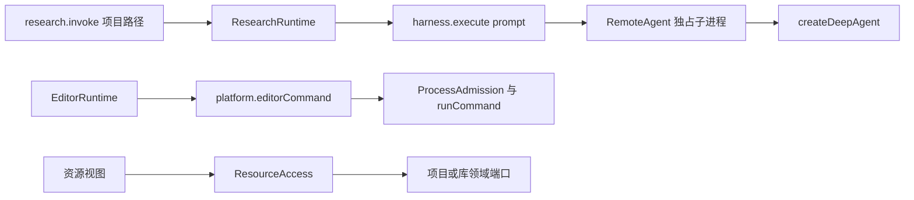

# 调查依据

## macOS 完整进程归属：收尾调查与后续规划

2026-10-24，用户在主分支要求修复 detached 后代 P1，随后明确选择“保持 macOS 全功能目标，先规划系统级服务／隔离环境，暂不宣称公共基础验收完成”。本节为当前候选依据；没有选定 macOS 实施后端，也没有授权安装系统服务、修改本机权限或部署 VM。

| 一手来源与已核对事实 | 对方案的影响 |
| --- | --- |
| [Apple XNU filt_procattach](https://github.com/apple-oss-distributions/xnu/blob/main/bsd/kern/kern_event.c) 明确拒绝 NOTE_TRACK／NOTE_CHILD；本轮真实 macOS CI 同样报告不可用 | 删除 BSD kqueue 自动跟踪候选，不能靠原进程组或一次 PID 扫描证明全范围停止。 |
| [XNU coalition syscall](https://github.com/apple-oss-distributions/xnu/blob/main/bsd/kern/sys_coalition.c) 对创建检查 privileged coalition | 不能把普通用户可建立 coalition 当作现成公开方案；root 服务也不自动获得受支持的进程容器接口。 |
| [SMAppService.register](https://developer.apple.com/documentation/servicemanagement/smappservice/register()) 的 LaunchDaemon 注册需管理员批准 | 它解决服务安装与生命周期，不单独证明 detached 后代归属。服务方案须另外证明归属与停止机制。 |
| [Endpoint Security client](https://developer.apple.com/documentation/endpointsecurity/es_new_client(_:_:)) 要求 entitlement 与 TCC；[entitlement 文档](https://developer.apple.com/documentation/bundleresources/entitlements/com.apple.developer.endpoint-security.client) 要求向 Apple 申请 | 本机 root 或能编译不等于产品可分发；签名、批准与权限拒绝是可行性条件。 |
| [es_new_descendants_client](https://developer.apple.com/documentation/endpointsecurity/es_new_descendants_client(_:_:)) 的官方 Markdown 标明 macOS 27 起，观察递归后代；无需 root／TCC，仍需 entitlement，非 root 后代的 setuid／setgid 执行受限 | 新增较窄的本机候选，纠正“所有本机方案均须 root 服务”的过宽推断。不能据文档存在提高最低系统版本，也不能直接宣称完整任意程序支持。 |
| [Endpoint Security seq_num](https://developer.apple.com/documentation/endpointsecurity/es_message_t/seq_num) 说明内核队列可能丢事件，可用序号发现 | 能观察 fork 不等于可靠停止；须验证通知积压／丢失、身份复用、确认时仍在途的后代及无新事件时的完整性。证据不完整保持 unknown。 |
| [Apple macOS VM 样例](https://developer.apple.com/documentation/virtualization/running-macos-in-a-virtual-machine-on-apple-silicon) 使用 Apple silicon、系统镜像与独立 VM 配置 | 隔离环境是不同的部署方案，须核对硬件、系统范围、原生程序与环境兼容、材料传输及持久成果；不能静默用 Linux VM 替代 macOS 本机程序。当前样例新增 macOS 27 功能，不把样例部署目标视为整个框架最低版本。 |

Apple 页面正文由官方 `.md` 入口读取，快照在 `/tmp/scholoom-r5-macos-{descendants,client,service,vm,entitlement}.md`；XNU 片段见 `/tmp/scholoom-r5-xnu-*.c`。这是一手文档／源码调查，未在 Mac 编译或执行这些候选。

调查顺序先尝试保留本机工具语义：验证有签名的后代 ES 客户端及系统服务方案，只有其保证或分发条件不能满足目标时再评估隔离环境。各候选统一用同一 detached 双重派生、短命父进程、取消／正常退出、宿主／监督者死亡、积压和权限撤销实验。以实际完整归属停止及未确认保护为判据，不以能收到事件或能安装服务为通过。

需要闭合的决定包括最低 macOS／硬件范围、entitlement 可取得性、是否接受服务授权或 guest 环境、升级卸载及确认丢失后的核查。先取得可复验原型证据及安装权限方案，再更新本变更设计／规格并作实施决定；当前保留 macOS 全功能目标和 4.5／4.6 待办，不新增猜测性生产适配。后续步骤见 tasks 第 5 组。

本轮用户进一步确认没有可供验收的 Mac，也没有 Apple 开发者账号。GitHub macOS runner 可承担普通编译或无特权实验，但不能据此取得或替代 Apple 审批的 ES entitlement、产品签名和安装／撤权／分发验收。5.3 的 ES 候选真实验证现受该外部条件阻塞，5.4 不据文档直接选定生产后端；VM 仍需按同一保证及原生环境兼容判据另行实验证明，尚不能视为已接受或已实现的替代方案。

## 当前事实与复用选择

2026-10-22，静态阅读及已有归档证据核对；本轮未实跑。真实工作域行为依赖工作域变更的对应增量；独立实现可在共同契约落入 dev 后并行，不据规划文件存在声称已可用。

| 来源 | 事实与复用结论 |
| --- | --- |
| `packages/protocol/src/resources.ts:14-39,96-168`；`packages/editor/src/resource-access.ts` | ResourceRef 已区分项目 fileId 与库 attachmentId/materialVersionId，describe/read/document/save 有内容依据和所属授权。直接复用，不新建全局材料表或复制库文件。 |
| `packages/protocol/src/research-contracts.ts:4-12`；`packages/research/src/runtime.ts:145-190` | 既有材料分析只接受 materialPaths，记录及输出检查按项目文件。它是已交付旧入口，不能当作业务 Graph 或库材料输入已接通。 |
| `packages/protocol/src/harness-module-contracts.ts:18-25`；`execution-graph.ts:42-146` | harness.execute 仅 attemptId/prompt/expectedOutput；execution.initialize 等是 SDK 单 Agent 驱动协议，不是科研 Graph 注册。需给源码装配的执行器一个真实入口。 |
| `packages/harness/src/execution.ts:146-164`；`remote-agent.ts:64` | SDK 图及 checkpoint 在独占子进程；当前固定 createDeepAgent。保留默认 Agent，增加宿主控制的 worker 装配，不让 harness 导入科研实现。 |
| `packages/protocol/src/editor.ts:154-172`；`apps/kernel/src/manual.ts:159-185`；`packages/platform/src/command.ts` | editorCommand 限 editor、quarto/latexmk；底层受管进程、准入和有界结果可复用。提取共同命令机制，运行记录和环境供给留给计算域。 |
| `playwright.ui.config.ts`；`tests/ui/fixture.ts` | 数据目录可隔离，但 renderer 的 5174 在配置、fixture 中重复固定。增加同源端口参数供多工作树测试，而不引入新测试宿主。 |
| `packages/projects/src/store.ts:323-417`；`packages/projects/src/files.ts:364-582` | save 的无 basis 分支已能安全新建且返回 fileId，但没有调用方创建身份；结构操作已有持久 operationId 和查询。需要在项目所有者内扩展创建收据，不能仅靠要求已有 ref 的 resources.save。 |
| `packages/protocol/src/harness-record-contracts.ts:47-60` | run 只有通用执行状态，没有图版本、等待点及恢复绑定；新增图执行协议必须同时落到持久尝试及查询投影，不能只增加子进程事件。 |

图为已核对的现状。三条路径已有机制可组合，但尚无统一的资源证据／图执行交接。

## 影响方案的未知项与实验

不选择新 SDK，不安排联网实验。既有 LangGraph 1.5.0 和 Deep Agents 的默认路径保留；公共入口只接入源码静态装配的图工厂，不接受客户端路径、代码或 Graph 定义。以实际固定 StateGraph 验证执行接线，不能用通用 Agent 加完整 Skill 冒充业务图。

本次不修改库对象、引用键、材料修订和删除恢复 schema，沿当前 ResourceRef 调用现有所属端口，因此不以尚未完成的生态调查结果猜测新领域存储。后续涉及这些语义的变更仍须先闭合相应调查。

## 结论与承接

在前序工作域基础上交付资源证据类型、源码装配的图执行端口和宿主受管命令端口；使用已有实际文件保存／部分关联失败事实，不新增科研完成权威。固定图、固定程序及隔离双宿主夹具作为公共基础验收，七域通过同一接口替换自身依赖。

已有测试为 `tests/kernel/research-module.spec.ts`、`harness-module.spec.ts`、`capability-isolation.spec.ts`、`resource-access.spec.ts`、`editor-runtime.spec.ts`、`platform-processes.spec.ts`、`process-admission.spec.ts` 及 `tests/types/contracts.ts`。新增只覆盖跨模块端口的稳定缺口，历史用例未在本轮重新运行。

独立规划审查发现首次创建与 Graph 等待恢复的契约缺口，已在设计中补齐创建收据、图推进结果、持久绑定及新消息输入映射；其运行正确性仍由任务验证。

对上述修正及三个变更任务的独立复核已关闭原问题，未发现新的确定性规划阻塞；审查为只读文档与源码核对，不代替实施后的权限、并发和真实进程验证。
