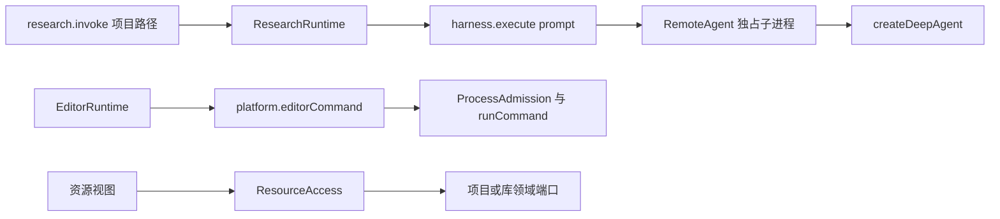

# 调查依据

## 当前事实与复用选择

2026-10-22，静态阅读及已有归档证据核对；本轮未实跑。真实工作域行为依赖工作域变更的对应增量；独立实现可在共同契约落入 dev 后并行，不据规划文件存在声称已可用。

| 来源 | 事实与复用结论 |
| --- | --- |
| `packages/protocol/src/resources.ts:14-39,96-168`；`packages/editor/src/resource-access.ts` | ResourceRef 已区分项目 fileId 与库 attachmentId/materialVersionId，describe/read/document/save 有内容依据和所属授权。直接复用，不新建全局材料表或复制库文件。 |
| `packages/protocol/src/research-contracts.ts:4-12`；`packages/research/src/runtime.ts:145-190` | 既有材料分析只接受 materialPaths，记录及输出检查按项目文件。它是已交付旧入口，不能当作业务 Graph 或库材料输入已接通。 |
| `packages/protocol/src/harness-module-contracts.ts:18-25`；`execution-graph.ts:42-146` | harness.execute 仅 attemptId/prompt/expectedOutput；execution.initialize 等是 SDK 单 Agent 驱动协议，不是科研 Graph 注册。需给源码装配的执行器一个真实入口。 |
| `packages/harness/src/execution.ts:146-164`；`remote-agent.ts:64` | SDK 图及 checkpoint 在独占子进程；当前固定 createDeepAgent。保留默认 Agent，增加宿主控制的 worker 装配，不让 harness 导入科研实现。 |
| `packages/protocol/src/editor.ts:154-172`；`apps/kernel/src/manual.ts:159-185`；`packages/platform/src/command.ts` | editorCommand 限 editor、quarto/latexmk；底层受管进程、准入和有界结果可复用。提取共同命令机制，运行记录和环境供给留给计算域。 |
| `playwright.ui.config.ts`；`tests/ui/fixture.ts` | 数据目录可隔离，但 renderer 的 5174 在配置、fixture 中重复固定。增加同源端口参数供多工作树测试，而不引入新测试宿主。 |
| `packages/projects/src/store.ts:323-417`；`packages/projects/src/files.ts:364-582` | save 的无 basis 分支已能安全新建且返回 fileId，但没有调用方创建身份；结构操作已有持久 operationId 和查询。需要在项目所有者内扩展创建收据，不能仅靠要求已有 ref 的 resources.save。 |
| `packages/protocol/src/harness-record-contracts.ts:47-60` | run 只有通用执行状态，没有图版本、等待点及恢复绑定；新增图执行协议必须同时落到持久尝试及查询投影，不能只增加子进程事件。 |

图为已核对的现状。三条路径已有机制可组合，但尚无统一的资源证据／图执行交接。

## 影响方案的未知项与实验

不选择新 SDK，不安排联网实验。既有 LangGraph 1.5.0 和 Deep Agents 的默认路径保留；公共入口只接入源码静态装配的图工厂，不接受客户端路径、代码或 Graph 定义。以实际固定 StateGraph 验证执行接线，不能用通用 Agent 加完整 Skill 冒充业务图。

本次不修改库对象、引用键、材料修订和删除恢复 schema，沿当前 ResourceRef 调用现有所属端口，因此不以尚未完成的生态调查结果猜测新领域存储。后续涉及这些语义的变更仍须先闭合相应调查。

## 结论与承接

在前序工作域基础上交付资源证据类型、源码装配的图执行端口和宿主受管命令端口；使用已有实际文件保存／部分关联失败事实，不新增科研完成权威。固定图、固定程序及隔离双宿主夹具作为公共基础验收，七域通过同一接口替换自身依赖。

已有测试为 `tests/kernel/research-module.spec.ts`、`harness-module.spec.ts`、`capability-isolation.spec.ts`、`resource-access.spec.ts`、`editor-runtime.spec.ts`、`platform-processes.spec.ts`、`process-admission.spec.ts` 及 `tests/types/contracts.ts`。新增只覆盖跨模块端口的稳定缺口，历史用例未在本轮重新运行。

独立规划审查发现首次创建与 Graph 等待恢复的契约缺口，已在设计中补齐创建收据、图推进结果、持久绑定及新消息输入映射；其运行正确性仍由任务验证。

对上述修正及三个变更任务的独立复核已关闭原问题，未发现新的确定性规划阻塞；审查为只读文档与源码核对，不代替实施后的权限、并发和真实进程验证。
