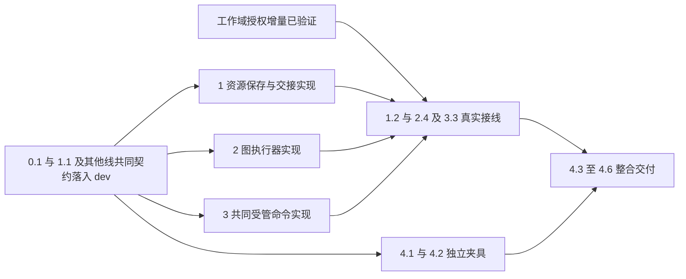

# 执行任务

实施前置分为共同契约与实际接线：0.1、1.1 参与三线契约先行，基线落入 dev 后可并行实现；1.2、2.4、3.3 的真实授权路径等待工作域 1.2、1.3、2.1、2.2 对应能力验证，不等待该 change 整项完成。写入归属、同步与整合关系见[公共基础实施规划](../../../.scratch/domain-development/public-foundation-plan.md)。各任务由本次执行者承担接入验证，独立整合任务开展前明确负责人。

## 0. 共同执行契约先行

- [x] 0.1 工作域 1.1 和本变更 1.1 的资源声明接入后，将 2.1、2.3、3.1 的图选择、等待／终态、持久绑定、resume 及命令输入输出声明先行交付，与工作台 1.1 的交叉 DTO 合并；本项验收声明及原路径兼容，实际 worker、存储、授权和进程验证仍由原任务完成。契约作为独立增量接入 dev，统一生成、通过架构／类型检查及原会话回归，各线同步或从同一基线创建，不重复升级产品协议版本。

## 1. 材料与成果证据

- [x] 1.1 在 protocol/resources 定义 ResourceEvidence、ExecutionResourcePort、新建及创建结果查询、保存／关联的分别结果，生成映射及类型反例；作为共同契约增量先接入 dev，供图与工作台契约引用。原库身份、引用键、修订及删除恢复 schema 不在此改动。
- [ ] 1.2 工作域对应授权能力验证并接入 dev 后，宿主通过 broker 绑定 ResourceAccess、本项目保存及目标只读能力，真实取用不依赖资源视图；扩展 resource-access.spec.ts，覆盖项目与库版本、撤权及禁止副本绕过。独立接入资源适配供工作台 2.2、3.2 验证真实授权路径，不等待完整 Graph／命令交付。
- [ ] 1.3 复用既有文件保存和成果关联回执，测试已保存而关联失败、同路径替换及旧依据冲突；返回实际引用，不新建交付权威或自动重生成文件。
- [ ] 1.4 同步工作域 1.2 的 store/files 增量后，在项目新建分支补稳定 operationId、候选及发布身份收据，复用所属操作记录和迁移保护；固定图从不存在的路径创建成果，验证回执丢失、登记未知、同身份不同输入和重启后仅补关联，不预建输出规避创建路径。

## 2. 源码装配图执行器

- [x] 2.1 消费 0.1 已交付的默认 agent／registered 及图身份版本配置声明，接入宿主和 worker 的同源注册；未注册、版本不符或非法配置在副作用前失败，类型和运行校验均覆盖。
- [x] 2.2 从 harness 固定 child 主体提取通用图 driver，在宿主静态 worker 入口装配工厂；保持 harness 不导入 research 实现，并验证实际 worker 只接收受控入口及可校验 DTO。将提取增量及回归独立接入 dev，工作台线改动相同执行适配块前先同步。
- [ ] 2.3 消费 0.1 的 waiting/completed/failed 及恢复契约，将图身份版本配置／状态格式／checkpoint／waitId 绑定落到持久尝试及查询，测试没有模型事件的确定性图；新指令经等待 schema 映射为 resume，checkpoint 成功后恰好确认消费，覆盖回执丢失及版本不兼容的新尝试。
- [ ] 2.4 为已装配图接通当前实例、模型额度、checkpoint、资源工具与取消。用测试宿主装配的固定 StateGraph 在实际子进程中读材料、写文件、等待输入并按新消息接续；等待可查询且不在重启后自动执行。
- [x] 2.5 回归普通会话及既有材料分析入口，核对默认 Agent、工具结果、实例失效、容量不足和停止未知仍沿原规则；测试夹具不进入生产默认注册。

## 3. 宿主共同受管命令

- [ ] 3.1 消费 0.1 的内部 platform.command 契约，接入宿主私有 workspace／executable 解析，绑定真实消费模块及工作域；测试伪造工作空间、未登记程序、跨域越权及全局会话借已登记程序突破只读限制均被拒绝。
- [x] 3.2 提取唯一准入与 runCommand 提供者，editorCommand 通过薄适配复用；保持排版快照、缓存、取消及最后成功预览。扩展 editor-runtime.spec.ts，不增加通用计算运行记录。
- [ ] 3.3 固定 Node 程序经过真实进程和准入，验证输出边界、等待撤权、取消、后代收尾及停止未知；扩展 process-admission.spec.ts 和 platform-processes.spec.ts。

## 4. 隔离夹具、整合与交付

- [ ] 4.1 统一 Playwright webServer、baseURL 与 UI fixture 的可配置 renderer 端口／URL，现有 tests/ui 中固定 5174 的导航调用一并迁入同源入口并保留缺省值；两个实例使用不同配置、库、项目、输出与端口，结束一轮不影响另一轮。将该增量独立接入 dev，工作台线修改共用 fixture 或相应用例前先同步。
- [ ] 4.2 复用现有测试组合添加窄契约替身及真实固定图／程序夹具，记录实际接线和替身，补七域独立接入说明；不另建工作台或通用测试框架。
- [ ] 4.3 运行 pnpm generate:contracts、pnpm check:architecture、pnpm typecheck、pnpm build 以及受影响资源／harness／科研／editor／进程内核测试；双宿主运行共同资源与写作定向回归。
- [ ] 4.4 在测试宿主装配真实内部模块，从显式输入经 worker 到实际材料读取、保存及结果查询；注入取消、关联部分失败和 worker 失联，取得可核查结果。真实模型和科研充分性另验。
- [ ] 4.5 对执行协议、资源授权、命令收尾及并发安排独立审查，修复问题并更新 docs/development.md 和必要架构说明。
- [ ] 4.6 根据实际执行结果取得 delivery instructions 并填写 delivery.md，记录公共基础完成标准、平台与替身边界，再更新本项状态。

## 续做入口

先核对共同契约及当前任务所需工作域增量的实际 delivery／dev 接入结果，再运行 `openspec instructions apply --change establish-domain-execution-handoffs --json`；无需等待工作域 change 整项完成。待办进度只在本文件维护；实际接线和验证结果进入本变更 delivery。
