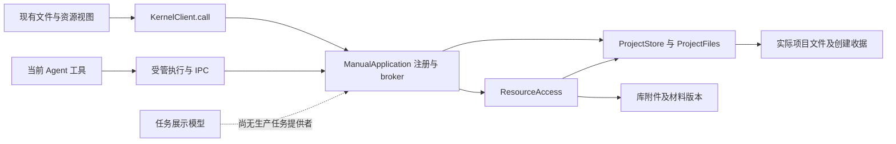

# 调查依据

## 当前事实与复用选择

调查日期：2026-10-25。Scholoom 基线：`e3d58fc807827a78493dcd16e38de28c8d02766e`。开始时工作区干净，`openspec list --json` 无活动 change。本树没有 `.codegraph/`，故使用文件及符号搜索，没有创建索引。本文件保留实施前静态源码、规格、历史交付及日志核对依据；后续用户已授权实施，实际代码、测试与局部交付见[delivery](delivery.md)，不将基线差距描述当作交付后现状。

### 领域、源码与具体差距

| 事项 | 已核对事实与来源（路径相对仓库根） | 规划选择 |
| --- | --- | --- |
| 任务事实源 | `.scratch/domain-development/issues/03-project-research-assets-scope.md` 的 Answer 明确项目多任务、入口文件、开放过程文件、动态完成条件及库知识只存指针。`packages/projects/src/schema.ts` 只有 meta、edits、artifacts、file_references、file_operations；没有持续任务实现 | 任务正文、研究状态、工作项与关系写文件；不增加任务正文表 |
| 旧成果关联 | `ProjectStore.linkArtifact/artifacts`（`store.ts:569`）以 sessionId／runId 保存执行产物；`researchAttemptSchema` 及 `ResearchRuntime.attempts` 仍表示能力调用和会话尝试 | 保留原执行关联，任务关联另在入口文件表达；不把 runId 用作 taskId，不要求人工操作建立会话 |
| 文件保护 | `ProjectStore.check/path/read/save`（`store.ts:183/209/292/342`）提供信任、路径、256 KiB 文本上限、串行保存和整份读取保护。`ProjectFiles.coordinate/reference/resolve`（`files.ts:63/98/160`）提供路径协调及稳定 fileId | 直接组合这些能力；不新造锁、事务、文件 hash 或正文存储 |
| 强版本与首次创建 | `packages/protocol/src/resources.ts` 的 ResourceRef／ResourceEvidence／ResourceCreationResult；`ProjectCreations` 保存原操作与候选。`ProjectStore.save` 在原临界区核对 expectedFileId、resourceBasis，首次创建用硬链接禁止覆盖 | 创建任务复用原创建收据；任务保存带入口强 basis，不能只以原文字相等判断替换文件归属 |
| 发现与监听 | `ProjectStore.list`（`store.ts:236`）按目录版本分页、每页至多100；`ProjectFileWatches` 仅显式目录／文件范围。目录版本来自目录自身 stat，不能证明所有子文件正文未变化；list 内部仍枚举当前目录名称 | 单一公开入口目录、有界页内解析；摘要为提示，每次 read/save 重查入口。复用目录列举成本，不宣称文件系统遍历工作量严格 O(page) 或取得全项目瞬时快照 |
| 资源读取 | `ResourceAccess` 和 `resources.describe/read/document/save` 已统一项目／库资源，稳定身份、库材料版本、正文只读能力及分片语义已交付 | 过程和成果通过原资源视图取用；保存任务入口使用同一项目保存机制，不改 editor 权威 |
| 工具与装配 | `apps/kernel/src/manual.ts` 的 `registerProjectHandlers/modulePort/projectFiles`，`application.ts` 的 Harness 构造端口；`packages/harness/src/runtime.ts:2138` 附近注册同源 schema 工具，真实执行仍经宿主 IPC；client 已有泛型 call | 任务操作由 projects 提供，宿主静态注册，harness 只增加任务薄工具。新增专属窄端口，不把整个 application 交给任务 Module |
| 任务 UI | `shell/AuxiliaryPane.tsx:145` 任务是不可打开的 `<li>`；`tab-state.ts` 无任务详情 kind；`business-session.tsx` 没有生产任务提供者 | 领域专属 TaskList／TaskDetail 接入现有右栏及中间 tab；展示状态模型不直接当作领域状态 |
| 项目切换与草稿 | `Workbench.tsx:107` 按项目保存文件组；`business-session.tsx:344/660` 分别管理接收者、会话草稿和文件草稿；资源与库导航独立于接收会话 | 任务 tab 沿项目文件组生命周期，明确附加入口才进 composer；不另建任务会话绑定 |
| 库错误语义 | `library.attachment`／`material-files.ts` 可表达 available、missing、changed、unavailable，并区分 managed／linked。`library.get` 按 sourceId；当前没有完整库删除历史、主题知识读取提供者 | 首批支持既有附件 ResourceRef；其他库引用接口留给其提供者。missing 不证明删除，缺删除证据时不能声称对象未删除或可恢复 |

### 已归档基础：直接消费，不重做

已核对下列 `openspec/changes/archive/` 交付。其运行结果是相应历史版本证据，本轮未重跑；早期段落的未完成状态不能覆盖各文件最终收尾。

| archive 目录 | 可复用交付及证据边界 |
| --- | --- |
| `2026-10-23-establish-scoped-execution-foundation` | 真实工作域、项目目标只读、实例授权和模型前重验；全局会话不能借任务端口获得目标写权限 |
| `2026-10-24-establish-domain-execution-handoffs` | 资源实际依据、首次创建／原操作核查、保存与执行关联分别返回、Graph driver／等待、受管命令。生产图注册仍为空；macOS受管执行明确不可用 |
| `2026-10-24-establish-workbench-context-bridge` | 连接所属快照、ContextItem、共同 composer、可靠显式项及草稿保护；不需要任务私有发送通道 |
| `2026-10-20-unify-workbench-resource-opening` | 共同资源打开、格式视图、只读库正文、强 basis、草稿和撤权保护；任务材料通过同一入口 |
| `2026-10-20-add-workspace-file-explorer` | 文件树、范围监听、结构操作、文件 tab、双宿主夹具；目录枚举不是全库知识投影 |

当前正式 `project-files`、`workbench-resources`、`workbench-agent-context`、`execution-work-domains`、`domain-execution-handoffs`、`module-runtime`、`research-capabilities` 以及题录／附件规格与上述复用方向一致，无需改其既有 Requirement。`docs/architecture.md` 的“当前实现基线”日期仍为2026-10-19，且一处迁移 change 链接未指 archive；以代码和开发说明为事实，本轮不改全局架构文档。实施时只补任务运行入口及所属 UI 设计，不复写公共基础。

实线来自上表所列当前源码；虚线仅表达已确认缺口，不表示存在隐藏任务实现。

### ResearchSpec 对照与许可

只读原仓 `/home/joshua/Workspace/Code/JavaScript/ResearchSpec`，当前 HEAD `62e442d07acb078c91fabe7e8f96da8e13033e8e`；领域票参考基线为 `607c7a73d49cb20a188945b68229c5dd559c40eb`。子 Agent 比较两版 `write-plan.ts`、`graph-recovery.ts` 无差异；主 Agent 抽查 Navigate、写入保护和使用文档。没有访问其他 Scholoom 工作树。

| 原仓来源 | 可吸收内容 | 不可外推的结论 |
| --- | --- | --- |
| `docs/user/usage-model.md:222`；`src/adapters/companion/workflows/navigate.ts:105` | 目标、交付、材料用途、实质进展、限制、未决问题和下一步；按阶段产出／遇阻保存，恢复时核对实际材料 | `work/researchspec-notes/<task-id>.md` 是方法约定；原 CLI 不扫描、不校验、没有 task selector，未实现本线所需发现及稳定身份 |
| `src/core/runtime/graph-recovery.ts:54` | 从所属事实派生交付声明、障碍与后续入口 | 正式 run、handoff、frontier 不等于本项目动态研究任务，输出声明不证明实际可读 |
| `src/core/workspace/write-plan.ts:105/143/312` | 写入前核对旧内容及读依赖、创建冲突、候选／备份及失败保护 | 不作为崩溃安全跨文件事务，未证明串行锁；本项目已有更直接的所属文件保存机制，故不复制该写入器 |
| `tests/write-plan.test.ts:63/78/93`、`tests/graph-recovery.test.ts:209/307` | 并发漂移不破坏其他文件、缺材料保留障碍、多个未完成对象不自动选一个的场景参照 | 仅阅读测试定义，未实跑；不是任务发现或真实科研质量 oracle |

原创上述 TS、测试和文档按原仓 LICENSE 为 MIT；如实际抽取代码／指令须固定版本并保留版权许可。首批选择本项目已有实现并据已确认模型编写任务说明，不搬整仓、旧主 Agent 独占笔记规则、正式 Gate 或审稿工作台的 SQLite 正文权威，不引入原仓依赖。

## 影响方案的未知项与实验

### 已有 CI 失败输入

并行计划记录的 Checks `40100596838` 对应 `55d020c`，Linux UI 101通过／9失败／2跳过，Windows内核374通过／15失败／12跳过；不是本树 HEAD 的实跑。已读取 `/tmp/scholoom-next-parallel-baseline-failures.log` 中项目相关段落，并与当前测试交叉核对。

| 输入 | 代码核对与可信结论 | 实施时承接 |
| --- | --- | --- |
| 日志4664、4814附近，同名新建项目会话按钮命中2／3个元素 | `tests/ui/fixture.ts:95` 全页按 projectName 定位；项目 DOM 有 `data-project-id`。重复名称是选择器歧义，不能据此认定产品保存失败 | 按明确 projectId 限定所属项目行，覆盖同名隔离，不使用 `.first()` |
| 日志4694、4845附近，切换项目草稿场景等待新会话超时 | `file-workbench.spec.ts:271` 先 arm session.create、再 await 会等待创建完成的 createSession，release 排在其后；静态可见夹具等待顺序相互阻塞 | 分离点击／已发送、切换及 release、最终受理／选择断言。修复并实跑后才判断产品迟到刷新是否还有缺陷 |
| harness `No held RPC`、报告空内容、Windows运行状态仍running | 本轮没有足够执行诊断确认根因；超时只表示断言期限内未到达预期 | 列为来源接续与 I1 的运行前置诊断，关联发送／受理／执行／刷新，不扩大生产时限；无关失败由所属线处理 |

没有必要用本轮只读实验代替实现验收，未启动任何服务或安装运行时。上述两项测试缺陷为静态证据，不冒充修复后运行结果；原日志是易失本机输入，正式设计保存了失败场景及可复查源码入口。

### 等待输入与明确阻塞范围

| 编号／提供者 | 已有证据、缺失输入 | 当前选项与局部处理 | 阻塞范围／解除依据 |
| --- | --- | --- | --- |
| W1 文献线，生态线提供上游约束 | 生态10.0.5调查已收到；4b13183已有library-records同源契约及sourceInstances／originalRecords实际持久化，提供原值身份{instanceId,libraryLocator,objectKey}、record／commit／history | 任务材料继续消费attachmentId／materialVersionId，不另造ResourceRef或TaskLink。外部原值身份不等于附件材料身份，源key重现也不等于恢复 | 仅完整库删除记录／恢复行为矩阵、主题／分析知识及其项目消费仍开放；notFound不能推出已查询且无删除记录 |
| W2 阅读交互线 | 两份design均已从用户快照分别完整读取并核对，见design第7节 | 材料位置增量与报告清单分别消费；共同ResourceRef／basis、context、composer及保存边界无静态冲突，报告批量附加仍是候选 | 信息及设计复核阻塞解除；不代表报告、M1／M2／M3、U1修复或I5已实现，不合并两个change |
| W3 科研线 | 实际research.requestGraph人工适配及固定worker已经进入共同源码，主线已接收I1机械组合；生产目录仍空 | 项目组合TaskRef／workItemId及来源，沿独立输入快照与process指针；实际依据见design第8节及delivery | 不再等待提供者／同步；校准图仅测试注入，不关闭真实业务Graph和科研质量 |
| W4 Agent／计算线 | 当前通用worker真实TaskPort闭环已进入共同源码，父read→入口Evidence→子保存→父重读save关联有四场景证据 | 沿已有TaskRef及材料Evidence，不向委派载荷加另一套DTO；result/workItemId由父写回任务。程序首批无需任务 | 项目侧4.4c可闭合；科研角色／标准／真实质量仍由所属change交付，不称完整I3通过 |

当前表于4b13183主线共同接入后复核；历史快照路径见design第7节，最新证据为`/tmp/scholoom-round6-acceptance-dXuzCA/{acceptance.md,synchronized.json}`及本树正式源码。W1完整库分类／恢复仍开放，W3／W4项目侧机械接线已具备实际证据。需要扩展公开行为时先审查范围；既有材料行为矩阵不重新投票。

## 结论与承接

可闭合：首批入口目录和格式、显式任务引用、按页发现、任务文件条件保存、材料导航、工作台接入、文件保存与入口关联分开核查。对应实现及验收见 design／tasks。

不可闭合：W1／W3／W4的相应真实接线与整合，以及M2待审新协议。资料已收到的事项不再以“未收到文件”阻塞。任务元信息不被研究图、运行状态或会话替代，未知保存效果不自动重放，库读取无fallback。规划工件齐备不表示这些前置已就绪或已获实施授权。

## 2026-10-28：file-workbench双宿主首模型计数的只读取证

本片只调查Checks **40479176954**、源码 **8c2fd24534001a9724f9c008482d404c336a5a07** 的两个指定场景，不改源码／测试，不关闭4.1。当前树HEAD为938c33f2c9fcafb2cce11b0c165b2fb1e9a818c3；主线安排及原日志见`/tmp/scholoom-round10-acceptance-j1MosP/`。上述首轮规划的未接入描述只作历史；I1、4.4c及M2已接收，本片不重做。

### 证据来源与承载

只读GitHub API确认run/head及artifact **12728680109 / diagnostics-ubuntu-latest**（65,548,621字节、未过期），与主线ci-baseline日志／矩阵匹配。实际选取20个文件，包括两场景各Browser／Electron的trace、error-context及失败前手动截图；原ZIP目录共476项，没有本轮全局UI profile，也没有目标项目DB／checkpoint或worker stderr。证据根为 **`/tmp/scholoom-file-workbench-r10-jFEF4T/`**，以下相对路径均基于该根：

- `run-source.json`、`artifact-source.json`保存API来源；`artifact-inventory.json`保存目录，`selected-manifest.json`保存20项大小及SHA256。
- 四份trace在`selected/ui-5174/`下的`file-workbench-project-fil-79a6c-y-rename-trash-and-recovery-ui-{browser,electron}/trace.zip`及`file-workbench-resident-pr-7ae0b-preserve-each-project-draft-ui-{browser,electron}/trace.zip`，全部通过`unzip -t`。每份内嵌file-workbench源码均与CI／当前树逐字节相同。
- `source-comparison.json`核对测试、model-kernel／model-server、UI fixture／RPC gate、Playwright配置、workflow及harness runtime／remote-agent／execution-driver，均与CI相同。当前lifecycle及kernel-fixture已有后续诊断增量，不能倒写为旧CI取证。
- Browser trace的`1-trace.network`通过`response.content._file`指向kernel WebSocket JSONL；原帧提取为各自`trace-content/kernel-websocket.jsonl`，下文行号就是JSONL的一基行号。`focused-rpc.json`及根`bounded-evidence.json`保留所需请求／回执／身份／时序，剔除认证及configure载荷。Electron真实窗口没有同等网络记录。

CI job122104867775的build步骤成功，步骤23实际运行`xvfb-run -a pnpm test:ui`并失败，artifact上传步骤27成功，原阶段摘取在`ci-step-source.json`。`playwright.ui.config.ts`起Vite renderer（5174）、单worker、零重试，Browser与真实Electron共用产品组件。两个场景导航`/`，没有开发样例参数；`startModelKernel`替换的是外部HTTP模型地址，内部serveKernel、broker、仓储和worker真实。没有在本机启动开发服务器或把这些场景放进普通静态产品重跑。静态承载的本机通过／失败均不能补该CI事实。

### 每个场景的最早未闭合环节

| 场景／宿主 | 已证发送及受理／首模型前状态 | 最早未闭合边界及归属 |
| --- | --- | --- |
| 预览、改名、回收恢复／Browser（原111行） | WS行267的`session.send`（RPC 130）09:52:21.455Z发送，268于21.472Z返回instructionId／runId；270、275的watch显示同指令accepted、同run queued、provider configured。原5秒poll结束仍计数0 | 已受理后至首个可计数模型HTTP之间；没有worker实例／PID、进程准入、initialize、consume或model.acquire证据。交Agent按下面绑定身份继续，不称文件保存失败 |
| 同场景／Electron（原111行） | test.trace确认填消息、点击及poll期望1实际0，结束10:14:30.394Z；实际窗口`1-trace.network`为0字节，trace没有该窗口RPC／snapshot | 发送回执、项目/session/run及worker身份均缺证，不能套Browser身份或断定同因。公共UI夹具需要真实Electron窗口trace及清理前快照，Agent再核执行 |
| 多项目草稿切换／Browser（原400行） | WS行392的`session.send`（RPC 195）09:52:49.163Z发送，393于49.181Z返回；395、400显示Alpha会话同指令accepted、同run queued、provider configured。原5秒poll结束计数0 | 同样只定位到受理后／首可计数HTTP前；不能据queued认定具体worker初始化或容量问题。交Agent独立按该run取证 |
| 同场景／Electron（原400行） | test.trace确认切回Alpha、填消息、点击及poll期望1实际0，结束10:14:58.138Z；实际窗口network仍为0字节 | 尚无发送／受理身份链，先补公共夹具取证，不能将两个Browser run当作它的执行事实 |

上述时间均为2026-10-27 UTC。Browser精确绑定如下，完整回执在`bounded-evidence.json`，无需从标题猜运行：

| 字段 | 预览Browser | 多项目Browser |
| --- | --- | --- |
| projectId | `2225856a-c66b-4ca1-ade5-4b9eb63aaecc` | `217aec79-6e9e-41a4-9154-9e87b87aaa41` |
| sessionId | `44b2bef7-dd5a-49ed-9807-f17117815941` | `a450364c-6390-4048-bd2f-4a8e45dd9f70` |
| instructionId | `f72a6ade-97ee-4dc3-bff6-9e5b8e3381a5` | `60e13060-fff9-4044-8d4d-9bc94c3d0942` |
| runId | `97a4c35d-dd58-4838-aec6-dfc229cc214e` | `cae289fd-3050-4899-b3fc-11059247d6b7` |
| bootstrap kernel instance／PID | `9bccaf57-6452-436b-9711-831c847c0146`／23524 | `c0a9f4f4-cf48-47aa-b28f-28749f58d030`／23710 |

bootstrap PID是内核进程，**不是worker PID**。最后实际watch分别在09:52:21.526Z和49.246Z，随后没有新的run进展回执；不能把早期queued快照扩大成持续逐阶段观测。原项目数据库已随finally清理，不能离线核其run_instances或checkpoint。

Browser的`kernel.stopping`分别在WS行276（09:52:27.451Z）和401（09:52:55.098Z），晚于计数断言失败约1.1秒，符合finally的`stop()`。error-context在清理后显示“正在停止内核”“Not connected…草稿已保留”，不能倒推停机或保存报错是计数失败前的首因。

### 实际文件动作及不能外推的结论

第一场景在失败前已创建目录、文件及本地图片；Browser WS行71–72确认`files.save`创建空入口，139–140确认`resources.save`将221字符Markdown保存到`notes/draft.md`（fileId `309663cf-5603-4928-a20d-94567a0a9ccc`，新basis在回执）。顺序执行的磁盘内容断言通过，随后未保存段落仍在编辑器／预览、表格／公式／本地图片及远端图片阻止均已核对；两宿主保存了预览截图。新会话发送之后才会进入大文本／延迟测量、目录改名、回收恢复与重新打开项目，这些后续主体**没有执行**。新增段落只验证了草稿保留，不称它已落盘，也不能称本次失败丢失草稿。

第二场景先以文件系统创建Alpha／Beta初始内容并登记可信项目／会话，已完成迟到创建保护、两个项目各自编辑及切回后草稿仍在的断言和截图。Browser这段UI没有files.save或resources.save请求；新草稿未要求保存，不能称保存失败。仅Alpha首条消息已发送；Beta后台发送、双项目运行标记、释放模型后完成和最终两请求断言均未到达。两宿主都不能据此宣称持久化／刷新恢复或后续消息隔离已通过。

`model-server.ts:530–544`只在目标POST路径、完整JSON解析成功后将请求加入requests，再等待hold；因此hold=true不能解释已登记请求仍为0。但零计数也不能排除错误路径、JSON拒绝／未读全或更早阶段未完成。没有实际worker／模型准入记录，不把它定为同一个harness初始化缺陷。

### 交回的窄取证边界

Agent可从两份已绑定Browser回执继续核`Harness.send/schedule`（runtime.ts:970、1214）、`RemoteAgent`进程启动／`execution.initialize`（remote-agent.ts:284、418）、`execution.beforeModel`与`execution.consume`、`model.acquire`。send在指令事务及setRun后才返回（runtime.ts:1154–1189），成功回执与后续accepted快照证明领域受理，但不是worker已启动或模型已发出的证明。queued同样不能区分reservation、initialize、指令消费或模型排队；当前不在项目树并改这些提供者。

公共UI夹具的缺口是实际Electron上下文未跟踪，且两场景在首次计数前没有附加所属run的阶段／容量／模型准入事实，finally又删掉项目／配置。需要绑定原项目/session/run、在清理前取得一次实际snapshot与worker阶段，并保留Electron窗口的RPC流；这只是本片交回的取证要求，没有新增探针或修改model-server／期限。项目提供者本片无确证保存、版本或草稿缺陷可修。两场景具有相同表面边界，不足以证明同因；达到上述精确缺证即停止。

## 2026-10-28：29cd728窗口侧观察的实际补证

第十一轮公共UI取证沿design第10节实现，只消费当前真实uiPage的Playwright WebSocket事件，不改业务调用。唯一一次resident project sessions双宿主实跑为Browser通过／Electron原首模型计数失败；它是当前已构建静态产品的新样本，不是旧8c2fd24开发承载CI的重现。证据根`/home/joshua/.cache/scholoom-ui-rpc-7C1T29/`，原始结果`ui-first.log`，安全附件在`ui-first/*-ui-{browser,electron}/ui-window-rpc.json`，逐回执投影在`artifact-validation.json`。具体命令和边界见同一delivery末节。

Electron同一实际窗口的RPC135请求于1793140025669、成功回执于1793140025706，绑定project `60c0bac1-e200-4445-877a-3dd05276f45e`、session `87885264-8ce3-4cca-b101-93aacca20add`、instruction `d3898d7c-1752-4bca-8b53-1f9d9e390ce3`、run `13d33d9d-6eda-4a92-b2ab-fd08f2ec498a`。随后1793140025721和1793140025761的watch均为revision12、同session／run的queued及同instruction的accepted。监听／丢弃／无效字段／待回执计数均0，真实窗口原先空network造成的身份缺口已有本次实际证据；观察不包含instance／PID或worker阶段，不能据queued替Agent判初始化根因。

Browser两次发送均有同连接成功回执及匹配watch，最终两个run均completed。Electron首模型计数在原5000ms仍为0，不证明文件保存／草稿损失；该场景此前文件／草稿切换断言已执行，后续Beta发送未执行。下一轮由主线／Agent将上述原身份和本地时点与实际执行侧关联，本树不修改harness或model-server，也不重放发送。完整4.1所需库删除／恢复及主题知识提供者仍未提供。
