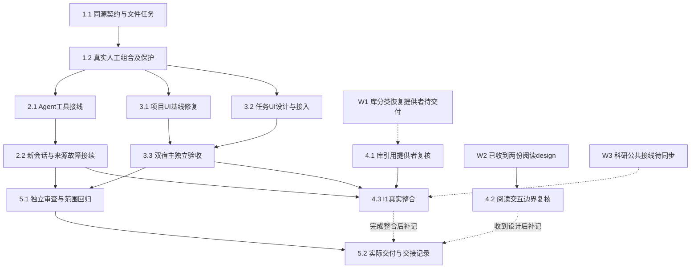

# 执行任务

2026-10-25用户已授权实施及锁定依赖安装、隔离双宿主验收；本轮主线另授权快照消费、公共补丁准备及M2／I1有界方案，见design第7–8节。Git操作和真实用户数据未授权。W2资料复核已完成，其余实际提供者及跨域验收不因CLI ready而闭合；不把主线快照当共同dev已合入。

图中虚线为尚未具备的真实提供者／接线及后续补记路径，不是安排其他工作树执行的DAG；资料到达和静态核对不代替实际接入。核心局部交付可以先记录，4组进展取得后继续更新同一delivery。2组与3组在1组通过后可并行：2组仅写任务工具安装点与harness相关测试，3组写任务UI／所属设计与UI测试；共享schema由本线主Agent维护，主Agent负责整合和最终接受，不重叠写入。

## 1. 无模型的文件任务闭环

- [x] 1.1 在 `task-contracts.ts` 定义并导出入口元信息、TaskRef及tasks.list/read/create/save同源声明，实现projects内ProjectTasks并复用原目录、强读取和创建／保存。以 `tests/kernel/research-tasks.spec.ts` 的真实临时文件／容器验证缺目录空查询、创建后重读／重启、扫描数分页、损坏／超限／未知格式、重复ID不自动选中、工作项导航及依赖检查；普通正文不作固定标题门禁。声明、必要聚合和生成映射与实现同批闭合，无业务依赖新增。
- [x] 1.2 在ManualApplication注册实际提供者，完整宿主可消费同一窄Interface；创建核查沿原resources.creation且保持原可信创建主体。验证无harness人工组合、trusted／restricted与跨项目拒写、应用内改名、人工变更重读、任务旧身份／同内容替换拒绝、成果保存后入口关联冲突、原操作未知后查询只核查、恢复副本本地引用不回读原项目。复用project-files、resource-identity、resource-creation、manual-application既有用例，仅补任务参数传递及部分失败缺口；通过schema生成一致性、架构和相关类型检查，补开发说明的任务操作及诊断入口。

## 2. 真实Agent工具与接续

- [x] 2.1 注入当前项目任务窄端口，在独立task-tools及runtime安装点注册四个schema派生任务工具，并以read_task_creation薄工具暴露已有resources.creation原操作查询，沿原执行实例、ToolRecord、IPC与模型前授权；不修改Graph driver或harness运行权威。当前项目真实会话经受控模型创建／读／改任务，实际保存过程文件和成果并更新入口，原执行产物关联与任务文件关联分别核查；创建未知按原操作查询，不以失败重建任务。全局或其他项目不能经工具登记／修改目标。新增接口传播和受影响调用者类型检查通过。
- [x] 2.2 扩展work-materials既有真实harness样本：新会话先发现候选，再读入口、原比较理由、人工补充材料及实际成果，核对障碍和下一步后保存后续文件。另测来源读取失败后保留文件、原错误及分类提供者不可用，Agent提出选择并停止依赖工作，明确收到用户决定才继续；受控响应不替代任务正文或直接代写成果。覆盖关联失败后重读只补关联，不重复生成，测试结论只认机械接线和保存行为，不认科研质量或完整库恢复。

## 3. 任务工作台与相关CI基线

- [x] 3.1 作为可独立检查的公共测试增量，调整fixture.createSession的项目身份定位及受影响调用，修正file-workbench门控场景中点击／完成等待／release的顺序；明确同名项目、实际选中会话及迟到创建的断言。先实跑相关双宿主场景，区分测试问题与剩余产品问题，不用 `.first()` 或延长测试／生产超时使其通过。无服务授权或运行时缺失时保持未完成，不安装。
- [x] 3.2 先更新UI设计右区任务／中间详情小节，再实现TaskList／TaskDetail／TaskPanel／有界use-tasks及精确工作台挂载：右栏创建／选择／续页，中间入口与工作项导航，共同编辑与资源打开，显式附加进入现有composer。按projectId／taskId／fileId保留tab及文件草稿，当前视图贡献沿原context端口；旧占位行删除，demo与类型随真实接口调整，样式只用既有语义token。关联仅存引用字段，共同正文有草稿时先保存再关联，不新增第二份正文或私有发送机制。
- [x] 3.3 在隔离端口5721（运行前核对占用）、配置／项目／库／输出下，经Browser和真实Electron用户入口验证创建、详情、编辑持久化、关联资源、键盘、有界分页、人工文件变化重读、同名项目及切换／刷新／迟到回执保护、任务附加不改变接收者。复用file-workbench／resource-opening／context-bridge受影响场景；先完成构建再跑UI，期间不重建。当前任务文件和持久结果来自真实内部提供者，外部模型可受控，结束只收尾本轮执行。

## 4. 跨线输入与真实整合

- [ ] 4.1 【W1调查已收到，实际库提供者仍缺】已消费固定Zotero10.0.5身份／关系、字段及插件保存／SQL／通知／固定键调查，见design第7节。题录／附件删除恢复、主题分析及共同来源身份仍等所属正式契约／实际提供者；不实现伪删除、无历史或恢复，不把notFound当删除分类。新增引用字段须先审查受影响范围。
- [x] 4.2 【W2设计复核完成】分别读取用户快照中 `add-material-annotation-interactions/design.md` 与 `add-interactive-research-reports/design.md`，核对资源ref／basis、context、共同composer及正文保存触点。结论及精确路径见design第7节；不接管批注／报告协议，不合并两个change，不将设计到达称为实现接入。
- [ ] 4.3 【I1实际整合仍开放】Graph目录／调用／查询与固定worker源码已收到；实际用户入口候选、真实组合及失败验收方案见design第8节。待D-I1入口确认、公共增量经dev验证并同步后接真实科研／库／任务／broker／worker／仓储；校准夹具不能当生产目录或后置综合流程，不拷私有实现假接通。
- [x] 4.4a 【任务契约正式交接及静态消费核对】以主线快照的本线task-contracts.ts／projects.ts正式交接tasks四操作、TaskRef三元组、可选workItemId、入口Evidence和部分关联语义。逐份核对科研、Agent、计算design及实际DTO：均可消费材料Evidence，但尚无完整任务字段；程序不要求绑定任务，session成果association不等于task links。
- [ ] 4.4b 【实际消费接线未完成】由科研／Agent所属change确认需用的可选任务／工作项DTO并经公共组合同步，取得实际调用与结果核查证据后再闭合。计算首批继续可以无任务；不要求消费者整项完成，不从只读核对推出已接入。

## 5. 整合与交付

- [x] 5.1 对任务契约、实际条件保存／跨项目权限、原创建主体与部分关联安排独立审查，直接提供原决议、delta、代码及运行证据，不先给结论。按design运行最小必要协议／架构／类型／构建、定向kernel及双宿主检查，修复已确认回归；整体CI未实跑或未诊断失败逐项保留，不能宣称全仓绿色。核对文档运行入口与实际结果，正式规格同步／归档后再以链接替换相应初设正文。
- [x] 5.2 实际执行或交接后运行 `openspec instructions delivery --change establish-file-backed-research-tasks --json`，按实际成果填写同一delivery.md，列明完成判据、真实／替身边界、验证命令／结果、独立审查、失败与未完成前置，再更新本项。核心可交接而4组未完成时明确是局部交付，不能归档整个change。规划期间不创建delivery；Git操作和真实用户数据仍需单独授权。

## 续做入口

续做先读proposal、investigation、specs、design及已有delivery，对照代码和已勾选任务继续。4组按主线快照及实际提供者推进；下一步是主线审查并在dev接入公共补丁、用户同步消费者。CLI ready不消除未确认契约和真实整合前置。

## 6. 主线第二阶段公共对接准备

- [x] 6.1 拆出不依赖任务的resource-contracts叶schema补丁；对共同基线protocol独立构建、三种入口导入顺序、原schema／操作／格式及Ajv／重导出身份核对，通过原真实资源行为定向14例。补丁不含image；阅读后续更新同一叶模块。
- [x] 6.2 准备保留openWorkbenchWindow和createSession(projectId)的准确组合补丁；保留原下载／目录选择／desktop映射，不覆盖整文件。临时组合夹具类型检查及真实Browser／Electron两窗口同名项目回归2/2通过。
- [x] 6.3 创建M2独立待审规划 `establish-trusted-file-edit-origins`，完成proposal／investigation／delta specs／design／tasks。明确CallContext事实、IPC精确来源缺口、保存临界区、旧历史未知、多指令、子委派、整次undo及有界查询；D1–D3待主线选择，未上线字段，无delivery。
- [x] 6.4 基于科研实际graph目录／调用／查询和固定worker，提出I1用户入口选项及真实组合、部分保存／任务关联冲突、新会话续接验收方案；生产目录仍空，D-I1与dev接入前停止，不实现后置综合Graph。
- [ ] 6.5 【交回主线后】公共补丁在dev接入验证、用户同步消费者，再据已确认D1–D3／D-I1安排对应实施及I1。当前只有候选补丁和本地验证，没有dev接入或跨域运行结果。
