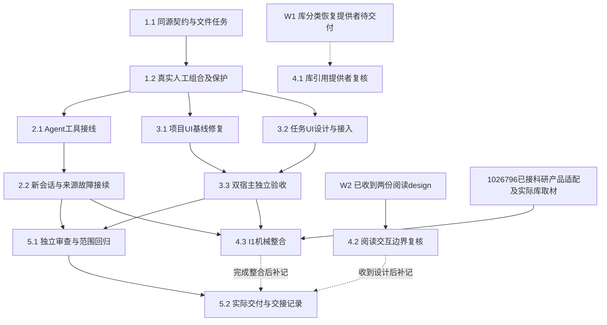

# 执行任务

2026-10-27本轮共同HEAD为4b13183f7489d3cae12fd0a7d1a9e83fb33d7384；主线round6验收／同步及本树构建复验已完成。沿已接收I1、M2和通用worker TaskPort，核对4.4c及当前来源身份，轻量修正project-backend旧CI夹具；不再应用旧补丁或等同步。仅改所属任务／交付、必要事实源及测试；不改生产Manual／Kernel装配、runtime／生态、来源hook或资格提供者。历史第8组保留，当前切片归第9组。

图中W1的完整库分类／恢复继续开放，不阻塞已有材料实际读取的I1机械组合；资料到达和静态核对不代替实际接入。本图仅表示交付依赖，不安排其他工作树执行。当前第8组记录正式源码上的真实组合，历史验证仍保留在同一delivery。

## 1. 无模型的文件任务闭环

- [x] 1.1 在 `task-contracts.ts` 定义并导出入口元信息、TaskRef及tasks.list/read/create/save同源声明，实现projects内ProjectTasks并复用原目录、强读取和创建／保存。以 `tests/kernel/research-tasks.spec.ts` 的真实临时文件／容器验证缺目录空查询、创建后重读／重启、扫描数分页、损坏／超限／未知格式、重复ID不自动选中、工作项导航及依赖检查；普通正文不作固定标题门禁。声明、必要聚合和生成映射与实现同批闭合，无业务依赖新增。
- [x] 1.2 在ManualApplication注册实际提供者，完整宿主可消费同一窄Interface；创建核查沿原resources.creation且保持原可信创建主体。验证无harness人工组合、trusted／restricted与跨项目拒写、应用内改名、人工变更重读、任务旧身份／同内容替换拒绝、成果保存后入口关联冲突、原操作未知后查询只核查、恢复副本本地引用不回读原项目。复用project-files、resource-identity、resource-creation、manual-application既有用例，仅补任务参数传递及部分失败缺口；通过schema生成一致性、架构和相关类型检查，补开发说明的任务操作及诊断入口。

## 2. 真实Agent工具与接续

- [x] 2.1 注入当前项目任务窄端口，在独立task-tools及runtime安装点注册四个schema派生任务工具，并以read_task_creation薄工具暴露已有resources.creation原操作查询，沿原执行实例、ToolRecord、IPC与模型前授权；不修改Graph driver或harness运行权威。当前项目真实会话经受控模型创建／读／改任务，实际保存过程文件和成果并更新入口，原执行产物关联与任务文件关联分别核查；创建未知按原操作查询，不以失败重建任务。全局或其他项目不能经工具登记／修改目标。新增接口传播和受影响调用者类型检查通过。
- [x] 2.2 扩展work-materials既有真实harness样本：新会话先发现候选，再读入口、原比较理由、人工补充材料及实际成果，核对障碍和下一步后保存后续文件。另测来源读取失败后保留文件、原错误及分类提供者不可用，Agent提出选择并停止依赖工作，明确收到用户决定才继续；受控响应不替代任务正文或直接代写成果。覆盖关联失败后重读只补关联，不重复生成，测试结论只认机械接线和保存行为，不认科研质量或完整库恢复。

## 3. 任务工作台与相关CI基线

- [x] 3.1 作为可独立检查的公共测试增量，调整fixture.createSession的项目身份定位及受影响调用，修正file-workbench门控场景中点击／完成等待／release的顺序；明确同名项目、实际选中会话及迟到创建的断言。先实跑相关双宿主场景，区分测试问题与剩余产品问题，不用 `.first()` 或延长测试／生产超时使其通过。无服务授权或运行时缺失时保持未完成，不安装。
- [x] 3.2 先更新UI设计右区任务／中间详情小节，再实现TaskList／TaskDetail／TaskPanel／有界use-tasks及精确工作台挂载：右栏创建／选择／续页，中间入口与工作项导航，共同编辑与资源打开，显式附加进入现有composer。按projectId／taskId／fileId保留tab及文件草稿，当前视图贡献沿原context端口；旧占位行删除，demo与类型随真实接口调整，样式只用既有语义token。关联仅存引用字段，共同正文有草稿时先保存再关联，不新增第二份正文或私有发送机制。
- [x] 3.3 在隔离端口5721（运行前核对占用）、配置／项目／库／输出下，经Browser和真实Electron用户入口验证创建、详情、编辑持久化、关联资源、键盘、有界分页、人工文件变化重读、同名项目及切换／刷新／迟到回执保护、任务附加不改变接收者。复用file-workbench／resource-opening／context-bridge受影响场景；先完成构建再跑UI，期间不重建。当前任务文件和持久结果来自真实内部提供者，外部模型可受控，结束只收尾本轮执行。

## 4. 跨线输入与真实整合

- [ ] 4.1 【原值来源身份已有，完整库分类／恢复仍开放】固定Zotero10.0.5调查已收到；当前library.createSourceInstance、record／commitRecords／recordHistory及sourceInstances／originalRecords已提供原值来源身份{instanceId,libraryLocator,objectKey}。它不替代任务材料attachmentId／materialVersionId，不新增TaskLink union。题录／附件完整删除记录与恢复分类、主题／分析知识及其项目侧消费仍待正式契约和真实验收；不将notFound当删除或已查询无历史，也不以源key重现判定恢复。
- [x] 4.2 【W2设计复核完成】分别读取用户快照中 `add-material-annotation-interactions/design.md` 与 `add-interactive-research-reports/design.md`，核对资源ref／basis、context、共同composer及正文保存触点。结论及精确路径见design第7节；不接管批注／报告协议，不合并两个change，不将设计到达称为实现接入。
- [x] 4.3 【I1机械整合】在1026796正式源码上由任务详情经默认broker调用科研所属human→host适配，真实库／项目／固定worker／仓储完成首次成果、过程指针、条件关联与新会话文件接续。第8组及delivery记录实际双宿主和故障证据；校准图仅构造注入，生产目录继续空，不验科研综合质量或W1整体恢复。
- [x] 4.4a 【任务契约正式交接及静态消费核对】以主线快照的本线task-contracts.ts／projects.ts正式交接tasks四操作、TaskRef三元组、可选workItemId、入口Evidence和部分关联语义。逐份核对科研、Agent、计算design及实际DTO：均可消费材料Evidence，但尚无完整任务字段；程序不要求绑定任务，session成果association不等于task links。
- [x] 4.4b 【科研实际消费】项目侧重读TaskRef／workItemId，保存原入口输入并派生Evidence；默认端口经科研实际适配启动及查询，process记录原调用与快照，科研schema不加任务字段或run镜像。实际worker和新会话工具核对已保存文件，程序仍无需任务。
- [x] 4.4c 【项目侧可选委派消费】当前真实TaskPort已支持父read任务取得入口Evidence交通用子worker，子按原材料和输出授权实际保存，父重读入口后save关联result/workItemId；delegation-task-port四场景及主线round6实际证据核对完成，不新增委派TaskRef DTO或第二套任务权威。计算首批仍可无任务；科研角色／标准／质量及完整I3归所属方开放。

## 5. 整合与交付

- [x] 5.1 对任务契约、实际条件保存／跨项目权限、原创建主体与部分关联安排独立审查，直接提供原决议、delta、代码及运行证据，不先给结论。按design运行最小必要协议／架构／类型／构建、定向kernel及双宿主检查，修复已确认回归；整体CI未实跑或未诊断失败逐项保留，不能宣称全仓绿色。核对文档运行入口与实际结果，正式规格同步／归档后再以链接替换相应初设正文。
- [x] 5.2 实际执行或交接后运行 `openspec instructions delivery --change establish-file-backed-research-tasks --json`，按实际成果填写同一delivery.md，列明完成判据、真实／替身边界、验证命令／结果、独立审查、失败与未完成前置，再更新本项。核心可交接而4组未完成时明确是局部交付，不能归档整个change。规划期间不创建delivery；Git操作和真实用户数据仍需单独授权。

## 续做入口

续做先读specs、design第8–9节及delivery最新节，对照代码和任务继续。公共同步、I1和项目侧通用worker任务消费已有证据；第7组保留历史注入端口结果。4.1完整库分类／恢复仍开放，原值来源身份已存在；不重新应用旧/tmp补丁或等待已经收到的提供者。科研角色和质量不由项目侧机械闭环关闭。

## 6. 主线第二阶段公共对接准备

- [x] 6.1 拆出不依赖任务的resource-contracts叶schema补丁；对共同基线protocol独立构建、三种入口导入顺序、原schema／操作／格式及Ajv／重导出身份核对，通过原真实资源行为定向14例。补丁不含image；阅读后续更新同一叶模块。
- [x] 6.2 准备保留openWorkbenchWindow和createSession(projectId)的准确组合补丁；保留原下载／目录选择／desktop映射，不覆盖整文件。临时组合夹具类型检查及真实Browser／Electron两窗口同名项目回归2/2通过。
- [x] 6.3 2026-10-25创建M2独立规划 `establish-trusted-file-edit-origins`，完成proposal／investigation／delta specs／design／tasks，明确CallContext事实、IPC精确来源缺口及保存／undo／有界查询。当时止于实施前；后续D1–D3已由用户确认，实际实施与delivery由该独立change承接。
- [x] 6.4 基于科研实际graph目录／调用／查询和固定worker，提出I1用户入口选项及真实组合、部分保存／任务关联冲突、新会话续接验收方案；生产目录仍空，D-I1与dev接入前停止，不实现后置综合Graph。
- [x] 6.5 【同步门已具备】主线已同步到77cd078，git确认0519904／b838402祖先；恢复前clean及共享／桌面／宿主构建、类型／架构／映射、内核16+4与双宿主等证据见`/tmp/scholoom-sync-recovery-wyn13R/recovery.md`、`synchronized.json`和本树日志。资源叶schema／执行历史／v6迁移／双窗口及图片叶模块保留；D1–D3及任务详情单入口已确认。该项只关闭公共消费同步门，不证明真实I1。

## 7. 已同步后的任务科研图局部切片

- [x] 7.1 实现task-graph-contracts同源声明及映射、TaskGraphs与Manual／Kernel薄注入；服务端从TaskRef／入口basis／workItemId／sourceLinkIds派生实际Evidence，保留人工身份，由科研所属端口启动。先保存调用指针process材料，再条件关联入口；分别返回call、资源创建和任务关联结果。真实项目／库／broker及注入科研端口定向通过，不增科研任务字段或run状态镜像。
- [x] 7.2 既有任务详情接入单一运行动作，按需分页目录、工作项来源及配置；未保存正文拒绝启动，全请求及未知／部分结果跨切换刷新保留，完整确认后才允许独立新调用。先构建后双宿主8项原任务／空目录／草稿和4项注入科研端口的来源选择／过程指针／关联冲突均通过；首次测试夹具失败及替身边界见delivery，不称真实I1。
- [x] 7.3 独立审查取材和部分保存，修复科研回执额外project/session覆盖并以两例回归闭合；相关构建／类型／架构／8份生成映射／OpenSpec／diff检查通过，更新原delivery并按符号交M2公共和I1独立补丁。4组实际提供者及整合仍开放，到本轮边界停止。

## 8. 共同基线上的真实I1机械组合

- [x] 8.1 Manual保留独立／显式注入，Kernel默认TaskResearchPort经broker消费research.graphs/requestGraph，保留原human/project/session及授权／去重；仅补真实architecture消费，先构建后用实际提供者核对。
- [x] 8.2 从任务详情启动静态注入的真实固定图，真实库／项目／worker保存成果、process指针和任务条件关联；核对入口版本交错、错误主体／撤权／忙与等待／容量拒绝、unknown与部分关联。内部不使用synthetic runId替身，首次失败保留，不降低版本或停止保护。
- [x] 8.2a 用户已选独立调用输入快照：先记录原TaskRef／basis及正文和来源指针，再以快照Evidence启动；创建unknown不启动，过程指针保存快照引用，可选inputSnapshot沿同源结果／UI传播。保护快照只作历史输入、库正文不复制，以及原稳定请求和部分失败语义；用已复现的真实worker红例验闭合。
- [x] 8.3 新会话从实际任务／过程／成果读取下一步，外部模型可受控；必要双宿主及原边界回归、独立审查、类型／架构／生成／OpenSpec／diff检查完成后更新原delivery，交有界补丁并停止。新增产品／跨域契约选择带证据返回，受阻分支不假闭合。

## 9. 共同整合后的任务消费与后端CI夹具

- [x] 9.1 保留6b22d60／40315429083的Linux／Windows两项project-backend失败及本树固定红例，按当前完整执行来源契约修正测试内资格seam。broker、FileEdit来源及项目锁／CAS／最终授权真实，Manual生产不装harness或默认human；保护等待撤权拒绝、人工访问和无关目录改名。先build后原两例及相关后端／任务／真实worker边界最小回归，记录首次失败、最终结果和Linux以外未复验范围，再更新同一delivery并交有界增量后停止。

## 10. 有界窗口观察片

- [x] 10.1 沿design第10节新增按需uiRpc fixture与窄窗口观察helper，白名单投影当前真实uiPage的发送／受理／快照身份与时点；固定队列／字段／关联上限、丢弃和缺证计数，不采正文／token／原始通用帧，不包装或重放业务发送。两指定file-workbench场景在原清理前幂等冻结附件，保留原helper和业务行为，完成安全／故障模块自检及类型／lint检查。
- [x] 10.2 复用已构建静态产品，在独立缓存根／TMPDIR下仅运行resident project sessions场景最小双宿主一次；保持原断言和期限，核真实点击、请求／回执／快照映射及失败时安全附件，原失败照实交回。记录CI目标一次状态、模拟边界、首次／最终结果和原delivery，交独立增量后停止；不由诊断片关闭业务CI或4.1。
