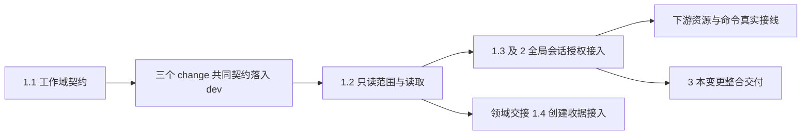

# 执行任务

本变更先交付 1.1 的共同契约，另外两线相应契约接入 dev 后，三线并行实施。工作域实际授权是下游真实接线的前置，不是其独立实现的整项前置。文件归属及跨 change 任务依赖见[公共基础实施规划](../../../.scratch/domain-development/public-foundation-plan.md)。本次执行者负责自身接入与验证，真实整合另行指定当次负责人；按完整完成依据勾选任务，已实施增量及未完成条件见 delivery。

## 1. 可信工作域及目标只读端口

- [x] 1.1 在 protocol 声明 WorkDomain 和 project.readTarget 的判别式输入输出，复用原身份／basis；按共享归属合并可信范围和来源字段，生成映射并验证载荷及范围外调用不相容。将契约独立接入 dev，通过架构与类型检查；另外两线共同契约及普通会话回归齐备后，既有开发树同步该基线，新工作树从该基线创建。
- [ ] 1.2 在 projects 内实现只读访问范围和已登记文件的分页／描述／文本及字节读取；不调用会登记身份或写缓存的路径，未登记身份明确不可用。扩展现有项目测试核对路径、内容依据和目标零写入；将 store/files 增量独立接入 dev，供领域交接 1.4 同步后修改创建分支。
- [x] 1.3 在宿主注册提供者、消费范围及有效执行资格，来源身份随异步过程保留；扩展 project-backend／harness-module 测试，验证嵌套调用不能扩大为目标写权限。

## 2. 全局会话与现有组合接入

- [x] 2.1 Harness 暴露工作域说明及目标只读工具，复用现有 sessionScratch，保留 application 普通文件接口拒写；两个全局会话同名临时文件互不可见。
- [ ] 2.2 各片读取及交付前重新检查目标信任和当前实例；测试排队撤权、在途撤权、旧实例迟到及目标变更，保留原成果和结构化失败。将 1.2、1.3、2.1、2.2 对应实际能力及验证接入 dev，记录交接，供另外两线真实资源／授权路径使用，不等待本 change 所有任务完成。
- [x] 2.3 回归本项目条件保存、人工无 harness 组合、application 会话创建和 scratch 缺失接续，证明新增只读没有放宽原保护。

## 3. 整合与交付

- [x] 3.1 执行 pnpm generate:contracts、pnpm check:architecture、pnpm typecheck 和 pnpm build；修正实际调用方、注册与声明的不一致。
- [x] 3.2 运行相关内核用例：tests/kernel/project-backend.spec.ts、checkpoint-files.spec.ts、harness-module.spec.ts、sessions.spec.ts 及新增工作域行为用例。真实 broker、文件和持久仓储不可替换；模型边界可使用受控响应。
- [x] 3.3 在隔离配置、库和两个项目中，经实际会话入口验证目标只读及拒写，核对目标文件／记录无此次读取造成的持久修改；数据及进程只按本轮归属收尾。
- [x] 3.4 更新 docs/development.md 的全局工作域、独立端口及诊断入口；实施后安排权限与异步范围的独立审查，修复实际发现。
- [ ] 3.5 根据实际执行结果取得 delivery instructions 并填写 delivery.md，逐项核对完成判据、验证和未完成事项，再更新本项状态。

## 续做入口

执行 `openspec instructions apply --change establish-scoped-execution-foundation --json`，读取现有工件；若已有 delivery，先核对其实际结果。按公共规划检查共同契约及本次增量的 dev 基线，其他两线消费实际已验证增量。规划完成不表示已获业务实施或特殊操作授权。
