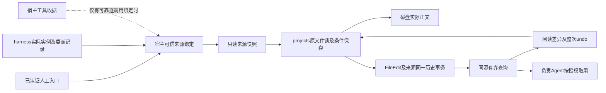
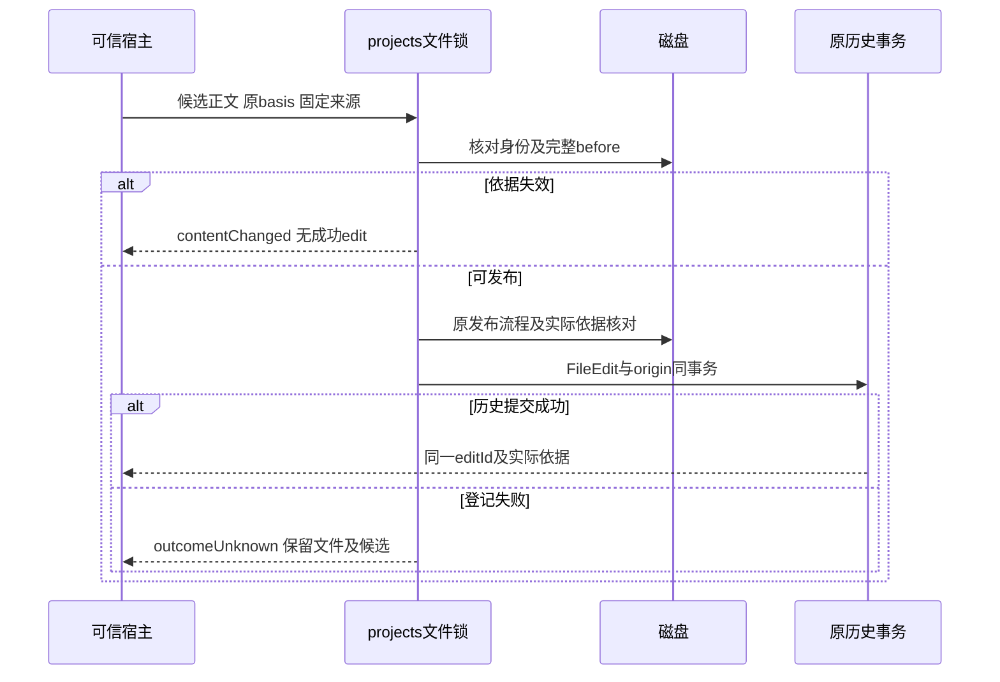

# 实现设计

## 变更总览

本文件为M2实施设计。2026-10-26用户关闭D1–D3并恢复本线实施：粗粒度可信来源、原整次FileEdit撤销、有界changes／edit与editId。HEAD77cd078已含0519904，来源见`/tmp/scholoom-sync-recovery-wyn13R/recovery.md`。复用projects保存模块和既有收据，精确工具token不实施。

本次cb5f7ed已接入真实执行／委派事实、MaterialChangeView及Agent历史工具，不再等待提供者同步。3.3沿既有execution-facts与material-delegation-history验证实际子worker创建、父worker读取并修改同一fileId、可信委派链／前后Evidence、人工重叠拒绝、整次undo和原会话随后get_file_changes/read_file_edit/read_file读回；只有外部模型响应受控。未知指令／工具及修改理由仍按原来源契约显示未知，不新增精确token，也不以负责Agent可查询冒充已消费。

### 已确认范围

| 决策 | 推荐及依据 | 替代／影响 |
| --- | --- | --- |
| D1 来源精度 | 先落可证明的principal、session/run/instance及已核实委派链；instructionContext和tool明确unknown。现CallContext支持这些事实，不能假定ALS跨IPC有效 | 若M2首批必须精确到工具：先独立交付宿主令牌作用域，绑定实际worker、实例、宿主收据和有效输入范围，再传递。增加跨进程并发／重放验证；不能直接把模型toolCallId写进CallContext |
| D2 局部undo粒度 | 采用既有“一次完整FileEdit”；保护完整after，新增revertsEditId | 差异块／选区撤销涉及映射、重复片段与重叠编辑，是新产品范围，另立设计后实施；不将其伪装成本次既有undo |
| D3 查询及资源结果 | 采纳下述两个窄读取操作和项目资源结果的可选editId；manual resources.save继续返回原descriptor，可按实际输出依据核查所属修改 | 只扩FileEdit／原files.history也可先展示来源，但现路径式最近20条全文不支持可靠游标和缺口诊断，不能据此宣称负责Agent已取得完整变化 |

D1采用粗粒度方案，D2采用整次编辑，D3采用有界查询和明确editId，均由本轮用户指令确认。下面字段在实施中按同源schema收敛；消费者是否已接入仍据实际结果判断。

## 方案与接口

### 来源与身份单一事实源

声明集中在`protocol/src/project-file-contracts.ts`，从同一schema派生FileEdit及窄端口。所有字段只增加到结果／内部可信绑定，不加入普通公开保存参数：

| 候选字段 | 精确语义及提供者 |
| --- | --- |
| `FileEdit.origin?` | 缺省表示旧记录无法证明来源；不迁移猜测。新记录为下述human／system／execution／unknown之一 |
| human | `{kind:'human',projectId,moduleId,principal:{kind:'human',id}}`，只由宿主实际调用身份建立；连接身份不等于自然人实名 |
| system | `{kind:'system',projectId,moduleId,principal:{kind:'system',id}}`，内部适配已证明来源；外部程序改文件不能被自动标system |
| execution | `{kind:'execution',projectId,moduleId,principal:{kind:'agent',id},sessionId,runId,instanceId,instructionContext,tool,delegation?}`。runId按现有含义记录，绝不由它推断实际父／子写入者 |
| instructionContext | `{state:'observed',instructionIds:[...]}`或`{state:'unknown',reason:'notCaptured'|'recordUnavailable'}`；observed仅代表宿主确证交付给该推进的集合，不是因果或理由。最多100项，不从batch选一条。没有逐调用快照时为unknown，不能默认拿整个run当前集合 |
| tool | 仅`{state:'unknown',reason:'notBound'|'notToolOperation'|'recordUnavailable'}`。精确作用域未实施，schema不接受verified／任意toolCallId |
| delegation | 可选`{delegationId,parentInstanceId,parentRunId}`，宿主按childInstanceId核对实际delegations记录；child的session/run与父相同并不丢失child实例 |
| unknown | `{kind:'unknown',reason}`，包括无法建立来源的内部保存；reason为结构化枚举，不用模型生成说明补证 |
| `beforeEvidence?`、`afterEvidence?` | 原读取／实际发布后取得的ResourceEvidence；新建没有before，删除式创建撤销没有after。FileEdit.basis目前是byteBasis，不能直接转换为ResourceEvidence.basis；由所属文件实际stat取得后者 |
| `revertsEditId?` | 只在一次实际撤销成功的新edit上记录原editId；原edit不改来源 |

来源证明的是系统动作，不证明科研结论正确、全部因果或模型解释可靠。工具理由沿实际指令／ToolRecord按需读取；没有记录时明确缺失，不新增“修改理由”生成器。

### 可信绑定与跨进程边界

宿主在ManualApplication／KernelApplication的已验证CallContext处建立只读Origin，并在所属保存被受理时固定；projects独立组合只消费显式窄Origin参数，不依赖harness数据库。产品请求不能自行声明来源，执行上下文仍须核对项目、有效实例和信任。Kernel可注入可信`fileExecutionFacts`，核对project/session/run/instance完全一致后保留提供者的指令集合／委派链；本树尚无Agent私有委派提供者装配，默认instruction unknown且不补造delegation。绑定夹具只验seam，不称真实委派接入。

如果选择D1精确分支：宿主工具中间件为已登记收据分配不透明作用域令牌；worker仅在该工具的异步链中转发令牌，新的execution.call在宿主核对实例、收据、仍有效的作用域及操作后还原来源。并发工具使用不同作用域，不能用进程全局“当前工具”。接收普通客户端origin、同run猜tool、把worker token直接当可信收据、在RPC结果回调补来源均不成立。作用域绑定尚无现成生产实现，需单独协议审查；未绑定请求只能记录粗粒度执行事实与unknown工具。

保存已经受理时保留原来源快照；取消或后续新指令不改写它，授权／发布仍沿既有保证。重放原创建仅返回原记录，不产生新的作者。

### 保存临界区及部分失败

在`ProjectStore.save`原`ProjectFiles.coordinate`临界区中，先按原basis核对身份和整份正文，再形成editId、原始origin和beforeEvidence；发布文件后核对实际身份／依据，将afterEvidence和origin与before／after在现有edits事务一起写入。没有第二份来源表，不在harness成功回调晚补。task.save、resources.save及project.saveFile必须到达同一入口；原创建prepare保存原edit，再由inspect确认，不能改成查收据者来源。

沿#13不为普通改稿建立通用持久事务状态机。文件已落盘但历史失败时，现有候选和实际内容可核查，**来源可能永久无法证明**；不伪造恢复。若主线要求每次失败也可恢复精确作者，须针对必要操作另审增强保存收据，不能悄悄扩大本方案。备份保留已存字段；独立恢复副本的当前文件ref重绑定到副本，但历史执行来源标明原项目，仅作历史引用，不因此获得原执行资格。

### 有界查询、结果传播及undo

- `files.changes({projectId,fileId,afterEditId?,cursor?,limit?})`默认25、上限100，返回`{changes,nextCursor?,coverage}`。changes为摘要`{editId,fileId,createdAt,origin?,beforeEvidence?,afterEvidence?,revertsEditId?}`。cursor／nextCursor为`{projectId,fileId,afterEditId?,anchor,fromEditId,throughEditId,beforeEditId}`：首次固定锚点状态、保留窗口最低记录及已登记上界，后续按新到旧续页。带cursor时schema禁止再次提供顶层afterEditId，锚点只取cursor；要改锚点必须不带cursor重新开窗。提供者核对所属项目／文件、上下界顺序及保留情况；即使through／before尚在，下界被裁剪也明确失效。开窗已缺失的锚点持续missing，可分页读取首屏固定范围；原matched锚点后续丢失则失效。不需要签名或新持久事务。
- coverage为`{anchor:'notRequested'|'matched'|'missing',retention:'pruned'|'unknown',current:'matchesLatest'|'changedOrUnrecorded'|'unavailable'}`。新历史裁剪时在同事务的既有meta中保存所属fileId的裁剪标记；旧记录无标记只能unknown。锚点缺失不猜从未发生还是已裁剪。current比较的是文件当前强依据和最新已登记afterEvidence；只说明保留的领域记录，不承诺枚举所有外部写入。无任何历史时仍核对实际文件并返回空摘要及未知覆盖。
- 候选`files.edit({projectId,fileId,editId})`返回单条原FileEdit，核对所属身份；正文仍受原大小及授权限制。实现前将上述分页窗口字段放入同一schema，并用旧history成本／裁剪行为核对，不新增无界全项目扫描。
- `files.save`原FileEdit直接带关联；执行`ResourceSaveResult`和已确认项目创建结果拟增可选`editId`，仅在所属登记确认后设置。`ResourceDescriptor`不加入编辑事件身份。旧结果缺省不可猜；人工resources.save调用方可按当前强afterEvidence从changes核对候选，再以files.edit取明确信息。
- `files.undo`保持现有editId整次语义；新增撤销origin及revertsEditId。锁内核对稳定fileId、完整after及已有byteBasis，再以当前强依据保护发布；内部单文件改名的ctime变化不会误阻止撤销，实体／内容变更仍拒绝。创建撤销同样核对，并将新历史与缺失身份同事务；移走文件后登记失败为outcomeUnknown。没有hunk参数，没有自动启动原Agent。
- 负责Agent通过新增只读工具消费当前授权项目的changes／edit，见到撤销后按实际用户新指令处理；未查询、已查询与实际采用不能混为一谈。本方案不持久化科研“已解决”状态，也不自动发送跨会话消息。子委派首批不开放任意文件历史；如确需读取，须沿精确材料版本和自身结果范围限制，不以同ref扩大授权。

## 文件变化

| 所属／候选文件 | 变更与复用 |
| --- | --- |
| projects协议：`project-file-contracts.ts`、`project-contracts.ts`、`projects.ts` | 唯一来源／结果声明、changes／edit窄查询、派生类型；保留原保存输入保护 |
| `packages/projects/src/store.ts`、`creations.ts` | 原保存／创建／undo临界区和已有历史事务记录来源及实际依据；有界查询，不建第二份正文／审查数据库 |
| kernel：`manual.ts`、`application.ts` | 根据可信CallContext与实际委派提供者绑定Origin；人和执行共用同一所属保存入口 |
| harness：`runtime.ts`、执行控制协议及`execution-driver.ts` | D1精确分支获批后才实现工具作用域；粗粒度分支只传可证明执行事实。与Agent增量按具体符号组合 |
| `resource-contracts.ts`、资源适配及harness结果接点 | 可选editId从原FileEdit一路保留；不改ResourceRef、不把association当修改来源 |
| 阅读消费：MaterialChangeView及其context端口 | 归阅读线在提供者同步后接入，不在本树复制其组件；只消费edit及原undo |
| `tests/kernel/project-files.spec.ts`、`resource-access.spec.ts`、`context-instructions.spec.ts`及必要小用例 | 扩展实际来源、部分失败、批量指令、子实例、并发及旧记录边界；不测大段提示语或内部调用顺序 |

## 验证与风险

最小样本：人工保存、真实worker粗粒度来源及下一条指令查询人工更改；可信提供者seam中的多指令集合／四元组不符；原创建查询不换来源；任务与资源保存沿同一记录；历史事务失败保留落盘文件且unknown；旧记录／裁剪／外部变更如实诊断；内部改名后整次undo及后续修改拒绝。实际命令、首次失败与最终结果以delivery为准。精确工具令牌和真实委派提供者没有上线验证。

只读来源不改变授权；涉及正文历史读取要复查项目及模型外发权限。保留原历史上限与单条正文界限，不因溯源保存全部模型输入或建立永久完整审计。独立审查直接核对实际回执、领域记录和保存故障，不以模型自述作预期。Linux本机通过不能替代三平台验收。

## 待办边界

D1–D3已确认，公共基线已同步；本轮交提供者局部闭环和独立补丁。M2不等于I5完成；阅读线后续消费、Agent真实委派／逐推进事实提供者、差异块撤销、科研意见状态机和完整历史审计均保留后续边界。schema ready不代表真实跨域验收。
