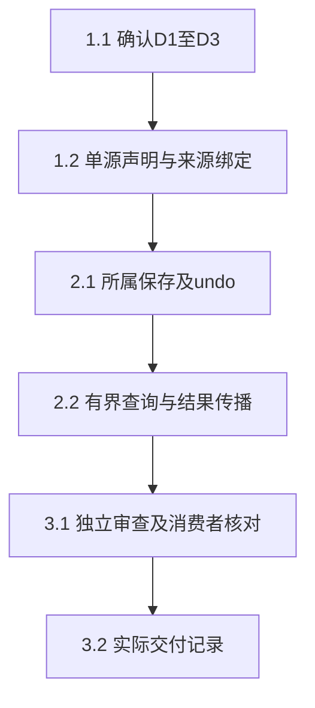

# 执行任务

2026-10-26恢复实施。用户已确认D1粗粒度可信来源、D2原整次编辑撤销、D3有界查询／editId。当前HEAD77cd078包含0519904／b838402，恢复验收见`/tmp/scholoom-sync-recovery-wyn13R/recovery.md`；既有成果均保留。精确工具token后续，实际结果写delivery；不把本线局部闭环称为阅读I5或真实委派已接入。

## 1. 明确公共范围与可信输入

- [x] 1.1 用户及恢复指令已确认D1–D3，采用粗粒度可信来源、原整次编辑undo及有界changes／edit和editId；git确认公共0519904祖先，精确工具作用域明确另列后续，不用自报字段替代。
- [x] 1.2 在project-file-contracts定义唯一Origin／查询／结果schema和派生类型；宿主绑定真实人工／系统／活动执行事实及核对四元组的可信提供者seam。多指令保留可证明集合或unknown；普通参数拒绝自报，tool只接受unknown。真实worker及绑定夹具验证通过，夹具委派事实不计实际Agent提供者已接入；精确token分支留后续。

## 2. 文件权威内独立交付

- [x] 2.1 在原store.save、创建prepare／inspect和undo临界区记录来源及实际before／after依据，和FileEdit同事务。验证冲突无成功edit、历史登记失败保留实际文件且unknown、旧创建查询不改来源、旧历史不补作者；安全undo产生新edit及revertsEditId，后续内容变化拒绝覆盖，正常内部改名仍可撤销。创建撤销登记失败同样outcomeUnknown；未新增通用持久事务框架。
- [x] 2.2 实现files.changes／files.edit及窄消费端口，固定分页上界、所属fileId、首屏上下界／锚点状态；缺锚仍可读固定范围，下界裁剪使旧游标失效，列表无全文。项目资源结果可选editId沿实际FileEdit传播，保留association。裁剪续页、并发新保存、同路径新实体、旧结果及真实Agent下一指令读取人工更改通过；子实例历史入口保守拒绝，不自动唤醒。

## 3. 整合与交接

- [x] 3.1 构建后运行定向kernel、schema／架构／类型检查及独立审查；重命名undo、无锚窗口裁剪及缺锚续页三项P2已静态复核并由53/53覆盖，资源保存association失败及editId／来源另10/10通过。工具结果、领域历史及故障分别核对，不以模型说明证明修改原因。
- [x] 3.2 实际执行后已取delivery instructions，记录成果、同步事实、首次失败、审查与未验证边界；交独立公共补丁并验证适用性，未入dev的本轮M2增量不称消费者已同步，不归档。
- [ ] 3.3 【外部实际提供者／消费者未接入】Agent提供真实逐推进指令／委派事实，阅读线同步后消费MaterialChangeView并真实验整次undo／覆盖缺口；不复制其私有实现，不将绑定夹具当实际委派，I5另留真实整合记录。精确工具token另立后续范围。

## 续做入口

从当前已同步正式源码继续apply；不再复制旧/tmp组合或等待公共同步。精确工具作用域、阅读消费和真实跨域验收分别保留边界；完成本线闭环及补丁后停。
