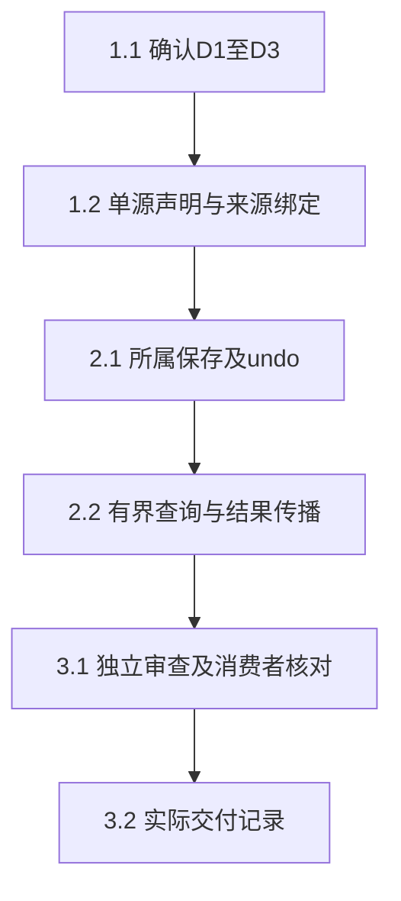

# 执行任务

本轮止于待审规划，以下均未实施。D1–D3是已识别的主线决定，不因CLI ready而消失；先确认采用范围，再依实际共同基线更新本清单和精确schema。没有delivery。

## 1. 明确公共范围与可信输入

- [ ] 1.1 主线审查design的D1–D3，确认粗粒度来源或精确工具作用域、整次编辑undo及新增读取／editId范围；记录明确选择。精确分支先取得Agent对宿主作用域跨双向IPC的确认与公共增量接入，不用自报字段替代。未确认停止该分支，不写业务来源字段。
- [ ] 1.2 按确认方案在project-file-contracts定义唯一Origin／查询／结果schema和派生类型；宿主根据真实人工／系统／执行／委派事实构建只读来源。多指令保留可证明集合或unknown，子run／instance不混同。沿已有类型／schema守卫验证自报来源拒绝；精确分支另测两个并发工具、跨实例、过期和重放令牌，工具作用域不靠同进程ALS结论。

## 2. 文件权威内独立交付

- [ ] 2.1 在原store.save、创建prepare／inspect和undo临界区记录来源及实际before／after依据，和FileEdit同事务。扩展project-files／resource-creation已有用例，验证冲突无成功edit、历史登记失败保留实际文件且unknown、旧创建查询不改来源、旧历史不补作者；安全undo产生新edit及revertsEditId，后续内容变化拒绝覆盖。不得为普通改稿新增通用持久事务框架。
- [ ] 2.2 实现files.changes／files.edit及窄消费端口，固定分页上界、校验所属fileId、锚点缺失与裁剪／未登记变化诊断，列表不带所有正文。将已确认项目资源结果的可选editId沿实际FileEdit传播，保留原association语义。实际测试裁剪续页、并发新保存、同路径新实体和旧结果；子委派不能沿同fileId读取越权版本，负责Agent工具只读不自动唤醒。

## 3. 整合与交接

- [ ] 3.1 先完成相关构建，再运行定向kernel、schema／架构／类型检查和独立审查；确认M2消费者的MaterialChangeView经同步后只展示实际来源、整次undo及覆盖缺口。阅读线实际接入与I5另留真实整合记录，不拷其私有实现。工具结果、领域历史及故障分别核对，不以模型说明证明修改原因。
- [ ] 3.2 只有实际执行后才取delivery instructions并记录成果／未验证边界及D1–D3选择。主线尚未确认或公共增量未入dev时保持未完成；不因规划齐备归档或传播来源字段。

## 续做入口

先读investigation及design决策表，拿到主线范围选择和实际公共接入基线后再apply。现有文件任务核心change独立保留，不把本规划存在写成M2提供者已就绪。
