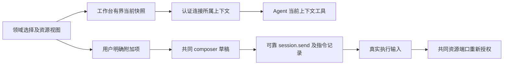
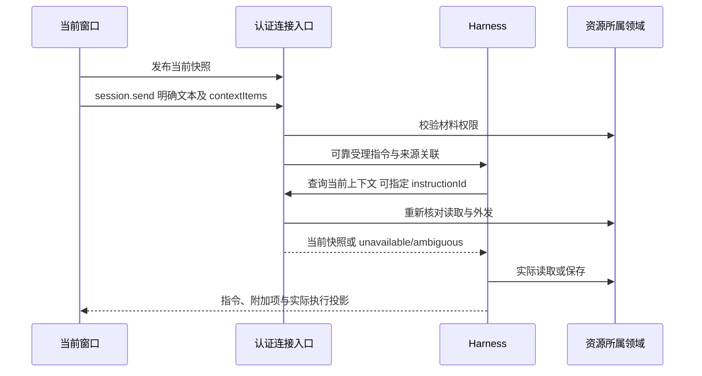

# 实现设计

## 变更总览

独立实现依赖工作域及资源证据等共同契约先落入 dev，真实资源与授权接线再等待对应实现增量，不等待另外两个 change 整项交付。领域UI完整行为由七域各自实现，本变更交付共同贡献入口、真实文本选择接入及固定领域提供者验证。

## 并行边界

1.1 在共同契约阶段交付 workbench-context、指令来源、contextItems 及执行输入扩展，与领域交接线的图等待／恢复字段一起核对，并统一将产品协议升至 4；内核、客户端、worker 同步，旧消息按可选字段读取，原会话回归通过。工作域、资源及图声明只引用提供线的同源契约，不重复定义。三线随后同步 dev 基线并行实施，完整文件归属与交接见[公共基础实施规划](../../../.scratch/domain-development/public-foundation-plan.md)。

本线独立实现认证连接、当前快照、来源记录、显式项、草稿及 UI 贡献；资源／授权提供者未就绪时以明确契约替身验证自身模块，不据此宣称外发授权或最终整合通过。2.2、3.2 的真实权限验证等待工作域对应授权增量和领域交接 1.2 的资源适配；不依赖整个 Graph 或命令实现。

涉及通用图 driver 提取的同一执行代码块，先同步领域交接 2.2；扩展共用 UI fixture 及已改造用例，先同步领域交接 4.1 的 URL 增量。其他模块继续独立推进。4.5 承接三个 change 的 dev 真实组合验收，等待实际所需能力及各自验证；当次指定整合负责人，不建立常驻协调 Agent，也不承接其他线的模块交付。

## 方案与接口

### 共同契约落点

纯声明位于 `workbench-context-contracts.ts`，派生映射由现有生成器输出 `workbench-context-types.ts`，`workbench-context.ts` 导出类型及共同校验入口。`workbench-source.ts` 只声明宿主绑定的连接来源，供 CallContext 引用，避免 core 与运行校验入口互相依赖。

快照以 receiver（项目／会话或 null）、viewId、selectedItems 与 selections 表达；null 快照表示清空。显式项复用资源引用和 basis，text 使用 quote／contentState，region 使用归一化矩形，object 使用 providerId／objectId／name／semantics。接入者使用 isContextItems／isWorkbenchContextSnapshot 同时检查 schema、64 KiB UTF-8 总量、重复 itemId 和矩形范围；单项摘录上限 8192 UTF-16 单元，批注上限 4096。

产品 publish 声明不接收可信 connectionId；内部 read 只接受可选 instructionId，返回 available、unavailable 原因或 ambiguous 指令引用。session.send、持久消息和执行初始化已声明可选上下文项／来源，旧字段继续可读。实际 Agent 指令由 execution.beforeModel 的结构化 instructions 更新进入 worker 状态及 checkpoint；初始化非空 instructions 在注册图及 Agent 分支前拒绝，直到对应初始化消费链路接线。生产非空 contextItems 及含资源的快照查询在统一资源适配就绪前明确不可用；隔离替身验证可靠受理、执行传递与模型前权限复查，不代表真实资源交付。

### 连接身份与实时快照

新增 `workbench.context.publish` 和内部 `workbench.context.read`，声明集中在 protocol/workbench-context，实际 schema 同源生成。宿主在 socket 认证完成后创建自己的连接身份，并提供有生命周期的 product 调用端口；页面不发送可信 connectionId。现有 `application.call` 继续用于 CLI／独立测试，表示没有工作台来源。

快照保存于宿主内存，按所属连接限定一份当前快照：revision、接收项目/会话、视图标识、已选条目身份、可用 ResourceEvidence、当次摘录或区域。revision 单调推进，旧更新忽略；最多 100 个条目、16 个资源选择，文字摘录单项 8192 UTF-16 单元、快照正文总量 64 KiB，超过直接报告容量问题，不静默改变选择语义。采用数据层贡献，不全库读取或跨 DOM 搜索。

只有该连接的发布可覆盖其快照。切换会话或撤权时发布清空／新范围；socket 断线或工作台销毁即移除快照。重连建立新身份，旧执行来源不自动重绑到新窗口；新指令可建立新关联。

session.send 在宿主受理时附加来源连接关联，不复制隐含选区。来源记录属于指令事实，执行工具按它读取当下快照。若一次推进包含来自不同窗口或无窗口的多个指令，工具返回 ambiguous 及相应指令引用，模型必须显式指定属于当前有效推进的 instructionId 或询问用户，不能选择最后活跃窗口。没有来源或来源不可用返回 unavailable；候选不能暴露其他会话正文。

查询快照前核对有效实例、指令归属及当前接收会话，再逐项核对项目／库的读取和外发权限，工具不得以“只是界面状态”绕过授权。查询所得选择仅是线索，是否为用户所指对象由 Agent 理解，不足时询问。

### 显式附加与持久指令

在 protocol/resources 复用前序 ResourceEvidence；显式项为判别类型 `resource|text|region|object`，包含本地 itemId、ref/basis、必要选择载荷和可选 comment。text 附摘录及 contentState（saved/draft）；region 为对该版本图片的归一化矩形；object 附提供者给出的名称／标识及有界语义资料，缺少语义时只能用 region。draft 摘录明确为用户草稿，不当作 basis 对应原文。每条指令最多 16 项，显式正文总量不超过 64 KiB，批注单项最多 4096 单元。

session.send 增加可选 contextItems，空缺表示旧指令。服务器在受理前核对项结构、资源归属及材料外发权限；可靠消息、pending 重试相等性及恢复结果包含完整 contextItems。模型前再次核对材料授权，队列期间撤权不能凭保存摘录继续外发。消息投影显示明确附加项，实际读取沿独立工具事实，不声称已读完整原文。

历史摘录保留发送时的 basis 和内容。恢复及模型外发复查当前身份和权限，实际重新取材才核对版本；不要求历史 basis 始终等于资源最新版本。已使用的引用随会话持久保存，因此工具结果、历史消息或摘要仍须通过当前读取／外发检查。无资源适配时不会以已保存摘录代替授权。

原材料路径与 materialFileIds 保留，避免强迫已有消息和已完成尝试迁移。新指令采用结构化项表达库材料和局部选择，不在 text 中拼接隐藏 JSON。IPC 两端及框架消息编码保留类型，SDK 内部适配集中在 harness。

### UI 贡献及草稿

在现有 WorkbenchSession 上增加选择贡献与 `appendContextItem` 窄入口，具体领域只提交自身对象的纯数据及释放动作。库导航、报告按钮及阅读器复用这一入口；发布选择不等于 append，更不自动发送。先以现有文本视图和固定区域提供者验证共同链路，图表精细命中及报告脚本运行由阅读交互线后续承接。

business-session 沿原 pending、instructionId、草稿和消息通道扩展，composer 提供可检查／移除的附加项，不新增发送控制器。草稿命名空间带稳定工作台实例、配置目录、项目及会话；工作台实例与临时连接身份分开，刷新可恢复原草稿。旧草稿保留，迁入新命名空间时只在目标为空且来源无歧义时复制；多个候选明确提供恢复选择，不覆盖或删除旧值。

持久化和恢复项需再次结构校验。发送期间后续添加项不被旧回执清除，切会话时只更新原指令。资源或报告变化只使当前内容可重新核查，已附加项保留原摘录和版本；不增加跨版本自动定位。

## 文件变化

| 文件范围 | 目的 |
| --- | --- |
| 新增 protocol/workbench-context.ts；修改 resources、harness、harness-record-contracts、execution-graph 及生成映射 | 快照、上下文项、来源关联和可靠指令的同源契约；旧消息字段可选 |
| kernel/server.ts、manual.ts、application.ts；新增连接所属 WorkbenchContextStore | 受认证生命周期管理及执行查询，维持 CLI 无窗口路径 |
| harness/runtime.ts、schema.ts、checkpoint 消费及 execution 消息适配 | 保存指令来源与显式项，按有效指令查询并在模型前重查权限；不以来源赋权 |
| desktop/workbench/session.ts、business-session.tsx、共同 composer 及 ResourceView 文本选择接入；新增有界上下文贡献模块 | 复用草稿、pending 和消息投影，支持显式附加与移除 |
| docs/ui-design/README.md、docs/development.md | 实施UI前落实控件、状态和访问名；保持三区及 dock/overlay，不新建布局 |
| tests/kernel/sessions.spec.ts、tests/types/contracts.ts、tests/ui/resource-lifecycle.spec.ts；必要新增 context 专项 | 多窗口、授权、幂等及跨进程实际材料，双宿主草稿保护 |

## 验证与风险

实际协议增加连接来源及指令上下文，内核、客户端与执行单元一起更新；将产品 protocolVersion 从 3 协同升至 4，旧运行实例不能混接新载荷。历史持久消息按可选字段读取，若领域 JSON 列需升级解析，迁移先备份、不改原消息正文。来源关联只能辅助诊断和临时查询，不是权限凭证；旧关联失效不能重新激活窗口。

最小验证包括协议生成、架构及类型检查，真实 WebSocket 两连接、受控模型查询调用、无界面显式材料路径、断线、窗口切换、不同来源追加、库外发撤回、同指令不同载荷拒绝及资源变化。扩展既有内核／双宿主UI用例，新测试只补相应行为缺口。观察真实消息记录、worker 输入及实际资源结果，不能仅断言 chip 文案。执行完记录真实接线、替身和平台范围。
