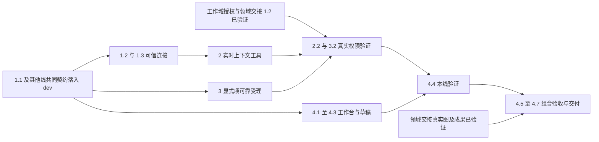

# 执行任务

1.1 与另外两线的共同契约先接入 dev，随后可并行实现连接、来源、显式项和 UI。2.2、3.2 的真实资源／授权路径等待工作域对应授权增量及领域交接 1.2，不等待两个 change 整项完成；4.5 的最终组合再汇合三线实际成果。共享文件归属和局部同步条件见[公共基础实施规划](../../../.scratch/domain-development/public-foundation-plan.md)，本次执行者负责本线接入及验证。

## 1. 同源契约与连接归属

- [x] 1.1 在 protocol 定义快照、显式上下文项、来源关联及有界 schema，消费工作域和资源证据声明，扩展 session.send、记录与执行输入并与图／等待字段合并；统一更新 protocolVersion=4、调用映射及内核／客户端／worker，增加类型反例和历史消息读取回归。契约独立接入 dev，通过生成、架构与类型检查及原会话回归；三线同步或从共同基线创建后并行实现，不等待另两项全部交付。
- [x] 1.2 在 server 认证后创建连接所属 product 端口及 WorkbenchContextStore，publish 只作用自身、revision 单调、断线释放；直接 application.call 保持无工作台来源，不能用普通参数声明可信窗口身份。
- [x] 1.3 扩展真实双 WebSocket 连接用例，检查同会话不同窗口、伪造来源、超量载荷、旧修订及断线后不可用；不以单个内存 Store 测试代替实际边界。

## 2. 实时上下文查询

- [x] 2.1 可靠保存每条指令的来源关联，将其传到有效执行；来源连接与临时快照不成为持久权限凭证。
- [ ] 2.2 新增 Agent 上下文工具，调用时读取合法当前快照并核对资源读取／外发；无来源、接收会话不匹配或已失效明确不可用，不自动固定发送时选择。独立模块可用声明过的替身开发，勾选前须在工作域授权和领域交接 1.2 资源适配接入 dev 后验证真实权限路径。
- [x] 2.3 多来源指令追加时返回歧义及当前指令引用，只有明确指定本推进内 instructionId 才可查询对应来源；用受控模型工具路径证明不选择最近窗口。

## 3. 显式材料可靠受理及执行

- [x] 3.1 contextItems 随 pending 及原 instructionId 保存，重试相等性包含完整载荷；同身份不同内容拒绝，原项目路径材料保持可用。
- [ ] 3.2 在实际消息／指令存储、checkpoint 注入、IPC 与 SDK 适配传递显式项；修改图 driver 提取的同一代码块前同步领域交接 2.2，其他部分可独立推进。实现模型前授权复查，工作域授权和领域交接 1.2 资源适配接入后，实测排队期间撤销库外发及目标信任，保存摘录不得绕过。
- [x] 3.3 扩展 sessions／harness 可靠指令测试，核对回执丢失、重启后补交、持久消息读回及实际 worker 输入，区分显式材料与实际读取事实。

## 4. 共同工作台、整合与交付

- [x] 4.1 先更新 docs/ui-design/README.md 的选择贡献、附加项及状态呈现，沿语义 token、现有布局和可访问名；不重建 composer 或总体工作台。
- [x] 4.2 WorkbenchSession 增加窄选择贡献及 appendContextItem，business-session 复用原草稿／pending；接入真实文本视图及固定区域／对象提供者，条目可检查移除，按钮动作只加入共同草稿。
- [x] 4.3 为稳定工作台实例隔离草稿命名空间，保留旧草稿及恢复选择；测试刷新、切会话、后续新增项及迟到回执，不能覆盖原窗口或另一个窗口的输入。
- [ ] 4.4 修改共用 UI fixture 或 URL 改造涉及用例前，先同步领域交接 4.1 的独立增量；运行 pnpm generate:contracts、pnpm check:architecture、pnpm typecheck、pnpm build 及相关会话、资源生命周期和上下文内核测试，双宿主验证实际选择、附加、发送、持久读回和资源重新取用。专用上下文及组件验证可先独立推进。
- [ ] 4.5 三线实际能力、必要验证和对应 dev 增量就绪后，由本项承接公共基础真实组合验收：全局会话取可信项目／库材料，工作台选择变化由工具读取，显式项可靠发送，固定图保存项目成果；拒写、撤权、断线及部分结果可诊断。开展前指定当次整合负责人及隔离配置，不建立常驻协调 Agent；全部公共基础验收后才启动七域。
- [ ] 4.6 对可信连接、模型外发、指令幂等和多窗口草稿安排独立审查，修复发现；更新 docs/development.md，记录七域选择／视图／工具接入示例及真实能力边界。
- [ ] 4.7 根据实际执行结果取得 delivery instructions 并填写 delivery.md，区分公共基础就绪与七域业务完成，记录平台及替身范围，再更新本项状态。

## 续做入口

核对共同契约与当前任务实际依赖增量的 delivery／dev 接入结果，再运行 `openspec instructions apply --change establish-workbench-context-bridge --json`，不以另外两个 change 整项交付作为独立任务启动条件。实际执行后更新 delivery；具体阅读图表命中、报告脚本、通用计算管理、库分析存储及业务 Graph 流程由所属领域继续。
