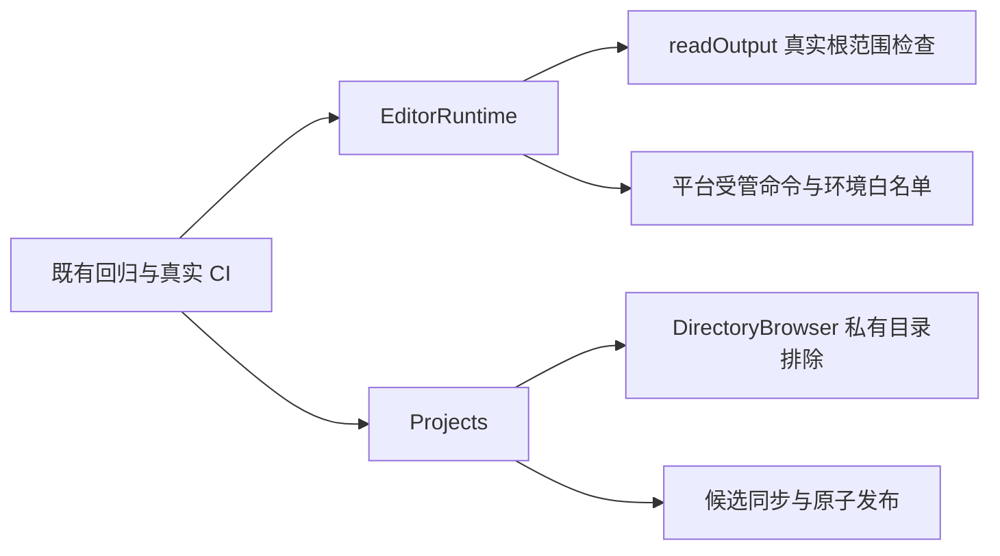

# 调查依据

## Windows 执行等待的定向诊断

2026-10-24，续做核对最终源码 `cb7eb06` 的 [CI 40060356348](https://github.com/leike0813/Scholoom/actions/runs/40060356348)：Windows 原生专项 16 通过／1 跳过，完整内核 385 通过／2 失败／12 跳过。最新 trace 显示 basis-upgrade 在首次指令的 5 秒等待内一直 queued；structure 从 queued 进入 running，5 秒内未完成。现有 trace 没有 worker、模型请求与工具阶段证据，不据此认定产品错误或测试期限错误。

本轮增加手动 Windows 定向 workflow：只构建共享模块，两个失败路径各独立重复 5 次，再检查开发宿主生命周期，无测试重试。沿原 5 秒完成断言记录有界状态采样、模型请求数、工具身份／状态及本会话进程实例；不记录正文、工具输入输出或凭据。诊断在测试清理前取得，HTML 报告保存成功样本及失败 trace；无需等待写作工具链或全仓测试。Linux 同入口两轮 4/4 通过，42.3 秒，尚不是 Windows 根因结论。

## 当前事实与复用选择

基线为远端 dev 23e68c8。最新 CI [39976414916](https://github.com/leike0813/Scholoom/actions/runs/39976414916) 的 Linux job 120492067017 为 380 通过、1 失败，仍是书目大小写；macOS job 120492067069 为 369 通过、12 失败，分别涉及产物别名根、书目大小写、监听注入路径、私有目录与重定位路径；Windows job 120492066674 为 320 通过、51 失败、12 既有跳过，耗时 41.6 分钟。Windows 除已定位的 ESM、别名、CMD、fsync 与移动问题外，包含执行状态等待超时，修复后须按实际结果逐项核对，不先归因于平台速度。PR #10 运行 39959929016 三平台日志保存在 `/tmp/scoped-r5-pr10-*.log`，最新日志在 `/tmp/scoped-r5-latest-{linux,mac,win}.log`。

- `editor/conversion.ts` 使用 Pandoc 的 bibtex reader。未保护的 `title={Independent Evidence}` 按 BibTeX 语义可调整大小写；实际命令在英文语言环境返回 Independent evidence，`title={{Independent Evidence}}` 返回原大小写。改夹具表达原有精确保留意图，原断言不变。
- `editor/resources.ts:readOutput` 把 realpath 后的目标与 resolve(root) 比较。真实合成目录经别名根读取得到 permissionDenied，直接根可读。应只规范化根，不放宽越界拒绝。
- `projects/directory-browser.ts` 使用未规范化 applicationDirectory 排除私有目录。合成别名根可稳定复现 profile 出现在列表；复用原 within，对两侧使用真实目录。
- `projects/store.ts` 创建候选已写完，但为同步使用只读句柄；Windows fsync 错误栈直接位于该行。改用 r+，同步、关闭、硬链接发布、原依据及未知效果不变。
- Windows Quarto 日志为执行 CMD 不存在；受管 Node 白名单没有 PATHEXT／ComSpec。应只增加这两个系统启动变量，不继承整个环境或凭据。
- 文件监听两项失败通过私有方法注入非规范化路径，而真实 watcher 使用 store.path 返回的路径。用实际订阅根注入，保留范围与溢出断言；重定位结果也按真实路径核对。
- 若子进程使用 fileURLToPath 结果拼 ESM import，Windows 将盘符误作 URL scheme。改用 file URL 字符串，文件系统参数仍是本机路径。

## 实验与承接

Linux 原有 editor-runtime 两项与目录浏览共 3/3 通过，说明普通路径测试漏掉别名根；新增测试须在真实 junction／symlink 根下验证合法读取及越界拒绝。目录浏览扩展同一测试，不复制领域实现。Windows fsync／重命名及命令环境必须经真实远端 CI；Linux 模拟不能记作 Windows 通过。项目移动遵循开发说明：Windows 移动前释放所属存储，不以忽略 EPERM 或扩大重试替代。

没有需要改变领域权威、协议或库 UI 的未决设计；保留真实平台诊断，对后续 CI 新失败按同一根因核查。

## Windows 后续实跑

同代码 `b894d01` 的 push CI [39981865053](https://github.com/leike0813/Scholoom/actions/runs/39981865053) 为 366 通过、6 失败、12 既有跳过；PR CI [39981909728](https://github.com/leike0813/Scholoom/actions/runs/39981909728) 为 340 通过、32 失败、12 既有跳过。`5245169` 的 [39986421464](https://github.com/leike0813/Scholoom/actions/runs/39986421464) 为 363 通过、9 失败、12 既有跳过。后者额外三项为执行状态等待及一个附件进程回归，其他多项在不同 runner 中出现短时间等待失败，不能用较少失败的运行替代另一份真实结果。

- fsync 的原 EPERM 已不再出现，创建及 Graph 相关多数回归恢复；Quarto 进入下一步后明确报告 `APPDATA` 缺失。核对本机同版本 `/opt/quarto/bin/quarto.js` 的 tinyTexInstallDir，Windows 确实要求 APPDATA，故仅补齐该系统变量。
- 目标移动仍 EPERM：project.close 仅关闭 project 存储，宿主另持 harness／research 句柄；测试准备须经既有 projectReplacing 释放这些句柄，并避免重开时再次操作已关闭仓储。
- history 缓存回归在 push 完成 31／66 轮、PR 完成 21／66 轮后碰到 60 秒总上限；每轮正常 render 有 9 次 privateDirectory，Windows 每次会启动 PowerShell 设置 ACL。full-cache 在第二轮或第16轮已经失败，远未达到64份；PR 日志明确给出最终收据 rename EPERM。记录读写未协调，毫秒级轮询与 rename 可在本进程交叠；尚不能排除外部扫描占用。实施实例内目录准备和身份核对、同路径记录读写协调，不加泛化重试、不放宽超时；失败时输出原 job 诊断供新一轮实跑核对。
