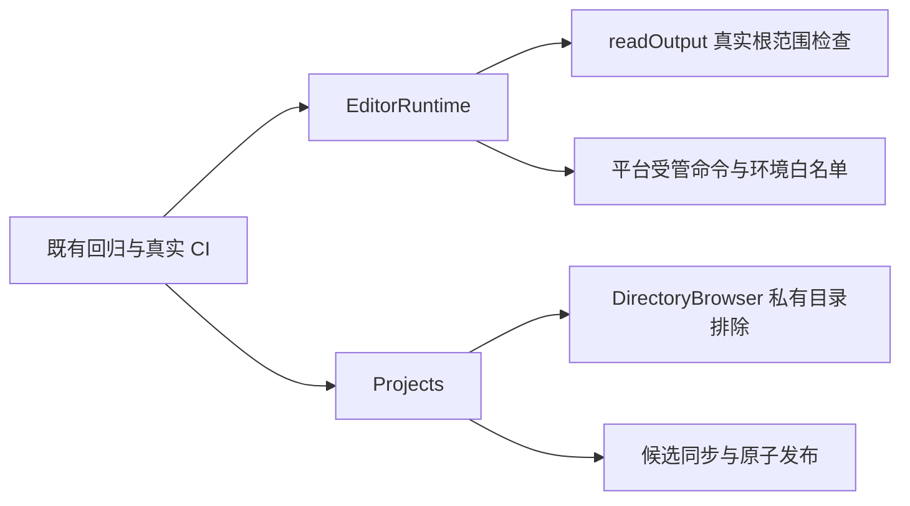

# 调查依据

## 当前事实与复用选择

基线为远端 dev 23e68c8。最新 CI [39976414916](https://github.com/leike0813/Scholoom/actions/runs/39976414916) 的 Linux job 120492067017 为 380 通过、1 失败，仍是书目大小写；macOS job 120492067069 为 369 通过、12 失败，分别涉及产物别名根、书目大小写、监听注入路径、私有目录与重定位路径。PR #10 运行 39959929016 三平台日志保存在 `/tmp/scoped-r5-pr10-*.log`，最新 Linux／macOS 在 `/tmp/scoped-r5-latest-{linux,mac}.log`。Windows 最新任务尚在运行，最终结果由 delivery 记录，不用旧日志冒充最新结果。

- `editor/conversion.ts` 使用 Pandoc 的 bibtex reader。未保护的 `title={Independent Evidence}` 按 BibTeX 语义可调整大小写；实际命令在英文语言环境返回 Independent evidence，`title={{Independent Evidence}}` 返回原大小写。改夹具表达原有精确保留意图，原断言不变。
- `editor/resources.ts:readOutput` 把 realpath 后的目标与 resolve(root) 比较。真实合成目录经别名根读取得到 permissionDenied，直接根可读。应只规范化根，不放宽越界拒绝。
- `projects/directory-browser.ts` 使用未规范化 applicationDirectory 排除私有目录。合成别名根可稳定复现 profile 出现在列表；复用原 within，对两侧使用真实目录。
- `projects/store.ts` 创建候选已写完，但为同步使用只读句柄；Windows fsync 错误栈直接位于该行。改用 r+，同步、关闭、硬链接发布、原依据及未知效果不变。
- Windows Quarto 日志为执行 CMD 不存在；受管 Node 白名单没有 PATHEXT／ComSpec。应只增加这两个系统启动变量，不继承整个环境或凭据。
- 文件监听两项失败通过私有方法注入非规范化路径，而真实 watcher 使用 store.path 返回的路径。用实际订阅根注入，保留范围与溢出断言；重定位结果也按真实路径核对。
- 若子进程使用 fileURLToPath 结果拼 ESM import，Windows 将盘符误作 URL scheme。改用 file URL 字符串，文件系统参数仍是本机路径。

## 实验与承接

Linux 原有 editor-runtime 两项与目录浏览共 3/3 通过，说明普通路径测试漏掉别名根；新增测试须在真实 junction／symlink 根下验证合法读取及越界拒绝。目录浏览扩展同一测试，不复制领域实现。Windows fsync／重命名及命令环境必须经真实远端 CI；Linux 模拟不能记作 Windows 通过。项目移动遵循开发说明：Windows 移动前释放所属存储，不以忽略 EPERM 或扩大重试替代。

没有需要改变领域权威、协议或库 UI 的未决设计；保留真实平台诊断，对后续 CI 新失败按同一根因核查。
