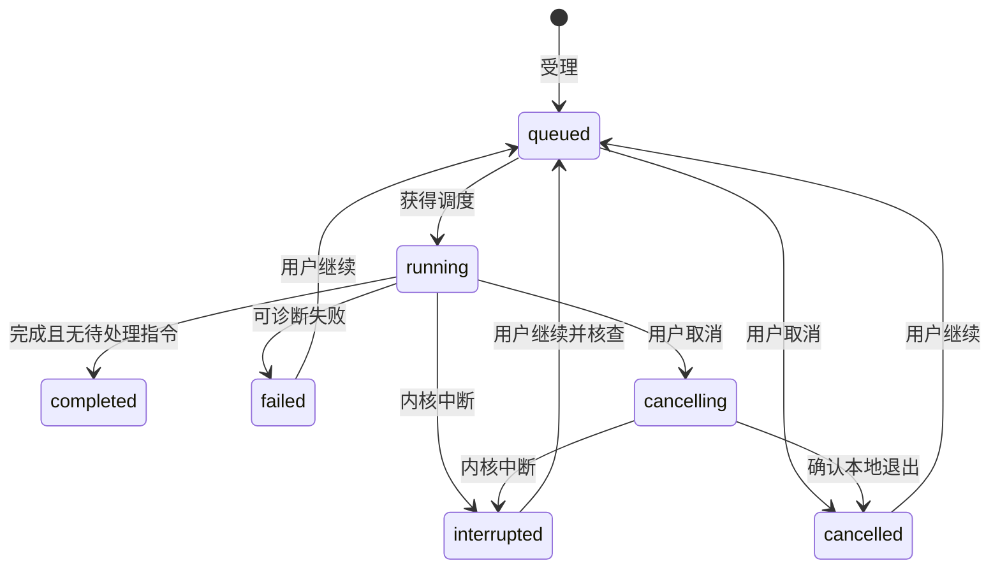

# agent-harness Specification

## Purpose

提供一个可以脱离工作台执行的真实单 Agent harness，使普通会话能够使用授权材料、保存科研成果、接受后续要求并安全中止或接续。会话和执行持久化用于观察与恢复，科研成果保存为项目文件，不依赖旧 transcript 或 checkpoint 才能继续使用。

## Requirements

### Requirement: 持久会话与可靠指令

系统 SHALL 提供持久会话、分页消息与实际材料引用；普通对话不自动创建研究任务。发送 SHALL 返回稳定指令和执行引用，同一指令身份重复提交不重复受理。执行中追加 SHALL 落盘并在下一可处理边界消费，区分已受理与已消费；最后边界到达的消息也不能静默遗留。会话串行推进，所有模型请求共用应用调度。

长历史 SHALL 可经分页消息接口和 Agent 的 `read_instructions` 工具按需读取。checkpoint 不可用时，未完成推进中的全部指令 SHALL 再次参与接续，不能仅依赖最近一页 transcript。

#### Scenario: 回执丢失
- **WHEN** 指令已保存但客户端未收到响应
- **THEN** 可按原身份查询或补交而不重复执行同一指令

#### Scenario: 运行中追加
- **WHEN** 用户在工具运行时追加要求
- **THEN** 可查询待处理状态，在下一边界消费，取消或中断不丢弃指令

### Requirement: 流式执行与可诊断观察

执行 SHALL 使用真实模型与文件工具，公开回复、工具状态、实际成果、失败和必要用量。长执行受理即返回，不依赖 RPC 长等待。订阅 SHALL 以快照与有界更新衔接，溢出或重连只重同步相关范围，不丢追加文本或清空草稿。关窗或断线不取消执行，CLI 与 GUI 查询同一状态。

#### Scenario: 关窗后完成
- **WHEN** 用户关闭窗口而已受理执行仍在运行
- **THEN** 内核继续，重新连接可读回真实消息和已保存文件

#### Scenario: 通知积压
- **WHEN** 一个订阅超出容量
- **THEN** 要求该范围重读持久状态，保留其他投影和输入

### Requirement: 取消与显式安全接续

取消 SHALL 停止后续调度并中止本地在途调用，等待相关工具退出后才确认本地取消，不能据此宣称远端停止计费。已保存成果与未消费指令保留。重启 SHALL 将未确认完成的执行标为中断，不自动恢复；显式继续先核对授权和实际文件，兼容 checkpoint 恢复原尝试，不可用时保留旧记录，从持久指令、材料和成果开启新尝试。未知副作用先核查，不盲目重放。

#### Scenario: checkpoint 不可用
- **WHEN** 用户继续普通会话但 checkpoint 损坏或不兼容
- **THEN** 保留原执行记录，建立新尝试并读取持久材料，不自动创建研究任务

#### Scenario: 主动取消后重启
- **WHEN** 用户已取消工作而内核随后重启
- **THEN** 取消状态与待处理指令可查询，不自动启动模型调用
