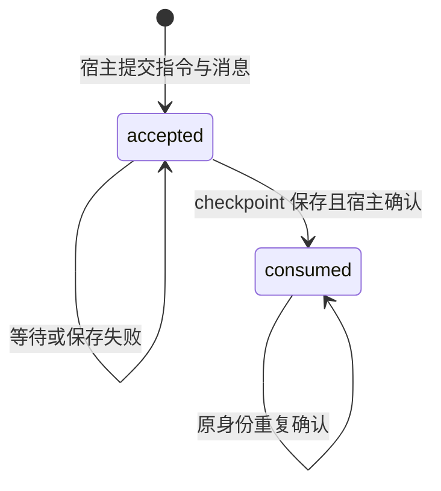
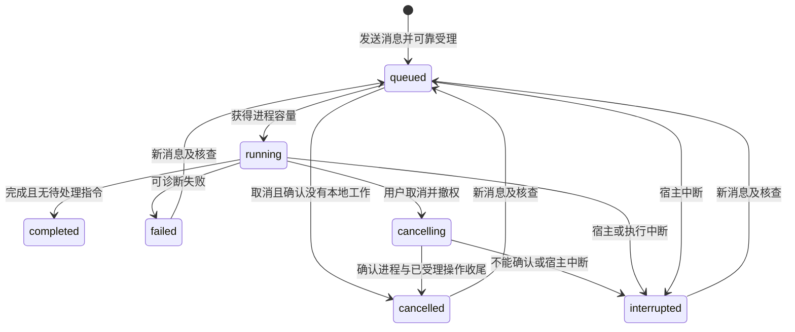
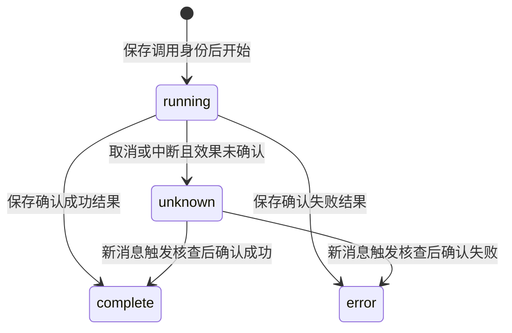
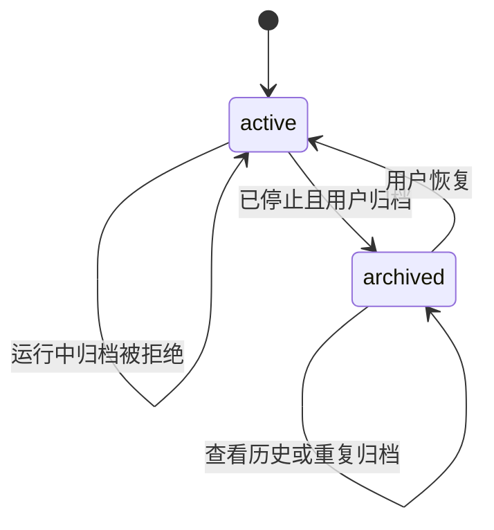

# agent-harness Specification

## Purpose

提供一个可以脱离工作台执行的真实单 Agent harness，使普通会话能够使用授权材料、保存科研成果、接受后续要求并安全中止或接续。会话和执行持久化用于观察与恢复，科研成果保存为项目文件，不依赖旧 transcript 或 checkpoint 才能继续使用。

## Requirements

### Requirement: 持久会话与可靠指令

系统 SHALL 提供持久会话、分页消息与实际材料引用；普通对话不自动创建研究任务。发送 SHALL 返回稳定指令和执行引用，同一指令身份重复提交不重复受理。执行中追加 SHALL 落盘并在下一可处理边界消费，区分已受理与已消费；最后边界到达的消息也不能静默遗留。会话串行推进，所有模型请求共用应用调度。

指令与用户消息 SHALL 在宿主侧可靠提交后才返回已受理；指令被当前有效运行实例纳入可恢复上下文并完成 checkpoint 保存后，才可确认已消费。保存成功但消费确认丢失时 SHALL 按原指令身份核对，不重复注入；无法保存必要记录时停止依赖它的新操作。长历史 SHALL 可经分页消息接口和 Agent 的 `read_instructions` 工具按需读取。checkpoint 不可用时，未完成推进中的全部指令 SHALL 再次参与接续，不能仅依赖最近一页 transcript。

发送新消息 SHALL 为正常跨轮及取消、失败、中断后的统一推进入口，新消息先参与当前意图判断。普通调用方 SHALL 不需要也不能通过独立 `session.resume` 或 CLI `continue` 接续；归档状态及既有授权仍须核对。

#### Scenario: 回执丢失
- **WHEN** 指令已保存但客户端未收到响应
- **THEN** 可按原身份查询或补交而不重复执行同一指令

#### Scenario: 运行中追加
- **WHEN** 用户在工具运行时追加要求
- **THEN** 可查询待处理状态，在下一边界消费，取消或中断不丢弃指令

#### Scenario: checkpoint 已保存但消费确认丢失
- **WHEN** 指令已进入可恢复 checkpoint，而宿主尚未确认消费即发生中断
- **THEN** 后续发送消息触发核查，按原身份补齐消费确认，不再次注入同一指令

#### Scenario: 保存必要状态失败
- **WHEN** 指令上下文或必要运行记录无法可靠保存
- **THEN** 不将该指令报告为已消费，也不开始依赖该保存的新模型或修改动作，无关工作仍可继续

### Requirement: 流式执行与可诊断观察

执行 SHALL 使用真实模型与文件工具，公开回复、工具状态、实际成果、失败和必要用量。长执行受理即返回，不依赖 RPC 长等待。订阅 SHALL 以快照与有界更新衔接，溢出或重连只重同步相关范围，不丢追加文本或清空草稿。关窗或断线不取消执行，CLI 与 GUI 查询同一状态。

#### Scenario: 关窗后完成
- **WHEN** 用户关闭窗口而已受理执行仍在运行
- **THEN** 内核继续，重新连接可读回真实消息和已保存文件

#### Scenario: 通知积压
- **WHEN** 一个订阅超出容量
- **THEN** 要求该范围重读持久状态，保留其他投影和输入

### Requirement: 取消与显式安全接续

取消 SHALL 停止后续调度并中止本地在途调用，等待相关工具退出后才确认本地取消，不能据此宣称远端停止计费。已保存成果与未消费指令保留。重启 SHALL 将未确认完成的执行标为中断，不自动恢复；用户发送新消息后先核对授权、当前意图和实际文件，兼容 checkpoint 恢复原尝试，不可用时保留旧记录，从持久指令、材料和成果开启新尝试。未知副作用先核查，不盲目重放。

取消 SHALL 先撤销当前运行实例的新动作资格，请求协作退出，宽限期后按归属终止仍未退出的执行及其后代，并核查已经受理的本地操作。只能在相关单元实际停止且操作已完成或停止后报告本地取消完成；无法确认时保留取消中或中断及未知诊断。迟到结果可以补充原操作历史和实际效果，不能覆盖新实例状态或自动重新开工。用户新消息改变或撤回旧要求时 SHALL 据此调整，不先无条件重放旧工作。

#### Scenario: checkpoint 不可用
- **WHEN** 用户向普通会话发送消息，而原 checkpoint 损坏或不兼容
- **THEN** 保留原执行记录，建立新尝试并读取持久材料，不自动创建研究任务或要求独立恢复操作

#### Scenario: 主动取消后重启
- **WHEN** 用户已取消工作而内核随后重启
- **THEN** 取消状态与待处理指令可查询，不自动启动模型调用

#### Scenario: 取消与已受理写入竞争
- **WHEN** Agent 进程已停止，而所属文件模块中的已受理写入尚未确认完成
- **THEN** 不报告本地取消完成，继续核查实际效果，保留最终保存内容及必要历史

#### Scenario: 取消后改变方向
- **WHEN** 用户发送新消息撤回先前尚未完成的目标
- **THEN** 先纳入新要求并核查旧操作效果，再决定下一步，不自动继续旧目标

### Requirement: 持久工具调用事实

系统 SHALL 为实际工具调用持久保存稳定身份、所属执行、调用名、有界输入与结果预览，并明确预览是否截断。工具状态 SHALL 区分执行中、成功、失败与结果未知；结构化后端错误和工具异常不得因工具函数正常返回而被记为成功。取消或内核重启后的在途工具 SHALL 转为结果未知，保留已确认结果，不宣称既有效果已撤销。工具记录 SHALL 经共同客户端分页读取，界面刷新不重新执行工具；原有无详情记录仍可读取。

宿主侧 SHALL 先保存必要调用身份及核查参数，再允许工具产生效果；确认结果或完整恢复结果引用 SHALL 先持久化，再交给执行图。界面预览截断不等于完整恢复结果。已有确认结果可按原调用身份复用，未知结果先查询所属记录和实际产物，不能自动重放。工具收据服务交互、诊断与内部恢复，SHALL 不成为另一套永久业务台账；文件已写而关联未完成只补关联，不删除或重复生成已保存文件。

#### Scenario: 正常返回错误

- **WHEN** 文件工具返回权限、冲突或缺失等结构化错误
- **THEN** 持久工具记录与模型看到失败结果，执行图正常结束也不改变该次工具失败的事实

#### Scenario: 取消或重启中断

- **WHEN** 工具调用在结果确认前因取消或内核重启中断
- **THEN** 该工具显示结果未知，保留调用身份及已有成果，不自动重新调用

#### Scenario: 有界详情与再次读取

- **WHEN** 工具输入或结果超过预览上限且用户稍后读取历史
- **THEN** 返回有明确截断标记的有界详情，已结束状态保留，不因读取或刷新而重跑工具

#### Scenario: 调用收据不能保存

- **WHEN** 工具开始前无法保存必要调用记录
- **THEN** 不执行该工具的副作用，向相关执行返回可诊断障碍

#### Scenario: 结果保存后执行端失联

- **WHEN** 宿主已保存工具确认结果，而执行端未收到结果即中断
- **THEN** 后续核查可复用该结果，不能再次产生同一副作用

### Requirement: 共同文件管理工具

内置 Agent SHALL 通过与 GUI 相同的领域实现创建目录、重命名、回收、列出回收项和恢复，核对当前项目信任和可信执行范围。工具 SHALL 复用持久调用记录、结构化失败和未知结果。结构操作不取消整个执行；已变化的路径和依据要求重读，不能静默覆盖或重建旧目标。待确认和受限项目不得执行 Agent 文件操作；撤销信任后每次后续操作 SHALL 被拒绝，人工操作继续沿共同文件实现。

#### Scenario: 人在执行中重命名目录
- **WHEN** 用户移动了 Agent 已读取文件的父目录名称
- **THEN** 后续旧依据修改失败并提供核查线索，执行仍可通过文件发现和重读继续

#### Scenario: Agent 回收后恢复
- **WHEN** Agent 在有效项目信任下回收并恢复一个目录
- **THEN** 工具记录反映真实操作，载荷和成果引用保留，冲突不覆盖后续文件

### Requirement: 会话命名与有界发现

系统 SHALL 从新会话首条已受理指令生成不超过 40 字符的短标题，合并空白；显式指定或手动修改的标题 SHALL 保留，重命名接受 1 至 200 字符的非空内容。历史标题不回填。会话 SHALL 按当前项目、活动／归档状态及字面标题子串查询，按最近更新时间及身份降序分页，默认 50、上限 100 条；不得先截断任意集合再排序。当前所选会话 SHALL 独立读取，不依赖列表页或筛选是否包含它。同项目的会话元数据和执行状态变化 SHALL 通知各客户端，流式文本不要求重新查询列表。

#### Scenario: 首条发送与手动改名并发
- **WHEN** 用户在首条指令受理前手动重命名，或重复提交同一已受理指令
- **THEN** 手动标题保留，重复提交取得原回执，不重新命名或启动执行

#### Scenario: 会话不在列表页内
- **WHEN** 项目超过 100 个会话，或筛选排除了当前会话
- **THEN** 所选会话及其执行控制仍可读取，其他会话可经分页或标题查找发现

#### Scenario: 另一客户端修改会话
- **WHEN** 客户端正在观察一个会话，而同项目的另一个会话被改名或改变执行状态
- **THEN** 列表可刷新真实状态，不混入另一个会话的消息

### Requirement: 可逆会话归档

系统 SHALL 允许停止后的会话归档和恢复，重复设置相同状态保持同一结果。排队、运行、取消中或尚未退出本地执行单元的会话 SHALL 拒绝归档。归档 SHALL 保留消息、执行、成果、未处理指令和草稿，只允许查看历史；发送新指令必须先恢复。恢复 SHALL 不自动执行或消费指令。已受理指令的重复提交 SHALL 仍返回原回执。旧记录没有归档字段时 SHALL 视为活动会话。

#### Scenario: 停止后归档与恢复
- **WHEN** 用户取消会话并等待本地停止，然后归档、重启内核并恢复
- **THEN** 历史和成果保留，恢复不启动模型请求，原未处理指令可在发送新消息后参与核查和处理

#### Scenario: 多客户端执行与归档竞争
- **WHEN** 一个客户端请求执行而另一个客户端请求归档
- **THEN** 内核按实际受理状态拒绝冲突操作，不产生归档中仍新启动的执行

### Requirement: 执行钉入实际模型配置

新建执行 SHALL 在创建时解析会话有效模型配置（会话覆盖优先、缺项回落应用默认），把实际使用的模型与推理强度（受支持时）写入该执行的持久记录，并对客户端可见。执行中追加指令 SHALL 沿用所属执行已钉入的配置；新消息触发对未完成执行的兼容接续 SHALL 沿用原执行配置，不重新解析当前默认。checkpoint 不可用而为同一未完成推进建立回退尝试时 SHALL 继承原实际配置；正常一轮结束后的新执行使用届时有效配置，同时继承会话有效上下文。变更应用默认或会话覆盖 SHALL 不影响已创建或已排队的执行。没有新字段的旧会话与旧执行记录 SHALL 按继承当前有效配置兼容读取。

#### Scenario: 追加与继续使用原配置

- **WHEN** 用户修改默认或会话覆盖后，向运行中的执行追加指令或发送消息接续已中断的执行
- **THEN** 追加与接续使用原执行钉入的模型与推理强度，新配置只作用于之后创建的正常新执行

#### Scenario: 执行记录可核对

- **WHEN** 用户或客户端读取一次已结束的执行
- **THEN** 可见该次执行实际使用的模型与推理强度，与创建后发生的默认变更无关

### Requirement: 执行进程归属与独立故障范围

一次活动 Agent 执行 SHALL 独占受管 OS 进程，同一会话串行推进；一次推进可以包含多条追加指令、模型请求及普通工具调用，不要求每个调用新建进程。会话身份、执行尝试和当前运行实例 SHALL 分别表达，运行实例绑定宿主实例和实际进程身份，不以 PID 代替。替换前撤销旧实例资格，只有当前有效实例可发起操作、申请模型和推进状态。

独占执行阻塞或崩溃 SHALL 限定到该执行及实际依赖方，宿主、共同文献权威和无关会话继续可用；系统级资源耗尽不在此独立可用保证之内。存活、事件循环响应与工作进展 SHALL 分别诊断，不以无日志或模型等待直接判为卡死。短等待可保留进程，回收只发生在接续状态已保存、没有仍由它负责的在途操作的安全边界；实际存活进程仍计入容量。宿主失联 SHALL 阻止新增动作并按归属退出，重启先排除遗留写者再接续。

#### Scenario: 一个执行阻塞
- **WHEN** 某执行的事件循环无法响应健康检查
- **THEN** 宿主能核查并终止该执行，另一会话及人工文献查询仍可推进，失败原因与模型等待可区分

#### Scenario: 旧实例迟到提交
- **WHEN** 同一尝试已启用新运行实例，而旧实例发送模型申请、工具请求或状态更新
- **THEN** 新动作被拒绝；已受理操作的迟到结果仅归原操作核查，不覆盖新实例状态

#### Scenario: 安全回收后继续
- **WHEN** 某执行在已保存接续状态且没有在途责任的边界被回收
- **THEN** 接续可使用新的运行实例，尝试身份按 checkpoint 兼容性处理，不把 PID 更换当作丢弃会话上下文的理由

### Requirement: 会话有效上下文与工作独立承接

正常跨轮 SHALL 保留同一会话的有效对话、工具结果、摘要及必要工作状态，不能仅因一轮完成或进程退出就只取最近一页聊天重新开始。上下文过长可压缩，保留原始历史的有界查询及当前目标、约束和未完成事项。关闭界面后重开仍使用该有效上下文。

每个执行尝试 SHALL 有独立私有 checkpoint，由当前有效运行实例独占访问，业务数据库不能由执行进程直接打开。兼容接续保留尝试身份；资料缺失或不兼容时说明缺失，保留旧记录并从持久事实建立新尝试。工作目标、依据、进展、决定和实际成果 SHALL 在形成时保存到所属工作区和领域记录，会话或 checkpoint 不成为换会话承接工作的必要依赖；本变更不增加会话删除操作。必要业务或安全记录保存失败只阻止依赖它的操作，临时上下文缺失不能被混同为领域数据丢失。

#### Scenario: 超过历史页仍需保留约束
- **WHEN** 一项仍有效的用户约束及工具结果早于最近 30 条消息，用户完成一轮后关闭界面再发送消息
- **THEN** 新推进从有效上下文或保留约束的摘要继续，不只靠最近一页 transcript 丢失该约束

#### Scenario: 原会话不可用后换会话
- **WHEN** 旧会话上下文不可用，而所属工作区与领域记录保存了必要事实和成果
- **THEN** 另一个会话可发现、读取这些材料并开展后续工作，不要求恢复旧 checkpoint 或重新生成已完成成果
