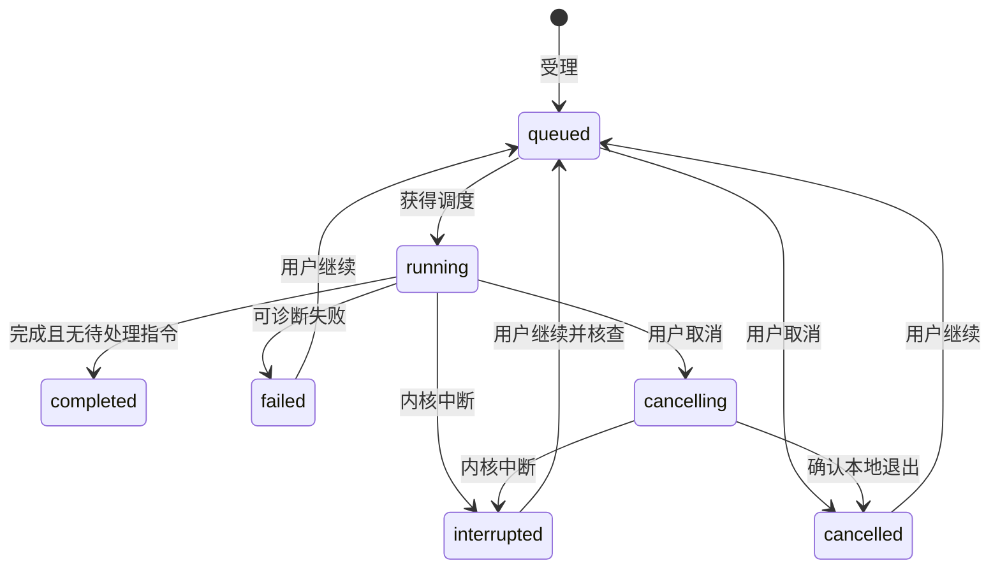
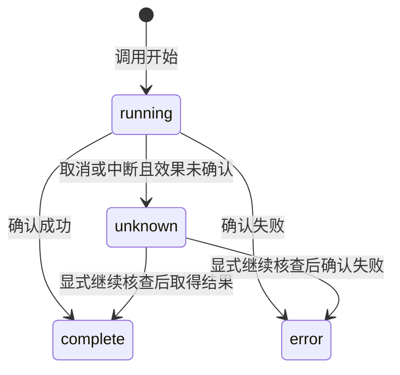
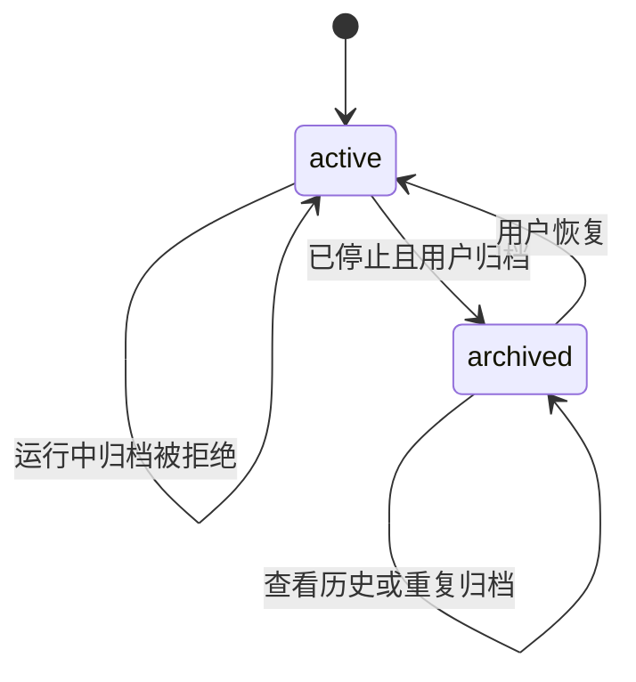

# agent-harness Specification

## Purpose

提供一个可以脱离工作台执行的真实单 Agent harness，使普通会话能够使用授权材料、保存科研成果、接受后续要求并安全中止或接续。会话和执行持久化用于观察与恢复，科研成果保存为项目文件，不依赖旧 transcript 或 checkpoint 才能继续使用。

## Requirements

### Requirement: 持久会话与可靠指令

系统 SHALL 提供持久会话、分页消息与实际材料引用；普通对话不自动创建研究任务。发送 SHALL 返回稳定指令和执行引用，同一指令身份重复提交不重复受理。执行中追加 SHALL 落盘并在下一可处理边界消费，区分已受理与已消费；最后边界到达的消息也不能静默遗留。会话串行推进，所有模型请求共用应用调度。

长历史 SHALL 可经分页消息接口和 Agent 的 `read_instructions` 工具按需读取。checkpoint 不可用时，未完成推进中的全部指令 SHALL 再次参与接续，不能仅依赖最近一页 transcript。

#### Scenario: 回执丢失
- **WHEN** 指令已保存但客户端未收到响应
- **THEN** 可按原身份查询或补交而不重复执行同一指令

#### Scenario: 运行中追加
- **WHEN** 用户在工具运行时追加要求
- **THEN** 可查询待处理状态，在下一边界消费，取消或中断不丢弃指令

### Requirement: 流式执行与可诊断观察

执行 SHALL 使用真实模型与文件工具，公开回复、工具状态、实际成果、失败和必要用量。长执行受理即返回，不依赖 RPC 长等待。订阅 SHALL 以快照与有界更新衔接，溢出或重连只重同步相关范围，不丢追加文本或清空草稿。关窗或断线不取消执行，CLI 与 GUI 查询同一状态。

#### Scenario: 关窗后完成
- **WHEN** 用户关闭窗口而已受理执行仍在运行
- **THEN** 内核继续，重新连接可读回真实消息和已保存文件

#### Scenario: 通知积压
- **WHEN** 一个订阅超出容量
- **THEN** 要求该范围重读持久状态，保留其他投影和输入

### Requirement: 取消与显式安全接续

取消 SHALL 停止后续调度并中止本地在途调用，等待相关工具退出后才确认本地取消，不能据此宣称远端停止计费。已保存成果与未消费指令保留。重启 SHALL 将未确认完成的执行标为中断，不自动恢复；显式继续先核对授权和实际文件，兼容 checkpoint 恢复原尝试，不可用时保留旧记录，从持久指令、材料和成果开启新尝试。未知副作用先核查，不盲目重放。

#### Scenario: checkpoint 不可用
- **WHEN** 用户继续普通会话但 checkpoint 损坏或不兼容
- **THEN** 保留原执行记录，建立新尝试并读取持久材料，不自动创建研究任务

#### Scenario: 主动取消后重启
- **WHEN** 用户已取消工作而内核随后重启
- **THEN** 取消状态与待处理指令可查询，不自动启动模型调用

### Requirement: 持久工具调用事实

系统 SHALL 为实际工具调用持久保存稳定身份、所属执行、调用名、有界输入与结果预览，并明确预览是否截断。工具状态 SHALL 区分执行中、成功、失败与结果未知；结构化后端错误和工具异常不得因工具函数正常返回而被记为成功。取消或内核重启后的在途工具 SHALL 转为结果未知，保留已确认结果，不宣称既有效果已撤销。工具记录 SHALL 经共同客户端分页读取，界面刷新不重新执行工具；原有无详情记录仍可读取。

#### Scenario: 正常返回错误

- **WHEN** 文件工具返回权限、冲突或缺失等结构化错误
- **THEN** 持久工具记录与模型看到失败结果，执行图正常结束也不改变该次工具失败的事实

#### Scenario: 取消或重启中断

- **WHEN** 工具调用在结果确认前因取消或内核重启中断
- **THEN** 该工具显示结果未知，保留调用身份及已有成果，不自动重新调用

#### Scenario: 有界详情与再次读取

- **WHEN** 工具输入或结果超过预览上限且用户稍后读取历史
- **THEN** 返回有明确截断标记的有界详情，已结束状态保留，不因读取或刷新而重跑工具

### Requirement: 共同文件管理工具

内置 Agent SHALL 通过与 GUI 相同的领域实现创建目录、重命名、回收、列出回收项和恢复，核对读取、普通写入与外发授权。工具 SHALL 复用持久调用记录、结构化失败和未知结果。结构操作不取消整个执行；已变化的路径和依据要求重读，不能静默覆盖或重建旧目标。已有项目未重新确认扩大的写授权前不得执行新增写操作。

#### Scenario: 人在执行中重命名目录
- **WHEN** 用户移动了 Agent 已读取文件的父目录名称
- **THEN** 后续旧依据修改失败并提供核查线索，执行仍可通过文件发现和重读继续

#### Scenario: Agent 回收后恢复
- **WHEN** Agent 在有效写授权下回收并恢复一个目录
- **THEN** 工具记录反映真实操作，载荷和成果引用保留，冲突不覆盖后续文件

### Requirement: 会话命名与有界发现

系统 SHALL 从新会话首条已受理指令生成不超过 40 字符的短标题，合并空白；显式指定或手动修改的标题 SHALL 保留，重命名接受 1 至 200 字符的非空内容。历史标题不回填。会话 SHALL 按当前项目、活动／归档状态及字面标题子串查询，按最近更新时间及身份降序分页，默认 50、上限 100 条；不得先截断任意集合再排序。当前所选会话 SHALL 独立读取，不依赖列表页或筛选是否包含它。同项目的会话元数据和执行状态变化 SHALL 通知各客户端，流式文本不要求重新查询列表。

#### Scenario: 首条发送与手动改名并发
- **WHEN** 用户在首条指令受理前手动重命名，或重复提交同一已受理指令
- **THEN** 手动标题保留，重复提交取得原回执，不重新命名或启动执行

#### Scenario: 会话不在列表页内
- **WHEN** 项目超过 100 个会话，或筛选排除了当前会话
- **THEN** 所选会话及其执行控制仍可读取，其他会话可经分页或标题查找发现

#### Scenario: 另一客户端修改会话
- **WHEN** 客户端正在观察一个会话，而同项目的另一个会话被改名或改变执行状态
- **THEN** 列表可刷新真实状态，不混入另一个会话的消息

### Requirement: 可逆会话归档

系统 SHALL 允许停止后的会话归档和恢复，重复设置相同状态保持同一结果。排队、运行、取消中或尚未退出本地执行单元的会话 SHALL 拒绝归档。归档 SHALL 保留消息、执行、成果、未处理指令和草稿，只允许查看历史；发送新指令和继续执行必须先恢复。恢复 SHALL 不自动执行或消费指令。已受理指令的重复提交 SHALL 仍返回原回执。旧记录没有归档字段时 SHALL 视为活动会话。

#### Scenario: 停止后归档与恢复
- **WHEN** 用户取消会话并等待本地停止，然后归档、重启内核并恢复
- **THEN** 历史和成果保留，恢复不启动模型请求，原未处理指令可在显式继续后处理

#### Scenario: 多客户端执行与归档竞争
- **WHEN** 一个客户端请求执行而另一个客户端请求归档
- **THEN** 内核按实际受理状态拒绝冲突操作，不产生归档中仍新启动的执行
