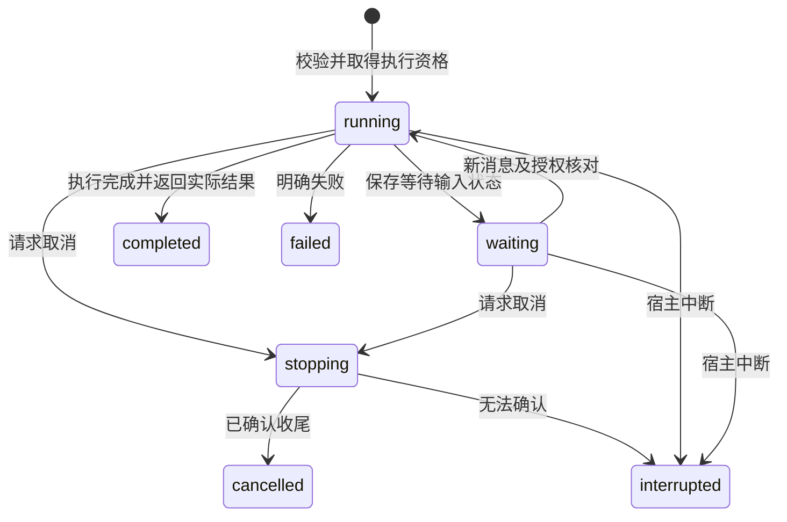

# domain-execution-handoffs Specification

## Purpose

为科研方法、计算、阅读交互及资源领域提供共同的材料证据和执行交接，使源码装配的图及受管程序复用宿主授权、进程与实际保存能力。各领域继续掌握自己的事实和判断，固定样例只证明公共基础已接通。

## Requirements

### Requirement: 资源证据与实际成果分别交接

跨域材料 SHALL 复用所属资源的稳定引用及内容依据，库材料保留具体材料版本，项目路径仅作为显示和定位信息。实际读取、实际保存与成果关联 SHALL 分别返回可核对的引用及结果；参数中出现材料不等于已经读取，执行结束也不等于产物保存或科研达标。共同接入 SHALL 不复制库材料为项目副本后才允许使用，不建立反向项目引用表。

#### Scenario: 项目与库材料共同取用
- **WHEN** 一次已授权执行按明确引用取用项目文本及库附件
- **THEN** 两者分别经所属领域读取并记录实际依据，库材料不产生隐式项目副本

#### Scenario: 保存成功但关联失败
- **WHEN** 成果已落盘而所属关联操作失败
- **THEN** 保留实际文件、稳定身份和未完成关联，执行结果不能报告整体交付可用，也不能自动重复生成文件

#### Scenario: 首次输出没有文件身份
- **WHEN** 固定图向当前可写项目中的不存在路径首次保存成果
- **THEN** 经项目受保护的新建能力取得实际 fileId 和内容依据，不能要求调用方预建空文件或伪造 ResourceRef

### Requirement: 源码装配的图执行入口

系统 SHALL 允许宿主按已装配的图身份、整体实现版本及配置 schema 启动执行，并在实际执行进程校验所选实现。入口 SHALL 只接受源码装配的能力，不能加载客户端提供的代码、模块路径或任意 Graph 定义。普通 Agent 与已交付材料分析入口 SHALL 保持其原范围；选择新图不能把通用 Agent 加完整 Skill 解释为业务流程实现。图的业务含义与交付判断仍由科研领域负责。

#### Scenario: 固定图经过真实进程
- **WHEN** 宿主装配的固定样例图以合法配置启动
- **THEN** 实际执行子进程运行对应图，通过共同端口读写材料，返回所采用图身份及版本，不绕过授权或直接访问领域数据库

#### Scenario: 图版本或配置无效
- **WHEN** 图未装配、版本不存在、配置非法或执行进程只具备不同版本
- **THEN** 执行在产生业务效果前明确失败，不静默切到默认 Agent 或其他图版本

#### Scenario: 平台执行明确不可用
- **WHEN** 内核所在平台尚不能满足受管进程归属保证，包括当前 macOS，用户提交普通 Agent 或源码图的新执行
- **THEN** 系统 SHALL 在受理指令及创建 worker 前返回 unavailable，保留原会话、已受理指令的回执查询和实际成果，不回退到无隔离执行

### Requirement: 图执行共用取消与接续边界

图执行 SHALL 复用执行身份、模型额度、进程准入、checkpoint 及已受理操作核查；等待输入必须可查询，重启不得自动推进。用户通过发送消息提供后续要求或输入；恢复前核对当前意图、授权及已保存结果。取消只有在所属单元及已受理操作收尾可确认时才能报告完成，未知效果保留。

跨进程结果 SHALL 区分模型事件、图等待、图完成和图失败，确定性图无需产生模型事件。每次尝试 SHALL 持久绑定图身份、整体版本、实际配置、状态格式、checkpoint 和等待身份；查询能读回这些执行事实。后续指令转换为指定等待的输入并校验，保存带输入的 checkpoint 后才确认消费；不同等待、重复输入或未知指令不得静默注入。恢复不兼容 SHALL 保留旧尝试及成果，新消息核查后建立新尝试，不替换成其他图。

#### Scenario: 等待期间取消和重启
- **WHEN** 固定图保存等待状态后被取消或内核重启
- **THEN** 已有结果及等待依据保留，重启不自行执行，后续消息按实际终态核查接续或新尝试

#### Scenario: 确定性图等待后恢复
- **WHEN** 图没有模型事件且保存一次等待，用户后续发送该节点所需输入
- **THEN** 查询可见原图和 waitId，输入按当前等待 schema 验证并恰好消费一次，图从对应 checkpoint 继续

#### Scenario: 升级后 checkpoint 不兼容
- **WHEN** 原等待尝试的图版本或状态格式与当前可用实现不兼容
- **THEN** 旧等待及实际成果保留，接续先核查并建立新尝试，不能用新版本静默恢复旧状态

### Requirement: 宿主受管命令窄能力

内部命令请求 SHALL 绑定真实消费模块、已登记工作空间及允许的可执行程序，复用宿主进程容量和实际停止确认。原生目录及执行配置只能由受控宿主适配解析，普通客户端不能借命令载荷指定任意本机执行。命令结果 SHALL 有界表达退出、输出与失败；所属业务负责环境选择、日志持久化及科研解释。人工排版继续不需要会话或模型，并保留最后成功预览。

命令能力 SHALL 同时受实际工作域约束，全局会话不能凭已登记程序获得无隔离 Shell／任意解释器或目标项目写入能力。

#### Scenario: 合法消费与非法转用
- **WHEN** editor 发起已登记排版命令，而另一个模块试图复用其工作空间或执行未登记程序
- **THEN** editor 走共同受管进程执行，非法请求被拒绝，不能因共用机制扩大模块权限

#### Scenario: 取消时实际进程未退出

- **WHEN** 请求已取消但进程或其后代仍无法确认退出
- **THEN** 保留停止未知及占用事实，不提前释放容量或删除仍可能使用的工作目录

#### Scenario: 平台不支持受管命令

- **WHEN** 当前 macOS 内核收到需要受管进程的命令或新排版请求
- **THEN** 系统 SHALL 明确返回 unavailable，保留最后成功预览及已有成果，不改为普通子进程执行

#### Scenario: 根进程消失但完整归属未确认
- **WHEN** 控制器失联且根进程已消失，尚无完整原生范围退出的确认
- **THEN** 即使监督程序实际进行了清理，仍保留停止未知及容量占用，执行接续与项目仓储释放不得从根 PID 推断安全，重启也不自动放行；同一会话更早的未确认归属也必须核对，连续新尝试不能绕过

#### Scenario: 全局会话请求目标项目程序
- **WHEN** 全局执行通过已登记解释器或目标工作空间请求会修改目标的程序
- **THEN** 请求在启动前被拒绝，不能把项目只读授权或程序登记当作通用执行权限

### Requirement: 有界历史执行与启动来源查询

所属领域 SHALL 能通过内部只读能力，按明确项目／会话及真实run、原指令或图首次启动来源查询执行历史。结果 SHALL 复用真实执行记录，分页默认25、最多100并受字节上限保护；跨会话身份不能返回其他会话记录。查询不启动执行、不消费指令、不补造历史来源。

源码图 SHALL 由宿主记录首次启动指令作为来源，兼容等待接续以及取消后的普通消息新尝试沿用该来源；显式新图启动即使配置相同也使用新的启动来源并保留旧记录。来源不能由worker或客户端载荷自报。现有无来源历史仍可按真实run／原指令核查。

#### Scenario: 取消后新尝试并查询历史
- **WHEN** 已启动图取消后由普通新消息建立新run，领域按首次指令来源查询
- **THEN** 原run和新run均可查询，身份和实际状态各自保留，查询不重新执行

#### Scenario: 相同配置的独立调用
- **WHEN** 宿主显式使用新指令身份启动同一版本及配置的图
- **THEN** 新调用取得新的来源，不被归入原调用，原等待／成果保持

#### Scenario: 跨会话及超量查询
- **WHEN** 使用另一会话的run／指令身份或请求超过声明分页范围
- **THEN** 不泄露其他会话记录，非法分页请求被拒绝，合法查询保持有界

### Requirement: 宿主最终受理检查

宿主为一次新执行受理提供领域同步检查时，系统 SHALL 在异步准入完成后、持久接受新指令及run之前执行该检查。拒绝 SHALL 保留既有会话、消息、等待及成果，不建立worker，不留下新已受理指令／run或占用本轮执行容量。检查只来自可信进程内提供者，不能由RPC载荷、Agent或客户端提交函数／自报授权。

原身份原输入的已受理重放 SHALL 复用原回执；领域检查不能把重放变成新执行。未提供该检查的现有宿主入口保持原语义。检查为同步受理条件，不增加独立运行状态或checkpoint权威。

#### Scenario: 异步等待后领域条件失效

- **WHEN** 新请求在准入异步等待期间失去领域授权或会话空闲条件，宿主最终检查拒绝
- **THEN** 请求返回所属结构化错误，旧推进保持，新指令／run及worker未被受理，本轮预留释放

#### Scenario: 已受理回执补交

- **WHEN** 原身份原输入已被受理，调用方补交并附带宿主最终检查
- **THEN** 返回原引用，不重复执行或以检查重新开启同一指令
