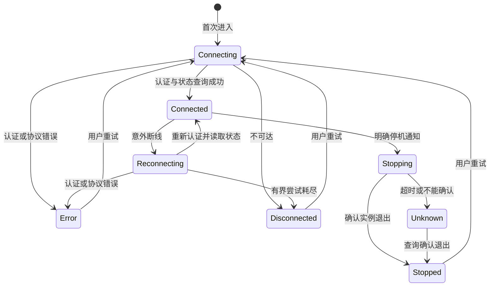

# Kernel Lifecycle Specification

## Purpose

为人类工作台、浏览器开发入口与 CLI 提供共同的真实内核生命周期，使同一数据配置的后台实例能独立运行，连接失败、关闭窗口和明确停机不会被混淆，后续科研能力可以从可靠的共同入口接入。

## Requirements

### Requirement: 共同配置与单实例

系统 SHALL 为同一规范化数据目录协调一个内核实例，不同配置 SHALL 独立。Electron 打开时自动发现或启动；浏览器开发命令负责发现或启动；CLI SHALL 提供启动、状态、停止。状态与停止 SHALL 不创建实例或初始化缺失配置。过期发现信息不证明实例存活；存活但不可达或身份不明 SHALL 不被超时抢占。

#### Scenario: 并发启动
- **WHEN** 多个 GUI 或 CLI 入口同时启动同一尚未运行的配置
- **THEN** 只有一个内核取得服务权，成功入口报告同一实例身份

#### Scenario: 空配置的状态与停止
- **WHEN** CLI 查询或停止尚未初始化的数据配置
- **THEN** 报告没有运行实例，且不初始化运行目录或创建内核

#### Scenario: 关闭工作台与重新打开
- **WHEN** 用户关闭工作台，再用 CLI 查询并重新打开工作台
- **THEN** CLI 与工作台仍访问同一驻留实例

#### Scenario: 配置隔离与路径别名
- **WHEN** 入口分别选用不同数据目录或同一目录的可解析路径别名
- **THEN** 不同配置独立；同一真实目录共用实例

### Requirement: 本机认证与共同协议

内核 SHALL 仅在本机监听，通过认证首帧验证凭据、协议及目标实例，随后按运行时 Schema 校验请求、响应与通知。未认证连接 SHALL 不得查询状态或停止内核。共同传输 SHALL 关联请求及响应，处理双向请求和通知，拒绝未知操作。连接资料 SHALL 不写入 URL、构建产物或日志；浏览器引导 SHALL 限制本机同源请求并禁止缓存。

#### Scenario: 未认证或错误凭据
- **WHEN** 未认证客户端查询状态，或用错误凭据认证
- **THEN** 内核拒绝访问并返回可辨认的认证错误

#### Scenario: 协议或实例不匹配
- **WHEN** 客户端提交不兼容协议或错误实例身份
- **THEN** 显示对应错误，不重复认证或启动替代实例

#### Scenario: 非法消息与响应
- **WHEN** 调用方或服务端消息违反协议 Schema
- **THEN** 接收方拒绝使用非法内容，连接或请求失败可诊断

#### Scenario: 任意网页读取引导凭据
- **WHEN** 引导端点收到跨来源、非法 Host 或非本机请求
- **THEN** 拒绝交付凭据，不允许该网页借引导入口启动实例

### Requirement: 有界恢复与界面保护

客户端 SHALL 区分连接、重连、认证／协议错误、不可达和确认退出。短暂断线 SHALL 有界退避重连，成功后读取实际状态；认证／协议错误 SHALL 直接停止重试。自动重连 SHALL 不创建内核；确认退出后由用户重试启动。连接变化 SHALL 保留工作台草稿和已有内容，不生成模拟研究回复。

#### Scenario: 短暂断线
- **WHEN** 连接中断而内核仍在运行
- **THEN** 有界重连成功后显示同一实例的实际状态，并保留草稿

#### Scenario: 存活但不可达
- **WHEN** 内核仍占用配置但无法完成连接
- **THEN** 显示失败及重试入口，保留草稿，不创建替代实例

#### Scenario: 内核退出
- **WHEN** 内核意外退出
- **THEN** 客户端不自动创建新实例；用户重试后才启动并连接新实例

### Requirement: 明确停机与结果确认

CLI 和工作台 SHALL 提供明确停止操作；工作台 SHALL 说明所有连接客户端受到影响。内核 SHALL 先拒绝新操作，响应停机受理并通知客户端，再清理退出。客户端 SHALL 不把受理、断线或超时当作退出成功；不能确认时显示结果未知并提供状态查询。收到明确停机通知后 SHALL 停止自动重连，查询结果 SHALL 不启动内核。

#### Scenario: 多客户端停机
- **WHEN** 一客户端明确停止内核
- **THEN** 所有连接客户端获知停机，实际退出后显示停止，且不自动拉起实例

#### Scenario: 停机结果未知
- **WHEN** 停机请求发出后连接中断或等待超时
- **THEN** 显示无法确认，并可查询实际状态，不直接报告成功或重放停机操作

#### Scenario: 普通关窗
- **WHEN** 用户关闭或退出人类工作台
- **THEN** 只关闭客户端，不停止内核

### Requirement: 隔离验证与诊断

系统 SHALL 通过状态、结构化错误和有界诊断信息定位启动、认证、连接及停机失败。开发检查 SHALL 在独立配置上覆盖真实 CLI、浏览器和 Electron 接线，三平台使用同一组生命周期检查，实际未验证的平台 SHALL 明确记录。

#### Scenario: 检查开发链路
- **WHEN** 开发者运行生命周期与双宿主检查
- **THEN** 测试连接真实内部实现，结束时停止自己拥有的实例，平台结果按实际运行记录
