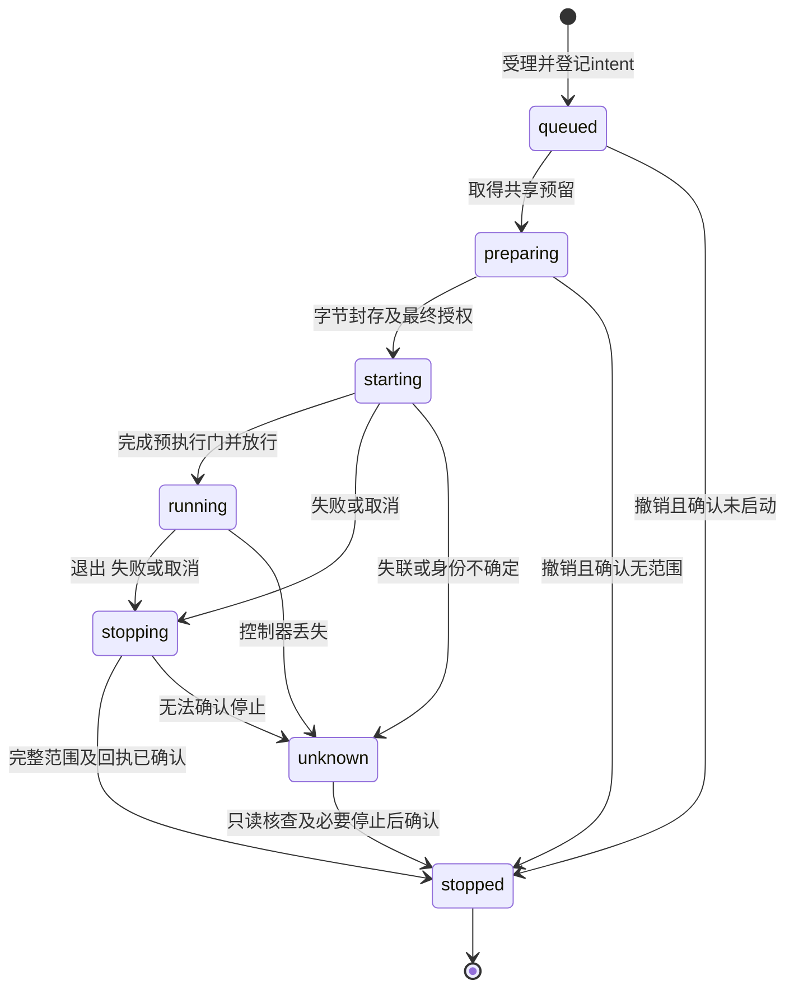

# linux-isolated-report-provider Specification

## Purpose

为宿主提供独立于工作台和harness的Linux隔离执行能力，仅处理所属领域已批准的有界字节和可信登记策略。必要OS条件、预执行保护、实际资源上限及完整范围停止均须可核查；不能确认时保留不可用或未知，避免将有限原生实验、进程退出或资源路径当成业务授权及生产报告安全保证。

## Requirements

### Requirement: 独立能力及必要条件核查

提供者 SHALL 仅在Linux、宿主已登记的程序／策略及其必要机制均可兑现时声明该组合可用。普通用户已有namespace、bwrap及scope委托不足、实际CPU／memory／swap／pids上限不能读回、策略或目标架构未校准时 SHALL 在放行不可信程序前返回unavailable及有界原因。不得自动安装、提权、修改委托或退回普通受信程序执行；普通managedExecution可用不授予本能力，人工资源操作不依赖本能力。

`check` SHALL 仅作登记、已校准策略、工具与管理器的有界预检；其`available`表示可以继续尝试该组合，不是本次执行已兑现隔离条件的证明。`start` SHALL 在每次放行前实际核对namespace、scope身份及资源限额等必要条件，未兑现即拒绝；预检成功不能跳过该核验或据此开放未验证的浏览器／报告。

#### Scenario: 必要条件不足

- **WHEN** 系统缺少已登记策略要求的工具、namespace权限或实际scope资源控制
- **THEN** 明确返回不可用和失败阶段，不放行目标代码，不把属性请求、W_OK或工具版本代替兑现证明

#### Scenario: 浏览器组合未验

- **WHEN** 原生固定程序已独立验证，而完整浏览器进程图／策略尚未验证
- **THEN** 仅表达已验证程序组合的范围，浏览器及活动报告继续不可用，不将原生测试或模拟Windows／Mac作为目标验收

### Requirement: 领域核准的有界冻结字节

提供者 SHALL 仅接收宿主绑定的有界字节与视图内相对位置，不接用户原生路径、领域仓储句柄或新的ResourceRef身份。领域继续核对ref／basis、来源read/send和前后读取依据，在排队后及最终放行前重新授权；文件dev／ino SHALL 仅用于物理身份保护，不代替内容版本。分片、数量、字节、准备对象和等待均有界；封存完整前不得执行。实际交付 SHALL 固定已批准字节且只读，特殊文件／目录／链接或对象替换不得成为资源输入。

#### Scenario: 来源变化或撤权

- **WHEN** 准备字节期间依据变化、内容未完整取得，或排队后领域核查撤权
- **THEN** 拒绝放行，保留原领域对象及可核查状态，不用同路径或同inode替代原basis，不外发未批准字节

#### Scenario: 交付只读固定字节

- **WHEN** 宿主完成全部有界分片并封存批准字节
- **THEN** 目标只能读取对应冻结内容、不能写回原项目／库；特殊文件及身份替换在进入前拒绝，准备状态不形成第二份材料或报告身份

### Requirement: 先于不可信执行的完整策略

不可信程序进入前 SHALL 完成最小文件视图、网络拒绝、系统调用／namespace策略、FD白名单及实际范围登记。白名单 SHALL 核类型、身份、访问方向和对端用途，包含stdio及所有非白名单高FD；不能保留通用代理、宿主认证、内核／预加载、文件／目录／迁移控制句柄。SCM_RIGHTS接收、只读pathname socket、后续取得句柄及系统调用旁路 SHALL 属于策略核查范围；未证明必要保证时不可用，不以未执行动作冒充OS拒绝。

#### Scenario: 继承及接收通道反例

- **WHEN** 启动输入包含高FD、已连接代理、cgroup写句柄，或把SCM接收socket误放到stdio
- **THEN** 在放行前关闭或拒绝不合策略的配置；危险控制及安全对照分别验证真实访问／拒绝，不因编号0–2或netns自动信任

#### Scenario: 特殊文件及迟到能力

- **WHEN** 输入或执行企图通过socket／目录／特殊文件、重新建namespace、转移FD或其他策略旁路扩大能力
- **THEN** 执行策略拒绝且原因可核查；未覆盖的必要旁路阻止该程序组合声明可用，不能静默降级网络或文件保证

### Requirement: 唯一准入与实际资源范围

准备、排队和运行 SHALL 沿宿主唯一ProcessAdmission预留，不能复制容量权威。等待期间不读取无界字节；实际取得槽位后准备字节仍计入保留占用。所有目标后代及相关执行进程 SHALL 留在可核查范围并受策略要求的CPU／memory／swap／pids上限约束；墙钟期限、JS堆或根PID数量不能代替整组上限。未知范围继续占用，新启动不得绕过。

#### Scenario: 满额及排队后撤权

- **WHEN** 其他执行已占满共享容量，或等待后授权失效
- **THEN** 沿已有有界等待／资源限制处理，不另开私有槽位；取得容量后重新核权，失败不执行且仅在确认无遗留后释放

#### Scenario: 子孙扩大范围

- **WHEN** 固定程序创建多代或detached后代、尝试迁移scope或超过实际资源上限
- **THEN** 所属进程仍受同一策略／预算和完整停止管理；迁移权威不得可得，未能确认范围完整则unknown并保留槽位

### Requirement: 可查询且不混淆的生命周期

提供者 SHALL 区分准备／排队、启动、实际运行、停止请求、完整停止及未知；启动／取消受理不表示代码已运行或范围已停止，根程序退出与完整停止分别记录。查询仅观察原实例，不重放或创建新执行。任何状态回执丢失 SHALL 按原instanceId核查，不自动再次启动。

#### Scenario: 启动或停止回执丢失

- **WHEN** 原启动或取消请求已受理但确认丢失
- **THEN** 查询原实例可区分已观察阶段及unknown，不把查询变成重放，不以IPC断开或根PID消失返回完整停止

#### Scenario: 字节准备期取消

- **WHEN** 实例尚未放行而用户取消或领域撤权
- **THEN** 停止接收新分片及放行，核原intent未留下执行范围后结清；不能仅凭客户端没有看到running推定未启动

#### Scenario: 运行后撤权

- **WHEN** 宿主在运行后收到领域取消或撤权，而目标已持有原批准字节
- **THEN** 停止新增字节／结果交付并请求完整收尾，结果交付仍核当前授权；不声称已取字节可被撤回，停止缺证继续unknown及保留占用

### Requirement: 控制器丢失与持久恢复

宿主 SHALL 在可能创建执行范围前持久记录原实例及范围意图，gate放行前保存可核查范围身份。独立控制路径 SHALL 在被执行代码阻塞或宿主失联时停止其完整范围；不能满足时不放行。重启 SHALL 在开放新准入前恢复未知占用并核对原配置、boot／范围／调用实例身份；旧PID或同名unit不赋予终止权。完整停止及其持久回执确认后才释放或结清恢复占用；持久化失败／身份无法匹配 SHALL 保留unknown，不能自动接续或释放容量。

#### Scenario: 控制器或宿主异常消失

- **WHEN** 实际受限代码不响应且控制器或宿主被终止
- **THEN** 独立于受限代码事件循环的机制按原归属收尾；重启只核查原执行，未确认范围保持unknown并计入同一容量，不自动重新运行

#### Scenario: 记录身份与当前scope不符

- **WHEN** 重启遇到复用PID／unit、缺失确认、恢复副本或无权读取实际范围
- **THEN** 不杀不匹配的工作，不因名称相同或范围目录消失单独推定成功；有充分启动未放行或完整停止证据才结清，否则unknown

#### Scenario: 停止已发生但记录失败

- **WHEN** OS范围已确认停止而持久停止回执保存失败
- **THEN** 保留可核查事实及unknown占用，后续仅核查／补保存，不重启或跳过持久化释放

#### Scenario: 私有根存在未索引或未知对象

- **WHEN** 持有原writer锁恢复记录时，pin住的私有根在config.json、index.json、writer.lock和已验证index的storageId目录之外存在对象，或根目录核查超限／不完整
- **THEN** 拒绝本提供者初始化，保留原configId、index、receipts及现场；不得只恢复索引子集后开放本提供者、自动删孤儿、重建索引或给原对象另发身份。已索引目录仍按原记录身份与内容规则验证，不以完整根枚举代替范围及停止核查

### Requirement: 有界诊断与独立验收

提供者 SHALL 返回安全、有界的阶段／错误码／实际策略与范围核查结果，区分领域授权、字节准备、OS前置、启动门、执行、停止和回执持久化失败；不得包含凭据、宿主环境或任意正文。独立模块可替换领域批准字节／授权依赖，但OS保证、完整停止和重启容量 SHALL 以真实Linux机制验收。未跑、未执行、被拒启动与实际动作拒绝分别记录，不能因退出0关闭生产报告或科研质量。

#### Scenario: 独立模块验证

- **WHEN** 使用合成固定字节与可控领域授权端口运行模块测试
- **THEN** 标明领域替身，真实scope／namespace／资源上限及原生故障／停止路径不能由模拟成功代替；不要求启动工作台、模型或真实用户库
