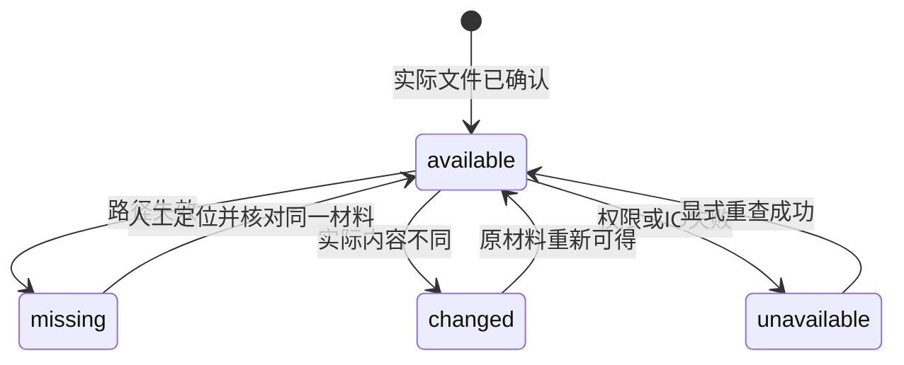

# literature-attachments Specification

## Purpose

将本地原材料纳入共同文献权威，供人和 Agent 通过稳定附件及材料版本引用取用。区分托管副本与外部链接、文件登记与实际可读，保留多附件用途、逐项摄取结果和缺失诊断，使路径变化不会冒充材料版本或破坏已保存的题录与研究依据。

## Requirements

### Requirement: 稳定多附件与本地文件归属

系统 SHALL 为每个文献附件保存独立稳定身份、材料版本、来源条目、名称、用途、托管方式及来源。默认复制为库托管副本，也可明确只登记外链；原文件 SHALL 不被移动或改写。一条题录可以有多个不同用途的附件，正文、补充材料和题录字段相互独立。未提供既有题录时，文件摄取 SHALL 以文件名创建未核对题录候选，不编造 DOI、作者或发表版本。用户提供相同批次引用和相同输入 SHALL 返回原记录，不因回执丢失重复生成身份。

#### Scenario: 正文与补充材料
- **WHEN** 用户给同一文献分别添加正文和补充材料
- **THEN** 两个附件保留独立身份和用途，可分别查询及取用，不覆盖另一附件或题录

#### Scenario: 托管后原文件移走
- **WHEN** 成功托管的原文件被用户移动
- **THEN** 库副本仍可读取，原始路径只作为来源，不影响托管材料身份

### Requirement: 渐进文件摄取与中断接续

本地文件摄取 SHALL 沿共同库的批次状态、授权与有界逐项结果契约，受理后返回持久引用，成功文件立即可用，缺失、超限或不可读项独立失败。已确认来源、附件及逐项结果 SHALL 同事务保存，暂存文件不可被报告为已交付；进程中断后只允许显式接续未确认项，已确认附件不重复创建。撤回写入 SHALL 阻止后续项及异步复制后的最终发布，保留已确认部分。

#### Scenario: 批次部分失败
- **WHEN** 一批本地路径包含可读正文、缺失文件和另一个合法附件
- **THEN** 合法附件和题录可查询，缺失项有结构化失败，不把整批误报为全部成功或回滚合法结果

#### Scenario: 文件发布后回执未确认
- **WHEN** 内核在文件暂存或发布与逐项提交之间被终止
- **THEN** 重启保留诊断线索，接续只核查本项拥有的文件，不覆盖用户文件；最终一个成功项只有一个稳定附件及来源身份

### Requirement: 有界取用与材料失效诊断

系统 SHALL 按附件引用有界查询状态及分段读取原字节，区别可读、缺失、内容已变和其他不可用原因。列表 SHALL 只检查当前分页对象，不扫描全库文件；实际取用 SHALL 核对材料版本。库读取授权控制取用；Agent 还需有效项目信任与库外发授权，模型请求及重试仍检查撤权。Agent 摄取只能从已信任项目根内的普通文件进入共同模块，不能借附件接口读取任意本机路径。

项目文件摄取 SHALL 保留宿主确认的调用来源；Agent 批次在后续准备及发布前复查信任，人工批次可从受限项目摄取，仍检查库授权。来源不能通过客户端参数自报提升。

#### Scenario: 撤回读取或外发
- **WHEN** 附件已存在，而用户撤回有效读取或 Agent 外发授权
- **THEN** 后续读取或模型请求被拒绝，既有附件与题录保留，不由继续执行自行重新授权

#### Scenario: 二进制分段读取
- **WHEN** 客户端按引用请求一个合法范围
- **THEN** 得到该材料版本在请求范围的原字节及实际总长度，不把二进制当成已解析正文

#### Scenario: Agent 摄取中撤销信任
- **WHEN** Agent 项目材料批次尚有未完成项，用户撤销项目信任
- **THEN** 后续材料取用或发布被拒绝，保留已确认成果；人工项目文件操作不被阻断

### Requirement: 人工重定位保持材料版本

外链移动后 SHALL 可由可信用户显式重新指定路径，成功时保留附件及材料版本身份。重新指定 SHALL 核对实际内容是同一材料，不把同名或不同内容文件绑定到旧版本。新内容 SHALL 通过添加新材料保存，不迁移旧证据或批注；缺项只影响该附件，题录和其他材料保持可用。托管材料不能通过重定位变成任意可编辑外链。

#### Scenario: 同一材料移动
- **WHEN** 用户将缺失外链重新指定到内容相同的文件
- **THEN** 原附件恢复可用，稳定身份与材料版本不变

#### Scenario: 同名新内容
- **WHEN** 用户选择一个同名但内容不同的文件作为旧附件的新路径
- **THEN** 返回材料变化错误并保留旧关联，不把新文件的页码或内容当成旧版本
