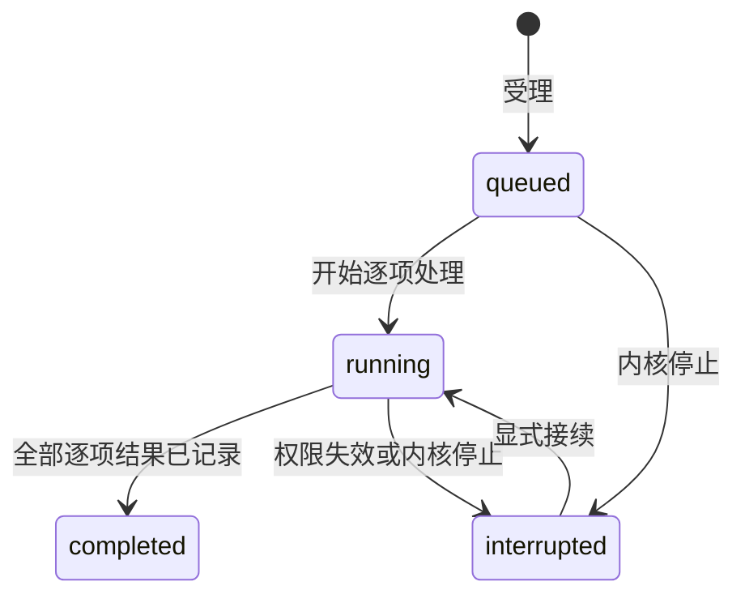
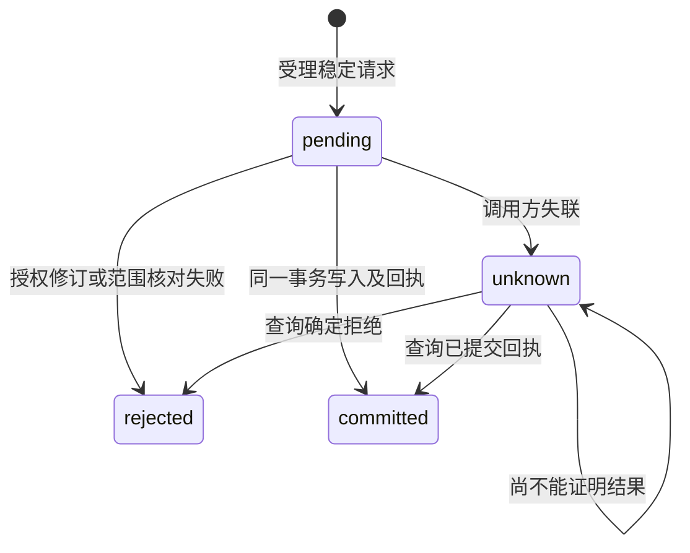
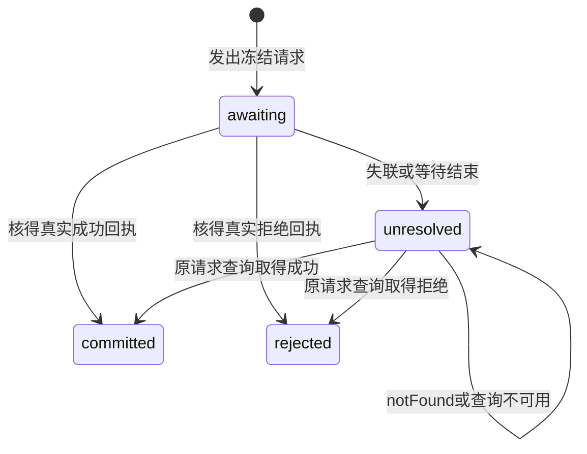
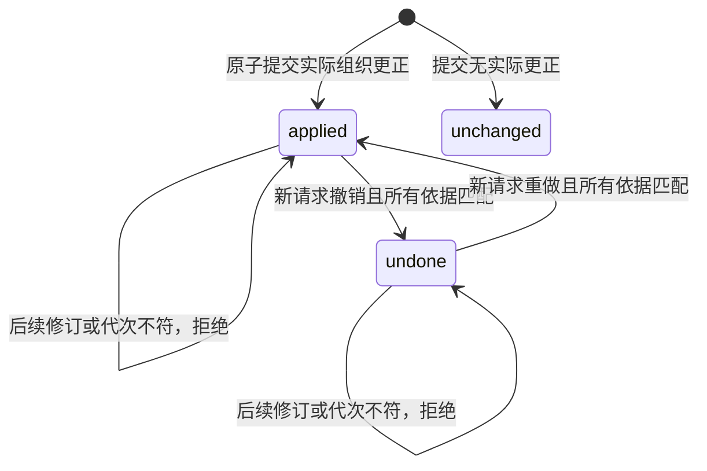

# literature-catalog Specification

## Purpose

提供独立于研究项目的共同文献题录权威，使 GUI 和内置 Agent 从同一服务摄取、查询并整理有稳定身份的文献，保留来源、发表版本、逐项结果和可恢复副本。题录先可用，附件取得和科研分析分别由后续能力实现及表达。

## Requirements

### Requirement: 独立题录与版本身份

系统 SHALL 持久保存独立全局库身份和文献身份，与路径、外部题录 ID、DOI 分开。文献 SHALL 保留 CSL JSON 题录、明确版本标签、来源、更新时间和修订号；题录、全文地址、附件登记及实际可读、分析是否生成 SHALL 分别表达。只在规范化 DOI 和明确版本标签相同时复用身份，未知版本及无确定标识不自动合并。相同版本补齐空字段，冲突保留候选与来源，不覆盖已有值；不同版本可显式双向关联。

#### Scenario: 预印本与正式版
- **WHEN** 同一 DOI 的不同明确版本分别收录并显式关联
- **THEN** 保留两个稳定条目及各自题录，版本关联可双向查询，不以较新版本覆盖旧版

#### Scenario: 重复收录冲突
- **WHEN** 同版本再次收录，已有题名冲突但摘要缺失
- **THEN** 复用原身份并补入摘要，保留原题名和可查询冲突候选，不重复生成来源条目

#### Scenario: 登记附件不等于可读
- **WHEN** 来源有附件登记但实际外链已失效
- **THEN** 来源仍能查询，附件详情明确缺失，不把登记数量或全文地址当作可读证明

### Requirement: 有界整理与授权更正

系统 SHALL 提供有界题录查找、精确读取、集合/子集合和标签；同一条目可属于多个集合，移出只改变分组。更正 SHALL 核对已读取修订号，拒绝过期覆盖，并保存可检查的旧值和来源。读取、写库和发送题录到模型 SHALL 分别受有效库授权约束，方法或模型请求不自行扩大授权。变化 SHALL 使相关客户端重新读取有界范围，保留草稿与当前会话。

#### Scenario: 两客户端同时更正
- **WHEN** 两个客户端基于同一修订号提交不同题录
- **THEN** 只接受先提交者，后提交者重读，不覆盖已保存内容；旧值仍可核查

#### Scenario: 移出集合
- **WHEN** 用户将条目从一个集合移出
- **THEN** 只移除该分组，库条目和其他集合关系保留

### Requirement: 可接续逐项题录摄取

CSL JSON 摄取 SHALL 返回稳定批次引用并保留原输入、来源与各项实际结果。重复身份相同输入返回原批次，不同输入拒绝；无效记录不影响其他记录入库。批次查询 SHALL 有界，已成功项不重跑；中断保留结果并标明剩余未执行，只有明确接续才继续。受理前及每个写入边界 SHALL 核对权限，数据库提交中的题录与对应批次结果保持同一事务。

#### Scenario: 部分非法条目
- **WHEN** 批次包含合法题录和缺少题名的记录
- **THEN** 合法项可立即查询，非法项有结构化失败，批次完成不表示每项成功

#### Scenario: 入库后回执丢失
- **WHEN** 一项已提交，随后进程终止且调用方未取得回执
- **THEN** 重启查询取得已确认条目与结果，显式继续只处理未执行项

### Requirement: 题录库备份与独立恢复

题录库 SHALL 使用数据库备份接口，提供范围明确、可关闭的自动备份及手动备份。新备份 SHALL 纳入所引用的托管材料，列明外链未纳入及不可取得文件的缺项；旧题录备份的实际范围保持可辨。恢复 SHALL 创建不存在的独立副本，不覆盖当前库或后续编辑；副本身份独立、写入/外发需重新授权，既有文献与附件身份、材料版本及关系保留。损坏或不兼容库 SHALL 停止受影响写入并保留现场。扩大写入与外发能力的迁移 SHALL 保留迁移前副本，原题录写入/外发授权不能隐含授权新文件管理及附件发送能力。

#### Scenario: 恢复早于后续编辑的备份
- **WHEN** 用户恢复旧库备份
- **THEN** 副本可独立打开核查，当前库和新成果保持原状；副本不自动执行遗留批次

#### Scenario: 托管文件与外部依赖
- **WHEN** 备份包含托管正文和一个外链附件
- **THEN** 独立副本可读回托管原字节，清单说明外链未复制，缺失外链不导致题录或托管文件恢复失败

### Requirement: 共同工作台的题录管理入口

浏览器与 Electron 工作台 SHALL 经共同库权威提供人工授权、手动建项、CSL JSON 文本或所选文件导入、集合整理、逐项批次查询及显式接续、手动备份与独立恢复入口。读取、写入、材料外发与自动备份 SHALL 分别设置，不由建项或导入自动扩大授权。操作 SHALL 保持当前会话和未发送指令；列表、详情、批次和集合只读取当前有界范围，通知不触发全库展开。

更正 SHALL 绑定所读修订号，按库和条目保留未保存草稿；范围刷新、切换条目、页面重载及迟到回执不得覆盖后续输入。保存失败保留草稿并可显式重新读取；恢复备份只创建不存在的独立副本并显示结果路径。

#### Scenario: 从真实入口建项与导入

- **WHEN** 用户授权写库后提交手动题录或包含部分非法项的 JSON 批次
- **THEN** 界面显示实际批次进展和逐项结果，合法条目可在列表查询，无效项单列失败，当前指令草稿保留

#### Scenario: 保存期间继续编辑或切换条目

- **WHEN** 用户保存更正后继续输入或切换条目，随后收到旧保存回执
- **THEN** 只推进该条目对应草稿的修订号，后续输入和另一条目的画面均保留；过期修订仍被拒绝

#### Scenario: 备份恢复保留当前库

- **WHEN** 用户从备份列表指定不存在的恢复目录并明确恢复
- **THEN** 界面显示新副本路径，当前库和后续编辑保持原状，托管材料及缺项范围如实显示

### Requirement: 集合直接父范围查询

集合查询 SHALL 支持未指定父范围的原扁平分页、null 根集合范围及明确父身份的直接子集合范围。范围过滤 SHALL 发生在分页前，保持有界读取和原库授权，不扫描条目或附件正文。原生 CSL 编辑能力声明 SHALL 与开放 metadata 保留规则分开，不因编辑器只支持部分类型／字段拒绝合法未知值。

#### Scenario: 多级集合分支分页
- **WHEN** 多级集合数超过一页且父子身份无排序关系
- **THEN** 根与各直接子范围独立分页，不混入其他分支；未指定父范围保留原扁平结果

### Requirement: 来源原值与题录投影分离

共同文献权威 SHALL 将外部来源对象身份及原始题录与CSL投影分别保存和读取。原类型、字段、创建者姓名形态／角色及完整顺序、日期和Extra原文不得通过CSL反向猜测；仅更正CSL SHALL 不覆盖未明确修改的原值。来源身份 SHALL 区分来源实例、库定位及对象键，不能用本机数字itemID、路径、DOI或正式引用键替代。恢复或复制Zotero源库 SHALL 默认登记新来源实例；仅用户显式确认才允许重绑定，未提供确认路径时拒绝自动重绑定。

#### Scenario: 多对一类型和跨角色创建者

- **WHEN** 不同外部类型映射到同一CSL类型，且创建者跨角色交错排列，随后用户只更正CSL题名
- **THEN** 可分别读回更正后的CSL及原类型、姓名、角色、顺序、日期和Extra原文，来源关联不改变

#### Scenario: 相同数字ID来自不同来源实例

- **WHEN** 两个来源实例提交相同本机数字itemID或同名库／对象键
- **THEN** 不因这些局部值自动合并，未确定实例身份时拒绝接入并保留原库

### Requirement: 正式引用键由领域最终提交保护

共同文献权威 SHALL 单独保存正式引用键及固定状态，并在最终提交时核对已读修订、有效写入授权和固定键。同库正式键 SHALL 在Unicode NFC及默认Unicode小写比较后唯一，显示保留原拼写。插件生成结果、缓存与CSL扩展字段只作为候选，不获得覆盖既有正式键或改变固定状态的权力。键或固定状态变更必须有显式意图及有效修订；冲突 SHALL 拒绝并可诊断，不自动改名、挑选胜者或覆盖固定键。

#### Scenario: 插件重算命中固定键

- **WHEN** BBT重算生成不同候选，而领域记录的正式键为固定状态
- **THEN** 普通题录保存不改正式键，调用方能区分已保存题录与未采纳候选，缓存不被当作提交成功依据

#### Scenario: 并发解除固定后写入

- **WHEN** 调用方基于过期修订请求解除固定并修改正式键
- **THEN** 整个请求被拒绝，原键、固定状态、原值和题录均保持，调用方重读后重新决定

#### Scenario: 大小写冲突及候选固定状态

- **WHEN** 已有Smith2024，另一条目请求smith2024；或插件候选请求新建固定键
- **THEN** 冲突请求整体拒绝；无冲突的新候选可以填补缺键但不取得固定状态，已有正式键保持，只有显式意图可改变固定状态

### Requirement: 提交结果可核查且通知不先于提交

涉及同一已授权事务范围的题录、原值、来源关联、正式键及历史 SHALL 一起提交或一起保持原状。首片支持同库最多100条已有题录、编码请求256KiB及单份原值64KiB；尚未开放的对象创建、附件／集合写入、任意SQL或跨库范围 SHALL 明确拒绝，不拆成逐条成功。稳定请求身份可查询已接受的提交或拒绝结果，同身份不同内容拒绝。提交前核对授权及所有修订，提交后才发布一次变化。调用方未获回执 SHALL 标为结果未知并查询，不推断回滚或立即重跑。

#### Scenario: 提交后回执丢失

- **WHEN** 库事务已提交后连接断开，调用方用相同请求身份重试或查询
- **THEN** 返回原提交结果，原值、键、历史和关系不重复写入，不发送重复业务变化

#### Scenario: 已有题录的多对象原子保存

- **WHEN** 调用方提交范围及限额内的多个已有题录，其中一个修订、来源关联或正式键发生冲突
- **THEN** 所有题录、原值、键和历史保持原状，仅记录可查询拒绝结果；无冲突时一起提交并发布一次变化

#### Scenario: 提交前撤权

- **WHEN** 请求受理后、最终事务前写库授权被撤销
- **THEN** 不写题录、原值、键或回执成功状态，不发送成功通知，已有记录可继续核查

### Requirement: 有界原子组织更正

系统 SHALL 提供对既有题录集合成员及标签的窄组织提交，输入明确库身份、稳定请求身份及1—100个唯一条目身份／观测修订；每项至少明确一个组织字段，字段省略表示不改，空数组表示明确清空，值不重复。集合成员及标签按集合语义比较，仅排列不同 SHALL 保留原值并报告未变；标签按现有非空／长度约束及精确字符串比较，不自动改大小写或归一化。

系统 SHALL 在全部变更前核对有效读取／写入授权、当前库身份、所有观测修订、目标集合存在性、字段限制和预算。请求JSON及捕获的before/after组织参与集投影 SHALL 分别不超过262144个UTF-8字节；超限不得自动拆分。已受理结构有效的一组更正 SHALL 整组原子，任一失败不修改任何条目的组织字段、历史或修订。请求可以产生实际失败回执记录，但不能把它称为部分应用。

#### Scenario: 多条跨集合整理

- **WHEN** 调用方基于同一库中多条题录的有效修订，更正它们的集合成员并添加或移除标签
- **THEN** 同一事务应用全部实际更正，只有实际改变项递增修订并保存旧值，未请求字段及其他身份／材料保持，结果可逐项核对

#### Scenario: 后一项过期不污染前一项

- **WHEN** 结构有效的请求包含一个过期修订，其他条目仍有效
- **THEN** 整组rejected，过期项标为blocked并给出错误码，其他项标为notApplied；条目、历史及组织可逆依据没有部分提交

#### Scenario: 小请求需要过大的旧值依据

- **WHEN** 清空操作的请求在预算内，但捕获的现有组织字段及新值投影超过依据预算
- **THEN** 返回resourceLimit且整组不应用，调用方可明确缩小范围，不自动降为逐条成功或丢弃撤销依据

### Requirement: 组织更正保留同一材料身份

跨集合仅改变同一条目成员，系统 SHALL 保留sourceId、CSL及未知值、原值／来源／正式键／固定状态、版本关联、附件身份、父关系和材料版本；不创建第二条题录或复制／移动文件。人和未来Agent消费者 SHALL 共用该领域操作，权限／模型外发沿现有授权；本片不因端口存在自动开放root工具或新GUI。

#### Scenario: 跨集合不复制题录与附件

- **WHEN** 题录已有原值、固定键、未知嵌套CSL及已登记的附件，并从集合甲整理到集合乙
- **THEN** 仅明确请求的组织字段及修订改变，同一sourceId及原材料身份可继续读取，未指定字段完整保持

### Requirement: 组织请求的持久逐项结果与未知核查

组织提交及其撤销／重做 SHALL 使用共同持久请求回执权威，区分操作种类；同请求身份、同操作种类及同原输入只返回原结果，不重新执行，同身份不同输入或不同种类拒绝。现有原值／正式键提交及查询的旧DTO、成功／拒绝结果 SHALL 保持；不能将新组织请求解释为原值写入。

组织结果 SHALL 逐项表达applied、unchanged或blocked、notApplied。成功回执与源更正及可逆依据同事务提交；拒绝回执不污染条目。结构／授权／身份在受理前被拒绝可以直接返回错误，不伪造已受理记录。数据库不能确认持久化时不得伪造最终成功或拒绝。

结果查询 SHALL 检查当前库读取授权及库身份，返回原库身份与原持久结果或notFound；权限拒绝、错库、读取异常不能伪装notFound。断线、客户端取消等待或超时只表示调用方未知，不回滚已经提交的操作，也不自动重放。notFound仍保持待核查，不能据此自动重试。

#### Scenario: 提交后丢失回执

- **WHEN** 真实组织提交已经持久化，但调用方丢失回执并在重启后查询原请求身份
- **THEN** 查询返回原完整结果，不产生第二次更正或修订；有效授权仍在查询时核对

#### Scenario: 重复提交不是重做

- **WHEN** 调用方在组织操作已被撤销后再次发送其原提交请求
- **THEN** 只取得原提交回执，不使组织字段重新应用；重做必须是明确的新动作及请求身份

#### Scenario: 未送达及撤权

- **WHEN** 请求未送达时查询，或调用方在已确认提交后失去读取授权
- **THEN** 前者返回notFound且不自动重放，后者返回权限拒绝；两种情况不互相替代

### Requirement: 撤销重做保护后续成果

每次成功组织操作 SHALL 保留不可变的原库身份、实际改变字段的before/after及参与条目，并维护当前组织记录代次、应用位置和预期条目修订。组织明细 SHALL 按有界成员差异查询，不返回整份题录／原值；明细分页绑定观测的记录代次，代次变化不得静默混页。查询中的资格仅是诊断，不是执行租约。

撤销／重做 SHALL 使用新的请求身份，明确原组织记录、期望记录代次和方向；实际提交时再次核对当前权限、库身份、位置、全部实际变更参与项的整条题录修订及恢复目标集合存在性。即使后来改动只在其他字段或又改回相同值，也 SHALL 因修订变化整组拒绝，保护后续成果，不强制合并。成功只反向应用本次组织字段，修订单调递增、原历史保留，绝不重置旧修订或回滚数据库。未变项不被撤销；无实际改变的原操作可查询，但不可撤销。

#### Scenario: 后续题名更正阻止旧撤销

- **WHEN** 组织操作成功后，另一个客户端通过现有接口更正了其中一条题录的题名或版本关联
- **THEN** 基于原组织记录的撤销整组拒绝并指出依据失效项，所有新成果及其他条目的组织值保持

#### Scenario: 连续撤销和重做

- **WHEN** 调用方明确撤销，再读取新代次及修订后明确重做，期间没有其他写入
- **THEN** 仅本次组织字段在before／after间转换，每次成功产生新修订及稳定动作回执；旧动作重复查询或重复相同请求不再改变数据

### Requirement: 组织历史的迁移与副本语义

新增组织依据及回执种类 SHALL 随library自己的迁移纳入数据库备份，升级前保留旧库副本；不得从旧题录历史或原值记录猜造可逆组织操作。旧来源、正式键、元数据、关系及原回执含义保持，不扩大读取／写入／外发授权；不兼容版本或迁移失败停止受影响写入并保留现场。

正常重启 SHALL 保留原库身份、组织记录代次和稳定回执，不自动撤销、重做或接续未知请求。恢复仍创建新库身份的独立副本，保留源对象身份及历史，写入／外发重新授权；原组织记录可审计，但其originLibraryId与副本不符时 SHALL 拒绝撤销、重做或重绑定，即使对象ID和修订碰巧相同。新的副本更正必须基于副本现状明确创建新请求。

#### Scenario: v4库升级

- **WHEN** 现有库含原值、固定键、组织字段及旧authority回执并升级
- **THEN** 迁移前副本可核查，旧回执保持原操作种类及内容，旧题录历史不成为可撤销记录；新操作可单独验收

#### Scenario: 恢复早于后续更正的组织备份

- **WHEN** 用户恢复含组织操作的旧备份到新配置，原库已有后续编辑
- **THEN** 原库和后续编辑保持，副本只读保留原组织历史并显示原库身份；直接撤销原操作被拒绝，不复制／移动材料或自动修改项目引用
