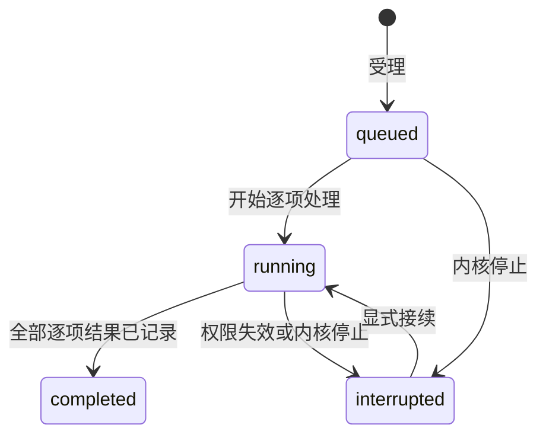

# literature-catalog Specification

## Purpose

提供独立于研究项目的共同文献题录权威，使 GUI 和内置 Agent 从同一服务摄取、查询并整理有稳定身份的文献，保留来源、发表版本、逐项结果和可恢复副本。题录先可用，附件取得和科研分析分别由后续能力实现及表达。

## Requirements

### Requirement: 独立题录与版本身份

系统 SHALL 持久保存独立全局库身份和文献身份，与路径、外部题录 ID、DOI 分开。文献 SHALL 保留 CSL JSON 题录、明确版本标签、来源、更新时间和修订号；题录、全文地址、附件登记及实际可读、分析是否生成 SHALL 分别表达。只在规范化 DOI 和明确版本标签相同时复用身份，未知版本及无确定标识不自动合并。相同版本补齐空字段，冲突保留候选与来源，不覆盖已有值；不同版本可显式双向关联。

#### Scenario: 预印本与正式版
- **WHEN** 同一 DOI 的不同明确版本分别收录并显式关联
- **THEN** 保留两个稳定条目及各自题录，版本关联可双向查询，不以较新版本覆盖旧版

#### Scenario: 重复收录冲突
- **WHEN** 同版本再次收录，已有题名冲突但摘要缺失
- **THEN** 复用原身份并补入摘要，保留原题名和可查询冲突候选，不重复生成来源条目

#### Scenario: 登记附件不等于可读
- **WHEN** 来源有附件登记但实际外链已失效
- **THEN** 来源仍能查询，附件详情明确缺失，不把登记数量或全文地址当作可读证明

### Requirement: 有界整理与授权更正

系统 SHALL 提供有界题录查找、精确读取、集合/子集合和标签；同一条目可属于多个集合，移出只改变分组。更正 SHALL 核对已读取修订号，拒绝过期覆盖，并保存可检查的旧值和来源。读取、写库和发送题录到模型 SHALL 分别受有效库授权约束，方法或模型请求不自行扩大授权。变化 SHALL 使相关客户端重新读取有界范围，保留草稿与当前会话。

#### Scenario: 两客户端同时更正
- **WHEN** 两个客户端基于同一修订号提交不同题录
- **THEN** 只接受先提交者，后提交者重读，不覆盖已保存内容；旧值仍可核查

#### Scenario: 移出集合
- **WHEN** 用户将条目从一个集合移出
- **THEN** 只移除该分组，库条目和其他集合关系保留

### Requirement: 可接续逐项题录摄取

CSL JSON 摄取 SHALL 返回稳定批次引用并保留原输入、来源与各项实际结果。重复身份相同输入返回原批次，不同输入拒绝；无效记录不影响其他记录入库。批次查询 SHALL 有界，已成功项不重跑；中断保留结果并标明剩余未执行，只有明确接续才继续。受理前及每个写入边界 SHALL 核对权限，数据库提交中的题录与对应批次结果保持同一事务。

#### Scenario: 部分非法条目
- **WHEN** 批次包含合法题录和缺少题名的记录
- **THEN** 合法项可立即查询，非法项有结构化失败，批次完成不表示每项成功

#### Scenario: 入库后回执丢失
- **WHEN** 一项已提交，随后进程终止且调用方未取得回执
- **THEN** 重启查询取得已确认条目与结果，显式继续只处理未执行项

### Requirement: 题录库备份与独立恢复

题录库 SHALL 使用数据库备份接口，提供范围明确、可关闭的自动备份及手动备份。新备份 SHALL 纳入所引用的托管材料，列明外链未纳入及不可取得文件的缺项；旧题录备份的实际范围保持可辨。恢复 SHALL 创建不存在的独立副本，不覆盖当前库或后续编辑；副本身份独立、写入/外发需重新授权，既有文献与附件身份、材料版本及关系保留。损坏或不兼容库 SHALL 停止受影响写入并保留现场。扩大写入与外发能力的迁移 SHALL 保留迁移前副本，原题录写入/外发授权不能隐含授权新文件管理及附件发送能力。

#### Scenario: 恢复早于后续编辑的备份
- **WHEN** 用户恢复旧库备份
- **THEN** 副本可独立打开核查，当前库和新成果保持原状；副本不自动执行遗留批次

#### Scenario: 托管文件与外部依赖
- **WHEN** 备份包含托管正文和一个外链附件
- **THEN** 独立副本可读回托管原字节，清单说明外链未复制，缺失外链不导致题录或托管文件恢复失败
