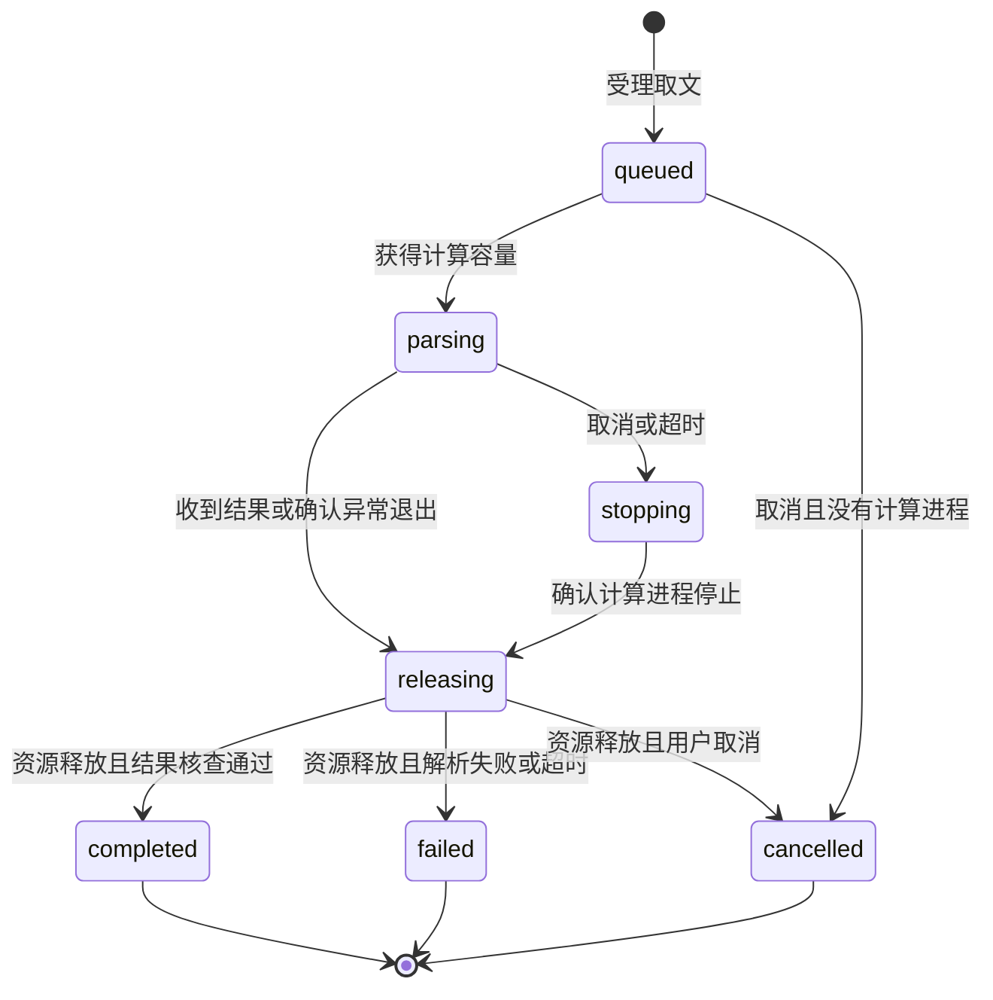
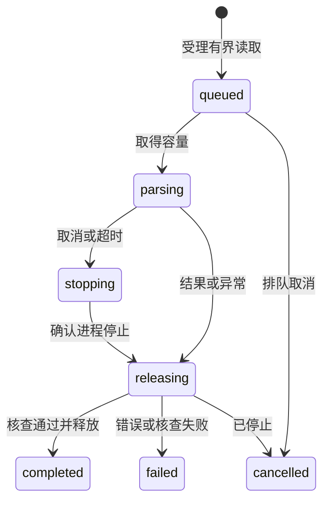
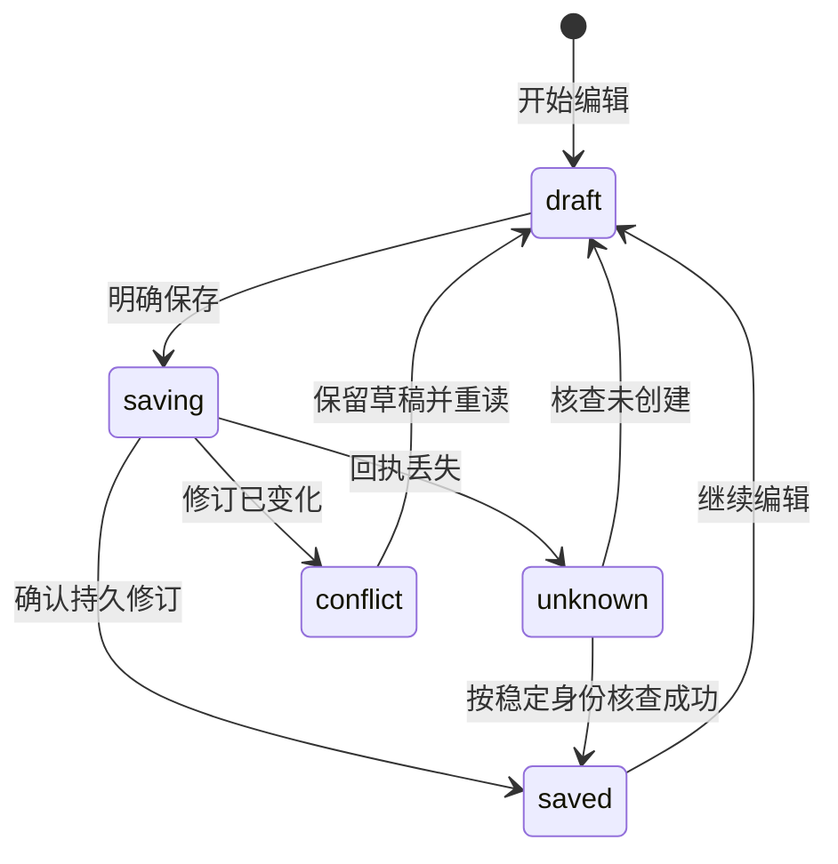

# literature-reading Specification

## Purpose

让用户与 Agent 共同读取已收录 PDF 的正文和阅读成果，在没有可见阅读窗口时仍可按页取用材料。以实际材料版本保存页码、区域、摘录、作者和解释，提供有界访问、并发更正及可恢复保存，使阅读结果不依赖某个窗口或第三方阅读器的内存状态。

## Requirements

### Requirement: 独立有界 PDF 取文

系统 SHALL 根据稳定附件和材料版本引用检查 PDF 及读取指定页的正文，不要求打开 GUI。响应 SHALL 区分页数、请求页、实际返回文字及截断／下一位置；单页超出响应预算时允许按字符位置继续，不把部分文字表示为完整材料。无文字层、加密不支持、格式损坏、材料缺失／变化及范围无效 SHALL 可辨，不能把解析失败作为空白正文成功返回。读取 SHALL 有输入、响应、并发及执行时限边界；停止或超时不报告已完成，后续合法请求仍可执行。取文 SHALL 不改写原材料。

解析计算 SHALL 在独立受管的操作系统进程中执行，线程 Worker SHALL 不视为满足该隔离；解析进程阻塞或崩溃 SHALL 不影响宿主、文献库查询及无关会话，崩溃后的合法请求仍可执行。取消、超时或崩溃的收尾 SHALL 在确认本地计算进程停止并释放资源后，才上报本地取消或安排需要同一容量的新请求。取文及结果交付的权限复查 SHALL 沿用阅读授权要求。

#### Scenario: 阅读窗口从未打开
- **WHEN** 授权调用方按稳定材料引用读取 PDF 的第二页
- **THEN** 取得该版本第二页的有界文字及页信息，结果不依赖可见阅读窗口

#### Scenario: 超长或无文字层的页面
- **WHEN** 一页文字超过单次预算，或页面只有扫描图像
- **THEN** 前者明确截断及继续位置，后者明确没有可提取文字，均不宣称已经完成 OCR 或全文分析

#### Scenario: 材料或执行不可用
- **WHEN** 目标文件内容已变、PDF 损坏或读取超时
- **THEN** 返回对应结构化失败，保留附件与已存记录，不将错误缓存成成功正文

#### Scenario: 解析崩溃后恢复
- **WHEN** 某次取文的解析计算进程崩溃，随后按合法材料引用重新取文
- **THEN** 宿主与文献库未受影响，受影响请求返回可辨失败，新的合法取文正常执行

#### Scenario: 解析卡死时库与其他会话仍可响应
- **WHEN** 某次取文的解析进程阻塞或长时间占用
- **THEN** 宿主、文献库查询及无关会话仍正常响应，该请求按自身时限收尾，后续合法请求仍可执行

### Requirement: 共同书签批注与笔记

系统 SHALL 通过共同内核保存和有界查询书签、高亮批注及文献笔记，GUI 和 Agent 使用同一数据权威。记录 SHALL 有独立身份、来源条目、附件及材料版本、类别、创建者、最后修改者、时间和修订号；原文摘录与记录者说明分别保存。PDF 位置 SHALL 使用该材料的页索引及可选区域，不绑定窗口 DOM 或文件路径；其高亮须有摘录与区域，书签有页位置，笔记可针对该材料整体或某页。EPUB／HTML 位置沿同版本规范化文本位置要求。界面产生的临时选区不等于持久保存成功。

#### Scenario: 人与 Agent 分别作批注
- **WHEN** 用户保存带摘录的高亮，Agent 随后在同一材料保存解释笔记
- **THEN** 双方读取同一组记录，能分辨摘录、原作者身份和 Agent 的解释，不混成文献作者原文

#### Scenario: 重启后读取
- **WHEN** 关闭阅读窗口并重启内核，再按材料引用查询阅读成果
- **THEN** 已确认的书签、批注和笔记仍可读，临时选区不会伪装成已保存记录

### Requirement: 独立有界文档取文

系统 SHALL 从已收录的 EPUB 2／3 重排版或单文件 HTML 材料提供章节目录、规范化正文、允许的结构、搜索及受控栅格资源；GUI 与 Agent 使用同一解析结果和文字位置，不要求可见阅读窗口。目录、正文、资源和搜索 SHALL 有界并提供继续位置，搜索说明实际覆盖，不将部分扫描表示为全文无命中。固定版式、受保护正文、损坏、超限及材料变化 SHALL 返回可辨失败。解析不执行脚本、不取回外部实体、样式、字体、图片或网络正文，不访问 HTML 配套目录，原材料保持不变。缺图片不妨碍可用正文，外链仅由明确用户动作打开。

解析 SHALL 沿共同受管操作系统进程、容量及截止时间执行，授权、材料核对、取消和实际退出确认遵守共同 PDF 读取相同要求。

#### Scenario: 无窗口继续读取
- **WHEN** Agent 按材料引用分段读取 EPUB 或 HTML
- **THEN** 取得共同规范化正文、章节及继续位置，可查询人类保存的阅读记录

#### Scenario: 不可信资源和损坏材料
- **WHEN** 材料包含脚本、外部资源、逃逸 ZIP 路径或超限展开内容
- **THEN** 脚本及外部访问不执行，非法结构或超限明确拒绝，已有材料和记录保留

#### Scenario: 搜索未覆盖全书
- **WHEN** 本次搜索达到结果或扫描预算
- **THEN** 返回已有命中、实际覆盖及继续位置，不报告完整无命中

### Requirement: 同版本规范化文本位置

EPUB／HTML 的书签、高亮及可选带位置笔记 SHALL 沿共同记录、可信作者、修订、幂等、未知回执核查及独立恢复契约保存。位置 SHALL 指向实际材料版本、规范化版本、章节和 UTF-16 文字区间；高亮须有非空摘录及有效非空区间，保存时核对摘录与正文一致。书签可为章节内的零长度位置，笔记可不带位置。PDF 既有位置和记录继续有效。原材料失效或规范化位置不可用时保留原摘录，不自动重绑新版。仅修改说明且原依据不变时，允许沿既有修订规则更正已失效材料上的记录。

#### Scenario: 同一摘录在人与 Agent 间共享
- **WHEN** 用户在章节中保存高亮，Agent 随后读取记录
- **THEN** 双方获得同一文字区间、原摘录及可信作者，Agent 说明不混作原文

#### Scenario: 错误摘录和旧材料
- **WHEN** 提交的摘录与章节区间不同，或将旧位置用于新材料版本
- **THEN** 拒绝保存，保留既有记录及调用方草稿

#### Scenario: 独立恢复
- **WHEN** 含文档记录的库备份恢复到独立配置
- **THEN** 副本保留原位置、记录和修订，当前库后续成果不变

### Requirement: 修订核对与保存诊断

新增记录 SHALL 允许以调用方稳定身份核查回执未知的结果；相同身份相同创建输入返回原成果，不同输入拒绝。更正及明确移除 SHALL 核对所读取的修订号，不接受过期覆盖；创建者及材料版本不可由普通更正改写。更正后保留可查询旧修订。移除阅读记录不删除附件或外部原文件。保存失败、冲突或回执未知 SHALL 保留调用方草稿并提供重读核查路径，不能静默覆盖或报告成功。

#### Scenario: 两个客户端同时更正
- **WHEN** 两端读取相同修订后依次保存不同说明
- **THEN** 首次保存成功，第二次返回冲突，保留草稿和已保存内容；旧修订仍可核查

#### Scenario: 创建回执丢失
- **WHEN** 记录已保存但客户端未收到回执，再使用同一身份及创建输入提交
- **THEN** 返回原记录，既有后续更正不被重放的创建输入覆盖

### Requirement: 版本失效与独立恢复

记录 SHALL 始终绑定创建时的实际材料版本。原材料不可达或内容不同，系统 SHALL 保留摘录、版本、作者和说明并显示不能定位的原因；不得把旧页码用于新附件，不自动迁移或重绑旧证据。同内容人工重定位后可再次打开原位置。已保存记录及修订 SHALL 纳入共同库备份和独立副本恢复，保留记录与材料身份，当前库及备份后的成果保持原状。

#### Scenario: 外链失效后增加新版
- **WHEN** 旧外链已缺失，用户为同一题录添加不同内容的新附件
- **THEN** 旧记录仍显示摘录及原版本，不能跳转到新附件的同页；新材料上的记录使用新引用

#### Scenario: 恢复含阅读成果的备份
- **WHEN** 在保存批注后备份，再更正内容并恢复旧备份到独立配置
- **THEN** 副本可查询旧记录及修订和可取得的托管原材料，当前库保留后续更正

### Requirement: 阅读授权与离线边界

读取正文和阅读记录 SHALL 检查库 read，保存／移除还需 write；Agent 取用及模型请求／重试还需有效项目 send 和库 send。异步结果交付前 SHALL 重查权限，不能用缓存绕过撤权。Agent 创建及修改记录的身份 SHALL 由执行上下文确定，不由模型冒充用户。阅读器所需运行资源 SHALL 随应用提供，不自动将正文、摘录或阅读行为发往外部服务；外链仅由明确用户动作打开。

#### Scenario: 取文期间撤权
- **WHEN** 调用已进入异步解析而库读取或 Agent 外发授权被撤回
- **THEN** 后续结果交付和模型请求被拒绝，既有材料与阅读成果仍保留

#### Scenario: 离线阅读
- **WHEN** 外网不可用而本地材料及授权有效
- **THEN** 工作台仍可使用随应用提供的 PDF 运行资源阅读，不依赖 CDN、远程字体或云 PDF 服务
