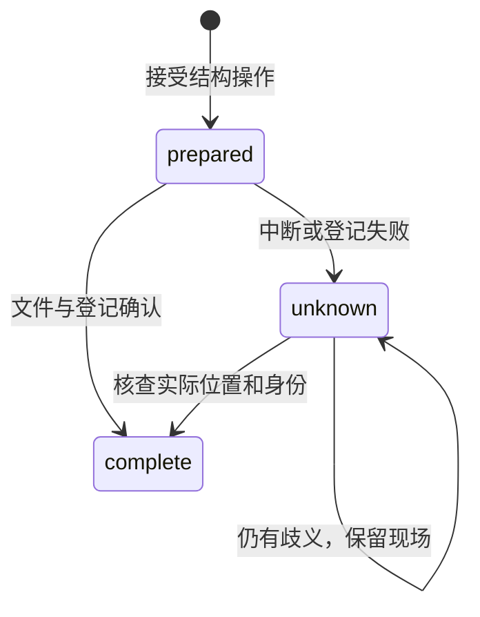

# project-files Specification

## Purpose

让人和内置 Agent 从共同内核打开研究项目，读取并安全修改开放文本材料，在并发编辑、写入失败、撤销与备份恢复时保护已经保存的成果。项目身份和自身记录随目录保存，文件正文保持实际磁盘内容的事实权威。

## Requirements

### Requirement: 项目身份与有界访问

项目 SHALL 在本地保存稳定身份和必要结构化事实，目录移动及应用登记丢失不改变身份。列表、搜索、历史和内容读取 SHALL 有界，目录按需展开。文件接口 SHALL 核对真实路径及授权，拒绝越界和内部私有资料访问，GUI 与 Agent 读取同一文件。

#### Scenario: 移动项目
- **WHEN** 项目目录移动后再次打开
- **THEN** 原身份、会话和成果仍可读取，路径登记更新

#### Scenario: 越界路径
- **WHEN** 请求通过相对路径或符号链接越出项目授权范围
- **THEN** 拒绝访问且不读取或修改范围外内容

### Requirement: 文件保护与实际结果

保存 SHALL 按文件串行核对读取依据对应的整份内容，变化时要求重读，不自动合并；新建已存在目标不得覆盖。结果 SHALL 区分冲突、目标不存在、目标不明、权限不足、暂不可用和效果未知。草稿 SHALL 与磁盘事实分开，提供差异、有界历史和保护后续编辑的撤销。保存后关联实际成果，关联失败保留文件并允许补齐，不重复登记。

#### Scenario: 外部修改其他段落
- **WHEN** 读取后外部编辑器修改了文件另一处
- **THEN** 旧依据保存被拒绝，外部内容及候选草稿保留

#### Scenario: 并发保存与撤销
- **WHEN** 两调用方基于同一内容保存，或旧修改后存在后续编辑
- **THEN** 后保存者重读；不安全的撤销拒绝覆盖当前内容

#### Scenario: 成果登记失败后重启
- **WHEN** 普通文件已保存但成果登记失败，随后内核重启
- **THEN** 文件保留，待核查关联仍可查询；显式核查可补齐关联，同一执行与路径不重复登记

### Requirement: 备份与副本恢复

系统 SHALL 提供范围明确且可关闭的自动备份，使用数据库备份接口，记录未包含的文件；默认每五分钟检查变化，保留最近十份。恢复 SHALL 创建独立副本，可查看并选择性取回内容，不覆盖当前项目或后续成果。迁移前 SHALL 保护旧数据库，损坏或不兼容时停止受影响写入并保留现场。

#### Scenario: 取回旧备份
- **WHEN** 当前项目已有更新而用户恢复旧备份
- **THEN** 恢复副本可打开核查，当前数据保持原状，选择性取回仍经过安全保存

### Requirement: 项目创建与最近列表管理

系统 SHALL 支持创建不存在的项目目录、持久显示名和最近项目列表。新建不得覆盖已有目录；重命名不移动目录或改变身份；移出列表不删除数据、不关闭在途执行使用的存储。再次打开 SHALL 保留会话与身份并重新登记。

#### Scenario: 执行期间移出最近列表
- **WHEN** 用户移出一个正在执行的项目
- **THEN** 项目从最近列表移除，执行和磁盘内容保留，再次打开可查看结果

### Requirement: 稳定文件引用与结构管理

系统 SHALL 按需登记稳定文件身份，支持创建目录、重命名文件及非空目录、回收及恢复。成果和撤销引用 SHALL 跟随应用确认的结构变更，历史路径与正文不被改写。普通写授权 SHALL 明确包含结构操作，已有项目需重新确认扩大的权限。操作 SHALL 与相交路径的保存协调，保留并失效旧读取依据，不自动重建已移走目标。

#### Scenario: 原路径复用
- **WHEN** 一个已登记成果被改名或回收，原路径随后创建另一文件
- **THEN** 成果仍指向原文件身份，不能打开或撤销另一文件

#### Scenario: 目录与保存竞争
- **WHEN** 人或 Agent 保存子文件的同时重命名父目录
- **THEN** 短暂提交按相交路径协调；旧依据保存拒绝或在已确认的原提交前完成，草稿与实际文件保留

### Requirement: 回收恢复与结构操作核查

回收 SHALL 保存完整文件或目录载荷；恢复默认原路径，也允许指定新路径，不能覆盖已有内容。系统 SHALL 保存稳定结构操作身份和可查询结果；重复身份不同参数应拒绝，回执丢失不能重复副作用。中断后先核查实际位置，无法确定时保留现场和未知状态，不盲目重放。备份 SHALL 明确包含的回收载荷和图片，缺失载荷不能报告完整恢复。

#### Scenario: 恢复位置已存在
- **WHEN** 回收后原路径已有后续成果
- **THEN** 原内容和回收载荷均保留，用户可选择其他恢复位置

#### Scenario: 落盘后登记失败
- **WHEN** 结构操作已改变实际位置但元数据提交失败
- **THEN** 结果为未知，重启后可按原操作身份核查，不能再次搬移或覆盖内容

### Requirement: 有界本地图片读取

系统 SHALL 经共同授权接口读取项目内 PNG、JPEG、GIF、WebP 图片，检查实际格式、真实路径和读取权限，单张不超过 1 MiB。私有路径、越界、外部链接及其他格式 SHALL 拒绝，错误不能泄露私有内容。

#### Scenario: 预览引用越界图片
- **WHEN** Markdown 引用项目外路径、私有文件或未经读取授权的图片
- **THEN** 不交付资源，预览保留正文并显示该资源不可用

### Requirement: 项目目录浏览

内核 SHALL 向已认证本机客户端提供目录浏览 RPC，供没有系统路径选择能力的宿主在添加项目弹窗内选择目录。浏览 SHALL 只列目录、不列文件；目标路径经 realpath 解析后必须是普通目录，符号链接、隐藏项与应用私有配置目录 SHALL 排除在结果外且不读取其内容；结果按名称排序并受单页上限约束，超出时返回截断标记。响应 SHALL 包含当前目录的真实路径、父路径与目录条目（名称与真实路径）；未指定路径时从用户主目录开始。路径不存在或解析后不是普通目录时 SHALL 返回可诊断错误，不静默回退到其他位置。

#### Scenario: 只列目录

- **WHEN** 客户端浏览一个同时包含文件与子目录的目录
- **THEN** 结果只包含子目录条目，文件不出现

#### Scenario: 排除链接与私有配置

- **WHEN** 目录内含符号链接、隐藏项或应用私有配置目录
- **THEN** 这些条目不出现在结果中，链接目标不被读取

#### Scenario: 有界分页

- **WHEN** 目录条目数超过单页上限
- **THEN** 返回按名称排序的前 limit 条并标记截断

#### Scenario: 路径不可用

- **WHEN** 请求的路径不存在或 realpath 后不是普通目录
- **THEN** 返回可诊断错误，不静默切换到其他目录
