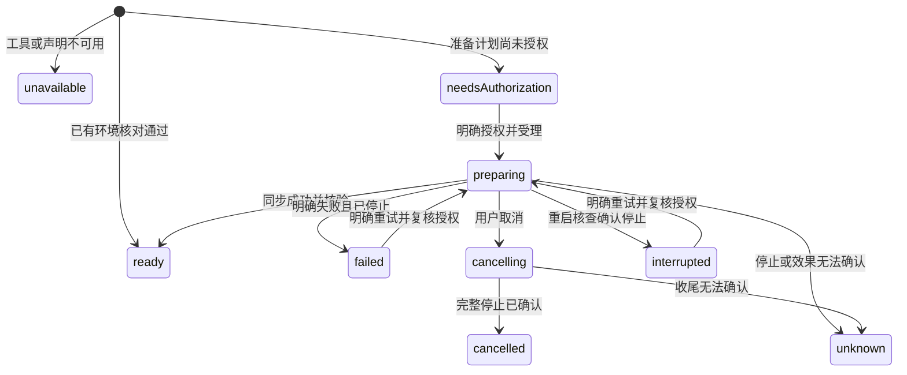
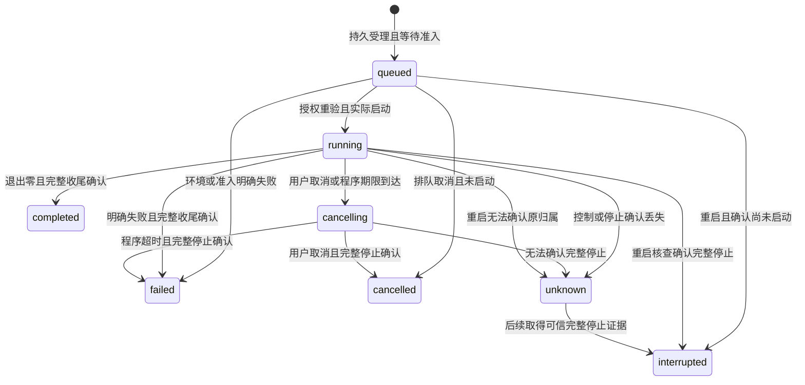

# project-program-runs Specification

## Purpose

为人和 Agent 提供共同的项目程序环境、运行记录、状态与有界日志，使获授权的可信程序实际使用项目材料并生成可核查的工作区输出。程序运行事实独立于会话、模型与科研判断，并在准备失败、取消、宿主中断和部分产物情境下保留可诊断依据。

## Requirements

### Requirement: 项目内共同运行入口与授权

系统 SHALL 让人和 Agent 使用同一环境与运行能力及记录，人工操作不要求会话或模型。运行必须显式指定已登记环境、项目内工作目录、程序入口及参数；环境登记不授予项目权限。Agent执行 SHALL 核对当前真实项目工作域、实例及项目信任，在排队后和启动前重验，拒绝全局会话、跨项目只读范围和失效实例。人工入口允许已有人工项目操作约定下显式运行可信代码，不将项目信任状态直接视为人工代码执行同意。

受理 SHALL 使用调用方稳定operationId；相同主体、项目、身份和输入返回原运行引用，输入不符拒绝。连接断开或受理等待结束后 SHALL 可按原身份查询，不自动重复启动。当前平台不能满足完整受管归属保证时，包括当前macOS， SHALL 在启动程序或准备worker前明确返回unavailable，保留人工文件操作及已有记录。

#### Scenario: 人工运行后由Agent查询
- **WHEN** 用户未创建会话、未配置模型，从项目运行入口启动固定程序，之后Agent获授权查询其引用
- **THEN** 两入口读取同一持久运行及输出，不补建人工会话或另一份运行记录

#### Scenario: 重复受理及无效归属
- **WHEN** 原受理回执丢失后按相同operationId补交，或全局／只读目标／旧实例请求项目程序
- **THEN** 合法补交返回原记录而不重跑，无效归属在启动前被拒绝

#### Scenario: 不可用平台
- **WHEN** 当前macOS或其他不能满足受管归属保证的内核收到新运行或环境准备
- **THEN** 不创建执行worker，明确说明不可用，历史记录、输出及人工文件能力保持可查

### Requirement: 环境选择及授权内准备

系统 SHALL 提供宿主Node、显式登记的已有Python／Conda解释器，以及使用已有uv与Python按项目锁定声明准备的受管Python环境。可用性、可确认版本、缺项与失败原因分别表达，不因存在环境名称就认为依赖齐备。准备 SHALL 使用稳定操作身份，保存实际计划、授权依据、执行与结果；仅在已授权的环境目录、声明依赖、联网和安装／构建范围内进行，并复用仍符合依据的环境。项目声明变化 SHALL 要求重新核对，不悄悄沿旧授权扩张。

首批准备 SHALL 不修改用户已有解释器／Conda环境、项目锁文件或项目`.venv`；不自动下载缺失工具或解释器、不退为无锁安装。需要授权时返回具体计划与缺项，后续可按同一计划明确授权；Agent工具不能自行铸造授权。准备失败、取消或中断的环境 SHALL 不标为ready，已ready的独立环境保持可用。就地代码执行不承诺任意代码强隔离，也不宣称发现全部依赖。

#### Scenario: 授权内首次准备及复用
- **WHEN** 所需uv、Python和锁定声明存在，且用户已授权相应受管准备范围
- **THEN** 准备在私有受管环境中执行并记录结果，后续符合相同依据的运行复用它，不逐次请求同一授权，不改变用户已有环境

#### Scenario: 缺依赖或授权不足
- **WHEN** 解释器／uv缺失、声明不受支持，或准备需要新增依赖／联网／改动已有环境而未获授权
- **THEN** 返回具体缺项、计划和授权需求，不自动安装或使用别的解释器；其他独立环境仍可运行

#### Scenario: 准备中断
- **WHEN** 准备过程中失败、取消或宿主退出
- **THEN** 查询区分已停止、未知和中断，不将部分环境提供为ready，不自动重试未知安装效果

### Requirement: 持久运行依据与独立生命周期

运行 SHALL 保留programRunId、发起主体、项目、受理身份、环境依据、实际命令与参数、工作目录、解释器及可确认版本、声明代码／输入引用和取得的版本依据。无法确认或未声明的依赖 SHALL 如实标明。会话／harness运行引用只作为可选来源，不成为通用运行身份或人工前置。

运行 SHALL 区分queued、running、cancelling、completed、failed、cancelled、interrupted和unknown，保存失败阶段与停止原因。completed仅表示程序退出成功并确认所属执行已收尾，不证明科研结论或输出完整。根程序退出后仍需收尾后代；失败也不能掩盖停止未知。结果核查和关联失败 SHALL 与进程退出事实分别保存。

#### Scenario: 声明依据发生变化
- **WHEN** 运行排队期间代码、输入、环境或工作目录身份变化
- **THEN** 启动前拒绝过期依据，保留原请求及诊断，不静默使用新的文件或环境

#### Scenario: 运行结束但输出关联失败
- **WHEN** 程序退出成功且完整停止，但实际结果登记或可选成果关联未完成
- **THEN** 退出事实保持可查，结果单列不完整或未知，不报告整体成果已交付，也不自动重跑程序

### Requirement: 人工后台移交的持久授权与接管

Agent 程序默认归原执行，父执行取消或退出 SHALL 按完整归属停止未移交程序并保存parentStopped原因。后台移交 SHALL 由可信人类对某个正在运行的程序逐次明确操作，持久记录授权人及时间后由宿主承担收尾；Agent不能自行申请已授权身份，移交不授予新的程序或项目权限。

移交 SHALL 先核对接管资格，授权持久成功前保留原归属和取消责任；授权已保存、实际接管和接管失败分别可查。父取消或控制资格在接管前失效时 SHALL 不脱离原归属；授权已保存且实际接管后完成收据保存失败，须报告outcomeUnknown及已确认的实际事实，不能冒充无授权或完整成功。

#### Scenario: 人工逐次移交后台
- **WHEN** 用户对正在运行的Agent程序执行“移交后台”后取消父会话
- **THEN** 该程序保留原来源及人工移交记录并继续受宿主管理，人工仍可查询和取消；未移交的程序随父执行停止

#### Scenario: 移交持久化与接管失败
- **WHEN** 授权保存失败，或授权保存后父取消／接管资格失效
- **THEN** 失败不解除原取消责任，记录区分授权保存与实际接管；只有已成功持久的授权才能支持实际后台运行

### Requirement: 有界日志与等待和程序期限分离

系统 SHALL 在运行中及重启后提供有界stdout／stderr记录，保留流类型、顺序游标、最后日志时间和截断／缺段指示。列表、查询、订阅、IPC积压及每次日志读取 SHALL 有界，不能以全量日志投影刷新整个工作台。超过保留上限 SHALL 持续排空输出并明确截断，不因普通日志过量导致无界存储；日志保存或传输故障须可诊断。

请求等待与程序执行期限 SHALL 分开：短探测／准备子命令具有明确期限，长程序可按配置无程序总期限，状态始终可查和取消。等待结束、界面关闭或无日志 SHALL 不自动判定失败或取消已由宿主接管的程序。前台委派尚未移交的程序按委派链收尾；后台继续必须显式记录宿主归属。

有限程序时限 SHALL 按完整单调累计时间计算，超过原生单次timer上限不得提前到期；null继续表示无程序总期限。

#### Scenario: 无日志长计算与工具等待结束
- **WHEN** 已移交宿主管理的程序长时间无输出，调用工具的等待结束
- **THEN** 返回或保留可查询运行引用与实际状态，程序继续受管，不把等待结束或无日志记成计算超时

#### Scenario: 日志超过保留上限
- **WHEN** 程序连续输出超过保留容量，用户按旧游标读取
- **THEN** 内存、持久日志和传输仍有界，返回保留片段和截断／游标缺段事实，程序不因未排空管道而卡住

### Requirement: 环境配置总容量及准备意图保护

环境配置的候选持久内容 SHALL 在替换前遵守读取的4MiB总上限，容量拒绝保留原文件和可用内存状态。活动登记／计划 SHALL 预留有界回执及恢复信息空间；准备派发前持久保存意图，不因容量回滚遗失已受理准备的防重复依据。既有近上限配置恢复诊断无法落盘时 SHALL 保留原历史并提供恢复后的可查询状态，不将容量不足变为全模块永久失效。

#### Scenario: 候选配置超出总容量
- **WHEN** 新登记或计划使完整候选及活动恢复预留超过4MiB
- **THEN** 替换前拒绝，保留原文件和可用状态，已授权历史不被清除，准备不会在持久意图之前派发

#### Scenario: 旧近上限配置恢复
- **WHEN** 可读取的旧配置含活动记录，新增恢复诊断无法写回原文件
- **THEN** 内核完成只读恢复并保留原历史，当前状态可查询，新写明确容量不足而不永久污染模块

### Requirement: 取消及重启按完整归属核查

取消 SHALL 先停止新增调度，进入cancelling并按归属停止程序与后代；完整停止确认后才报告cancelled或程序超时终态。取消不回滚文件或其他已产生效果。控制器退出、IPC断开、根PID消失或复用 SHALL 不作为完整停止证明；未知归属继续占用统一容量，并阻止可能重复写入的接续和相关仓储释放。

重启 SHALL 核查持久启动意图、停止证据和实际产物，不自动重启或重放程序／环境准备。不支持重接的程序明确说明；无法重新确认原生归属时保留unknown及原因，不假称断点续算。恢复独立备份副本 SHALL 保留历史与缺项，清除活动控制资格且不向原进程发信号，不把副本历史重新加入原执行的控制关系。

#### Scenario: 取消detached后代
- **WHEN** 固定程序创建detached后代后用户取消
- **THEN** 只有后代真实停止且完整归属已确认才显示cancelled及释放名额；已写结果仍可查看

#### Scenario: 控制丢失后重启
- **WHEN** 程序停止确认丢失且内核重启，即使原根PID已不存在
- **THEN** 原运行保持unknown及容量／冲突保护，不发送信号给复用PID，不自动重跑或释放受影响仓储

#### Scenario: 恢复到独立副本
- **WHEN** 含运行历史的项目备份恢复到独立项目
- **THEN** 副本可查询原运行依据与缺失输出，未结束记录明确为历史中断或未知，不启动程序、不控制原项目进程，原项目保持不变

### Requirement: 实际输出与工作台共同资源打开

运行 SHALL 按显式声明的项目输出逐项检查，保存实际资源引用、内容依据及present、missing、changed、unreadable或unknown等可读状态；未声明的项目文件不自动遍历登记。存在文件不证明由本次运行产生或已经完整，未验证的完整性 SHALL 保持unassessed；失败后的部分文件可以查看但不能冒充完整成果。默认提供新的项目输出位置，显式允许覆盖时保留已知旧输出依据和实际变化，不能声称能拦截任意可信代码的所有写入。

打开输出 SHALL 经共同资源入口重新核对身份、内容与权限，格式不支持时给出实际不可用原因，不执行输出中的任意HTML／脚本。输出登记、可选项目成果关联与字节存在分别表达；无法证明本次生成时只能保存观测事实。工作台运行tab SHALL 使用既有布局与语义token，只查询当前项目／当前运行；切换项目、刷新或关闭tab保留草稿且不改变会话接收者，不取消已受管后台运行。

#### Scenario: 失败后保留部分结果
- **WHEN** 固定程序写出部分CSV后非零退出，另一项预期输出未产生
- **THEN** 查询分别显示非零退出、已有文件及缺失项，已有文件可经共同资源打开，整体结果不标为完整交付

#### Scenario: 输出被替换与视图切换
- **WHEN** 用户打开运行结果前文件已被替换，或运行期间切换项目再返回
- **THEN** 打开核对原身份与依据并说明变化，原运行、配置草稿和当前会话不被迟到刷新覆盖，后台运行继续
