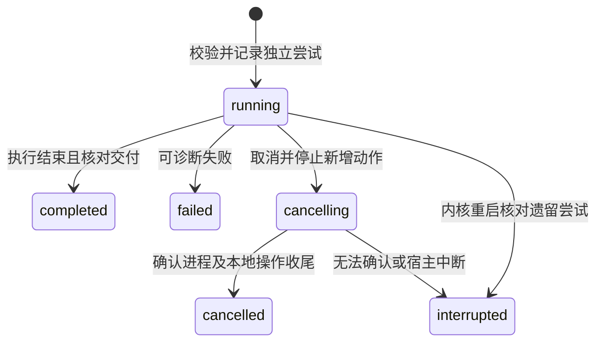
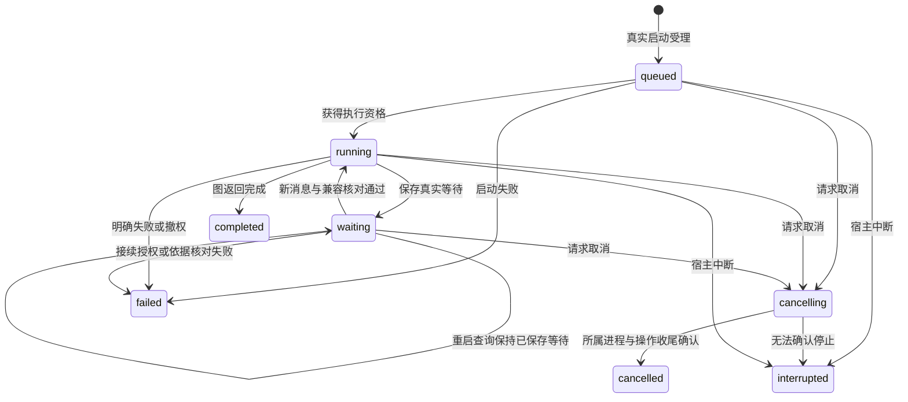

# research-capabilities Specification

## Purpose

让通用 Agent 在共同执行机制中按需读取科研方法并明确调用能力，由内核核对输入、授权、执行尝试和实际交付。方法内容、模型执行结束与科研判断保留各自含义，调用记录和普通项目成果可脱离旧对话查询与接续。

## Requirements

### Requirement: 内置方法发现与加载

系统 SHALL 提供有稳定身份、版本、作用域和来源的内置材料分析方法及能力声明，摘要发现与按需正文读取分开。普通 Skill SHALL 可直接读取而不创建能力调用或研究任务。能力输入及交付要求 SHALL 来自已校验声明；声明不增加执行权限。首次内容范围为内置方法，用户与项目内容管理沿后续实施。

#### Scenario: 按需使用方法
- **WHEN** 调用方发现并读取一个指定版本的方法
- **THEN** 取得对应方法正文、来源及能力约定，不启动模型或建立任务

### Requirement: 共同能力执行与身份

明确能力入口 SHALL 在执行前校验所选身份/版本、输入结构、材料可读性和当前项目信任及可信执行范围。一次科研使用 SHALL 有稳定调用身份，每次实际推进保存独立尝试、所属会话和执行、采用方法及输入，实际读取与保存结果沿共同文件工具记录。Agent SHALL 无需另调开工或结项工具；内部工具不产生新业务调用。能力模型请求 SHALL 共用父推进的模型额度、调度和取消控制。

现有能力入口触发的独立 Agent 图 SHALL 使用受管的独占执行进程，父执行等待其结果时不持有模型请求名额，实际存活的父子进程均计入容量。容量不足不能让父执行无限等待其占用的最后资源，SHALL 返回可诊断资源限制并保留已有记录。科研运行模块掌握方法、调用尝试及交付检查，通过公共接口使用通用 harness 及领域能力，不取得项目数据库或在自己的记录中复制领域权威。默认父推进负责子执行收尾，取消覆盖现有能力子执行及已受理本地工作。

#### Scenario: 无效输入或授权
- **WHEN** 输入缺项、版本不可用、材料越界或权限不足
- **THEN** 返回可诊断失败，不启动能力模型执行或扩大权限

#### Scenario: 从工作台调用
- **WHEN** 用户要求按内置方法分析项目文本并保存报告
- **THEN** 经真实共同能力入口执行，工具详情及持久查询反映调用与尝试，实际文件可通过共同成果入口打开

#### Scenario: 能力执行需要最后一个进程名额
- **WHEN** 父执行等待能力子执行，而进程容量无法安排该子执行
- **THEN** 返回资源限制，不无界排队或将仍存活的父进程从占用中隐藏；其他独立工作仍可查询

#### Scenario: 能力进程失败
- **WHEN** 能力 Agent 阻塞或崩溃
- **THEN** 该尝试保存实际失败及部分成果，父推进取得可诊断结果，宿主和无关会话不随它退出

### Requirement: 实际交付与科研判断分离

能力结果 SHALL 分别表达执行状态、实际产物及程序交付检查、科研充分性尚未评估。检查 SHALL 核对本尝试实际保存的声明产物、可读非空正文和实际读取的输入材料，不能以同路径旧文件或模型自述替代实际交付。产物保存或关联部分成功 SHALL 保留文件与诊断，不因执行结束报告整体交付可用；后续编辑或移动以稳定文件身份核查，不误认原路径上的新文件。

#### Scenario: 正常结束但没有报告
- **WHEN** 模型正常结束却未实际保存所要求的报告
- **THEN** 尝试执行状态为完成但交付不完整，报告具体缺项，科研充分性不自动通过

#### Scenario: 保留部分结果
- **WHEN** 执行保存一份结果后另一必要操作失败
- **THEN** 已保存文件与其已确认关系保留，结果分别说明实际成果和未完成项

### Requirement: 持久重试与有界诊断

系统 SHALL 提供按项目/会话、可选调用身份的有界尝试查询，查询不执行模型。明确重试 SHALL 核对调用归属及原目标/方法/输入，沿用调用身份并增加尝试；新的目标使用新调用。并发推进同一次调用 SHALL 拒绝重复执行。取消 SHALL 等能力本地执行及所属已受理操作完成收尾，保留已保存成果及尝试；无法确认时不报告取消完成。重启将遗留运行尝试标为中断，不自动执行。未知副作用 SHALL 先查询实际成果和工具记录，拒绝盲目重放旧工具。再次尝试仍沿共同文件保护，不覆盖已有成果。

用户 SHALL 通过向所属会话发送新消息表达重试或调整目标，由 Agent 判断是否继续同一次调用；能力结果到达或查询本身不能自动重新开工。已关闭或取消的推进不因迟到结果复活，迟到结果只补充历史及成果核查。

终态后的明确重试创建新尝试，旧尝试保持原终态与身份；调用身份沿用，同一尝试不被改回 running。

#### Scenario: 原调用重试
- **WHEN** 能力未交付完整报告，用户明确重试同一次科研使用
- **THEN** 保留原调用身份与旧尝试，增加独立尝试，既有文件不被无依据覆盖

#### Scenario: 取消后重启与查询
- **WHEN** 用户取消能力执行后重启内核并查询记录
- **THEN** 查询到实际终态、成果与缺项，查询本身不重新启动执行

#### Scenario: 取消后收到能力结果
- **WHEN** 子执行的结果在父推进取消后到达
- **THEN** 保存可核查的历史和产物，不启动新的模型请求或覆盖已停止推进的当前状态

### Requirement: 可信人工科研图请求

系统 SHALL 提供唯一的人工产品图请求入口research.requestGraph，复用已注册图的精确身份、版本、开放配置、projectId/sessionId、原invocationId/instructionId、材料ref/basis及文字目标，返回真实invocationId/instructionId/runId。产品参数 SHALL 不能指定可信角色、工作域、worker入口或任意代码；仅由宿主绑定的product/human调用可申请，执行Agent与system内部身份不得借该入口提权。内部research.startGraph SHALL 保持host/system限制。

#### Scenario: 人工连接请求并确认固定图

- **WHEN** 可信产品连接请求已静态注入的固定图并提交有效材料依据
- **THEN** 宿主经原内部broker入口启动真实执行并保留连接来源，读取材料、首次保存成果及等待，新输入仍从普通session.send进入

### Requirement: 人工图请求的受理复核

请求 SHALL 核对所属真实会话、项目当前信任及材料read/send权限、精确图配置和当前材料版本；预检不替代执行时再次检查。新调用 SHALL 只使用没有未完成推进的会话，不能取消或覆盖既有等待。相同输入的并发补交 SHALL 复用原受理；不同请求争用同会话须明确拒绝且不得排队新开工。同身份异参、恢复副本及未知回执继续沿原科研记录和harness事实核查。

#### Scenario: 忙碌会话与伪造身份

- **WHEN** 新调用选择已有未完成推进的会话，或载荷／调用方试图自行声明可信身份、代码入口或任务字段
- **THEN** 请求明确拒绝，原等待／成果保持，不启动替代执行；原调用的同输入补交仍核对原受理

#### Scenario: 材料变化或撤权

- **WHEN** 请求的材料身份、basis或read/send授权不再匹配
- **THEN** 在新业务受理前报告所属结构化诊断，不以当前同名材料或预检结果替代原引用；执行期间变化仍沿真实资源检查处理

### Requirement: 项目编排保持任务权威

TaskRef/workItemId、任务入口依据、sourceLinkIds和过程材料 SHALL 归项目编排；科研启动与调用记录不增加任务字段。项目服务端须先按任务文件核对选项再将明确的ResourceEvidence交给该入口。仅科研产品请求组合通过 SHALL 不能视为实际任务详情动作、任务链接保存或完整I1验收。

#### Scenario: 任务侧选择材料与保存调用引用

- **WHEN** 项目编排核对任务入口依据与所选来源，并取得科研真实回执
- **THEN** 来源按明确ResourceEvidence交接，调用引用进入所属任务过程材料；科研记录不补造任务状态，完整I1仍以实际用户入口组合验收

### Requirement: 内建科研图的发现与开放配置

系统 SHALL 提供有界的源码内建科研图发现及按 graphId 与整体实现版本的精确描述，返回来源、用途、配置约束、交付约定和所属节点资源标识。节点指导、模板与检查素材 SHALL 随整体实现版本追溯，不建立独立 Method 实体或提示词发布生命周期。发现或读取资源 SHALL 不启动执行、不建立研究任务、不扩大材料访问权限。

图配置 SHALL 只接受声明开放的参数；缺失实现、版本不符、非法配置或必要素材不可用 SHALL 明确失败，不能静默选其他实现或回退到完整 Skill。用户／项目自定义代码装载继续不开放。固定校准图 SHALL 明示其机制验证用途，不作为实际科研充分性或真实综合流程已经交付的证明。

#### Scenario: 发现与精确描述

- **WHEN** 调用方分页发现已装配图并精确读取某一版本的描述
- **THEN** 返回该实现与资源的来源、配置和交付要求，查询不产生执行或任务

#### Scenario: 未开放的配置或代码

- **WHEN** 配置带有未声明参数、客户端模块路径、任意代码，或请求未装配版本
- **THEN** 请求在业务效果前被拒绝，既有成果保持，不选择默认图或通用 Agent 替代

### Requirement: 科研图调用关联实际执行事实

科研图调用 SHALL 保留稳定 invocationId、宿主确认的工作域、原始目标／配置与输入材料依据；每次实际执行尝试 SHALL 关联 harness 的真实 run，而非发起工具的父 run 或科研自造执行身份。图身份、整体版本、实际模型配置及节点素材来源 SHALL 可追溯；无模型图 SHALL 明确没有模型执行配置，不能伪造默认模型。

执行状态、实例、checkpoint、等待及指令消费 SHALL 由 harness 掌握，科研记录只保存调用、执行引用及业务交付事实。最新会话运行 SHALL 不能代替旧调用的执行结果。相同启动身份与相同输入的回执核查 SHALL 不重复开工；同身份不同图、目标、配置或输入 SHALL 拒绝。启动受理结果未知时 SHALL 保留原身份与诊断，先查实际执行，不盲目新建尝试。

研究任务关联 SHALL 按实际需要提供，不因发现图、开始调用或普通会话而自动创建任务；任务、文献及库成果的身份和正文权威仍归所属领域。

#### Scenario: 新执行开始后查询旧调用

- **WHEN** 同一会话已经开始较新的推进，调用方查询先前科研图调用
- **THEN** 返回与原调用关联的真实尝试、版本、配置及业务成果，不将最新 run 状态写入旧记录

#### Scenario: 启动回执未知

- **WHEN** 原启动指令可能已受理而调用方未取得成功回执
- **THEN** 原身份和原输入保留，查询核对实际受理与 run，不自动再启动另一执行

#### Scenario: 没有关联研究任务

- **WHEN** 已授权调用只需要读取明确材料并将固定成果交回当前项目
- **THEN** 可以在没有研究任务关联的情况下执行，调用与成果仍保留各自所属身份

### Requirement: 科研图的材料与业务交付核查

科研图 SHALL 沿共同资源引用和内容依据读取所属项目／库材料，记录实际采用版本及实际读取结果。输入中列出引用或预检可读 SHALL 不算实际取材；路径、同名文件或新库对象 SHALL 不能替代原身份。材料读取、模型外发与成果保存 SHALL 复核当前有效授权；异常沿所属材料诊断处理，需用户选择时暂停并等待明确输入。

首次成果 SHALL 经共同受保护创建取得真实 fileId 与 basis；已有成果修改 SHALL 使用原身份及当前读取依据。交付结果 SHALL 分开表达执行结果、实际保存、成果关联、必需交付缺项及科研充分性。必要成果未读回、读取不完整、关联未确认、操作效果未知或必要步骤未完成时 SHALL 不报告整体交付可用。科研充分性 SHALL 保持 notAssessed，固定样例通过不能代替科研判断。

#### Scenario: 混合材料与首次成果

- **WHEN** 固定图按明确引用读取一份项目文本及一份隔离库材料，并首次保存项目成果
- **THEN** 保留两类实际读取依据与真实成果引用，不隐式复制库原文为项目材料，不要求预建空成果

#### Scenario: 保存成功但关联不完整

- **WHEN** 成果已经保存，而关系登记失败或未确认
- **THEN** 保留文件、原操作身份及关联诊断，交付不完整，后续只核查原结果或补原关联，不重复生成成果

#### Scenario: 旧成果或材料身份被替换

- **WHEN** 同路径已有旧成果但本尝试没有保存，或实际材料已成为另一身份／版本
- **THEN** 旧文件不能满足本次交付，替代材料不能冒充原引用，当前文件及历史结果保持

### Requirement: 科研图等待与取消后的业务记录保持

科研调用 SHALL 沿共同执行生命周期查询等待、取消、失败及接续，不自行复制流程位置或推进 checkpoint。等待期间已保存成果 SHALL 可核查；新输入经所属会话普通消息进入当前等待，只有实际保存及消费确认后才报告已采用。取消受理 SHALL 不等于已停止，未知效果 SHALL 不被报告为取消完成。取消、撤权、失败或重启 SHALL 保留实际部分结果与原调用身份；查询和迟到结果不能自动启动推进。

兼容等待接续 SHALL 关联原真实尝试；必须新建执行时 SHALL 保留原尝试与成果，并关联新真实尝试。checkpoint 缺失／不兼容不能成为覆盖原成果或换用默认 Agent 的理由。下图表示对共同执行状态的查询投影，不新增科研运行状态权威。

终态之后的显式推进若建立新 run，原 run 不改回 running；旧成果先核查，业务调用关联新的实际尝试。

#### Scenario: 等待后关闭并重新查询

- **WHEN** 固定图保存成果及等待状态，工作台关闭或内核重启后重新查询
- **THEN** 能取得原等待、成果与缺项，查询不自动开工，后续明确消息按当前授权和 checkpoint 核对

#### Scenario: 保存中取消或撤权

- **WHEN** 一项保存已受理，而执行被取消或后续授权撤回
- **THEN** 实际操作结果按其真实收尾表达，已保存成果保留，新动作受当前授权约束，不提前报告整个调用已交付或取消完成

#### Scenario: 不兼容的接续

- **WHEN** 用户要求继续而原图版本或 checkpoint 已不兼容
- **THEN** 保留旧执行与成果，报告具体阻碍，只有显式核查及新尝试才能继续，不静默迁移旧状态

### Requirement: 图接入保持既有材料分析契约

新图入口 SHALL 与既有材料分析的发现、正文加载、显式调用及尝试查询区分。旧方法身份、版本和输入范围 SHALL 保留，旧记录可继续读取；不能补造旧记录没有的 Graph、库材料版本或真实执行关系。加载旧 Skill SHALL 不被报告为业务 Graph 已实现。

#### Scenario: 接入后查询和使用旧材料分析

- **WHEN** 调用方使用 `scholoom.material-analysis` 1.0.0 或查询其历史尝试
- **THEN** 原有输入、授权、尝试及交付语义保持，历史没有的信息不被新图字段伪造
