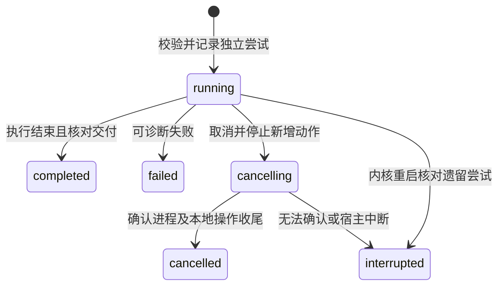

# research-capabilities Specification

## Purpose

让通用 Agent 在共同执行机制中按需读取科研方法并明确调用能力，由内核核对输入、授权、执行尝试和实际交付。方法内容、模型执行结束与科研判断保留各自含义，调用记录和普通项目成果可脱离旧对话查询与接续。

## Requirements

### Requirement: 内置方法发现与加载

系统 SHALL 提供有稳定身份、版本、作用域和来源的内置材料分析方法及能力声明，摘要发现与按需正文读取分开。普通 Skill SHALL 可直接读取而不创建能力调用或研究任务。能力输入及交付要求 SHALL 来自已校验声明；声明不增加执行权限。首次内容范围为内置方法，用户与项目内容管理沿后续实施。

#### Scenario: 按需使用方法
- **WHEN** 调用方发现并读取一个指定版本的方法
- **THEN** 取得对应方法正文、来源及能力约定，不启动模型或建立任务

### Requirement: 共同能力执行与身份

明确能力入口 SHALL 在执行前校验所选身份/版本、输入结构、材料可读性和有效读取/写入/外发授权。一次科研使用 SHALL 有稳定调用身份，每次实际推进保存独立尝试、所属会话和执行、采用方法及输入，实际读取与保存结果沿共同文件工具记录。Agent SHALL 无需另调开工或结项工具；内部工具不产生新业务调用。能力模型请求 SHALL 共用父推进的模型额度、调度和取消控制。

现有能力入口触发的独立 Agent 图 SHALL 使用受管的独占执行进程，父执行等待其结果时不持有模型请求名额，实际存活的父子进程均计入容量。容量不足不能让父执行无限等待其占用的最后资源，SHALL 返回可诊断资源限制并保留已有记录。科研运行模块掌握方法、调用尝试及交付检查，通过公共接口使用通用 harness 及领域能力，不取得项目数据库或在自己的记录中复制领域权威。默认父推进负责子执行收尾，取消覆盖现有能力子执行及已受理本地工作。

#### Scenario: 无效输入或授权
- **WHEN** 输入缺项、版本不可用、材料越界或权限不足
- **THEN** 返回可诊断失败，不启动能力模型执行或扩大权限

#### Scenario: 从工作台调用
- **WHEN** 用户要求按内置方法分析项目文本并保存报告
- **THEN** 经真实共同能力入口执行，工具详情及持久查询反映调用与尝试，实际文件可通过共同成果入口打开

#### Scenario: 能力执行需要最后一个进程名额
- **WHEN** 父执行等待能力子执行，而进程容量无法安排该子执行
- **THEN** 返回资源限制，不无界排队或将仍存活的父进程从占用中隐藏；其他独立工作仍可查询

#### Scenario: 能力进程失败
- **WHEN** 能力 Agent 阻塞或崩溃
- **THEN** 该尝试保存实际失败及部分成果，父推进取得可诊断结果，宿主和无关会话不随它退出

### Requirement: 实际交付与科研判断分离

能力结果 SHALL 分别表达执行状态、实际产物及程序交付检查、科研充分性尚未评估。检查 SHALL 核对本尝试实际保存的声明产物、可读非空正文和实际读取的输入材料，不能以同路径旧文件或模型自述替代实际交付。产物保存或关联部分成功 SHALL 保留文件与诊断，不因执行结束报告整体交付可用；后续编辑或移动以稳定文件身份核查，不误认原路径上的新文件。

#### Scenario: 正常结束但没有报告
- **WHEN** 模型正常结束却未实际保存所要求的报告
- **THEN** 尝试执行状态为完成但交付不完整，报告具体缺项，科研充分性不自动通过

#### Scenario: 保留部分结果
- **WHEN** 执行保存一份结果后另一必要操作失败
- **THEN** 已保存文件与其已确认关系保留，结果分别说明实际成果和未完成项

### Requirement: 持久重试与有界诊断

系统 SHALL 提供按项目/会话、可选调用身份的有界尝试查询，查询不执行模型。明确重试 SHALL 核对调用归属及原目标/方法/输入，沿用调用身份并增加尝试；新的目标使用新调用。并发推进同一次调用 SHALL 拒绝重复执行。取消 SHALL 等能力本地执行及所属已受理操作完成收尾，保留已保存成果及尝试；无法确认时不报告取消完成。重启将遗留运行尝试标为中断，不自动执行。未知副作用 SHALL 先查询实际成果和工具记录，拒绝盲目重放旧工具。再次尝试仍沿共同文件保护，不覆盖已有成果。

用户 SHALL 通过向所属会话发送新消息表达重试或调整目标，由 Agent 判断是否继续同一次调用；能力结果到达或查询本身不能自动重新开工。已关闭或取消的推进不因迟到结果复活，迟到结果只补充历史及成果核查。

终态后的明确重试创建新尝试，旧尝试保持原终态与身份；调用身份沿用，同一尝试不被改回 running。

#### Scenario: 原调用重试
- **WHEN** 能力未交付完整报告，用户明确重试同一次科研使用
- **THEN** 保留原调用身份与旧尝试，增加独立尝试，既有文件不被无依据覆盖

#### Scenario: 取消后重启与查询
- **WHEN** 用户取消能力执行后重启内核并查询记录
- **THEN** 查询到实际终态、成果与缺项，查询本身不重新启动执行

#### Scenario: 取消后收到能力结果
- **WHEN** 子执行的结果在父推进取消后到达
- **THEN** 保存可核查的历史和产物，不启动新的模型请求或覆盖已停止推进的当前状态
