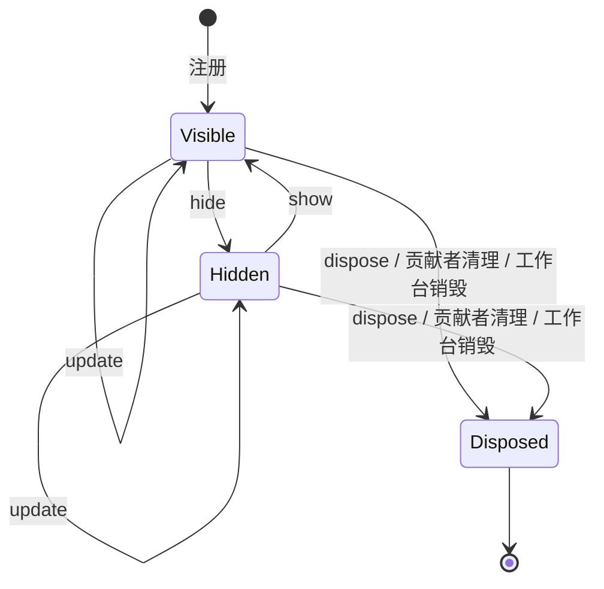
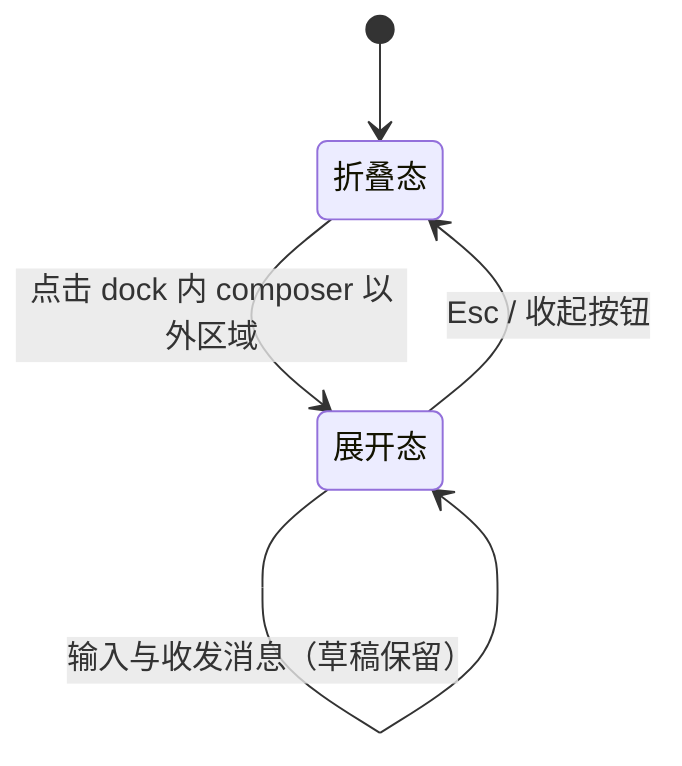
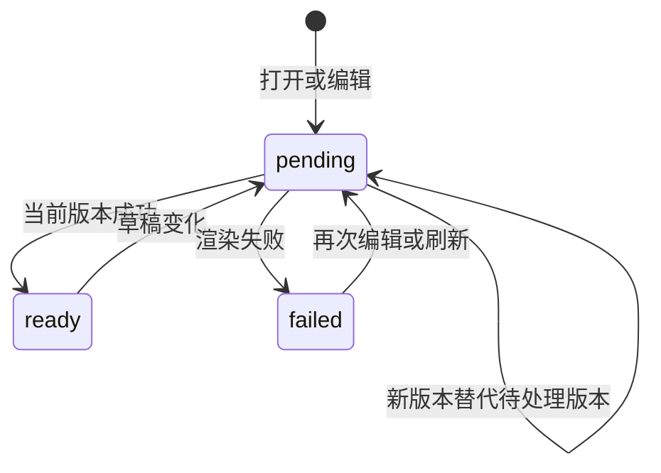
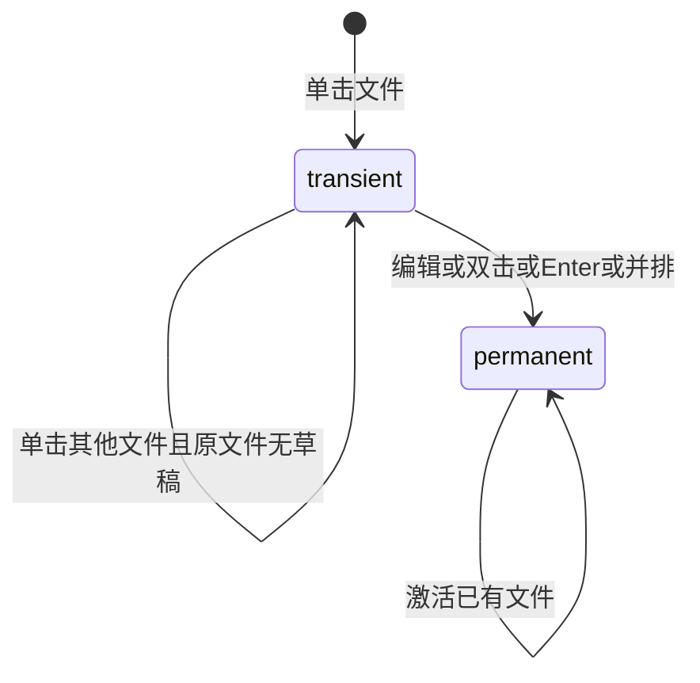

# ui-workbench-shell Specification

## Purpose

工作台外壳为文献库、阅读器、编辑器、交互预览与 Agent 会话提供统一的宿主结构：三区布局、可折叠辅助区、tab 组与 Agent 面板双形态，使后续业务模块以 tab 或面板形式接入，而不各自发明布局。视觉与交互契约来自已确认的 `docs/ui-design/` 设计。

## Requirements

### Requirement: 统一底部状态栏与通知

工作台 SHALL 提供从中间区贯通右区的固定单行状态栏，与左下内核状态区同高且上下边线对齐。左右栏折叠、拖动及 Agent dock/overlay 切换 SHALL 保留底栏，overlay 不遮挡底栏。状态栏 SHALL 常驻当前执行状态，以摘要及数量集中呈现归档、待核查指令与全局错误；错误优先于需用户处理事项，后者优先于普通信息。同级通知保持来源顺序。全部通知与原有操作 SHALL 可在向上展开、限高滚动的详情层中访问；失败留在所属通知内可重试。关闭详情层 SHALL 不改变项目、会话、草稿或发送行为。

项目信任决定 SHALL 使用居中确认弹窗；底栏只显示待确认/受限状态及重新打开入口，不计入通知数量。明确受限项目普通重开 SHALL 不重复弹窗。局部表单、编辑阅读反馈和成果入口 SHALL 保留所属上下文。底栏和详情层 SHALL 支持两套主题、键盘操作及文字截断；窄窗口保留通知入口和数量。Esc SHALL 优先关闭当前详情层并归还焦点，而不同时收起 Agent overlay。项目/会话切换 SHALL 移除旧通知与动作。

#### Scenario: 双形态与底边对齐
- **WHEN** 用户折叠任一侧栏、展开 Agent 或调整窗口宽度
- **THEN** 底栏始终单行可见，展开左栏时与内核状态区上下边线一致，内容和发送入口不被遮挡

#### Scenario: 查看和处理通知
- **WHEN** 多条通知同时存在，用户打开详情并执行恢复或补交
- **THEN** 摘要按优先级显示且数量准确，原操作沿共同接口执行，失败可原地重试，草稿保留且不自动重复发送

#### Scenario: 重新进入信任决定
- **WHEN** 用户点击待确认或受限状态条目
- **THEN** 打开居中信任弹窗，失败留在弹窗；取消不授信，明确选择受限后普通重开不重复询问

### Requirement: 标准状态栏贡献接口

工作台 SHALL 提供实例级、贡献者隔离的统一条目接口，内置执行状态、通知和信任入口 SHALL 使用同一接口。条目 SHALL 声明稳定身份、文字、左右位置、排序优先级及可选图标、提示、语义和可访问名；展示描述 SHALL 为纯数据，点击经独立激活动作适配。调用方 SHALL 能更新、隐藏、重新显示和释放条目，并按贡献者统一清理。重复的同贡献者身份 SHALL 明确拒绝；不同贡献者或工作台互不覆盖。同侧按优先级及完整身份稳定排序，右侧从右边缘开始排列。组件卸载或工作台销毁 SHALL 清理贡献，释放后的旧句柄 MUST NOT 修改后来注册的同名条目。无变化更新 SHALL 不产生重复订阅通知。

#### Scenario: 贡献者更新与清理
- **WHEN** 两个贡献者注册同名条目，其中一个更新、显隐后释放
- **THEN** 更新只作用于所属条目，另一贡献者不受影响，旧句柄不能复活或覆盖新条目

#### Scenario: 组件与工作台生命周期
- **WHEN** 组件重挂、卸载，或另一个工作台同时存在
- **THEN** 自动接入不重复注册，卸载清理自身贡献，各实例状态独立；动作读取最新处理函数

### Requirement: 三区骨架与折叠

工作台 SHALL 呈现固定三区骨架：左区为操作菜单、Agent 会话列表与内核状态；中间区为 tab 组与 Agent 面板；右区为文件树与任务列表。左区与右区 SHALL 各自支持折叠为图标轨与恢复展开，折叠与展开 SHALL 可通过按钮与键盘快捷键触发。窗口与各区 SHALL 具有最小尺寸约束；空间不足时 SHALL 以滚动或文本截断处理，MUST NOT 挤压破坏布局结构。内核连接状态与生命周期操作 SHALL 位于左区底部，行为沿用既有连接契约。

#### Scenario: 折叠与恢复左右区

- **WHEN** 用户点击左区或右区的折叠按钮，或按下对应快捷键
- **THEN** 该区域折叠为图标轨，中间区占用让出的空间；再次触发后恢复原布局

#### Scenario: 窄窗口防挤压

- **WHEN** 窗口宽度低于工作台最小宽度
- **THEN** 布局保持各区最小尺寸并出现横向滚动，输入框、发送按钮与状态指示保持可用，不发生重叠或挤压变形

### Requirement: Agent 面板双形态

Agent 面板 SHALL 固定属于中间区，具有折叠态与展开态。折叠态 dock SHALL 固定在中间区底部：transcript 区域 SHALL 只呈现最新一条 tool 消息与最新一条 agent 消息；tool 消息 SHALL 固定在 dock 顶部，单行、超长截断并带状态指示灯，其位置 MUST NOT 随 agent 消息长度变化；agent 消息 SHALL 占据剩余高度，超出时截断头部、显示尾部；dock 右侧 SHALL 保留精简 composer。展开态 overlay SHALL 占满整个中间区且不遮挡左右区，呈现完整消息流与完整 composer。

#### Scenario: 点击展开与 Esc 收起

- **WHEN** 用户在折叠态点击 dock 内 composer 以外的区域
- **THEN** Agent 面板以 overlay 占满中间区，焦点进入 composer 输入框；按下 Esc 或收起按钮后回到折叠态，焦点回到 dock

#### Scenario: 形态切换保留草稿与消息

- **WHEN** 用户在折叠态 composer 中编辑草稿后展开 overlay，再收起
- **THEN** 草稿内容与既有消息在两种形态间保持一致，不丢失、不重复

#### Scenario: 折叠态只显示最新进展

- **WHEN** Agent 会话存在多条历史消息
- **THEN** 折叠态 transcript 只显示最新一条 tool 消息（固定顶部、单行截断、带状态灯）与最新一条 agent 消息（超出高度时截断头部）

### Requirement: tab 组管理

中间区 SHALL 以 tab 组承载文献库、阅读器、编辑器、交互预览等内容页。tab SHALL 支持激活与关闭；tab 组头部 SHALL 提供"向右拆分"按钮把当前 tab 移入新组；横向 tab 组 SHALL 最多两个，组内无 tab 时 SHALL 合并回剩余组；无任何 tab 时中间区 SHALL 呈现空态入口。

#### Scenario: 按钮拆分与合并

- **WHEN** 用户在单组状态点击"向右拆分"
- **THEN** 当前 tab 移入右侧新组，两组并排；第二组内 tab 全部关闭后，布局合并回单组

#### Scenario: 空态

- **WHEN** 中间区没有任何打开的 tab
- **THEN** 显示空态，提供进入常用内容的入口，Agent 面板仍保持可用

### Requirement: 主题与设计 token

工作台样式 SHALL 以语义 token 定义（背景、表面、浮层、边框、三级文字、强调色、状态色），并映射浅色与深色两套主题。主题 SHALL 默认跟随操作系统，组件结构在两套主题下 SHALL 保持一致。

#### Scenario: 跟随系统与手动切换

- **WHEN** 系统主题为浅色或深色，或用户手动切换主题
- **THEN** 工作台整体呈现对应主题，正文、次级文字、状态色与焦点描边保持可读

### Requirement: 占位数据与空态

会话列表、文件树与任务列表 SHALL 从会话来源读取可选只读数据；来源未提供时 SHALL 呈现空态而非模拟数据。已实现的项目文件 tab SHALL 展示真实内容并支持安全编辑、差异和撤销；其余未实现内容保持空态。真实会话 SHALL 提供新建、切换、分页历史、追加指令、取消与继续，dock 和 overlay 共用消息与草稿。会话切换、断线和刷新 SHALL 保留各自未发送指令、材料选择及未保存文件草稿。

#### Scenario: 来源无数据时呈现空态

- **WHEN** 当前来源未提供会话、文件树或任务数据
- **THEN** 对应区域显示空态提示，不显示虚构条目

#### Scenario: 编辑期间切换

- **WHEN** 用户切换会话、打开另一个文件或重新进入页面
- **THEN** 草稿保持独立，可恢复并与实际磁盘内容核对，浏览变化不替换指令接收者

#### Scenario: 保存期间继续编辑

- **WHEN** 文件保存等待结果时用户继续编辑或切换文件
- **THEN** 保存回执只更新对应文件的磁盘依据，后续草稿不得被旧回执清除或覆盖

#### Scenario: 旧会话异步结果返回

- **WHEN** 发送失败或历史分页结果在切换会话后才返回
- **THEN** 失败输入保留在原会话，旧历史不混入当前会话；存储写入失败时本页仍保留最新草稿

### Requirement: 工具详情与实际执行上下文

dock 与 overlay SHALL 使用同一持久工具事实呈现真实调用名及运行、完成、失败或未知状态。overlay SHALL 提供可键盘展开的有界输入／结果详情及截断提示；dock SHALL 保持最新工具单行投影，不把工具文字重复显示为 Agent 正文。原有无详情记录 SHALL 保留可读的历史说明。

两种形态的输入器 SHALL 显示当前项目、实际模型配置与当前项目信任状态；选择尚未刷新或连接不可用时 SHALL 如实表达未就绪，不能把旧会话／项目状态作为新接收者的事实。切换形态、查看详情和打开成果 SHALL 保留当前草稿与接收会话。

dock 与 overlay SHALL 共用同一执行上下文配置行：左侧为权限只读段与模型／推理强度聚合入口，右侧固定取消／发送动作区；聚合入口在 overlay 显示当前“模型 · 推理强度”，在 dock 只显示图标并以可访问名给出当前值，点击后在同一弹层内以两组单选设置模型与推理强度；错误提示 SHALL 不挤压发送动作。配置行 SHALL 不提供“继续执行”入口；取消执行后由用户发送新的明确指令，内核 resume 能力不经工作台按钮暴露。模型与推理强度选项 SHALL 只来自内核下发的 provider 目录；每项提供“跟随默认”，选择具体值保存会话覆盖，选择“跟随默认”清除对应覆盖。所选模型不支持推理强度时，推理强度选择 SHALL 禁用并说明原因，已有偏好保留，切回支持的模型后继续生效。切换失败 SHALL 不做乐观更新：保留快照中的当前值，并在 composer 上下文内显示可重试的错误提示。归档会话、未连接或无会话时，聚合入口 SHALL 禁用。

新建会话等待受理时 SHALL 暂时禁用输入，避免把意图发往新会话的内容写入旧草稿；失败后恢复原草稿，创建结果不得覆盖等待期间用户明确选择的其他会话。

#### Scenario: 检查失败调用

- **WHEN** 用户展开失败工具记录
- **THEN** 可看到实际调用名、失败状态、输入与相关原因，dock 也显示失败而非完成

#### Scenario: 切换形态与项目

- **WHEN** 用户带着未发送草稿展开或收起会话，或切换项目等待新快照
- **THEN** 两种形态显示同一上下文且保留草稿，新项目不会短暂展示旧项目的权限与执行结果

#### Scenario: 新建会话响应延迟

- **WHEN** 用户点击新建会话而创建请求尚未返回
- **THEN** 原草稿保留且输入暂不可用，新会话就绪后恢复输入；若用户已另选接收者，迟到结果不抢回选择

#### Scenario: 会话覆盖与跟随默认

- **WHEN** 用户在 composer 选择具体模型或推理强度，之后改回“跟随默认”
- **THEN** 覆盖保存并在 dock/overlay 两形态一致显示，清除后显示应用默认；刷新或重载后保持

#### Scenario: 切换模型失败

- **WHEN** 会话覆盖保存失败
- **THEN** composer 保留快照中的当前值，显示可重试的错误提示，不做乐观更新或回滚已确认事实

### Requirement: 成果直接打开

已保存成果 SHALL 在所属执行的 Agent 结果消息中提供打开实际项目文件的入口，复用普通文件读取、授权、编辑和草稿保护；尚无正文结果时可使用同执行工具结果。消息与成果 SHALL 使用明确执行标识关联，历史记录及分页未加载的归属消息 MUST NOT 导致成果挂到其他执行回复。工作台 MUST NOT 在 tab 上方或消息流末尾另设成果汇总区。dock SHALL 保持进展摘要，成果入口随展开会话访问。保存与登记状态 SHALL 进入状态栏通知及详情；登记待核查 SHALL 保留核查并补齐入口，失败可重试。文件已缺失或不可读时 SHALL 显示相关错误。打开成果 SHALL 激活文件 tab，并使用户可见，不因 Agent overlay 遮挡而留下无反馈操作。

#### Scenario: 从会话查看产物

- **WHEN** 用户展开会话，点击所属结果消息中的成果打开入口
- **THEN** 文件 tab 显示当前实际内容，overlay 收起，未发送指令和当前会话保留，待登记事实不被文件存在替代，tab 上方不出现独立成果区域

#### Scenario: 多轮或历史消息中的成果归属

- **WHEN** 会话包含多个执行，或用户分页载入更早消息
- **THEN** 成果只出现在明确关联的执行消息中，每份成果只呈现一个打开入口；未加载归属消息时不附到当前回复

#### Scenario: 保存与登记反馈

- **WHEN** 成果已保存或登记结果待核查，用户查看状态栏通知详情
- **THEN** 详情显示对应文件和实际登记状态，待核查项能沿共同接口核查并补齐，失败可重试，草稿与接收会话保持

### Requirement: 可操作项目与文件工作台

真实工作台 SHALL 提供项目新建、打开、最近列表移出、设置与文件管理入口；目录按需展开且分页，文件变化只刷新相关已展开目录和打开文档。真实首页不以默认占位 tab 遮蔽已交付功能。项目切换 SHALL 保留各自 tab 状态与草稿，文件结构变化不得改变指令接收者或覆盖迟到请求之后的编辑。

左区 SHALL 同时驻留最近项目及普通会话，以项目为一级、会话为二级呈现：项目行显示目录末级名而非 projectId，折叠与展开分别以关闭／打开的文件夹图标表示，整行折叠/展开其会话列表；项目行末依次为扩展菜单和独立新建会话按钮，新建按钮绑定所属项目；普通会话行同样提供。扩展菜单 SHALL 展示项目路径并以紧凑图标条目提供打开项目和从侧栏移除，移除项经分隔呈现，不包含新建或重命名表单。菜单 SHALL 支持视口边界定位、键盘操作和关闭后焦点归还。顶部、折叠轨与中间空态 SHALL 不提供全局新建入口。左区顶部动作 SHALL 提供“添加项目”，打开居中弹窗并以“打开项目”“新建项目”两种模式完成：打开只选择目录，新建先选择父目录再输入新文件夹名称；项目显示名 SHALL 取目录最后一级，不提供手填项目路径。Electron SHALL 使用系统目录选择器；浏览器宿主 SHALL 经内核目录浏览 RPC 在弹窗内选择目录。提交新建或添加之前 SHALL 弹窗询问信任，提供信任、受限添加与取消；取消不创建或登记项目。成功后选择新项目并清空其会话选择。移出最近列表 SHALL 经确认并说明不删除目录、不停止执行；`application` 不提供移出入口；移出当前项目后 SHALL 选择下一个最近项目，没有则回退 `application`，并清理该项目的会话选择。

项目行 SHALL 只展开或折叠并保留展开状态；选择会话同时切换所属项目，右栏与项目文件标签组随之恢复。共同文献、设置和材料阅读器 SHALL 跨项目保留。移出非当前项目 SHALL 保留当前选择。

#### Scenario: 非当前项目行新建
- **WHEN** 当前正在使用项目 B，用户点击项目 A 行的新建按钮
- **THEN** 会话创建于 A 并在受理后选择；若等待期间用户明确选择其他会话，迟到回执不抢回选择，B 不产生额外会话

#### Scenario: 小窗口中的移除确认
- **WHEN** 用户在靠近视口底部的项目菜单中展开移除确认，或菜单显示失败内容
- **THEN** 菜单按自身尺寸重新约束到视口，确认和取消可完整操作；错误保留并允许重试

#### Scenario: 项目切换和结构操作
- **WHEN** 用户编辑文件后切换项目，或重命名其父目录
- **THEN** 草稿和会话保持独立，原文件可按新位置继续编辑，旧回执不会覆盖新状态

#### Scenario: 移出当前项目

- **WHEN** 用户在项目菜单确认移出当前项目
- **THEN** 仅最近记录变化，目录与在执行行不受影响；选择下一个最近项目或回退 `application`，该项目会话选择被清理

#### Scenario: 添加项目

- **WHEN** 用户通过顶部“添加项目”弹窗新建或打开项目成功
- **THEN** 新项目成为当前项目且会话选择清空，左侧以目录最后一级作为显示名呈现该项目节点

### Requirement: 同一文档的 Markdown 编辑预览

Markdown 的源码、预览与并排查看 SHALL 使用同一草稿，沿最多两个 tab 组展示；预览说明未保存及旧结果状态。支持常用正文、表格、代码块、本地图片与数学公式；不执行原始 HTML、工程代码或不可信公式扩展，不自动请求外部图片。相对文档链接经共同文件入口打开，外链仅经用户明确点击打开安全协议。

连续编辑 SHALL 合并渲染请求，仅展示当前文档最新版本；失败保留最后成功结果并说明状态。干净文档可随 Agent 保存更新；存在草稿时保留草稿并提示磁盘变化。解析与公式排版不阻塞输入和取消。

#### Scenario: 快速编辑与旧请求晚到
- **WHEN** 两次编辑的预览结果以相反顺序到达
- **THEN** 仅新版本更新展示，输入与未保存状态保持

#### Scenario: 不可信内容
- **WHEN** 文档包含脚本、危险 URL、远端图片或不可信公式命令
- **THEN** 不执行和自动外发，正文仍可阅读，源码保留

### Requirement: 会话整理与独立选择

左区会话区 SHALL 分别呈现各展开项目的活动会话，各项目按需沿内核游标追加加载下一页，不提供“活动／归档”切换与翻页控件；变更通知只重读已加载范围并按 id 去重，不改变当前会话选择。查找会话 SHALL 经左区顶部动作（及折叠轨会话入口）打开居中弹窗，跨最近项目全局搜索：空查询显示最近会话，输入经防抖后由内核一次有界合并查询；结果行显示状态、标题、项目名、归档标识与相对时间；迟到响应 SHALL 不覆盖新查询结果；选择结果后切换到对应项目与会话，草稿仍按项目／会话键隔离保存。归档会话 SHALL 集中在设置页按项目（含 `application` 范围）滚动列出并提供恢复；归档当前会话后状态栏提供归档摘要及详情内恢复入口，不替代设置页集中管理。折叠轨保留会话查找入口，新建时展开侧栏并使用所属项目行按钮。筛选、加载与列表刷新 SHALL 不改变当前指令接收者，异步结果按项目与查询范围隔离。归档当前会话 SHALL 保留历史视图与草稿，禁止发送／继续并提供恢复入口；新建会话回到可发现新会话的列表。空范围不得自行选择其他会话。

会话操作 SHALL 集中在会话整行的右键菜单（含 `Shift+F10`／ContextMenu 键盘入口），以“重命名”“归档/恢复”两个条目呈现，不再提供行尾“管理会话 …”入口；重命名 SHALL 在会话行原地编辑，Enter 保存、Esc 或失焦取消，失败时保持编辑并在行内显示错误；会话处于排队、运行或取消中时归档入口 SHALL 禁用并说明原因。归档或恢复失败 SHALL 在操作发生的菜单内显示错误且不静默关闭；设置页恢复失败 SHALL 留在对应行内；当前会话的恢复入口失败时 SHALL 在状态栏通知详情原地显示错误。归档状态下 composer 及其模型/推理强度选择 SHALL 禁用。

后台项目元数据变化 SHALL 只使相应列表失效，不能读取后台正文或刷新全部项目。各组的失败、分页和迟到结果 SHALL 独立处理。

#### Scenario: 多项目切换与后台状态
- **WHEN** 两项目驻留且后台项目会话状态变化，用户选择其中一条会话
- **THEN** 对应项目列表更新，选择同时切换项目与会话，旧异步结果不混入当前内容

#### Scenario: 查找期间仍保留当前工作

- **WHEN** 用户带草稿在搜索弹窗查询其他标题，或旧查询响应迟到
- **THEN** 当前会话、消息与草稿保留，迟到响应不覆盖新查询结果

#### Scenario: 搜索结果包含归档会话

- **WHEN** 搜索命中其他项目的归档会话
- **THEN** 结果行标识归档状态与所属项目，选择后切换到对应项目与会话

#### Scenario: 设置页恢复归档会话

- **WHEN** 用户在设置页恢复一个归档会话
- **THEN** 恢复成功后归档列表与左区活动列表刷新；失败时错误留在对应行内，可重试

#### Scenario: 归档当前会话

- **WHEN** 用户归档当前已停止会话
- **THEN** 历史仍可阅读、草稿保留，恢复前发送与继续不可用，恢复后不自行发送

#### Scenario: 归档或恢复失败

- **WHEN** 归档或恢复请求被内核拒绝或失败
- **THEN** 错误显示在操作发生的菜单或设置页行内（当前会话恢复失败显示在状态栏通知详情），菜单不静默关闭，可重试

### Requirement: 可阅读与可复制的消息

Agent 正文 SHALL 支持 Markdown、表格、代码和公式，用户指令保持纯文本；工具与受理状态、附加及实际使用材料 SHALL 独立于原始正文呈现。用户 SHALL 可复制原始正文或代码块，失败提供可读反馈。材料入口 SHALL 优先解析稳定文件身份，不以历史路径指代同名新文件；无身份的历史记录明确按历史路径打开。相对链接以项目根为基准，经现有文件入口打开并收起 overlay，保留会话、材料和草稿；http(s)／mailto 外链只在点击后打开，消息图片不加载，原始 HTML 和危险协议不执行。

渲染 SHALL 复用已有解析链和受限 Worker 调度，只处理已加载的可见消息，按对象合并待处理版本并拒绝旧会话或旧正文结果；解析失败保留可读正文。dock 保持最新工具与纯文本尾部，不增加完整 Markdown 解析。

#### Scenario: 复制及打开实际材料
- **WHEN** 用户复制有公式或代码的回复，或点击已改名材料
- **THEN** 剪贴板取得原始正文／代码，不包含状态标签；材料按实际身份打开当前位置，草稿不丢失

#### Scenario: 连续输出时切换
- **WHEN** Agent 持续输出 Markdown，用户输入、取消或切换会话
- **THEN** 输入与取消可受理，旧渲染结果不串入新会话，不自动加载消息图片或执行 HTML

### Requirement: 可操作的全局题录库

真实工作台 SHALL 从现有文献库入口打开共同库 tab，提供手动建项、CSL JSON 选择文件/粘贴导入、批次逐项结果、有界查找、题录更正与集合/标签整理。用户 SHALL 可从本机路径摄取默认托管或显式外链的材料，指定已有题录及用途，有界查看附件状态、下载原字节和人工重定位结果。查看库 SHALL 不切换 Agent 会话或丢失项目/会话草稿。附件登记、实际可读与分析是否生成如实显示，不把题录当作可读全文。授权、失败、冲突和备份范围及缺项入口使用已有交互样式并可键盘操作。

#### Scenario: 在项目内浏览共同题录
- **WHEN** 用户带着指令草稿打开文献库，建项并导入批次
- **THEN** 可查询已保存题录和逐项结果，原会话与草稿保留；另一个客户端重读取得同一事实

#### Scenario: 本地文件与重定位
- **WHEN** 用户导入本机文件，随后在同一文献详情重新指定失效外链
- **THEN** 可见各项实际结果、附件用途和状态，成功重定位保留身份，材料不同则保留原关联并显示错误；原会话及草稿保留

### Requirement: 真实 PDF 阅读与共享成果入口

工作台 SHALL 从共同文献库附件打开对应 reader tab，以相同材料及版本为阅读对象，提供翻页、缩放、搜索、文字选区、书签、高亮批注与笔记入口。浏览器与 Electron SHALL 共用阅读组件、client 和事件路径。阅读记录的保存状态、作者、摘录与说明 SHALL 可辨；冲突保留本地草稿并允许重读，外链失效时仍展示已存摘录并说明不能定位。分页查询及高频选区变化 SHALL 只处理当前材料和必要范围，不扫描全库或跨整个工作台 DOM。切换会话、展开／收起 Agent 面板及刷新相关库范围 SHALL 保留阅读对象、会话接收者和未保存说明草稿；关闭 tab 释放阅读资源，不删除持久记录。

#### Scenario: 从附件打开并保存批注
- **WHEN** 用户在题录详情打开 PDF，选中文字并明确保存高亮与说明
- **THEN** 同一工作台 reader tab 显示该材料及共同内核确认的记录，原会话与指令草稿保持原状

#### Scenario: 阅读时切换会话
- **WHEN** 用户带着未保存的笔记切换会话或展开 Agent 面板
- **THEN** 阅读材料及笔记草稿保留，保存仍指向原材料，不受新会话异步返回替换

#### Scenario: 材料不可定位
- **WHEN** 已保存记录的原材料缺失或内容变化
- **THEN** 显示原摘录和不可用原因，禁用错误的定位动作，不将同页跳转到其他附件

### Requirement: 真实 EPUB 与网页快照阅读入口

工作台 SHALL 从共同库附件打开 EPUB 重排版及单文件 HTML reader tab，提供分页章节目录、正文分段、搜索、选区、书签、高亮和笔记。正文采用工作台统一排版，保留允许的标题、段落、列表、表格、链接和内嵌栅格图片，缺资源显示替代说明。浏览器与 Electron 共用组件、client 和事件路径。记录作者、摘录、说明及保存状态 SHALL 可辨，复用共同记录面板及冲突／未知回执核查。原材料不可用时仍可查已存记录并禁用错误定位。交互、选区和高亮投影 SHALL 限于当前材料及正文片段；切换会话、项目及 Agent 面板不丢阅读对象或说明草稿。关闭 tab 释放自有请求、订阅和图片 URL，不删除持久记录。

#### Scenario: 阅读和重开
- **WHEN** 用户从附件打开 EPUB 或 HTML，选区保存高亮后关闭重开
- **THEN** 原材料的共同记录仍可读取并定位，原会话和指令草稿保留

#### Scenario: 离线及键盘操作
- **WHEN** 外网不可用，用户以键盘操作章节、搜索和记录入口
- **THEN** 本地正文及可用内嵌图片仍可阅读，焦点可见，不依赖 CDN 或远程阅读服务

### Requirement: 共享菜单与确认操作

工作台 SHALL 以同一共享菜单原语承载会话行、项目行与文件回收等操作菜单，不再由各组件分别手写下拉与确认逻辑。菜单 SHALL 支持 Esc 关闭且不向宿主冒泡、外点关闭、焦点进入菜单与归还触发处，以及方向键在条目间循环。会话操作 SHALL 由同一原语的受控右键菜单承载：定位到右键坐标并做视口边界收束，同时支持 `Shift+F10`／ContextMenu 键盘入口。居中弹窗（查找会话、添加项目）SHALL 使用共享 dialog 原语，提供 `role="dialog"`、Esc 与 backdrop 点击关闭、初始焦点与焦点归还。破坏性操作（如移出最近列表、回收文件）SHALL 使用共享确认呈现，确认文案说明实际后果（如移出最近列表不删除目录、不停止执行）。菜单内操作失败 SHALL 在菜单内保留并显示错误，不静默关闭。

#### Scenario: 键盘与指针关闭

- **WHEN** 用户打开任一操作菜单后按 Esc 或点击菜单外区域
- **THEN** 菜单关闭、焦点归还触发按钮，Esc 不触发宿主面板（如 Agent overlay）的收起

#### Scenario: 会话行右键菜单

- **WHEN** 用户在会话行点击右键，或聚焦会话行后按 `Shift+F10`／ContextMenu 键
- **THEN** 同一会话操作菜单打开在触发位置并收束在视口内，Esc 或外点关闭后焦点归还

#### Scenario: 确认破坏性操作

- **WHEN** 用户选择移出最近列表或回收文件
- **THEN** 先显示说明实际后果的确认，确认后才执行；取消不产生任何变化

### Requirement: 完整文件树交互

右区 SHALL 沿现有文件、材料、任务页签呈现文件树，提供紧凑行、语义图标、工具栏、共享右键菜单及行内新建重命名。树 SHALL 支持键盘导航、名称定位、Ctrl/Cmd增减选择、Shift范围选择、已加载展开条目全选、F2重命名、复制剪切粘贴和回收确认。选择文件与附加会话材料分别表达。菜单支持右键、Shift+F10、Esc及焦点归还；输入确认后执行，取消无副作用。

拖拽 SHALL 提供目标反馈、悬停展开、边缘滚动及复制修饰键，粘贴提供同样的键盘替代。跨项目剪贴板 SHALL 在项目切换时保留，系统导入提供选择及拖入入口。进度、冲突和失败在操作相关位置可读，保留可继续决定或核查的身份。已展开目录状态、选择和滚动 SHALL 随项目保留，DOM仅渲染可见窗口及有限overscan。

#### Scenario: 纯键盘整理材料
- **WHEN** 用户使用键盘多选文件、打开菜单、新建重命名、剪切并切换项目粘贴
- **THEN** 同一真实文件规则执行，焦点可见，材料附加状态及指令接收者不被文件选择改变

#### Scenario: 流式工作期间浏览大树
- **WHEN** 后台传输及Agent输出持续更新，用户浏览万条已加载树行
- **THEN** 树DOM及刷新范围有界，输入、选择和滚动保持响应，不逐次重读全项目

### Requirement: 临时文件tab与活动文件定位

单击文件 SHALL 在当前活动组临时打开，每组至多一个临时tab；双击、Enter打开、首次编辑及并排查看 SHALL 固定文件。相同稳定身份已打开时激活原tab。临时状态 SHALL 与Markdown预览模式分开，替换前核查草稿，未保存内容固定并保留。激活文件tab SHALL 定位树中对应条目，只读取祖先和相关分页；文件身份变化不得把原草稿移给同路径新文件。

#### Scenario: 连续临时打开及编辑
- **WHEN** 用户依次单击两个文件，再编辑后单击第三个文件
- **THEN** 第一个临时tab被替换，第二个因编辑固定，第三个临时打开，全部草稿保留

#### Scenario: 项目切换与文件改名
- **WHEN** 用户切换项目后返回，或激活已改名的文件tab
- **THEN** 原项目tab与草稿恢复，活动文件按稳定身份定位当前树位置

### Requirement: 科研编辑工作面

工作台 SHALL 在现有文件标签内提供源码、可视编辑、轻量预览、完整排版及导出入口，沿最多两个标签组展示。源码与可视模式共享文稿，不因模式切换隐式保存；相关编辑状态、编译状态和错误贴近当前文件。左右栏及 Agent dock 保持现有控制方式，不另建工作台布局。当前模式、格式、命令与状态 SHALL 可键盘操作且有可访问名，浅色和深色共用语义 token。

#### Scenario: 写作与并排排版
- **WHEN** 用户在文件标签切换源码与可视模式，再并排打开完整排版
- **THEN** 两组展示同一文稿与对应已保存版本，草稿、会话接收者及 Agent 面板状态保留

#### Scenario: 编译失败可诊断
- **WHEN** 完整预览失败或工具缺失
- **THEN** 当前文件显示具体状态、原因与重试入口，保留源码编辑和旧成功结果
