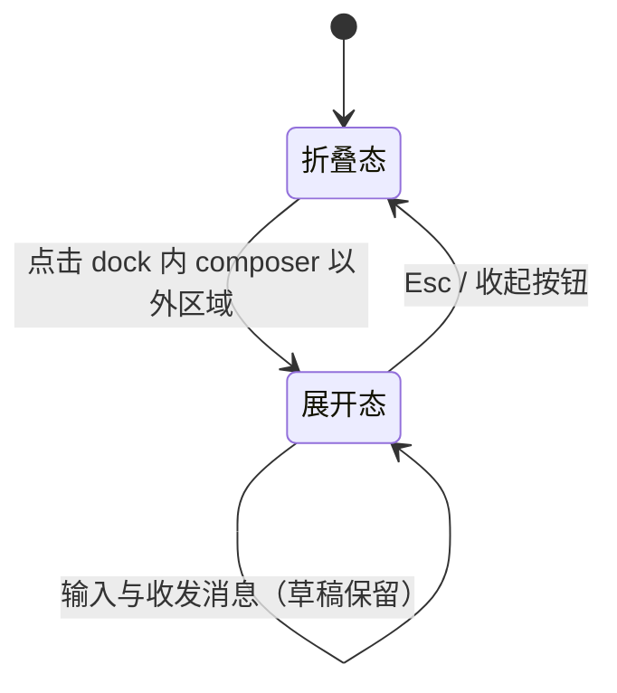
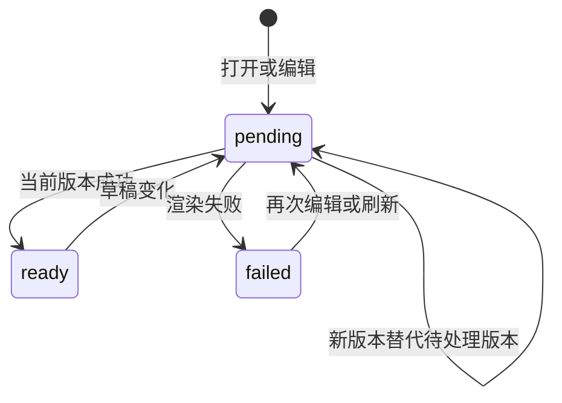

# ui-workbench-shell Specification

## Purpose

工作台外壳为文献库、阅读器、编辑器、交互预览与 Agent 会话提供统一的宿主结构：三区布局、可折叠辅助区、tab 组与 Agent 面板双形态，使后续业务模块以 tab 或面板形式接入，而不各自发明布局。视觉与交互契约来自已确认的 `docs/ui-design/` 设计。

## Requirements

### Requirement: 三区骨架与折叠

工作台 SHALL 呈现固定三区骨架：左区为操作菜单、Agent 会话列表与内核状态；中间区为 tab 组与 Agent 面板；右区为文件树与任务列表。左区与右区 SHALL 各自支持折叠为图标轨与恢复展开，折叠与展开 SHALL 可通过按钮与键盘快捷键触发。窗口与各区 SHALL 具有最小尺寸约束；空间不足时 SHALL 以滚动或文本截断处理，MUST NOT 挤压破坏布局结构。内核连接状态与生命周期操作 SHALL 位于左区底部，行为沿用既有连接契约。

#### Scenario: 折叠与恢复左右区

- **WHEN** 用户点击左区或右区的折叠按钮，或按下对应快捷键
- **THEN** 该区域折叠为图标轨，中间区占用让出的空间；再次触发后恢复原布局

#### Scenario: 窄窗口防挤压

- **WHEN** 窗口宽度低于工作台最小宽度
- **THEN** 布局保持各区最小尺寸并出现横向滚动，输入框、发送按钮与状态指示保持可用，不发生重叠或挤压变形

### Requirement: Agent 面板双形态

Agent 面板 SHALL 固定属于中间区，具有折叠态与展开态。折叠态 dock SHALL 固定在中间区底部：transcript 区域 SHALL 只呈现最新一条 tool 消息与最新一条 agent 消息；tool 消息 SHALL 固定在 dock 顶部，单行、超长截断并带状态指示灯，其位置 MUST NOT 随 agent 消息长度变化；agent 消息 SHALL 占据剩余高度，超出时截断头部、显示尾部；dock 右侧 SHALL 保留精简 composer。展开态 overlay SHALL 占满整个中间区且不遮挡左右区，呈现完整消息流与完整 composer。

#### Scenario: 点击展开与 Esc 收起

- **WHEN** 用户在折叠态点击 dock 内 composer 以外的区域
- **THEN** Agent 面板以 overlay 占满中间区，焦点进入 composer 输入框；按下 Esc 或收起按钮后回到折叠态，焦点回到 dock

#### Scenario: 形态切换保留草稿与消息

- **WHEN** 用户在折叠态 composer 中编辑草稿后展开 overlay，再收起
- **THEN** 草稿内容与既有消息在两种形态间保持一致，不丢失、不重复

#### Scenario: 折叠态只显示最新进展

- **WHEN** Agent 会话存在多条历史消息
- **THEN** 折叠态 transcript 只显示最新一条 tool 消息（固定顶部、单行截断、带状态灯）与最新一条 agent 消息（超出高度时截断头部）

### Requirement: tab 组管理

中间区 SHALL 以 tab 组承载文献库、阅读器、编辑器、交互预览等内容页。tab SHALL 支持激活与关闭；tab 组头部 SHALL 提供"向右拆分"按钮把当前 tab 移入新组；横向 tab 组 SHALL 最多两个，组内无 tab 时 SHALL 合并回剩余组；无任何 tab 时中间区 SHALL 呈现空态入口。

#### Scenario: 按钮拆分与合并

- **WHEN** 用户在单组状态点击"向右拆分"
- **THEN** 当前 tab 移入右侧新组，两组并排；第二组内 tab 全部关闭后，布局合并回单组

#### Scenario: 空态

- **WHEN** 中间区没有任何打开的 tab
- **THEN** 显示空态，提供进入常用内容的入口，Agent 面板仍保持可用

### Requirement: 主题与设计 token

工作台样式 SHALL 以语义 token 定义（背景、表面、浮层、边框、三级文字、强调色、状态色），并映射浅色与深色两套主题。主题 SHALL 默认跟随操作系统，组件结构在两套主题下 SHALL 保持一致。

#### Scenario: 跟随系统与手动切换

- **WHEN** 系统主题为浅色或深色，或用户手动切换主题
- **THEN** 工作台整体呈现对应主题，正文、次级文字、状态色与焦点描边保持可读

### Requirement: 占位数据与空态

会话列表、文件树与任务列表 SHALL 从会话来源读取可选只读数据；来源未提供时 SHALL 呈现空态而非模拟数据。已实现的项目文件 tab SHALL 展示真实内容并支持安全编辑、差异和撤销；其余未实现内容保持空态。真实会话 SHALL 提供新建、切换、分页历史、追加指令、取消与继续，dock 和 overlay 共用消息与草稿。会话切换、断线和刷新 SHALL 保留各自未发送指令、材料选择及未保存文件草稿。

#### Scenario: 来源无数据时呈现空态

- **WHEN** 当前来源未提供会话、文件树或任务数据
- **THEN** 对应区域显示空态提示，不显示虚构条目

#### Scenario: 编辑期间切换

- **WHEN** 用户切换会话、打开另一个文件或重新进入页面
- **THEN** 草稿保持独立，可恢复并与实际磁盘内容核对，浏览变化不替换指令接收者

#### Scenario: 保存期间继续编辑

- **WHEN** 文件保存等待结果时用户继续编辑或切换文件
- **THEN** 保存回执只更新对应文件的磁盘依据，后续草稿不得被旧回执清除或覆盖

#### Scenario: 旧会话异步结果返回

- **WHEN** 发送失败或历史分页结果在切换会话后才返回
- **THEN** 失败输入保留在原会话，旧历史不混入当前会话；存储写入失败时本页仍保留最新草稿

### Requirement: 工具详情与实际执行上下文

dock 与 overlay SHALL 使用同一持久工具事实呈现真实调用名及运行、完成、失败或未知状态。overlay SHALL 提供可键盘展开的有界输入／结果详情及截断提示；dock SHALL 保持最新工具单行投影，不把工具文字重复显示为 Agent 正文。原有无详情记录 SHALL 保留可读的历史说明。

两种形态的输入器 SHALL 显示当前项目、实际模型配置与有效读写／外发权限；选择尚未刷新或连接不可用时 SHALL 如实表达未就绪，不能把旧会话／项目状态作为新接收者的事实。切换形态、查看详情和打开成果 SHALL 保留当前草稿与接收会话。

新建会话等待受理时 SHALL 暂时禁用输入，避免把意图发往新会话的内容写入旧草稿；失败后恢复原草稿，创建结果不得覆盖等待期间用户明确选择的其他会话。

#### Scenario: 检查失败调用

- **WHEN** 用户展开失败工具记录
- **THEN** 可看到实际调用名、失败状态、输入与相关原因，dock 也显示失败而非完成

#### Scenario: 切换形态与项目

- **WHEN** 用户带着未发送草稿展开或收起会话，或切换项目等待新快照
- **THEN** 两种形态显示同一上下文且保留草稿，新项目不会短暂展示旧项目的权限与执行结果

#### Scenario: 新建会话响应延迟

- **WHEN** 用户点击新建会话而创建请求尚未返回
- **THEN** 原草稿保留且输入暂不可用，新会话就绪后恢复输入；若用户已另选接收者，迟到结果不抢回选择

### Requirement: 成果直接打开

已保存成果 SHALL 提供打开实际项目文件的入口，复用普通文件读取、授权、编辑和草稿保护。登记待核查状态 SHALL 继续显示并保留补齐入口；文件已缺失或不可读时 SHALL 显示相关错误。打开成果 SHALL 激活文件 tab，并使用户可见，不因 Agent overlay 遮挡而留下无反馈操作。

#### Scenario: 从会话查看产物

- **WHEN** 用户点击已保存成果的打开入口
- **THEN** 文件 tab 显示当前实际内容，overlay 收起，未发送指令和当前会话保留，待登记事实不被文件存在替代

### Requirement: 可操作项目与文件工作台

真实工作台 SHALL 提供项目新建、打开、显示名修改、最近列表移出、设置与文件管理入口；目录按需展开且分页，文件变化只刷新相关已展开目录和打开文档。真实首页不以默认占位 tab 遮蔽已交付功能。项目切换 SHALL 保留各自 tab 状态与草稿，文件结构变化不得改变指令接收者或覆盖迟到请求之后的编辑。

#### Scenario: 项目切换和结构操作
- **WHEN** 用户编辑文件后切换项目，或重命名其父目录
- **THEN** 草稿和会话保持独立，原文件可按新位置继续编辑，旧回执不会覆盖新状态

### Requirement: 同一文档的 Markdown 编辑预览

Markdown 的源码、预览与并排查看 SHALL 使用同一草稿，沿最多两个 tab 组展示；预览说明未保存及旧结果状态。支持常用正文、表格、代码块、本地图片与数学公式；不执行原始 HTML、工程代码或不可信公式扩展，不自动请求外部图片。相对文档链接经共同文件入口打开，外链仅经用户明确点击打开安全协议。

连续编辑 SHALL 合并渲染请求，仅展示当前文档最新版本；失败保留最后成功结果并说明状态。干净文档可随 Agent 保存更新；存在草稿时保留草稿并提示磁盘变化。解析与公式排版不阻塞输入和取消。

#### Scenario: 快速编辑与旧请求晚到
- **WHEN** 两次编辑的预览结果以相反顺序到达
- **THEN** 仅新版本更新展示，输入与未保存状态保持

#### Scenario: 不可信内容
- **WHEN** 文档包含脚本、危险 URL、远端图片或不可信公式命令
- **THEN** 不执行和自动外发，正文仍可阅读，源码保留
