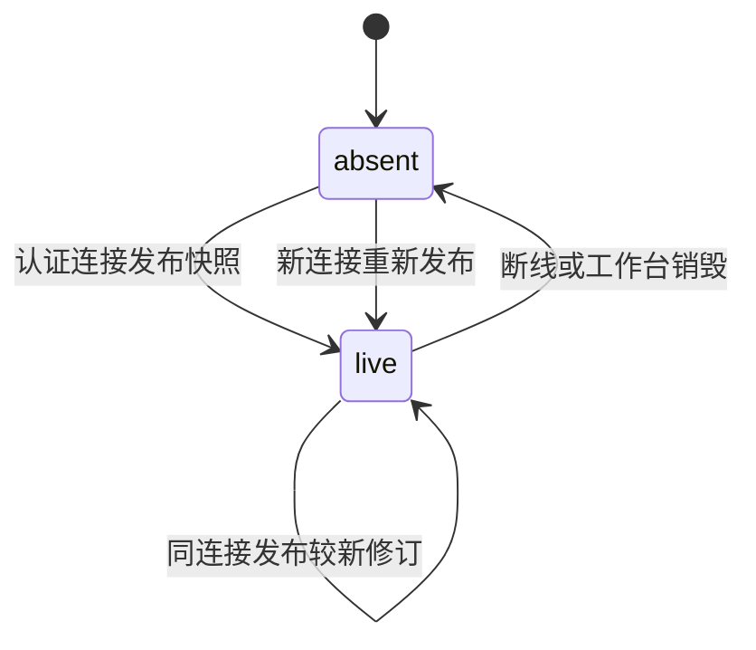

# workbench-agent-context Specification

## Purpose

让 Agent 能通过受权限约束的工具读取关联工作台的当前上下文，并让用户把明确选择的材料或对象批注随同指令发送。实时界面状态与已发送材料分别表达，多窗口、断线和版本变化均不能使用户要求被静默改写或扩大材料权限。

## Requirements

### Requirement: 连接所属的有界当前上下文

工作台 SHALL 经已认证连接发布本实例当前视图、会话接收者、条目选择及可提供的资源选择，快照携带版本及范围并受容量限制。连接只能更新自己的快照，断线或销毁后该快照失效；重连建立新的关联，不能凭客户端自报身份继承旧连接权限。快照不是研究事实权威，发布不自动启动 Agent。

#### Scenario: 同会话两个窗口
- **WHEN** 两窗口选择同一会话但分别浏览不同材料
- **THEN** 两份快照分别所属其真实连接，不能以最近活动窗口覆盖另一窗口的状态

### Requirement: 工具按调用时的关联上下文理解对象

执行 SHALL 从可靠受理指令的可信来源关联取得可查询工作台，工具在调用时读取其当前快照，不在发送时自动固定隐含选择。读取结果 SHALL 经过所属资源读取及模型外发权限检查。没有工作台来源、关联已失效或接收会话不匹配时返回明确不可用，不能查询其他窗口代替。Agent 无法据结果确定对象时 SHALL 询问用户并等待澄清，显式材料工作仍可继续。

#### Scenario: 发送后选择发生变化
- **WHEN** 用户发送未显式附加选择的指令后改变选择，Agent 随后调用上下文工具
- **THEN** 工具返回当次合法快照及修订，不能把发送时状态伪装为当前选择，也不能自动认定所选内容就是用户指定对象

#### Scenario: CLI 或来源窗口断线
- **WHEN** 无窗口来源的执行或已断线来源发起上下文查询
- **THEN** 返回可诊断不可用，不能使用另一个活跃窗口；明确资源引用的操作仍按自身权限处理

### Requirement: 显式对象项进入共同指令草稿

用户 SHALL 能明确将资源、文字摘录、图片区域或有结构对象说明及批注加入共同输入框，检查、补充或移除后发送。显式项 SHALL 保留当时资源身份、内容依据及选择载荷；区域定位不等于已经取得像素或可编辑对象语义。未保存稿件的摘录必须标为草稿内容，不能冒充已保存版本原文。普通浏览、筛选和选择不自动附加或发送，报告的 Agent 请求动作默认填入同一输入框。

#### Scenario: 页面按钮与选区批注共同发送
- **WHEN** 用户将一项选区批注及页面提出的分析要求加入当前输入框
- **THEN** 两者进入同一可编辑指令，发送前不启动执行，也不切换当前会话接收者

#### Scenario: 资源变化及草稿摘录
- **WHEN** 显式附加后资源被修改，或附加内容来自未保存草稿
- **THEN** 保留原选择及其依据／草稿标识，不替换成新版选区；后续实际取材或修改重新核对当前材料

### Requirement: 显式项可靠受理与权限核查

显式项 SHALL 随原指令身份可靠保存并进入实际执行输入，重复提交不能改变原指令或重复受理。接受前及后续模型或资源取用时 SHALL 检查对应权限，界面快照和附加项本身不授予读取、写入或外发能力。历史无显式项的消息继续可读，原项目文件附加仍有效。消息投影 SHALL 区分用户明确附加与 Agent 实际读取。

registered Graph SHALL 复用 InstructionContext 传递可信来源、完整显式项及原文字／项目附件。等待输入映射与实际 worker 获得同一持久指令上下文，消费确认必须核对已保存 checkpoint 中的完整载荷与服务端持久消息。恢复和模型外发仍复查资源授权，不以已保存摘录或来源代替当前许可；源码 execution.materials 保留其独立材料依据。

#### Scenario: 回执丢失后再次提交
- **WHEN** 含显式项的指令已经可靠保存但客户端未收到回执
- **THEN** 按原指令身份核查或补交取得同一受理结果，完整显式项进入原执行，不因重试再创建推进

#### Scenario: 排队后撤销材料外发
- **WHEN** 显式材料已受理，而模型开始前库外发或目标项目信任被撤回
- **THEN** 依赖这些材料的新模型取用被拒绝并保留原因，不能凭已保存摘录继续发送，也不删除已有领域成果

#### Scenario: 图等待接续的完整指令消费
- **WHEN** 含显式项目或库材料的指令用于恢复 registered Graph 的等待
- **THEN** 恢复映射和实际 worker 得到原指令的完整上下文，checkpoint 成功保存且载荷核对通过后才确认消费，不能只保存身份或忽略附件后消费

#### Scenario: 图消费确认故障后重启
- **WHEN** 图 checkpoint 保存、消费确认或确认回执发生故障并重启
- **THEN** 原受理身份及完整上下文保持，未保存的指令不确认消费，已保存的输入沿原 checkpoint 核查后继续，不重复领域成果或把旧来源绑定到新连接

#### Scenario: 多次等待累计指令及大批输入
- **WHEN** registered Graph 跨等待保留超过 100 条指令，或一批合法指令的完整上下文超过单次 IPC 帧容量
- **THEN** 沿原身份分次传递及确认完整上下文，未传完或未保存时不消费；部分确认后重启仍可核查接续，不能截断内容、遗漏指令或重复成果

#### Scenario: 普通 Agent 的完整更新超过单帧容量
- **WHEN** 普通 Agent 的本次指令消息及结构化显式项超过单个 IPC 帧容量
- **THEN** 完整更新分帧传递，收齐前不进入 checkpoint 或消费确认；传递失败保留原受理身份及完整载荷，重启可补交，仍按原单 run 指令数量上限处理

### Requirement: 草稿与后续领域接入保护

共同输入草稿及显式项 SHALL 按工作台、项目和会话隔离，刷新、切换、断线及迟到回执不覆盖后续输入。领域选择提供者 SHALL 通过窄接口贡献纯上下文及移除通知，不要求读取整个工作台或全库投影。真实阅读记录继续保存到原领域；本能力不把临时选区报告为已保存阅读批注。

#### Scenario: 发送期间继续编辑并切换会话
- **WHEN** 一条指令尚待受理确认，用户新增批注并切换会话
- **THEN** 迟到回执只更新原指令状态，原会话后续草稿与另一会话材料均保留
