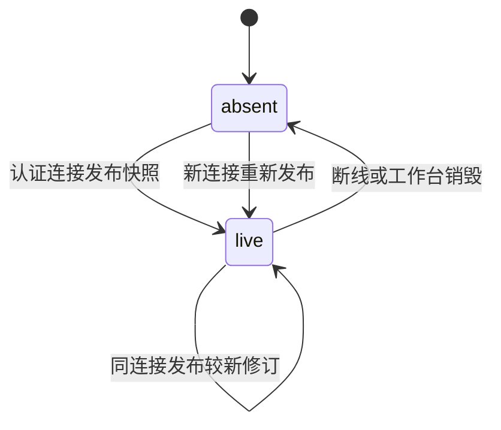

# workbench-agent-context Specification

## Purpose

让 Agent 能通过受权限约束的工具读取关联工作台的当前上下文，并让用户把明确选择的材料或对象批注随同指令发送。实时界面状态与已发送材料分别表达，多窗口、断线和版本变化均不能使用户要求被静默改写或扩大材料权限。

## Requirements

### Requirement: 连接所属的有界当前上下文

工作台 SHALL 经已认证连接发布本实例当前视图、会话接收者、条目选择及可提供的资源选择，快照携带版本及范围并受容量限制。连接只能更新自己的快照，断线或销毁后该快照失效；重连建立新的关联，不能凭客户端自报身份继承旧连接权限。快照不是研究事实权威，发布不自动启动 Agent。

#### Scenario: 同会话两个窗口
- **WHEN** 两窗口选择同一会话但分别浏览不同材料
- **THEN** 两份快照分别所属其真实连接，不能以最近活动窗口覆盖另一窗口的状态

### Requirement: 工具按调用时的关联上下文理解对象

执行 SHALL 从可靠受理指令的可信来源关联取得可查询工作台，工具在调用时读取其当前快照，不在发送时自动固定隐含选择。读取结果 SHALL 经过所属资源读取及模型外发权限检查。没有工作台来源、关联已失效或接收会话不匹配时返回明确不可用，不能查询其他窗口代替。Agent 无法据结果确定对象时 SHALL 询问用户并等待澄清，显式材料工作仍可继续。

#### Scenario: 发送后选择发生变化
- **WHEN** 用户发送未显式附加选择的指令后改变选择，Agent 随后调用上下文工具
- **THEN** 工具返回当次合法快照及修订，不能把发送时状态伪装为当前选择，也不能自动认定所选内容就是用户指定对象

#### Scenario: CLI 或来源窗口断线
- **WHEN** 无窗口来源的执行或已断线来源发起上下文查询
- **THEN** 返回可诊断不可用，不能使用另一个活跃窗口；明确资源引用的操作仍按自身权限处理

### Requirement: 显式对象项进入共同指令草稿

用户 SHALL 能明确将资源、文字摘录、图片区域或有结构对象说明及批注加入共同输入框，检查、补充或移除后发送。显式项 SHALL 保留当时资源身份、内容依据及选择载荷；区域定位不等于已经取得像素或可编辑对象语义。未保存稿件的摘录必须标为草稿内容，不能冒充已保存版本原文。普通浏览、筛选和选择不自动附加或发送，报告的 Agent 请求动作默认填入同一输入框。

#### Scenario: 页面按钮与选区批注共同发送
- **WHEN** 用户将一项选区批注及页面提出的分析要求加入当前输入框
- **THEN** 两者进入同一可编辑指令，发送前不启动执行，也不切换当前会话接收者

#### Scenario: 资源变化及草稿摘录
- **WHEN** 显式附加后资源被修改，或附加内容来自未保存草稿
- **THEN** 保留原选择及其依据／草稿标识，不替换成新版选区；后续实际取材或修改重新核对当前材料

### Requirement: 显式项可靠受理与权限核查

显式项 SHALL 随原指令身份可靠保存并进入实际执行输入，重复提交不能改变原指令或重复受理。接受前及后续模型或资源取用时 SHALL 检查对应权限，界面快照和附加项本身不授予读取、写入或外发能力。历史无显式项的消息继续可读，原项目文件附加仍有效。消息投影 SHALL 区分用户明确附加与 Agent 实际读取。

registered Graph SHALL 复用 InstructionContext 传递可信来源、完整显式项及原文字／项目附件。等待输入映射与实际 worker 获得同一持久指令上下文，消费确认必须核对已保存 checkpoint 中的完整载荷与服务端持久消息。恢复和模型外发仍复查资源授权，不以已保存摘录或来源代替当前许可；源码 execution.materials 保留其独立材料依据。

#### Scenario: 回执丢失后再次提交
- **WHEN** 含显式项的指令已经可靠保存但客户端未收到回执
- **THEN** 按原指令身份核查或补交取得同一受理结果，完整显式项进入原执行，不因重试再创建推进

#### Scenario: 排队后撤销材料外发
- **WHEN** 显式材料已受理，而模型开始前库外发或目标项目信任被撤回
- **THEN** 依赖这些材料的新模型取用被拒绝并保留原因，不能凭已保存摘录继续发送，也不删除已有领域成果

#### Scenario: 图等待接续的完整指令消费
- **WHEN** 含显式项目或库材料的指令用于恢复 registered Graph 的等待
- **THEN** 恢复映射和实际 worker 得到原指令的完整上下文，checkpoint 成功保存且载荷核对通过后才确认消费，不能只保存身份或忽略附件后消费

#### Scenario: 图消费确认故障后重启
- **WHEN** 图 checkpoint 保存、消费确认或确认回执发生故障并重启
- **THEN** 原受理身份及完整上下文保持，未保存的指令不确认消费，已保存的输入沿原 checkpoint 核查后继续，不重复领域成果或把旧来源绑定到新连接

#### Scenario: 多次等待累计指令及大批输入
- **WHEN** registered Graph 跨等待保留超过 100 条指令，或一批合法指令的完整上下文超过单次 IPC 帧容量
- **THEN** 沿原身份分次传递及确认完整上下文，未传完或未保存时不消费；部分确认后重启仍可核查接续，不能截断内容、遗漏指令或重复成果

#### Scenario: 普通 Agent 的完整更新超过单帧容量
- **WHEN** 普通 Agent 的本次指令消息及结构化显式项超过单个 IPC 帧容量
- **THEN** 完整更新分帧传递，收齐前不进入 checkpoint 或消费确认；传递失败保留原受理身份及完整载荷，重启可补交，仍按原单 run 指令数量上限处理

### Requirement: 草稿与后续领域接入保护

共同输入草稿及显式项 SHALL 按工作台、项目和会话隔离，刷新、切换、断线及迟到回执不覆盖后续输入。领域选择提供者 SHALL 通过窄接口贡献纯上下文及移除通知，不要求读取整个工作台或全库投影。真实阅读记录继续保存到原领域；本能力不把临时选区报告为已保存阅读批注。

#### Scenario: 发送期间继续编辑并切换会话
- **WHEN** 一条指令尚待受理确认，用户新增批注并切换会话
- **THEN** 迟到回执只更新原指令状态，原会话后续草稿与另一会话材料均保留

### Requirement: 当次选择位置与草稿对象保真

显式文字项 MAY 携带当次 PDF 或规范化文档位置，区域项 MAY 携带明确坐标基准，对象项 MAY 标明草稿内容。共同 schema、持久指令与模型编码 SHALL 保留这些载荷，拒绝非法位置区间；旧项缺失信息时不得猜测位置、基准或保存状态。此能力不承诺跨版本持续精确定位。

#### Scenario: 真实位置进入执行
- **WHEN** 调用方提交合法位置、区域基准或草稿对象项
- **THEN** 重启查询及实际执行得到原载荷，草稿对象与已保存原文分别表达

#### Scenario: 旧记录与非法位置
- **WHEN** 读取没有位置的旧项或提交反向区间
- **THEN** 旧项继续可读且不补造定位，非法新载荷明确拒绝

### Requirement: 实际格式视图的当次选择贡献

系统 SHALL 从当前实际加载的格式视图取得文字、已有结构对象或图片区域，保留所属资源、内容依据和实际坐标基准，允许明确附加到共同指令。PDF 文字保留页依据，规范化文档保留章节和规范化版本；图片区域区分整图、页面或结构中图片对象，缩放和旋转不能改变所指区域。有结构对象只使用提供者已有结构，普通图片框选不产生可编辑元素语义。源码、可视草稿与已保存产物 SHALL 如实区分；产物选择不得冒充稿件源码位置。

#### Scenario: PDF 与文档选区附加

- **WHEN** 用户分别从项目 PDF 或库 EPUB／HTML 选取当前可见文字并明确附加
- **THEN** 同一共同输入框取得当时摘录、资源版本及同版本位置，浏览不自动发送，选择无需先保存为阅读记录

#### Scenario: 缩放图片与已有结构对象

- **WHEN** 用户在缩放后的图片中框选，或选择已有结构中的表格／图例对象
- **THEN** 前者取得相对于确定图像基准的区域，后者取得提供者声明的对象身份与说明，不依据截图猜测可编辑语义

#### Scenario: 草稿或排版产物选择

- **WHEN** 选区来自未保存可视稿件或已生成的 PDF／HTML
- **THEN** 草稿保留草稿标识，产物保留实际产物及输入依据，不能据当前源码版本伪造选区位置

#### Scenario: 跨段、换行与表格的文字选择

- **WHEN** 用户选取当前Markdown预览中跨段落、BR或多个表格单元格的文字
- **THEN** 摘录保留实际选中范围及语义分隔，相邻数字不拼成新数值，空单元格不使其他值错列；完整公式只表达一次，部分公式仍整次拒绝，分隔符计入容量而不截断附加

### Requirement: 选区贡献的作用范围与失效清理

格式视图 SHALL 仅贡献自身已加载的有界对象，不读取其他视图 DOM、全书或全库以生成选择。失去选择、关闭、切换资源或撤权后 SHALL 清除该视图实时贡献，释放其读取和图像资源；已显式附加项保持原摘录与版本，后续使用仍复查授权。超过既有容量 SHALL 拒绝附加并保留已有草稿，不静默截断选取目标。

#### Scenario: 关闭一个分屏并迟到回执

- **WHEN** 同一材料在两个视图打开，用户关闭其中一个，原指令回执随后到达
- **THEN** 只移除被关闭视图的实时贡献，不取消另一视图或执行，也不删除用户后来增加的批注

#### Scenario: 撤权或选择超限

- **WHEN** 已选材料权限被撤回，或本次选择超过共同上下文容量
- **THEN** 实时受保护内容停止展示或附加被明确拒绝，已发送历史不被改写，不能凭缓存继续外发

### Requirement: 材料旁批注编辑共同草稿

系统 SHALL 在当前支持格式的当次选择入口提供就地批注，绑定附加时资源、版本、摘录或对象／区域。材料旁与共同检查器 SHALL 编辑同一个显式项，不建立另一份草稿。关闭就地编辑保留批注，移除才删除；切换选择、资源或接收会话不能重绑原项，超限整次拒绝且保留原草稿。浏览与输入不启动执行。

#### Scenario: 两处编辑同一批注
- **WHEN** 用户选取材料并在旁边填写批注，随后在共同检查器修改
- **THEN** 两处显示同一项的最新批注，关闭视图后原会话草稿仍保存原引用与要求

#### Scenario: 光标离开选择与切换接收者
- **WHEN** 用户点击批注框导致原生选择消失，或切换到另一会话
- **THEN** 原项保持当次快照，另一会话的材料与输入不被旧编辑器更正

### Requirement: 仅批注沿共同可靠指令发送

共同发送 SHALL 在正文为空且至少一项批注非空时可用，以“请处理附加材料中的批注”作为指令正文，保留完整显式项。正文非空沿原指令发送；只有无批注材料时不能发送空指令。两种路径 SHALL 复用同一可靠受理、接收者核对和权限规则，失败保留草稿，迟到成功仅清除实际发送且未经后续更正的项。

#### Scenario: 只填写选区批注
- **WHEN** 用户没有输入总正文，直接发送已填写的一个或多个批注
- **THEN** 原会话收到一条可靠指令及各自对应的显式项，不需用户重复输入或另走页面执行接口

#### Scenario: 发送后继续更正
- **WHEN** 仅批注发送尚未确认时用户更正批注或切换会话
- **THEN** 原受理载荷不变，后续草稿及另一会话保持，重复核查不创建第二次推进

### Requirement: 文献题录贡献真实工作台选择

工作台 SHALL 将当前库身份、视图范围、主选条目、完整当前多选集合及其题录修订依据贡献给既有连接所属上下文工具。无附件题录亦可被明确识别；题录选择不得假借任意附件或正文版本。选择 SHALL 有明确容量，超出能力时可诊断，不能静默截断；题录选择容量与显式附加材料容量分别表达。可用附件引用仅在已取得真实附件身份及材料版本时提供，选择条目不意味着正文可读或已发送。

读取 SHALL 经题录所属权威核对库身份、对象存在与读取／模型外发授权，并保留工作台观测的修订依据；界面依据落后时明确指出变化，不能把新值伪装为用户当时看到的值。工具调用及后续模型准入继续核查当前权限。发布、选择、分页、切库视图及打开附件均不改变工作域或会话接收者。无工作台、断线、接收者不符和多来源歧义沿既有可诊断行为处理，不查其他窗口替代。

#### Scenario: 无附件条目的多选

- **WHEN** 用户在题录表选中包含无附件条目的多个对象，Agent 从原指令来源调用当前上下文工具
- **THEN** 返回实际库和每个所选题录身份、主选及修订依据，均经题录读取／外发核查，不伪造材料引用或只返回首项

#### Scenario: 选择超过显式材料项容量

- **WHEN** 当前题录多选数量超过显式材料项上限但仍在已声明的题录选择容量内
- **THEN** 工具可取得完整题录选择，不自动附加或发送这些对象，不因共享显式项限制而静默丢弃后续选择

#### Scenario: 选择后题录变化或撤权

- **WHEN** 快照发布后题录被另一客户端修改，或库读取／外发授权撤回
- **THEN** 版本变化可核查且不覆盖原观察依据，撤权后的读取或模型取用明确拒绝，界面选择不作为授权凭据

#### Scenario: 切库视图保留接收者

- **WHEN** 用户在当前项目或全局会话中浏览库、翻页、打开附件或返回题录表
- **THEN** 上下文来自原连接当次活动视图，原会话接收者、工作域及未发送草稿保留；来源失效不会借用其他窗口

### Requirement: 题录独立容量及完整核对

题录贡献 SHALL 独立于ContextItem与显式材料16项预算，每次0至100个唯一题录身份，包含实际库、当前查询范围、主选及观测修订。空集的主选为空，非空主选必须属于集合；超容量、主选不合法或完整快照超过64KiB SHALL 整次拒绝而不截断。确认结果 SHALL 将观测修订和当前修订分开；任何对象或授权核对失败不得静默过滤成部分成功。

#### Scenario: 题录100项与材料预算独立

- **WHEN** 当前贡献含100个唯一题录、有效主选及合法16项显式材料，编码仍在64KiB以内
- **THEN** 两种容量分别核对；101个题录、重复身份、非法主选或字节超限均整体拒绝，不取前100个或清除材料来凑容量

### Requirement: 模型准入复查题录库

普通Agent、注册Graph及能力执行在模型排队前、排队后、最终同步准入及恢复时 SHALL 核对原实际库身份和当前读取／外发权限。已用库身份必须保存为恢复依据，不以当前窗口或其他库替代。

#### Scenario: 排队后原库身份或权限失效

- **WHEN** 工具曾成功核对题录，但模型排队期间库被替换或外发授权撤销
- **THEN** 最终准入拒绝且不发送模型请求，重启也沿原库身份核对，不因未读取正文而绕过权限
