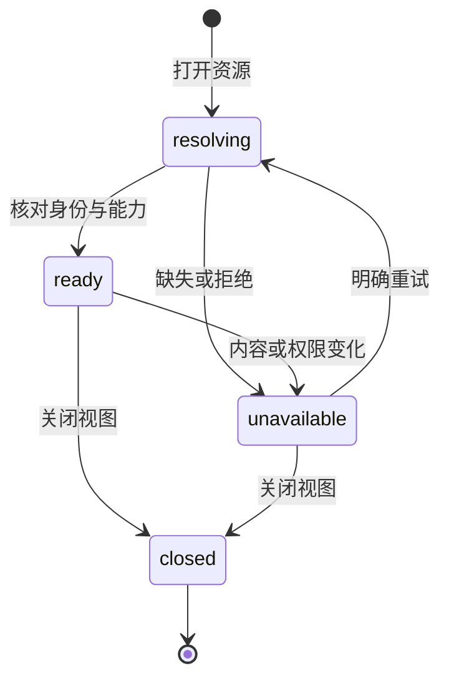
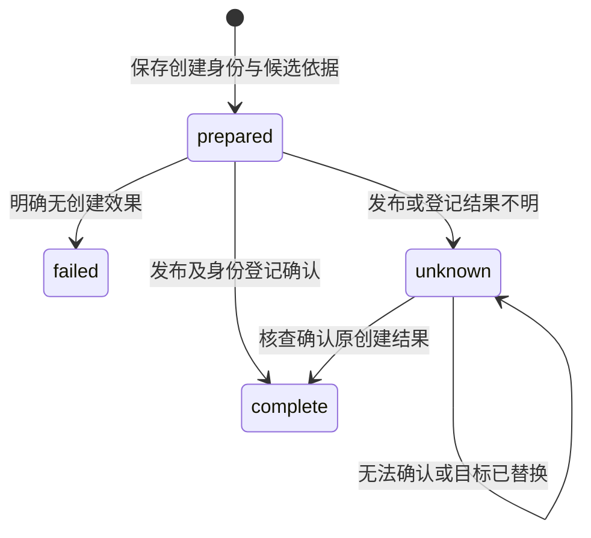
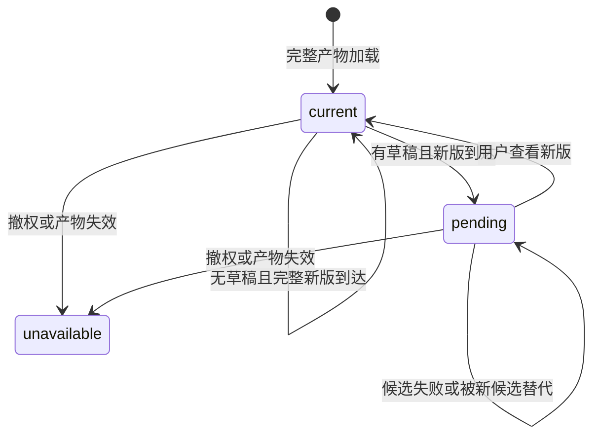

# workbench-resources Specification

## Purpose

为项目文件与共同文献库附件提供同一套资源打开、读取和编辑阅读能力，使用户从任一入口取得适合该格式的视图，并保留资源所属身份、材料版本、权限和草稿。资源导航服务人类交互，不改变 Agent 会话所属项目，也不将库材料复制为项目文件后才允许使用。

## Requirements

### Requirement: 共同资源引用与视图打开

系统 SHALL 通过共同资源入口打开项目文件和库附件，按格式和实际能力选择文本编辑／阅读或 PDF／EPUB／HTML 阅读视图。资源 SHALL 保留所属领域及稳定身份；库附件还须保留具体材料版本，项目路径只作为定位信息而非唯一身份。同资源重复打开 SHALL 激活或按明确分屏操作增加视图，不因入口不同创建互不关联的正文副本。格式不可用 SHALL 提供可诊断结果。

#### Scenario: 两类来源打开同格式材料
- **WHEN** 用户分别从项目文件树和文献附件列表打开一个支持的 PDF、EPUB 或 HTML
- **THEN** 两者使用共同打开与阅读接口及相应格式视图，保留各自来源身份，库材料不因打开被复制到项目

#### Scenario: 路径变化或重复打开
- **WHEN** 已打开的项目文件重命名后再次打开，或同一库附件从另一入口打开
- **THEN** 系统按稳定身份核对并激活对应资源，保留有效草稿和位置，不误认原路径上的新文件

### Requirement: 所属权限与有界资源访问

共同资源访问 SHALL 由所属领域核对资源范围、身份、内容依据及实际读写能力，公开响应不返回本机原生路径。字节、文本及文档解析请求 SHALL 有界并携带实际内容依据，结果交付前核对有效授权和内容变化。项目人工访问沿项目信任与人工操作现有约定，库取用沿库授权；Agent 材料使用继续遵守工具和模型外发规则。缓存不得绕过撤权或将旧版本结果用于新材料。

#### Scenario: 解析期间内容或授权变化
- **WHEN** 资源已经开始解析，而源内容发生变化或所属读取权限被撤回
- **THEN** 返回对应失败并保留已有记录，不交付伪称基于当前材料的旧结果，也不从其他路径绕过撤权

#### Scenario: 请求越界材料
- **WHEN** 项目资源引用指向项目范围外文件，或传入不匹配的稳定身份与材料版本
- **THEN** 请求在实际读取前被拒绝，不能以资源打开接口取得额外文件访问权

### Requirement: 共同正文与真实保存能力

项目文本与库内支持的 UTF-8 文本 SHALL 通过共同文本视图和能力接口展示。可写项目正文 SHALL 保持既有源码／可视编辑、条件保存、撤销和冲突保护；不具备正文保存能力的资源 SHALL 明确只读，仍可使用其已提供的阅读记录能力。两视图共享同一资源正文草稿并保留各自位置。源文件变化、保存失败或旧回执 SHALL 不覆盖用户后续输入。

#### Scenario: 两视图编辑及保存冲突
- **WHEN** 用户分屏编辑同一项目文件，外部程序随后修改文件或保存回执迟到
- **THEN** 两视图保持共同正文，过期保存被拒绝，冲突及草稿可取回，后续输入不被旧回执覆盖

#### Scenario: 库正文只读与共同编辑视图
- **WHEN** 用户打开没有正文修订能力的库内文本附件
- **THEN** 使用共同文本视图并明确只读，不显示能够持久保存原字节的虚假能力，不改变该材料版本

### Requirement: 资源视图生命周期与执行上下文独立

资源打开、选择、分屏、关闭和项目切换 SHALL 保持所属资源与草稿隔离，库资源视图可跨项目保留。切换文献库或打开附件 SHALL 不切换当前会话、harness 项目工作域、未发送指令或材料授权。关闭视图 SHALL 释放对应临时资源、订阅及所属读取请求，不能以关闭一个视图终止其他视图或无关执行；再次打开可继续读取已保存的阅读成果。

#### Scenario: 阅读库附件时继续原会话
- **WHEN** 用户在项目 A 会话中填写指令，切到文献库并打开附件，再返回会话
- **THEN** 项目、会话与草稿保持原状，附件仍是库资源，不自动附加或外发材料

#### Scenario: 多视图关闭与恢复
- **WHEN** 用户关闭某个阅读视图而其他视图或 Agent 仍在工作，再重新打开同一材料
- **THEN** 只释放被关闭视图拥有的资源，无关工作保留，已保存批注仍可查询；未保存草稿按原保护契约保留

### Requirement: 共同视图中的阅读成果保持所属权威

库材料通过共同视图创建、查询和更正的既有书签、批注及笔记 SHALL 继续保存到同一库记录及材料版本，保留可信作者、修订核对和未知结果查询。共同视图不得为缺少记录提供者的资源伪造持久化能力。原有文献工具 SHALL 仍可按明确库引用读取这些成果，不依赖阅读窗口打开。

#### Scenario: 迁入共同视图后查询旧批注
- **WHEN** 用户通过共同入口重开已有批注的库材料，Agent 随后通过原文献工具查询
- **THEN** 两者取得相同持久记录和材料版本，不产生第二份阅读权威或丢失原修订

#### Scenario: 无可用批注持久化提供者
- **WHEN** 资源只提供正文读取而没有阅读记录保存能力
- **THEN** 视图如实呈现能力，不将临时选区或浏览位置报告为已持久保存的批注

### Requirement: 项目成果首次新建与未知结果核查

共同资源能力 SHALL 支持在所属可写项目中，以调用方稳定操作身份将内容保存到不存在的路径，复用项目路径、串行保存及禁止覆盖保护。成功 SHALL 返回实际稳定资源身份和内容依据。新建受理及候选、发布、登记的核查依据 SHALL 由项目所有者保存，同身份不同输入拒绝，重复请求先核对原结果。

实际发布可能已完成但确认未知时 SHALL 保留文件、候选及操作依据，允许按原操作核查；不能仅凭同路径同内容认定归属，不能自动重写、覆盖或删除目标。已保存而关联失败 SHALL 仅补关联。该能力不能新建库分析或改变只读附件正文权限。

#### Scenario: 创建回执丢失后重试
- **WHEN** 结果已发布但回执丢失，调用方按原操作身份查询或补交
- **THEN** 返回同一已确认资源或效果未知，不覆盖已有路径，也不创建第二份成果

#### Scenario: 目标已被其他文件替换
- **WHEN** 原创建尚待核查，而同路径已是另一身份的文件
- **THEN** 原操作保留未知或已确认历史，当前文件保持不变，不把它当作原成果

### Requirement: 项目资源保存与修改历史关联分别可核查

项目资源的创建／执行保存结果 SHALL 在所属历史确已登记时提供可核查的editId；未提供时只能通过所属文件的实际版本与历史查询核查，不能把ResourceEvidence.basis、创建operationId或成果association当作editId。只在实际可证明的保存结果返回修改关联，不改变ResourceDescriptor的材料身份语义。来源与旧创建回执仍由projects掌握，不赋予库正文写入能力。

文件保存、FileEdit登记、执行成果association及任务入口links SHALL 分别表达其实际结果。后续关联失败不回滚已经保存的文件，不能重新生成成果或自动登记一份任务正文。

#### Scenario: 成果登记部分失败

- **WHEN** 项目正文及FileEdit已保存，而执行成果登记或任务入口关联失败
- **THEN** 保留可核查的文件／修改记录，分别报告未完成关联，不将其解释成文件未保存或所有关联已完成

#### Scenario: 无修改身份的旧结果

- **WHEN** 旧资源保存结果没有editId，或历史登记不能核实
- **THEN** 显示关联不可核查并沿所属查询处理，不用相同文字、basis字符串形状或时间邻近推断editId

### Requirement: 只读排版产物资源与原输入依据

系统 SHALL 以render资源的projectId、outputId及产物自身basis定位已发布PDF，并保存生产job及其实际输入ref／basis和依赖快照。共同资源打开、文档解析、字节读取和harness外发 SHALL 沿实际产物及当前授权；不提供正文保存，不将源稿或失败新job的basis解释为旧PDF版本。历史产物缺依据、淘汰、读取中变化或撤权时 SHALL 明确失败，不回退同名源码或最新输出。

#### Scenario: 嵌入PDF选区直接附加

- **WHEN** 用户在已生成的嵌入PDF选取文字并附加到共同输入框发送
- **THEN** 显式项保留render引用、产物basis及PDF位置，真实harness能沿共同端口取得同一PDF的字节和解析内容

#### Scenario: 新版排版失败而旧版仍可读取

- **WHEN** 新稿排版失败并继续显示lastSuccess
- **THEN** 选择绑定原成功产物的生产job和输入依据，不能使用失败job或当前源码basis；新生成及当前草稿不覆盖原显式项

#### Scenario: 历史产物缺少生产依据

- **WHEN** 已有成功PDF没有保存产物basis或输入依据
- **THEN** 原预览和显式导出保持可用，资源打开及直接附加明确不可用，不使用当前稿件补齐历史证据

### Requirement: 共同栅格图片视图

系统 SHALL 通过共同资源入口有界读取并展示受支持的项目或库栅格图片，保留所属身份、材料版本和权限，支持当次区域选取及键盘操作。图片选择只表达实际图像内容上的位置，不宣称已有像素分析、可编辑图表结构或正文修订能力。超限、解码失败、内容变化和撤权 SHALL 可诊断并释放该视图临时资源。

#### Scenario: 两类来源打开图片并选择区域

- **WHEN** 用户打开项目或库中的受支持栅格图片，调整缩放后选择区域
- **THEN** 两者使用共同视图并产生有明确图像基准的当次区域，不因来源不同建立另一条指令通道

#### Scenario: 图片不可用

- **WHEN** 读取或解码达到容量边界，或读取期间图片身份变化／权限撤回
- **THEN** 对应视图明确失败，不交付伪称当前版本的旧图像，不影响另一视图或已保存记录

### Requirement: 修改结果按实际保存依据核查

系统 SHALL 在材料或成果原入口提供实际修改、差异、执行者及依据的核查入口，区分候选、实际正文已保存、成果关联待核查及失败。差异 SHALL 基于所属提供者的实际前后内容及身份；理由和依据仅显示可追溯记录，缺失时明确未知，不能从相邻时间或路径猜测 Agent 已完成修改。并发编辑、未知保存和原版本不可得 SHALL 保留草稿及已有成果，不发布伪造差异。库正文保存能力未提供时 SHALL 保持只读，阅读记录更正不得冒充正文修订。本批明确不提供库附件正文修订或sidecar转正文；库write授权仅按已有能力生效，不扩大正文保存能力。

#### Scenario: 条件保存后核对真实修改

- **WHEN** 用户发送材料批注，Agent 沿所属项目能力保存了修改
- **THEN** 用户可从同一材料入口查看实际前后内容及可确认执行依据；正文保存和成果关联状态分别可辨

#### Scenario: 有界摘要与选定全文

- **WHEN** 用户打开项目材料的修改历史并选择某个修改编号
- **THEN** 先按稳定fileId读取有界摘要，再只读选定editId全文，不按同名路径拼接旧身份或预取全项目历史；覆盖锚点、历史保留和当前文件核查分别呈现，缺口不能解释为没有变化

#### Scenario: 执行身份可证而修改理由未知

- **WHEN** FileEdit记录提供human、system或execution来源及可选前后资源依据
- **THEN** 界面只显示实际记录字段，缺失理由、指令、工具或委派保持未知；系统身份不成为科研理由，观察到的指令集合不当作逐修改因果，不拿撤销校验basis补原资源Evidence

#### Scenario: 用户继续编辑或旧版本不可得

- **WHEN** Agent 修改回执迟到，而用户已继续编辑，或提供者无法取得旧版本
- **THEN** 当前草稿保持，旧版本缺失如实呈现，不把当前草稿与任意旧文本标为该次实际差异

#### Scenario: 库材料只有阅读记录写入能力

- **WHEN** 用户在库 PDF 上作批注并请求修订，而没有附件正文修订提供者
- **THEN** 可保存原库记录或发送要求，但正文修改明确受阻，不改写附件、不自动创建项目替代副本

### Requirement: 有依据的整次撤销与变化线索

系统 SHALL 经所属文件权威按整个FileEdit撤销，核对当前内容并保护后续编辑；重叠或依据不明时保留现状及可用差异供核查，不伪称公开接口未提供的候选已保存。撤销 SHALL 保存实际结果并向负责执行提供可查询变化线索，不自动启动Agent，不把界面提示当作对方已消费。会话不强制绑定任务，只有已有任务关联才沿所属任务记录交接。

#### Scenario: 撤销后再次修改

- **WHEN** 用户撤销某项实际修改，随后 Agent 根据新指令继续工作
- **THEN** 撤销结果可查询，后续修改先核对当前材料；执行不会因撤销动作自行重启

#### Scenario: 撤销与后续人工编辑重叠

- **WHEN** 待撤销变更与后续人工编辑重叠
- **THEN** 不整份恢复旧文本覆盖用户编辑，保留受影响部分的诊断和可核查候选

#### Scenario: 撤销中及未知结果时关闭历史

- **WHEN** 同一文件视图内有撤销在途，或已有未知结果后用户关闭再打开历史
- **THEN** 在途时不能通过面板开关重入，未知结果保护在开关后仍保留；重开重新核对读取权限，不自动重放撤销，已继续编辑的草稿不因迟到刷新丢失

### Requirement: HTML 排版产物的真实只读选择

系统 SHALL 沿既有 render 引用提供 HTML 产物描述、字节与解析，保留实际 outputId、产物 basis、生产 job 和原输入；仅支持只读。静态排版视图 SHALL 保持原布局并取得本 frame 内真实文字选区，按原产物附加到共同指令，不以源码版本冒充。页面脚本不能执行，外网资源及任意宿主访问不因选择功能取得权限。缺生产依据、缓存淘汰、身份变化或撤权时明确不可用。

#### Scenario: HTML 选区进入真实执行
- **WHEN** 用户在排版 HTML 中选字、就地批注并发送
- **THEN** 实际执行可沿同一产物引用读取原 HTML 字节及文档，摘录和版本保真，不伪造源码或规范化位置

#### Scenario: 静态页面带主动内容
- **WHEN** HTML 含脚本、事件属性、嵌入页面、表单或外网依赖
- **THEN** 不能借预览执行脚本、读取宿主或取得网络能力，合法静态正文与选择仍可使用

### Requirement: 排版候选更新保护批注草稿

排版视图 SHALL 仅在完整候选可用后更换显示；当前有相关批注或正文编辑草稿时保留原产物并提示新版，用户明确查看新版后切换，原显式项不重绑。失败、迟到读取和撤权 SHALL 保护后续输入；撤权优先停止受保护内容展示。

#### Scenario: 批注时源稿更新
- **WHEN** 旧产物已附批注，而源稿修改产生新产物
- **THEN** 旧页与草稿保留并提示新版本，明确切换后仍保留旧项的原产物依据

#### Scenario: 新编译失败或读取迟到
- **WHEN** 新编译失败，或旧候选在较新候选之后返回
- **THEN** 不替换成不完整或过时页面，不丢失当前批注和后续编辑

### Requirement: 长文本材料的真实有界范围读取

共同资源能力 SHALL 支持在明确容量内按原身份与内容依据取得 UTF-8 文本材料的有界范围，包括既有前缀之外的内容，保留实际字符位置、续读及结束条件。不得将截断前缀长度当作全文长度，不能将原字节或 HTML 转义副本冒充原文本。文本范围读取 SHALL 复用所属权限、内容变化、取消及原受管解析责任，不使材料取得正文修订能力。

超限、非法编码、身份／版本变化或撤权 SHALL 明确失败，保留已有成果；不能通过无限拼接、全库预读或无隔离执行取得范围。该能力不承诺同时将整篇装入编辑器，不改变既有源码保存、只读材料或产物来源语义。

#### Scenario: 取得前缀之后的真实文本

- **WHEN** 调用方按原材料依据读取超出旧前缀位置、但仍在所声明容量内的一段 UTF-8 文本
- **THEN** 得到该范围的原文字、实际位置及可靠续读／结束状态，多字节字符不因边界拆分损坏，不伪称未读部分已完成

#### Scenario: 续读期间材料改变

- **WHEN** 后续范围读取时材料身份、内容依据或授权已变化
- **THEN** 拒绝交付伪称原版本的片段，不拼接混合版本，也不回退同名文件或旧缓存继续外发
